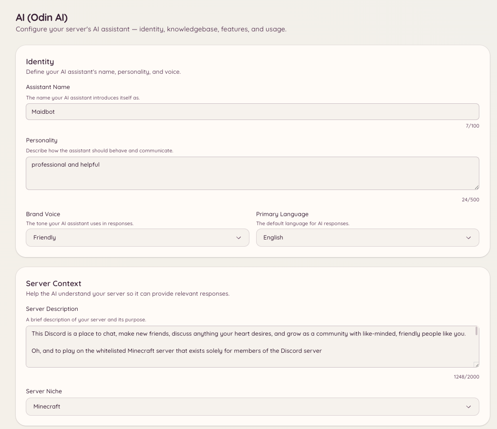

import { DashboardLink } from "/snippets/dashboard-link.jsx";

Odin ist der KI-Assistent von Heimdall. Mitglieder stellen Fragen und bekommen Antworten auf Basis der Wissensdatenbank deines Servers: Dokumentation, FAQs, Regeln oder alle anderen Inhalte, die du hochlädst. Odin behält den Kontext innerhalb einer Sitzung, Nachfragen funktionieren also ganz natürlich, ohne dass Hintergrundinfos wiederholt werden müssen.

<Frame>
  
</Frame>

## Eine Frage stellen

```text
/ask <question>
```

Mitglieder stellen jede Frage in normaler Sprache. Odin antwortet aus deiner Wissensdatenbank und nennt die Einträge, die es genutzt hat. Standardmäßig antwortet `/ask` nur aus der Wissensdatenbank: Deckt die Wissensdatenbank die Frage nicht ab, sagt Odin das, statt zu raten, und bietet dem Mitglied einen Weg zum Team an (einen Ticket- oder Modmail-Button, je nachdem, wie dein Server Support-Anfragen annimmt).

Damit `/ask` auch allgemeine Fragen aus Odins eigenem Wissen beantwortet, schalt **Allow general knowledge** unter <DashboardLink to="ai/feature-qa_bot">**AI \> Q&A Bot**</DashboardLink> ein. Fakten über deinen Server (Links, Preise, Befehle, Team) kommen weiterhin nur aus der Wissensdatenbank.

Standardmäßig steht `/ask` allen Mitgliedern zur Verfügung. Der Zugriff lässt sich in der Berechtigungskonfiguration einschränken.

## Wissensdatenbank

Die Wissensdatenbank ist die Sammlung von Dokumenten, mit denen Odin Fragen beantwortet. Geh im Dashboard zu <DashboardLink to="ai/knowledgebase">**AI \> Knowledgebase**</DashboardLink>, um sie zu verwalten.

### Dokumente hinzufügen

Klick auf **Add Document** und füg den Inhalt ein oder lade eine Datei hoch. Jedes Dokument sollte ein bestimmtes Thema abdecken: Serverregeln, eine FAQ, Anleitungen zu Integrationen oder andere strukturierte Inhalte, auf die Odin zurückgreifen soll.

Unterstützte Formate:

- Einfacher Text
- Markdown
- PDF
- Gängige Dokumentformate

Nach dem Hochladen wird das Dokument verarbeitet und indexiert. Innerhalb weniger Minuten greift Odin in Antworten darauf zurück.

### Aus dem Web importieren

Statt Inhalte einzufügen, kannst du Seiten direkt von einer Website holen:

- **Import URLs** ruft die Seiten ab, die du auflistest, eine pro Zeile, und bereitet jede als eigenen Eintrag auf.
- **Deep Crawl** folgt den Links auf einer Website bis zum Seitenlimit, das du festlegst, und importiert jede Seite mit echtem Inhalt.

Beide verbrauchen KI-Tokens, um jede Seite aufzubereiten. Eine Website, die Markdown-Versionen ihrer Seiten veröffentlicht (das machen die meisten Dokumentationsplattformen), wird so gespeichert, wie sie geschrieben ist, und das Aufbereiten kostet nichts.

Importierst du eine Seite, die schon in der Wissensdatenbank ist, entsteht keine zweite Kopie. Seiten werden über ihre Adresse zugeordnet: Eine unveränderte Seite wird übersprungen, ohne Tokens zu verbrauchen, und eine geänderte Seite aktualisiert ihren bestehenden Eintrag, wobei der Titel und die Tags erhalten bleiben, die du ihr gegeben hast. **Preview Pages** zeigt vor dem Übernehmen, wie viele Seiten neu, geändert und unverändert sind. Ein erneuter Crawl einer schon importierten Website kostet also nur Tokens für das, was sich geändert hat.

### Einträge aktuell halten

Odin prüft jede importierte Seite einmal pro Woche erneut. Hat sich die Seite nicht geändert, passiert nichts, und es werden keine Tokens verbraucht. Hat sie sich geändert, wird der Eintrag aus der Seite aktualisiert, mit den KI-Tokens dieses Servers für die Seiten, die aufbereitet werden müssen. Kann die KI die neue Version nicht aufbereiten, zum Beispiel weil der Server keine KI-Tokens mehr hat, bleibt der Eintrag genau, wie er war, und es wird später erneut versucht, statt ihn durch unaufbereiteten Seitentext zu ersetzen. Die Seite <DashboardLink to="ai/usage">**AI \> Usage**</DashboardLink> führt das gesondert als **Knowledgebase Upkeep** auf. Abschalten kannst du es mit **Keep imported pages up to date** unten auf der Seite <DashboardLink to="ai/knowledgebase">**AI \> Knowledgebase**</DashboardLink>.

- **Deine Änderungen bleiben erhalten.** Sobald du den Inhalt eines Eintrags von Hand bearbeitest, kopiert Odin die Seite nie mehr darüber. Ändert sich die Seite danach, wird der Eintrag als **Page changed since your edit** markiert, und du wählst **Replace with new version** oder **Keep my version**.
- **Entfernte Seiten werden markiert, nie gelöscht.** Ein Eintrag, dessen Seite „not found“ zurückgibt, wird als **Page missing** markiert. Nach zwei wöchentlichen Prüfungen hintereinander wird er bei Antworten nicht mehr genutzt, Odin zitiert also keine Seite mehr, die die Website entfernt hat. Kommt die Seite zurück, wird er von selbst wieder genutzt. Willst du ihn trotzdem weiter nutzen, bearbeite den Eintrag und leere seine Quell-URL.
- **Eine Website auf neue Seiten beobachten.** Jede per Deep Crawl erfasste Website steht unter **Crawled sites**. Schalt ihren Beobachtungsschalter ein, und Odin crawlt sie wöchentlich und importiert bis zu 25 Seiten, die noch nicht in der Wissensdatenbank sind. Das Finden von Seiten kostet keine Tokens; das Aufbereiten jeder neuen Seite schon. Eine Seite, auf der die KI nichts Brauchbares findet, etwa eine Login-Seite, wird gemerkt und erst wieder angesehen, wenn sich ihr Inhalt ändert.
- **Seiten, die sich bei jedem Aufruf ändern, werden seltener geprüft.** Manche Seiten ändern sich bei jedem Laden, zum Beispiel weil sie die aktuelle Uhrzeit zeigen. Nach drei wöchentlichen Prüfungen hintereinander, die eine Änderung gefunden haben, verdoppelt sich der Abstand zwischen den Prüfungen jedes Mal, bis auf alle acht Wochen, damit eine solche Seite nicht jede Woche Tokens kostet.

Mit dem Filter **Needs attention** siehst du jeden Eintrag mit fehlender Seite, mit einer Seite, die sich seit deiner Bearbeitung geändert hat, oder mit derselben Seite, die zweimal importiert wurde.

<Note>
Ein Eintrag, den die KI aus mehreren Seiten auf einmal erstellt hat, wird als **Not updated automatically** markiert, weil das erneute Lesen einer seiner Seiten ihn durch einen Bruchteil seiner selbst ersetzen würde. Crawl die Website erneut, um ihn zu aktualisieren.
</Note>

### Dokumente verwalten

Die Seite <DashboardLink to="ai/knowledgebase">**AI \> Knowledgebase**</DashboardLink> listet alle Dokumente mit Erstellungsdatum und Status. Du kannst:

- **Bearbeiten**: den Inhalt eines Dokuments ändern, wenn sich Informationen ändern
- **Löschen**: ein Dokument entfernen, damit Odin nicht mehr darauf zurückgreift
- **Vorschau**: ansehen, wie Odin das Dokument versteht und zusammenfasst

## Gesprächskontext

Odin behält den Kontext innerhalb einer Gesprächssitzung. Stellt ein Mitglied eine Nachfrage, nutzt Odin den bisherigen Austausch in derselben Sitzung, um den Bezug zu verstehen. Der Kontext gilt nur für das einzelne Mitglied und läuft nach einer gewissen Zeit ohne Aktivität ab.

Das Team kann frühere Gespräche unter <DashboardLink to="ai/conversations">**AI \> Conversations**</DashboardLink> nachlesen. Das hilft, einer unerwarteten Antwort auf den Grund zu gehen.

## Konfiguration

Geh im Dashboard zu <DashboardLink to="ai/setup">**AI \> Setup & Context**</DashboardLink>, um einzustellen:

| Einstellung | Beschreibung |
| --- | --- |
| **Identity** (Identität) | Odins Name, Persönlichkeit, Markenstimme und Hauptsprache |
| **Server context** (Server-Kontext) | Eine Beschreibung deines Servers und seiner Nische, damit die Antworten zu deiner Community passen |
| **Channel context** (Kanal-Kontext) | Wofür jeder Kanal da ist, damit Odin Mitglieder an die richtige Stelle schicken kann |
| **Rules and guidelines** (Regeln und Richtlinien) | Deine Serverregeln, Gebote und Verbote, verbotene Themen und Pflichthinweise |
| **Branding** | Farbe, Logo und Footer-Text an Odins Antworten |

Um festzulegen, in welchen Kanälen `/ask` funktioniert, oder um seine Wartezeiten einzustellen, nutz <DashboardLink to="ai/feature-qa_bot">**AI \> Q&A Bot**</DashboardLink>.

## Features

Geh zu <DashboardLink to="ai/features">**AI \> Features**</DashboardLink>, um die einzelnen KI-Fähigkeiten auf deinem Server zu sehen und zu aktivieren. Jedes Feature ist ein eigenes Verhalten, das Odin ausführen kann.

### Textmoderation

Odin kann jede Nachricht in eingerichteten Kanälen bewerten und Inhalte, die gegen deine Regeln verstoßen, markieren oder entfernen. Anders als Automod auf Basis von Regex versteht die Textmoderation Kontext: Sie kann unterscheiden, ob über ein Thema gesprochen oder wirklich gegen eine Regel dazu verstoßen wird.

Welche Kanäle überwacht werden, worauf die KI achtet und welche Aktion folgt (zur Prüfung markieren, löschen oder verwarnen), stellst du unter <DashboardLink to="ai/feature-text_moderation">**AI \> Text Moderation**</DashboardLink> ein.

#### Empfohlene Einstellungen

Die Textmoderation startet mit einer Reihe empfohlener Einstellungen, die wir pflegen und mit der Zeit verbessern. Jede Einstellung, die du nicht anfasst, folgt der Empfehlung. Veröffentlichen wir eine bessere Version, übernimmt dein Server sie also automatisch.

Eine Einstellung, die du änderst, gehört dir und wird als **Custom** markiert. Sie behält deinen Wert, wenn sich die Empfehlungen ändern. Drück daneben auf **Use recommended**, um wieder der Empfehlung zu folgen.

Ändert eine neue Version eine Einstellung, die du angepasst hast, listet die Karte **New recommendations** sie auf. Für jede kannst du **Use recommended** oder **Keep mine** wählen. Heimdall postet außerdem einmalig einen Hinweis in deinem Eskalationskanal, damit die Änderung nicht untergeht.

#### Feedback und bessere Empfehlungen

Jede KI-Eskalation in deinem Log-Kanal hat Buttons für 👍 und 👎 sowie einen Kommentar-Button. Sag Odin damit, ob eine Entscheidung richtig oder falsch war. Durch dieses Feedback werden die empfohlenen Einstellungen besser.

Um die Empfehlungen für jeden Server zu verbessern, wird das Feedback zentral gesammelt, zusammen mit der Entscheidung, um die es geht. Bevor etwas deinen Server verlässt, werden Erwähnungen, Nutzer-IDs und die Namen des Autors aus der Nachricht entfernt, und der Autor wird nur über einen Einweg-Code identifiziert, der sich nicht in eine Discord-ID zurückverwandeln lässt. Nachrichten, die auf Sorgen um das Wohlbefinden oder Selbstverletzung hindeuten, werden nie verschickt. Feedback wird bis zu 24 Monate aufbewahrt.

<Note>
Server mit eigenem OpenRouter-Key können sich unter **Improving recommended settings** auf der Seite <DashboardLink to="ai/feature-text_moderation">**AI \> Text Moderation**</DashboardLink> abmelden. Mit der Abmeldung wird auch das Feedback gelöscht, das dein Server schon geschickt hat. Server mit der verwalteten KI von Heimdall können sich nicht abmelden, weil die Empfehlungen, auf die sie sich verlassen, aus diesem Feedback entstehen.
</Note>

### Bildmoderation

Ist sie aktiviert, analysiert Odin Bilder, die an Nachrichten in überwachten Kanälen hängen. Empfindlichkeitsschwellen und die Aktion bei einem erkannten Regelverstoß stellst du unter <DashboardLink to="ai/feature-image_moderation">**AI \> Image Moderation**</DashboardLink> ein.

### Ticket-Autoantwort

Wird ein Ticket eröffnet, gleicht Odin die Eröffnungsnachricht mit deiner Wissensdatenbank ab und postet im Thread eine vorgeschlagene Antwort, die das Team vor dem Senden prüft. So muss das Team weniger Tickets von Hand beantworten, und die Antwortzeiten bei häufigen Fragen sinken.

Aktivieren und einrichten kannst du das unter <DashboardLink to="ai/feature-ticket_auto_reply">**AI \> Ticket Auto-Reply**</DashboardLink> oder im Bereich <DashboardLink to="tickets/ai">**Tickets \> AI**</DashboardLink>.

### Modmail-Assistent

Dieselbe Fähigkeit wie die Ticket-Autoantwort, angewendet auf eingehende Modmail-Gespräche. Eröffnet ein Mitglied einen Modmail-Thread, schlägt Odin eine Antwort auf Basis der ersten DM und deiner Wissensdatenbank vor.

Aktivieren und einrichten kannst du das unter <DashboardLink to="ai/feature-modmail_assistant">**AI \> Modmail Assistant**</DashboardLink> oder im Bereich <DashboardLink to="modmail/ai">**Modmail \> AI**</DashboardLink>.

### Q&A-Bot

Der Q&A-Bot überwacht eingerichtete Kanäle und beantwortet Fragen automatisch, ohne dass Mitglieder den Befehl `/ask` nutzen müssen. Sieht eine Nachricht wie eine Frage aus, gleicht Odin sie mit deiner Wissensdatenbank ab und antwortet, wenn es eine sichere Antwort findet.

Das ist etwas anderes als Autoantworten: Der Q&A-Bot nutzt volles KI-Verständnis statt Musterabgleich und antwortet nur, wenn er sich sicher genug ist. Die überwachten Kanäle und die Sicherheitsschwelle stellst du unter <DashboardLink to="ai/feature-qa_bot">**AI \> Q&A Bot**</DashboardLink> ein.

### Gesprächsmodi

Mit Gesprächsmodi legst du fest, wie sich Odin in bestimmten Kanälen verhält, zum Beispiel ein Kanal, in dem Odin einen fortlaufenden Gesprächskontext behält und als dauerhafter Assistent auftritt. Die verfügbaren Modi und die Kanäle, für die sie gelten, stellst du unter <DashboardLink to="ai/feature-conversation_modes">**AI \> Conversation Modes**</DashboardLink> ein.

Jeder Modus hat zwei Einstellungen, die bestimmen, wie er antwortet:

- **Allow general knowledge** (Allgemeinwissen erlauben, standardmäßig an). Odin beantwortet allgemeine Fragen, etwa zu dem Spiel oder Thema, um das es in deiner Community geht, aus eigenem Wissen und nutzt deine Wissensdatenbank für alles, was deinen Server betrifft. Es sagt, wenn es unsicher ist, und weist darauf hin, wo dein Server vom allgemeinen Fall abweichen kann. Fakten über deinen Server selbst, etwa Links, Preise, Befehle und Team, kommen weiterhin nur aus der Wissensdatenbank. Schalt das aus, damit der Modus nur aus der Wissensdatenbank antwortet, so wie `/ask` es standardmäßig tut.
- **Handoff action** (Übergabe-Aktion). Was passiert, wenn ein Mitglied nach einem Menschen fragt oder etwas braucht, das nur das Team erledigen kann. Normale Fragen werden immer beantwortet, nie übergeben.
  - **No hand-off** (Keine Übergabe, Standard): Odin sagt, dass es nicht helfen kann, und belässt es dabei.
  - **Open a ticket** (Ticket eröffnen): Odin zeigt den Ticket-Button deines Servers, oder den von Modmail, wenn du stattdessen Modmail nutzt.
  - **Ping a staff role** (Team-Rolle pingen): Odin erwähnt die Rolle, die du wählst. Jedes Mitglied kann sie höchstens einmal alle 10 Minuten pingen, und die Rolle wird höchstens einmal pro Minute gepingt; spätere Übergaben nennen die Rolle, ohne sie zu benachrichtigen. Die Rolle muss erwähnbar sein, oder Heimdall braucht die Berechtigung **@everyone, @here und alle Rollen erwähnen** (Mention @everyone, @here, and All Roles). Sonst verhält sich der Modus wie **No hand-off**.

Odin antwortet in der Sprache, in der das Mitglied schreibt. Die feste Übergabezeile und die Beschriftungen der Buttons folgen der **Primary Language**, die unter <DashboardLink to="ai/setup">**AI \> Setup & Context**</DashboardLink> eingestellt ist.

## Moderations-Logs

<DashboardLink to="ai/moderation-logs">**AI \> Moderation Logs**</DashboardLink> zeigt ein Protokoll der KI-Moderationsaktionen: Ereignisse der Text- und Bildmoderation, was markiert wurde und welche Aktion folgte. Nutz es, um die Entscheidungen der KI zu prüfen und deine Konfiguration nachzujustieren, wenn sie zu streng oder zu nachsichtig ist.

## Gespräche

<DashboardLink to="ai/conversations">**AI \> Conversations**</DashboardLink> ist ein Protokoll der Gespräche von Mitgliedern mit Odin. Das Team kann ein Gespräch öffnen, um es zu lesen, es markieren oder als geprüft kennzeichnen, eine gute Antwort zur Wissensdatenbank hinzufügen oder das Mitglied von KI-Features ausschließen.

## Einschränkungen

<DashboardLink to="ai/restrictions">**AI \> Restrictions**</DashboardLink> listet Mitglieder, die für KI-Features gesperrt sind oder einen Timeout haben, und lässt das Team solche Einschränkungen hinzufügen oder aufheben.

`/ask` auf bestimmte Kanäle zu beschränken und seine Wartezeiten einzustellen, geht stattdessen unter <DashboardLink to="ai/feature-qa_bot">**AI \> Q&A Bot**</DashboardLink>. Ohne Kanalbeschränkung steht `/ask` in jedem Kanal zur Verfügung.

## Nutzung und Abrechnung

<DashboardLink to="ai/usage">**AI \> Usage**</DashboardLink> zeigt den Verbrauch an KI-Tokens deines Servers über die Zeit, aufgeschlüsselt nach Feature (Q&A, Moderation, Ticket-Autoantwort usw.) und nach Tag. So siehst du, welche Features die meisten Tokens verbrauchen.

<DashboardLink to="ai/billing">**AI \> Billing**</DashboardLink> zeigt dein aktuelles KI-Guthaben und lässt dich weiteres Guthaben kaufen. KI-Features verbrauchen Guthaben pro verarbeitetem Token; die genauen Kosten hängen davon ab, welches Modell für deine Installation eingestellt ist.

<Note>
  Usage und Billing sind nur sichtbar, wenn deine Heimdall-Installation tokenbasiertes KI-Guthaben nutzt. Selbst gehostete Installationen mit einem lokalen Modell oder eigenem API-Key sehen diese Bereiche nicht.
</Note>

## KI in anderen Plugins

Odin ist in Tickets, Modmail und Vorschläge eingebunden:

- <DashboardLink to="tickets/ai">**Tickets \> AI**</DashboardLink>: die Ticket-Autoantwort für bestimmte Ticket-Kategorien aktivieren
- <DashboardLink to="modmail/ai">**Modmail \> AI**</DashboardLink>: den Modmail-Assistenten für bestimmte Modmail-Kategorien aktivieren
- **Suggestions** (Vorschläge): Odin erstellt automatisch einen knappen Titel, wenn ein Mitglied einen Vorschlag einreicht, sofern **AI Titles** für die Kategorie des Vorschlags unter <DashboardLink to="suggestions/categories">**Suggestions \> Categories**</DashboardLink> eingeschaltet ist. Ein Vorschlag ohne Kategorie bekommt nie einen. Mit der verwalteten KI von Heimdall muss außerdem **Suggestion Titles** unter <DashboardLink to="ai/features">**AI \> Features**</DashboardLink> eingeschaltet sein

## Erforderliche Berechtigungen

| Aktion | Berechtigungsschlüssel |
| --- | --- |
| `/ask` nutzen | `ai.qa.use_ask` (standardmäßig erlaubt) |
| Gesprächskontext ansehen | `ai.context.view_context` |
| Gesprächskontext verwalten | `ai.context.manage_context` |
| Konfiguration ansehen | `ai.config.view_config` |
| Konfiguration verwalten | `ai.config.manage_config` |
| Die Wissensdatenbank ansehen | `ai.knowledgebase.view_knowledgebase` |
| Die Wissensdatenbank verwalten | `ai.knowledgebase.manage_knowledgebase` |
