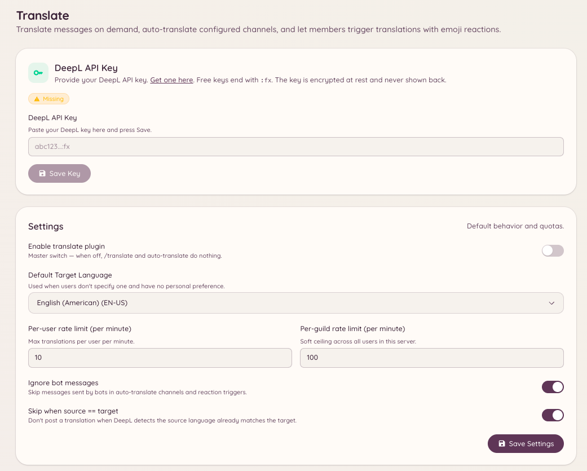

import { DashboardLink } from "/snippets/dashboard-link.jsx";

Das Übersetzungs-Plugin übersetzt Nachrichten mit DeepL. Mitglieder können jede Nachricht auf Anfrage übersetzen, und Admins können Kanäle einrichten, in denen jede Nachricht automatisch in eine Zielsprache übersetzt wird.

<Frame>
  
</Frame>

## Eine Nachricht übersetzen

```text
/translate message <message_id> <target_language>
```

Übersetzt eine bestimmte Nachricht in die Zielsprache. Der Bot antwortet mit dem übersetzten Text. Die Originalnachricht bleibt unverändert.

Du kannst auch über das Kontextmenü **Apps** von Discord übersetzen: Rechtsklick auf eine Nachricht, **Apps** wählen, dann **Translate**.

## Eine Sprache nachschlagen

```text
/translate language <language>
```

Sucht eine Sprache nach Name oder Code, damit du siehst, wie DeepL sie bezeichnet und aus welchen und in welche anderen Sprachen übersetzt werden kann.

## Kanäle automatisch übersetzen

Kanäle lassen sich so einrichten, dass alle Nachrichten automatisch in eine festgelegte Zielsprache übersetzt werden. Das ist praktisch für mehrsprachige Communitys, in denen ein einziger Kanal für Leute mit verschiedenen Sprachen zugänglich sein soll.

Geh im Dashboard zu <DashboardLink to="translate/channels">**Translate \> Channels**</DashboardLink>, um Kanäle zur Liste für die automatische Übersetzung hinzuzufügen. Für jeden Kanal stellst du ein:

| Einstellung | Beschreibung |
| --- | --- |
| **Channel** (Kanal) | Der Discord-Kanal, für den die automatische Übersetzung aktiviert wird |
| **Target language** (Zielsprache) | Die Sprache, in die alle Nachrichten übersetzt werden |
| **Source language** (Ausgangssprache) | Die erwartete Ausgangssprache, oder automatische Erkennung, wenn leer |
| **Translate bot messages** (Bot-Nachrichten übersetzen) | Ob der Bot auch Nachrichten anderer Bots übersetzt |

Ist die automatische Übersetzung aktiv, postet der Bot zu jeder Nachricht eine Übersetzung als Antwort. Nachrichten, die schon in der Zielsprache sind, werden übersprungen.

## Emojis für Sprachen

Geh im Dashboard zu <DashboardLink to="translate/emoji">**Translate \> Emoji Mappings**</DashboardLink>, um festzulegen, welche Flagge oder welches Custom-Emoji für jede Sprache steht. Diese Emojis erscheinen in der Kopfzeile übersetzter Nachrichten und zeigen Ausgangs- und Zielsprache auf einen Blick.

## Die Übersetzung testen

Geh im Dashboard zu <DashboardLink to="translate/test">**Translate \> Test**</DashboardLink>, um einen Testtext durch die Übersetzung zu schicken und das Ergebnis zu prüfen, bevor du sie in echten Kanälen einsetzt.

## Erforderliche Berechtigungen

| Aktion | Berechtigungsschlüssel |
| --- | --- |
| Nachrichten übersetzen | `translate.use` (standardmäßig erlaubt) |
| Konfiguration ansehen | `translate.view_config` |
| Konfiguration verwalten | `translate.manage_config` |
