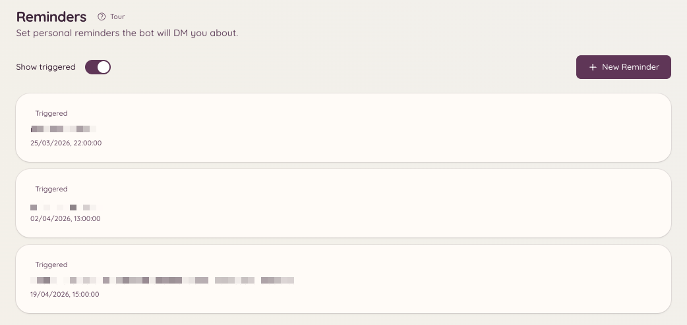

import { DashboardLink } from "/snippets/dashboard-link.jsx";

Mit dem Erinnerungs-Plugin setzen sich Mitglieder Erinnerungen für sich selbst. Zur geplanten Zeit stellt der Bot die Erinnerung per DM zu oder postet sie in dem Kanal, in dem sie gesetzt wurde. Erinnerungen können optional Kontext enthalten, zum Beispiel einen Link zu einem Ticket oder Modmail-Thread, damit die Erinnerung mit genug Informationen ankommt, um direkt loszulegen.

<Frame>
  
</Frame>

## Eine Erinnerung setzen

```text
/reminder
```

`/reminder` öffnet ein interaktives Panel. Dort kannst du:

- Beschreiben, woran du erinnert werden willst
- Festlegen, wann du erinnert werden willst (ein bestimmter Zeitpunkt oder eine Dauer ab jetzt, etwa `in 2 hours` oder `tomorrow at 9am`)
- Wählen, ob die Erinnerung per DM zugestellt oder im aktuellen Kanal gepostet wird

Der Bot bestätigt die Erinnerung mit einer Nachricht, die den Inhalt und den geplanten Zustellzeitpunkt zeigt.

## Deine Erinnerungen verwalten

```text
/reminders
```

Öffnet ein Panel mit all deinen aktiven, anstehenden Erinnerungen. Dort kannst du:

- **Ansehen**: den vollständigen Inhalt jeder Erinnerung
- **Löschen**: Erinnerungen, die du nicht mehr brauchst
- **Bearbeiten**: Zeitpunkt oder Beschreibung einer anstehenden Erinnerung

Wenn du Zugriff aufs Dashboard hast, zeigt die Seite <DashboardLink to="reminders">**Reminders**</DashboardLink> dieselbe Liste, immer nur mit deinen eigenen Erinnerungen, und du kannst sie dort ebenfalls hinzufügen, bearbeiten oder löschen.

## Kontext aus Tickets und Modmail

Führst du `/reminder` in einem aktiven Ticket oder Modmail-Thread aus, hängt der Bot automatisch einen Link zu diesem Thread an die Erinnerung. Wenn die Erinnerung fällig wird, enthält sie einen Sprunglink, mit dem du direkt zum Gespräch zurückkommst.

## Zustellung von Erinnerungen

Erinnerungen werden zur geplanten Zeit zugestellt, egal ob du online bist. Kann der Bot keine DM zustellen (zum Beispiel weil du DMs von Servermitgliedern deaktiviert hast), versucht er stattdessen, die Erinnerung in dem Kanal zu posten, in dem sie ursprünglich gesetzt wurde.

## Erforderliche Berechtigungen

| Aktion | Berechtigungsschlüssel |
| --- | --- |
| Erinnerungen setzen | `reminders.view_reminders` (standardmäßig erlaubt) |
| Eigene Erinnerungen verwalten | `reminders.view_reminders` (standardmäßig erlaubt) |
| Erinnerungen an andere Mitglieder senden | `reminders.send_public_reminders` |
| Alle Erinnerungen des Servers ansehen | `reminders.manage_reminders` |
