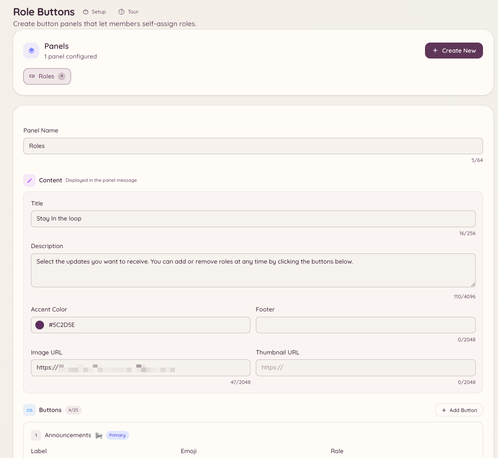

import { DashboardLink } from "/snippets/dashboard-link.jsx";

Rollen-Buttons sind dauerhafte Panels in einem Kanal, deren Buttons Mitglieder anklicken, um sich selbst Rollen zu geben oder zu entfernen. Anders als die eingebaute Rollenauswahl von Discord unterstützen die Panels von Heimdall Umschaltmodi, Rollengruppen sowie eigene Beschriftungen und Stile für Buttons.

<Frame>
  
</Frame>

## Ein Panel erstellen

```text
/rolebuttons create
```

Dieser Befehl öffnet einen Ablauf, in dem du das Panel festlegst. Du kannst Panels auch komplett im Dashboard unter <DashboardLink to="rolebuttons">**Role Buttons**</DashboardLink> erstellen und verwalten.

### Panel-Einstellungen

| Einstellung | Beschreibung |
| --- | --- |
| **Title** (Titel) | Der Überschriftstext des Panels |
| **Description** (Beschreibung) | Erklärender Text unter dem Titel |
| **Mode** (Modus) | Wie Rollen vergeben werden (siehe unten) |

### Vergabemodi

| Modus | Verhalten |
| --- | --- |
| **Toggle** (Umschalten) | Ein Klick gibt die Rolle, wenn man sie nicht hat, und entfernt sie, wenn man sie hat |
| **Add only** (Nur hinzufügen) | Ein Klick gibt die Rolle immer, entfernt sie nie |
| **Remove only** (Nur entfernen) | Ein Klick entfernt die Rolle immer, gibt sie nie |
| **Exclusive** (Exklusiv) | Man kann immer nur eine Rolle aus dem Panel haben; wer eine neue wählt, verliert die vorherige |

### Buttons hinzufügen

Jeder Button auf einem Panel gehört zu einer Discord-Rolle. Für jeden Button stellst du ein:

| Einstellung | Beschreibung |
| --- | --- |
| **Role** (Rolle) | Die Discord-Rolle, die vergeben wird |
| **Label** (Beschriftung) | Der Text auf dem Button |
| **Style** (Stil) | Primary (Blurple), Secondary (Grau), Success (Grün) oder Danger (Rot) |
| **Emoji** | Optionales Emoji auf dem Button |

Ein Panel unterstützt bis zu 25 Buttons (5 Reihen mit je 5).

## Das Panel posten

```text
/rolebuttons post <panel_id> [channel]
```

Postet das Panel im angegebenen Kanal (oder im aktuellen, wenn du keinen angibst). Das Panel ist dauerhaft: Es bleibt unbegrenzt im Kanal und funktioniert auch nach einem Neustart des Bots weiter.

Musst du den Inhalt des Panels nach dem Posten ändern, bearbeite es im Dashboard unter <DashboardLink to="rolebuttons">**Role Buttons**</DashboardLink>. Die gepostete Nachricht aktualisiert sich automatisch.

## Panels verwalten

```text
/rolebuttons list
/rolebuttons edit <panel_id>
/rolebuttons delete <panel_id>
/rolebuttons update <panel_id>
```

Das Dashboard zeigt unter <DashboardLink to="rolebuttons">**Role Buttons**</DashboardLink> alle Panels mit dem Ort, an dem sie gepostet sind, der Anzahl der Buttons und dem Zeitpunkt der letzten Änderung.

## Erforderliche Berechtigungen

| Aktion | Berechtigungsschlüssel |
| --- | --- |
| Rollen-Button-Panels nutzen | Standardmäßig alle Mitglieder |
| Panels im Dashboard ansehen | `rolebuttons.view` |
| Panels erstellen und bearbeiten | `rolebuttons.manage` |
