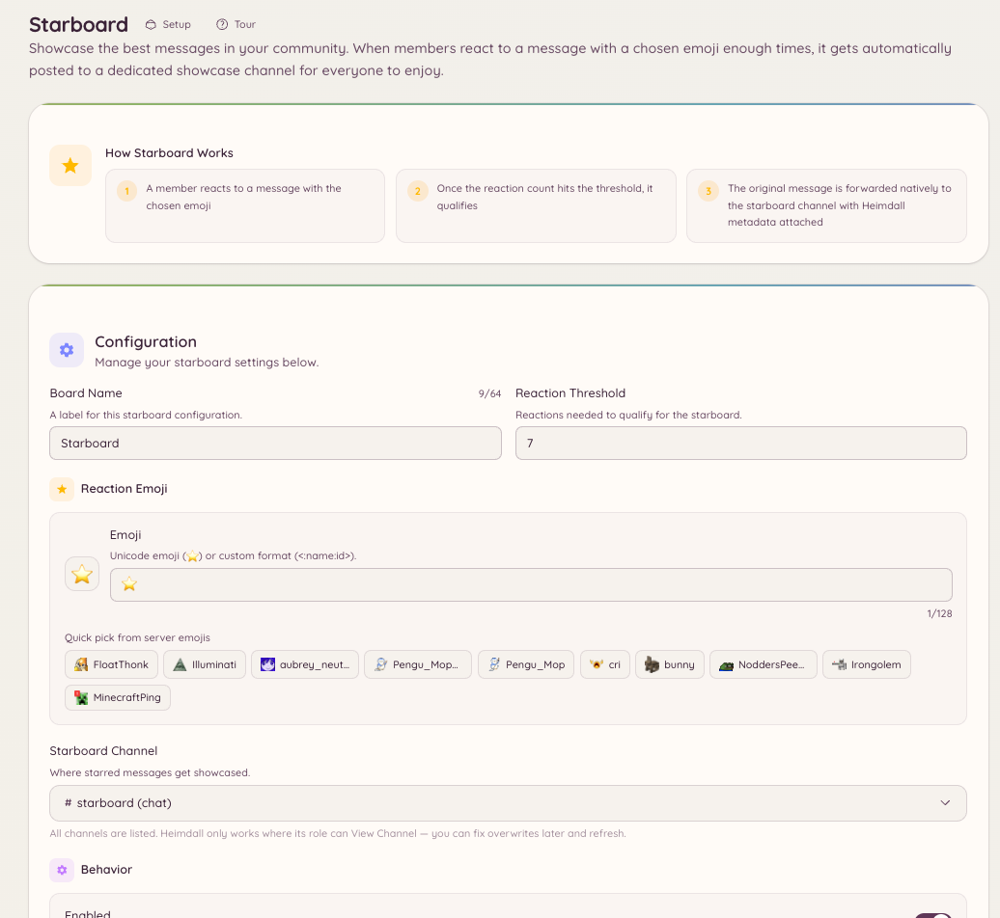

import { DashboardLink } from "/snippets/dashboard-link.jsx";

Das Starboard sammelt Nachrichten, die genug Reaktionen bekommen, und postet sie in einem eigenen Kanal neu. Es ist ein Werkzeug, mit dem die Community selbst auswählt: Mitglieder stimmen mit Reaktionen ab, und die beliebtesten Inhalte landen automatisch oben.

<Frame>
  
</Frame>

## So funktioniert es

Erreicht eine Nachricht so viele Reaktionen wie deine eingestellte Schwelle oder mehr, kopiert der Bot sie in den Starboard-Kanal. Die neu gepostete Nachricht zeigt den ursprünglichen Autor, den ursprünglichen Kanal, einen Link zurück zum Original und die aktuelle Anzahl der Reaktionen.

Fällt die Anzahl der Reaktionen wieder unter die Schwelle (weil Mitglieder ihre Reaktionen entfernen), entfernt der Bot den Starboard-Eintrag oder behält ihn, je nach deiner Konfiguration.

## Einrichtung

Geh im Dashboard zu <DashboardLink to="starboard">**Starboard**</DashboardLink> und stell ein:

| Einstellung | Beschreibung |
| --- | --- |
| **Channel** (Kanal) | Der Kanal, in dem markierte Nachrichten neu gepostet werden |
| **Reaction emoji** (Reaktions-Emoji) | Welche Reaktion das Starboard auslöst (Standard: Stern-Emoji) |
| **Threshold** (Schwelle) | Mindestanzahl an Reaktionen |
| **Self-star** (Eigener Stern) | Ob die eigene Reaktion des ursprünglichen Autors mitzählt |
| **Bot messages** (Bot-Nachrichten) | Ob Nachrichten von Bots markiert werden können |
| **NSFW channels** (NSFW-Kanäle) | Ob Nachrichten aus als NSFW markierten Kanälen dazugehören |

## Moderationswarteschlange

Das Starboard hat eine optionale Moderationswarteschlange. Ist sie aktiviert, landen Nachrichten nicht sofort im Starboard, wenn sie die Schwelle erreichen. Stattdessen kommen sie in eine Warteschlange auf der Seite <DashboardLink to="starboard">**Starboard**</DashboardLink>, wo das Team sie freigeben oder ablehnen kann, bevor sie erscheinen.

Geh im Dashboard zu <DashboardLink to="starboard">**Starboard**</DashboardLink> und aktiviere **Require moderation approval** (Freigabe durch Moderation erforderlich). Wartende Einträge erscheinen auf derselben Seite in der **Moderation Queue**.

Teammitglieder mit der Berechtigung `starboard.moderate` können wartende Einträge freigeben oder ablehnen. Freigegebene Einträge werden gepostet, abgelehnte verworfen.

## Die Schwelle nach der Einrichtung ändern

Erhöhst du die Schwelle nach der Einrichtung, werden bereits gepostete Starboard-Einträge, die unter der alten Schwelle hinzugekommen sind, nicht entfernt. Senkst du sie, werden alte Nachrichten nicht nachträglich hinzugefügt. Die Schwelle gilt nur für Reaktionen ab dem Moment, in dem sie sich ändert.

## Erforderliche Berechtigungen

Das Starboard läuft komplett automatisch und braucht keine Berechtigungen für Mitglieder. Die Konfiguration ist nur für Admins:

| Aktion | Berechtigungsschlüssel |
| --- | --- |
| Konfiguration ansehen | `starboard.view_config` |
| Konfiguration ändern | `starboard.manage_config` |
| Die Freigabe-Warteschlange moderieren | `starboard.moderate` |
