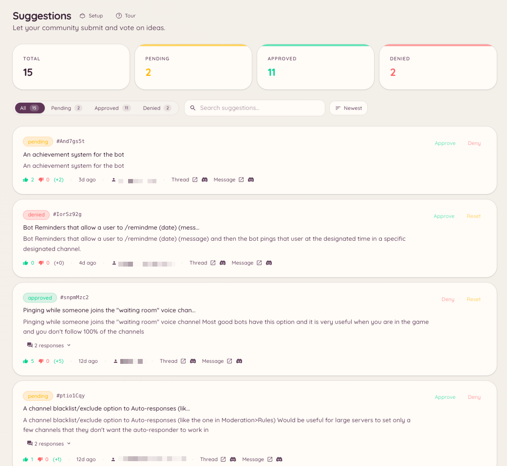

import { DashboardLink } from "/snippets/dashboard-link.jsx";

Das Vorschlags-Plugin schafft einen eigenen Ablauf für Feedback von Mitgliedern. Mitglieder reichen Vorschläge per Slash-Befehl ein, der Bot postet sie als formatierte Nachrichten mit Up- und Downvote-Reaktionen in einem festgelegten Kanal, und das Team prüft und bearbeitet sie über das Dashboard oder Slash-Befehle.

<Frame>
  
</Frame>

## Einen Vorschlag einreichen

```text
/suggest <content>
```

Das Mitglied schreibt den Text seines Vorschlags. Der Bot postet ihn im eingestellten Vorschlagskanal, die Abstimmungsreaktionen sind schon dran. Ist die KI-Titelerstellung aktiviert, erzeugt der Bot außerdem einen knappen Titel, der den Vorschlag zusammenfasst.

## Kategorien

Vorschläge lassen sich je nach Kategorie in verschiedene Kanäle leiten. Kategorien legst du im Dashboard unter <DashboardLink to="suggestions/categories">**Suggestions \> Categories**</DashboardLink> an.

Jede Kategorie hat:

| Einstellung | Beschreibung |
| --- | --- |
| **Name** | Wird angezeigt, wenn ein Mitglied eine Kategorie wählt |
| **Channel** (Kanal) | Wo Vorschläge dieser Kategorie gepostet werden |
| **Voting style** (Abstimmungsart) | Up-/Downvote, Sternebewertung oder eigene Emoji-Reaktionen |
| **Who can suggest** (Wer vorschlagen darf) | Einreichen auf bestimmte Rollen beschränken |

Gibt es mehrere Kategorien, wird das Mitglied beim Ausführen von `/suggest` gebeten, eine auszuwählen.

## Vorschläge verwalten

```text
/suggestion-config
/suggestion-categories list
/suggestion-categories create <name>
/suggestion-categories delete <id>
```

Das Team verwaltet einzelne Vorschläge im Dashboard unter <DashboardLink to="suggestions/list">**Suggestions \> Suggestions**</DashboardLink> oder über Aktionen im Kontextmenü der Vorschlagsnachricht.

Verfügbare Aktionen für einen Vorschlag:

| Aktion | Beschreibung |
| --- | --- |
| **Approve** (Annehmen) | Den Vorschlag als angenommen markieren, der Bot fügt der Nachricht ein Status-Abzeichen hinzu |
| **Reject** (Ablehnen) | Als abgelehnt markieren, mit einem optionalen Grund, der als Antwort gepostet wird |
| **In progress** (In Arbeit) | Als in Bearbeitung markieren |
| **Implemented** (Umgesetzt) | Als erledigt markieren |
| **Archive** (Archivieren) | Aus dem aktiven Feed entfernen, ohne zu löschen |

Wird ein Vorschlag bearbeitet, aktualisiert der Bot die ursprüngliche Nachricht mit dem neuen Status, und die Abstimmungsergebnisse bleiben sichtbar.

## Einstellungen im Dashboard

Unter <DashboardLink to="suggestions/config">**Suggestions \> Configuration**</DashboardLink> legst du fest:

| Einstellung | Beschreibung |
| --- | --- |
| **Default channel** (Standardkanal) | Wohin Vorschläge gehen, wenn keine Kategorien festgelegt sind |
| **Anonymous suggestions** (Anonyme Vorschläge) | Vorschläge posten, ohne den Namen der einreichenden Person zu zeigen |
| **Duplicate detection** (Duplikaterkennung) | Die einreichende Person warnen, wenn es schon einen ähnlichen Vorschlag gibt |
| **AI titles** (KI-Titel) | Automatisch einen kurzen Titel aus dem Vorschlagstext erzeugen |
| **Min/max length** (Mindest-/Höchstlänge) | Zeichenlimits für den eingereichten Inhalt durchsetzen |

## Opener

Opener sind Buttons in einem Kanal, über die Mitglieder einen Vorschlag per Modal-Formular einreichen, ohne den Befehl `/suggest` tippen zu müssen. Öffne <DashboardLink to="suggestions/openers">**Suggestions \> Openers**</DashboardLink> und klick auf **New Opener**. Leg die Beschriftung des Buttons und einen optionalen Hinweistext fest und klick dann auf **Post**, um das Opener-Panel in einem Kanal zu platzieren.

Opener sind praktisch, um den Vorschlagsablauf in einem eigenen Vorschlagskanal sichtbar zu halten, oder für Server, auf denen Slash-Befehle eingeschränkt sind.

## Erforderliche Berechtigungen

| Aktion | Berechtigungsschlüssel |
| --- | --- |
| Vorschläge einreichen | `suggestions.create_suggestion` (standardmäßig erlaubt) |
| Vorschläge im Dashboard ansehen | `suggestions.items.view_suggestions` |
| Vorschläge annehmen und ablehnen | `suggestions.items.manage_suggestions` |
