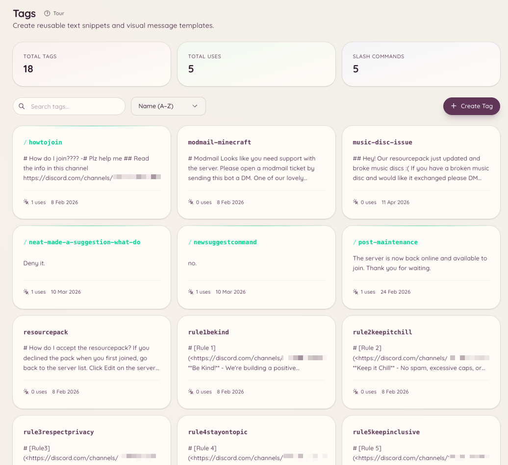

import { DashboardLink } from "/snippets/dashboard-link.jsx";

Tags sind wiederverwendbare Inhalte (ein Textblock, ein Embed oder eine formatierte Nachricht), die sich mit einem einzigen Befehl in jedem Kanal posten lassen. Sie sind besonders praktisch für Teams, die oft dieselben Fragen beantworten, dieselben Ressourcen teilen oder formatierte Ankündigungen posten. Ein Tag speichert den Inhalt einmal, und jeder mit Zugriff kann ihn sofort einsetzen.

<Frame>
  
</Frame>

## Einen Tag verwenden

```text
/tag use <name>
```

Postet den Inhalt des Tags in den aktuellen Kanal. Tag-Namen unterstützen Autovervollständigung: Fang an zu tippen, und der Bot schlägt passende Tags vor.

## Einen Tag erstellen

```text
/tag create <name>
```

Öffnet ein Modal, in dem du den Inhalt des Tags schreibst. Der Inhalt unterstützt Discord-Markdown. Wenn du einen Tag mit einem ausführlichen Embed erstellen willst, nutze stattdessen <DashboardLink to="tags/tags">**Tags**</DashboardLink> im Dashboard. Dort gibt es einen visuellen Embed-Editor.

Um einen Tag im Dashboard zu erstellen, öffne <DashboardLink to="tags/tags">**Tags**</DashboardLink> und klick auf **New Tag**. Der Editor im Dashboard unterstützt:

- Reinen Textinhalt
- Embeds mit Titel, Beschreibung, Feldern, Farbe und Vorschaubild
- Hochladen von Dateianhängen

## Bearbeiten und löschen

```text
/tag edit <name>
/tag delete <name>
```

Beim Bearbeiten öffnet sich dasselbe Modal wie beim Erstellen. Löschen entfernt den Tag dauerhaft.

## Tags auflisten

```text
/tag list
```

Listet alle Tags auf, die auf deinem Server verfügbar sind. Die Dashboard-Seite <DashboardLink to="tags/tags">**Tags**</DashboardLink> bietet dieselbe Liste mit Such- und Filteroptionen.

## Posts

Posts ähneln Tags, sind aber für längere Inhalte gedacht, die an bestimmte Kanäle gehen. Geplante Posts verwaltest du im Dashboard unter <DashboardLink to="settings/messages">**Settings \> Messages**</DashboardLink> im Bereich **Scheduled posts**. Der Befehl `/post` funktioniert neben `/tag`:

```text
/post send <name> [channel]
/post list
```

Ein Post schickt den Inhalt in einen festgelegten Kanal statt in den Kanal, in dem der Befehl ausgeführt wird. Nutze Posts zum Beispiel für wöchentliche Ankündigungen oder angepinnte Ressourcen, die an einen bestimmten Ort gehören, egal wo der Befehl ausgelöst wird.

## Vorlagen

Vorlagen sind im Dashboard gespeicherte Embed-Grundgerüste, die das Team als Ausgangspunkt für neue Tags nutzen kann. Du findest sie unter <DashboardLink to="settings/messages">**Settings \> Messages**</DashboardLink> im Bereich **Reusable templates**.

## Erforderliche Berechtigungen

| Aktion | Berechtigungsschlüssel |
| --- | --- |
| Tags verwenden | `tags.view_tags` (standardmäßig erlaubt) |
| Tags erstellen, bearbeiten und löschen | `tags.manage_tags` |
| Posts senden | `tags.manage_posts` |
