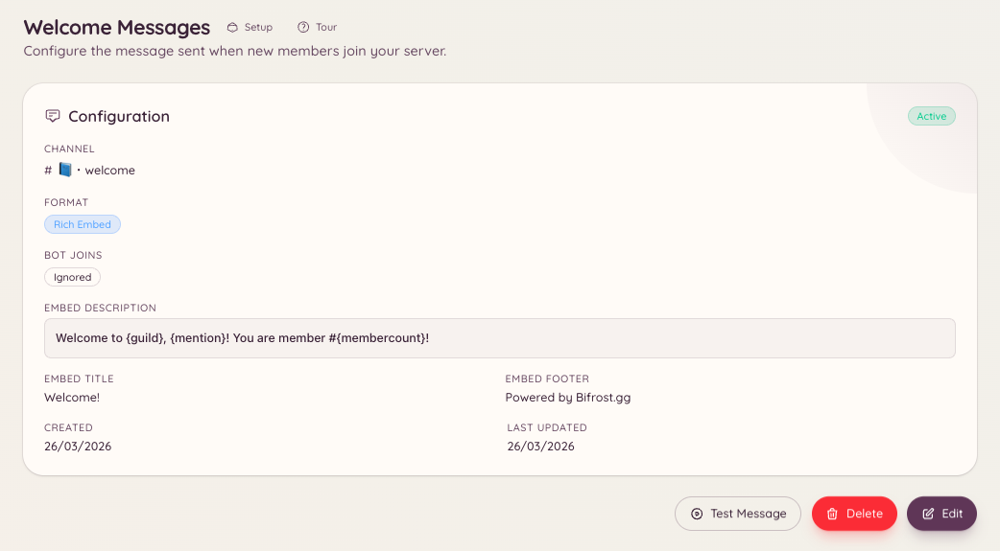

import { DashboardLink } from "/snippets/dashboard-link.jsx";

Das Willkommens-Plugin postet eine Nachricht in einen festgelegten Kanal, sobald jemand deinem Server beitritt. Die Nachricht lässt sich komplett anpassen: Du kannst sie als einfachen Text oder als Rich Embed schreiben und Variablen nutzen, um den Namen des Mitglieds, den Servernamen und die aktuelle Mitgliederzahl einzufügen.

<Frame>
  
</Frame>

## Einrichtung

```text
/welcome setup
```

`/welcome setup` öffnet ein Formular, in dem du den Willkommenskanal festlegst und deine Nachricht schreibst. Alternativ richtest du alles im Dashboard unter <DashboardLink to="welcome">**Welcome**</DashboardLink> ein.

### Konfiguration im Dashboard

Geh in der Seitenleiste des Dashboards zu <DashboardLink to="welcome">**Welcome**</DashboardLink>. Die Konfigurationsseite hat:

| Einstellung | Beschreibung |
| --- | --- |
| **Channel** (Kanal) | Der Kanal, in dem Willkommensnachrichten gepostet werden |
| **Message content** (Nachrichteninhalt) | Text- oder Embed-Inhalt der Willkommensnachricht |
| **Embed toggle** (Embed-Schalter) | Die Nachricht als Rich Embed mit Farbe und Feldern senden |
| **Embed colour** (Embed-Farbe) | Die Farbe am linken Rand des Embeds |

## Verfügbare Variablen

Variablen sind Platzhalter in deiner Nachricht, die der Bot beim Senden ausfüllt. Setz Variablen in geschweifte Klammern:

| Variable | Wird ersetzt durch |
| --- | --- |
| `{user}` | Eine Erwähnung des neuen Mitglieds (`@Username`) |
| `{user.name}` | Den Anzeigenamen des Mitglieds (ohne Erwähnung) |
| `{user.id}` | Die Discord-Nutzer-ID des Mitglieds |
| `{server}` | Den Namen deines Servers |
| `{server.count}` | Die Gesamtzahl der Mitglieder nach dem Beitritt |
| `{server.id}` | Die ID deines Servers |

### Beispielnachricht

```text
Welcome to {server}, {user}! You are member number {server.count}.
Please read <#channel-id> before getting started.
```

## Die Willkommensnachricht testen

```text
/welcome test
```

Postet eine Vorschau deiner Willkommensnachricht im aktuellen Kanal, mit deinem eigenen Account als Testmitglied. Praktisch, um Formatierung und Variablen vor dem nächsten echten Beitritt zu prüfen.

## Die aktuelle Konfiguration ansehen

```text
/welcome view
```

Zeigt die aktuelle Konfiguration der Willkommensnachricht, ohne einen Testversand auszulösen.

## Die Willkommensnachricht entfernen

```text
/welcome remove
```

Deaktiviert die Willkommensnachricht. Die Konfiguration bleibt erhalten, du kannst sie also später wieder aktivieren.

## Erforderliche Berechtigungen

| Aktion | Berechtigungsschlüssel |
| --- | --- |
| Willkommens-Konfiguration ansehen | `welcome.view_config` |
| Willkommens-Konfiguration bearbeiten | `welcome.manage_config` |
