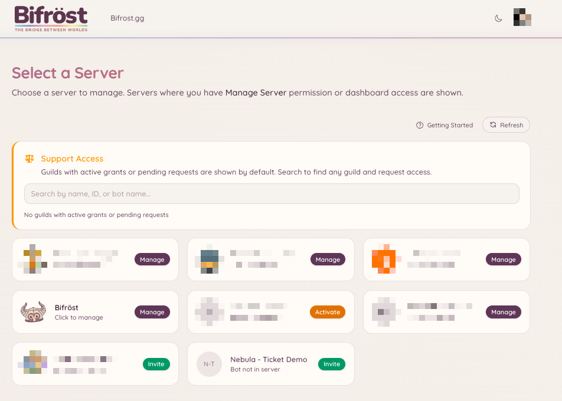
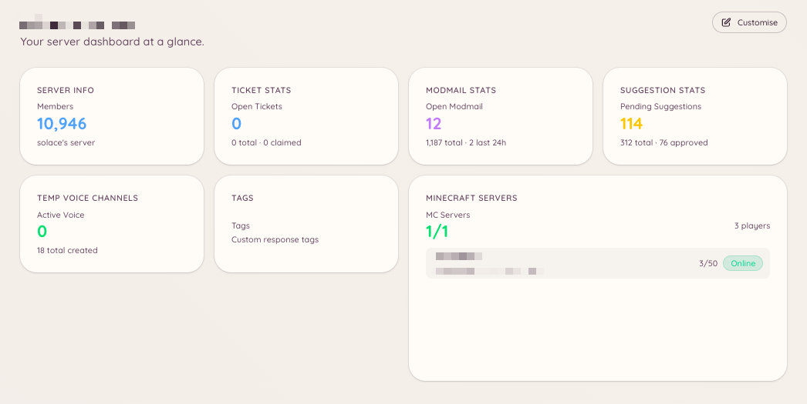

import { DashboardLink } from "/snippets/dashboard-link.jsx";

Das Heimdall-Dashboard ist eine Weboberfläche, in der Server-Administratoren jede Funktion des Bots einrichten. Normale Mitglieder brauchen keinen Zugriff aufs Dashboard, es sei denn, er wurde ihnen ausdrücklich erteilt.

## Anmelden

Öffne [**bot.bifrost.gg**](https://bot.bifrost.gg) und klick auf **Sign in with Discord**. Discord bittet dich, die Dashboard-Anwendung zu autorisieren. Sie liest deinen Benutzernamen, deinen Avatar und die Liste der Server, die du verwaltest. Zugriff auf Nachrichten oder Inhalte wird nicht angefragt.

Nach der Anmeldung landest du in der Serverauswahl.

## Serverauswahl

Die Serverauswahl listet jeden Discord-Server auf, auf dem du die Berechtigung "Server verwalten" hast und Heimdall vorhanden ist. Klick auf die Karte eines Servers, um sein Dashboard zu öffnen.

Verwaltest du einen Server, zu dem Heimdall noch nicht hinzugefügt wurde, zeigt die Karte "Invite". Klick einfach darauf, um Heimdall auf deinen Server einzuladen.

<Frame>
  
</Frame>

## Übersichtsseite

Die Seite <DashboardLink to="overview">**Overview**</DashboardLink> ist das Erste, was du nach der Auswahl eines Servers siehst. Statt eines festen Layouts ist sie ein vollständig anpassbares Widget-Dashboard. Heimdall bietet eine Bibliothek von Info-Widgets, von Mitgliederzahlen und Ticket-Warteschlangen bis zum Status des Minecraft-Servers und dem Modmail-Aufkommen, und du ordnest sie so an, wie es zu deiner Arbeitsweise passt.

Um das Layout anzupassen, klick oben rechts auf der Seite <DashboardLink to="overview">**Overview**</DashboardLink> auf **Edit layout**. Im Bearbeitungsmodus kannst du:

- **Widgets hinzufügen**: Klick auf den Button **\+**, um die Widget-Auswahl zu öffnen und Widgets aus der Bibliothek zu platzieren
- **Widgets verschieben**: Zieh eine Karte an eine neue Stelle im Raster
- **Widgets in der Größe ändern**: Zieh am Griff, um die Maße einer Karte zu ändern
- **Widgets entfernen**: Fahr mit der Maus über eine Karte und klick auf den Entfernen-Button, um sie aus dem Raster zu nehmen

Welche Widgets dir zur Verfügung stehen, hängt davon ab, welche Plugins auf deinem Server aktiviert sind und welche Dashboard-Berechtigungen deiner Rolle erteilt wurden. Widgets für Plugins, die nicht aktiv sind, erscheinen nicht in der Auswahl.

<Frame>
  
</Frame>

## Navigation

Die linke Seitenleiste listet jedes verfügbare Plugin auf. Jeder Eintrag führt zum Konfigurations- und Verwaltungsbereich dieses Plugins. Bereiche mit Unterseiten klappen beim Anklicken auf und zeigen Tabs wie **Configuration**, **Analytics**, **Categories** und so weiter.

Die Seitenleiste ist in Gruppen aufgeteilt, die den Abschnitten dieser Dokumentation entsprechen: Moderation, Support, Community, Voice, Games, Integrations, AI und Utilities.

## Panels in mehr als einem Kanal

Ein Panel ist eine Nachricht mit Buttons, die Mitglieder drücken, etwa ein Ticket-Opener, ein Panel mit Rollen-Buttons oder das Panel zur Verknüpfung von Minecraft-Accounts. Du kannst dasselbe Panel in beliebig vielen Kanälen posten. Postest du es in einem neuen Kanal, kommt dort eine Kopie dazu. Bestehende Kopien werden dabei nie verschoben oder gelöscht.

Wenn du ein Panel postest, zeigt der Dialog zum Posten eine Liste **Posted in** mit jeder Kopie, die Heimdall kennt. Jede Zeile zeigt den Kanal, wann die Kopie gepostet wurde, wer sie gepostet hat (wenn Heimdall das weiß) und ihren Zustand:

| Zustand | Bedeutung | Was du tun kannst |
| --- | --- | --- |
| **Live** | Die Nachricht ist im Kanal | **Refresh** aktualisiert sie auf den aktuellen Wortlaut. **Delete** entfernt sie aus dem Kanal |
| **Deleted** | Jemand hat die Nachricht in Discord gelöscht | **Post again** stellt sie im selben Kanal wieder her. **Remove from list** vergisst sie |
| **Can't reach** | Heimdall kann den Kanal nicht sehen oder seinen Verlauf nicht lesen | **Remove from list** vergisst sie. Heimdall kann nicht sagen, ob die Nachricht noch da ist, lösch sie also von Hand, falls doch |

Änderst du den Wortlaut eines Panels oder eine Einstellung, die beeinflusst, was darin steht, wird jede Kopie aktualisiert, die noch da ist. Eine Kopie, die jemand gelöscht hat, wird von der Liste genommen statt erneut gepostet.

Heimdall löscht nur Nachrichten, die es selbst gesendet hat. Stellt sich heraus, dass eine gelistete Kopie die Nachricht von jemand anderem ist, lässt Delete sie im Kanal und nimmt sie nur von der Liste.

Löschst du einen Opener für Vorschläge oder Spiele, werden auch die gelisteten Kopien gelöscht, die Heimdall erreichen kann. Eine Kopie, die es nicht erreichen kann oder die nie gelistet war, bleibt in Discord mit Buttons, die nicht mehr funktionieren. Lösch sie dort.

<Note>
  Bei den meisten Panels hat sich Heimdall früher nur die neueste Kopie gemerkt, daher ist anfangs nur diese ältere Kopie gelistet. Eine ältere Kopie an anderer Stelle kommt dazu, sobald ein Mitglied zum ersten Mal einen ihrer Buttons drückt, sofern Heimdall erkennen kann, zu welchem Panel sie gehört. Bei Openern (Tickets, Modmail, Vorschläge und Spiele) kann Heimdall nicht immer erkennen, zu welchem Opener eine alte Kopie gehört, eine alte Opener-Kopie wird auf diese Weise also unter Umständen nie hinzugefügt. Solange eine Kopie nicht gelistet ist, erreichen Refresh und Delete sie nicht, und du kannst sie wie gewohnt in Discord löschen.
</Note>

## Berechtigungen im Dashboard

Auf welche Bereiche des Dashboards du Zugriff hast, hängt davon ab, welche Berechtigungen deinen Discord-Rollen erteilt wurden. Siehst du einen Bereich nicht, fehlt dir entweder die passende Berechtigung, oder das Plugin ist nicht aktiviert. Administratoren mit der Discord-Berechtigung **Administrator** haben immer vollen Zugriff.

Unter [Berechtigungen](/de/permissions) findest du eine ausführliche Erklärung, wie das Berechtigungssystem funktioniert.

## Änderungen vornehmen

Änderungen im Dashboard gelten sofort. Es gibt keinen Schritt zum Veröffentlichen oder Alles-Speichern: Jeder Bereich hat einen eigenen **Save**-Button, der die Änderungen nur für diesen Bereich übernimmt.

<Note>
  Der Bot muss nicht neu gestartet werden, wenn du Einstellungen änderst. Änderungen werden automatisch übernommen.
</Note>
