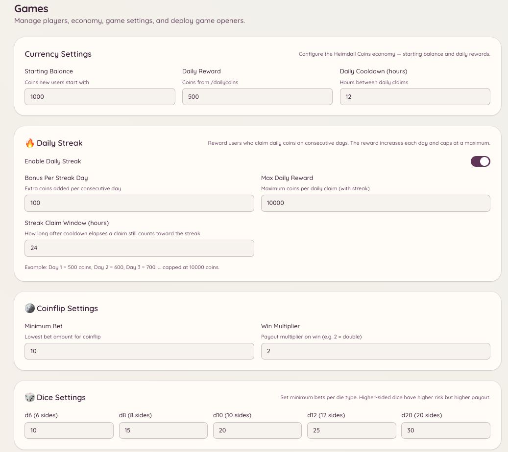

import { DashboardLink } from "/snippets/dashboard-link.jsx";

Das Economy-System gibt deinem Server eine virtuelle Währung, die Mitglieder über Spiele und tägliche Belohnungen verdienen und ausgeben. Die Währung gilt nur für einen Server: Kontostände werden nicht auf andere Server übertragen.

<Frame>
  
</Frame>

## Deinen Kontostand prüfen

```text
/balance [user]
```

Zeigt deinen aktuellen Coin-Kontostand. Gibst du ein Mitglied an, siehst du stattdessen dessen Kontostand (sofern es seinen Kontostand sichtbar gemacht hat).

## Tägliche Belohnung

```text
/dailycoins
```

Holt deine täglichen Coins ab. Mitglieder können das einmal pro Abklingzeit (standardmäßig 24 Stunden) tun. Wie viel es gibt, legst du unter <DashboardLink to="games/config/economy">**Games \> Configuration \> Economy**</DashboardLink> fest.

Administratoren können über die Konfiguration von `/economy claim` auch weitere Belohnungsbefehle mit eigenen Beträgen und Abklingzeiten anlegen.

## Anderen Mitgliedern Trinkgeld geben

```text
/tip <user> <amount>
```

Überweist Coins von deinem Kontostand an ein anderes Mitglied. Das Trinkgeld kommt sofort an und lässt sich nicht rückgängig machen. Nutze es, um hilfsbereite Mitglieder zu belohnen, für Dienste innerhalb der Spiel-Economy zu bezahlen oder Gewinne zu teilen.

## Bestenliste

```text
/leaderboard
```

Zeigt die Mitglieder mit den meisten Coins auf deinem Server, sortiert nach Kontostand. Die Bestenliste gilt nur für deinen Server.

Administratoren sehen die vollständige Bestenliste auch im Dashboard unter <DashboardLink to="games/players">**Games \> Players**</DashboardLink>, mit mehr Details als die Version in Discord.

## Belohnungen abholen

Mit dem Befehl `/economy claim` richten Administratoren einmalige oder wiederkehrende Belohnungsaktionen ein. Mitglieder führen den Befehl aus und erhalten eine Belohnung, die der Administrator festgelegt hat. Belohnungsaktionen richtest du unter <DashboardLink to="games/config">**Games \> Configuration**</DashboardLink> ein.

## Kontostände von Mitgliedern verwalten

Administratoren können einzelne Kontostände im Dashboard unter <DashboardLink to="games/players">**Games \> Players**</DashboardLink> ansehen und anpassen. Wähle ein Mitglied aus und nutze die Werkzeuge zur Anpassung, um Coins hinzuzufügen, abzuziehen oder den Kontostand direkt festzulegen. Alle Anpassungen werden protokolliert.

## Transaktionsverlauf

Im Dashboard unter <DashboardLink to="games/transactions">**Games \> Transactions**</DashboardLink> findest du ein Protokoll aller Economy-Transaktionen: tägliche Belohnungen, Trinkgelder, Gewinne und Verluste in Spielen sowie Anpassungen durch Admins. Jeder Eintrag zeigt das Mitglied, den Betrag, die Art der Transaktion und den Zeitstempel.

## Währung anpassen

Name der Währung, Emoji, Höhe der täglichen Belohnung und Startguthaben legst du unter <DashboardLink to="games/config/economy">**Games \> Configuration \> Economy**</DashboardLink> fest. Eine Änderung des Währungsnamens wirkt sich nicht auf bestehende Kontostände aus.

## Erforderliche Berechtigungen

| Aktion | Berechtigungsschlüssel |
| --- | --- |
| Kontostand prüfen und Belohnungen abholen | `games.use` (standardmäßig erlaubt) |
| Trinkgeld geben | `games.use` (standardmäßig erlaubt) |
| Kontostände von Spielern verwalten | `games.manage` |
