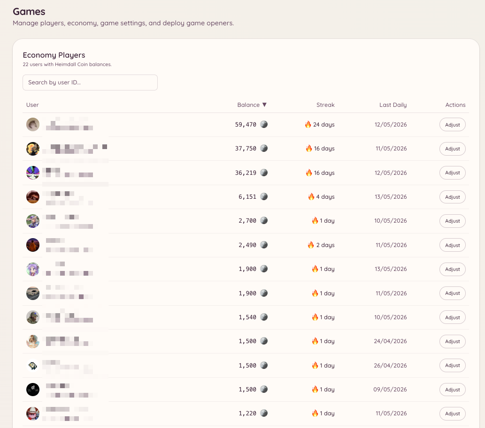

import { DashboardLink } from "/snippets/dashboard-link.jsx";

Das Spiele-Plugin bietet eine ganze Reihe interaktiver Spiele (Brettspiele, Casino-Spiele und ein Economy-System), die sich alle direkt in Discord spielen lassen. Jedes Spiel ist ein eigener Slash-Befehl. Die Economy gibt Mitgliedern eine virtuelle Währung, die sie über tägliche Belohnungen, Spielgewinne und Trinkgelder verdienen.

<Frame>
  
</Frame>

## Verfügbare Spiele

<Columns cols={2}>
  <Card title="Brettspiele" icon="chess-board" href="/de/games/board-games">
    2048, Vier gewinnt, Memory, Tic-Tac-Toe, Schiffe versenken, Solitaire
  </Card>

  <Card title="Casino-Spiele" icon="dice" href="/de/games/casino">
    Blackjack, Coinflip, Dice, Higher-Lower, Pferderennen, Mines, Roulette
  </Card>

  <Card title="Economy" icon="coins" href="/de/games/economy">
    Kontostand, tägliche Coins, Trinkgeld, Bestenliste und Belohnungen
  </Card>
</Columns>

## Spiele aktivieren

Öffne im Dashboard <DashboardLink to="games/config">**Games \> Configuration**</DashboardLink>. Sobald das Plugin aktiv ist, sind die Spiele standardmäßig für alle Mitglieder freigeschaltet.

## Zugriffssteuerung

Du kannst einschränken, welche Kanäle und Rollen Zugriff auf die Spiele haben:

- **Kanäle**: Öffne <DashboardLink to="games/config/channels">**Games \> Configuration \> Channels**</DashboardLink> und gib die Kanäle an, in denen Spiele erlaubt sind. Sind keine Kanäle eingestellt, funktionieren die Spiele überall.
- **Rollen**: Öffne <DashboardLink to="games/config/openers">**Games \> Configuration \> Openers**</DashboardLink>, um Spielbefehle auf bestimmte Rollen zu beschränken.

Beschränkst du die Spiele auf einen eigenen Kanal, überladen sie den Rest deines Servers nicht.

## Economy-Einstellungen

Unter <DashboardLink to="games/config/economy">**Games \> Configuration \> Economy**</DashboardLink> legst du fest:

| Einstellung | Beschreibung |
| --- | --- |
| **Currency name** (Name der Währung) | Wie dein Server seine Währung nennt (z. B. "Coins", "Gold", "Credits") |
| **Currency emoji** (Währungs-Emoji) | Ein optionales Emoji, das neben Kontoständen angezeigt wird |
| **Daily claim amount** (Tägliche Belohnung) | Wie viele Coins Mitglieder pro täglicher Belohnung bekommen |
| **Daily claim cooldown** (Abklingzeit der Belohnung) | Wie viel Zeit zwischen täglichen Belohnungen liegt (standardmäßig 24 Stunden) |
| **Starting balance** (Startguthaben) | Mit wie vielen Coins neue Mitglieder starten |

## Sichtbarkeit

Einzelne Spiele lassen sich in der Befehlsliste ausblenden, ohne sie zu deaktivieren. Unter <DashboardLink to="games/config/visibility">**Games \> Configuration \> Visibility**</DashboardLink> legst du fest, welche Spiele Mitgliedern angezeigt werden.

## Spielerstatistiken

Öffne im Dashboard <DashboardLink to="games/players">**Games \> Players**</DashboardLink>, um alle Mitglieder zu sehen, die das Spielesystem genutzt haben. Für jeden Spieler siehst du den aktuellen Kontostand, die Zahl der gespielten Spiele, die Bilanz aus Siegen und Niederlagen je Spieltyp und wann er zuletzt aktiv war.

Teammitglieder mit der Berechtigung `games.manage` können auf dieser Seite den Kontostand eines Spielers anpassen, seine Statistiken zurücksetzen oder ihn von der Bestenliste entfernen.

## Transaktionen

Unter <DashboardLink to="games/transactions">**Games \> Transactions**</DashboardLink> findest du das vollständige Journal aller Economy-Transaktionen auf deinem Server. Jeder Eintrag enthält:

| Feld | Beschreibung |
| --- | --- |
| **Player** (Spieler) | Zu welchem Mitglied die Transaktion gehört |
| **Type** (Typ) | Die Quelle der Transaktion (tägliche Belohnung, Gewinn oder Verlust im Spiel, Trinkgeld, Anpassung durch Admins, Belohnung fürs Voten) |
| **Amount** (Betrag) | Wie viele Coins hinzugefügt oder abgezogen wurden |
| **Balance after** (Kontostand danach) | Der Kontostand des Spielers nach der Transaktion |
| **Timestamp** (Zeitstempel) | Wann die Transaktion stattgefunden hat |

Filtere nach Spieler, Transaktionstyp oder Zeitraum. Das Transaktionsprotokoll ist schreibgeschützt.

## Analysen

Unter <DashboardLink to="games/analytics">**Games \> Analytics**</DashboardLink> findest du zusammengefasste Statistiken zu den Spielen auf deinem Server:

- Die meistgespielten Spiele nach Anzahl der Sitzungen
- Coins, die insgesamt im Umlauf sind
- Täglich aktive Spieler im Zeitverlauf
- Die Mitglieder, die am meisten verdienen und am meisten ausgeben

## Quizfragen

Ist das Quizspiel aktiviert, verwaltest du den Fragenkatalog unter <DashboardLink to="games/trivia">**Games \> Trivia Questions**</DashboardLink>. Du kannst:

- Eigene Quizfragen mit Multiple-Choice-Antworten hinzufügen
- Einen Stapel Fragen aus einer CSV-Datei importieren
- Bestehende Fragen bearbeiten oder löschen
- Einzelne Fragen aktivieren oder deaktivieren, ohne sie zu löschen

Eigene Fragen kommen zusammen mit den eingebauten Fragen in die Quizrotation.

## Belohnungen fürs Voten

Unter <DashboardLink to="games/topgg">**Games \> Vote Rewards**</DashboardLink> richtest du Economy-Belohnungen für Mitglieder ein, die auf top.gg für deinen Server voten. Votet ein Mitglied, bekommt Heimdall von top.gg eine Webhook-Benachrichtigung und schreibt dem Mitglied die eingestellte Coin-Belohnung automatisch gut.

So richtest du Belohnungen fürs Voten ein:

1. Gib in der Konfiguration die top.gg-URL deines Servers ein
2. Kopier die angezeigte Webhook-URL und füg sie in den Webhook-Einstellungen deines Servereintrags auf top.gg ein
3. Leg die Höhe der Belohnung fest (Coins pro Vote)
4. Richte optional einen Bonus-Multiplikator für Votes am Wochenende ein

## Erforderliche Berechtigungen

| Aktion | Berechtigungsschlüssel |
| --- | --- |
| Spiele spielen | `games.use` (standardmäßig erlaubt) |
| Einstellungen verwalten | `games.manage` |
