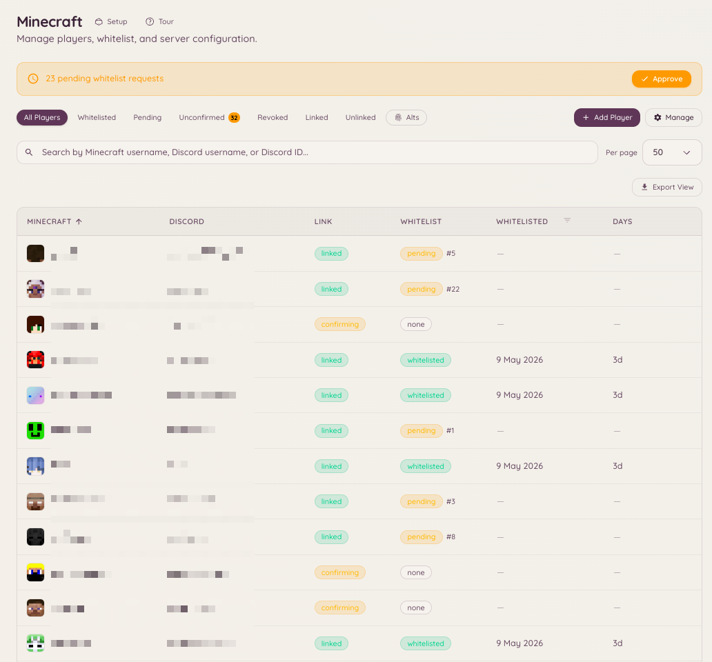

import { DashboardLink } from "/snippets/dashboard-link.jsx";

Die Minecraft-Integration verbindet deinen Discord-Server mit einem oder mehreren Servern der Minecraft Java Edition. Sie bietet Account-Verknüpfung (ein Discord-Nutzer wird mit seinem Minecraft-Benutzernamen verbunden), eine Whitelist-Verwaltung, die sich mit Discord-Rollen synchronisiert, RCON-Zugriff für Befehle aus der Ferne, eine Live-Anzeige des Serverstatus und ein eigenes Strafsystem für Banns, Mutes, Verwarnungen und Kicks.

<Frame>
  
</Frame>

## Navigation im Dashboard

Die Minecraft-Funktion hat sieben Seiten in der Seitenleiste des Dashboards:

| Seite | Was darauf ist |
| --- | --- |
| <DashboardLink to="minecraft/networks">**Networks**</DashboardLink> | Deine Server, wer darauf ist und was gerade passiert ist |
| <DashboardLink to="minecraft/players">**Players**</DashboardLink> | Die Spielerliste, die Beitritts-Warteschlange und jedes Spielerprofil |
| <DashboardLink to="minecraft/rules">**Rules**</DashboardLink> | Was als Vergehen zählt und wie es eskaliert |
| <DashboardLink to="minecraft/history">**History**</DashboardLink> | Alles, was einem Spieler passiert ist, nach Zeit geordnet |
| <DashboardLink to="minecraft/enforcement">**Enforcement**</DashboardLink> | Wie Heimdall bestraft und was die Öffentlichkeit sieht |
| <DashboardLink to="minecraft/bridge">**Chat Bridge**</DashboardLink> | Den Chat im Spiel in Discord-Kanäle weiterleiten, und zurück |
| <DashboardLink to="minecraft/settings">**Settings**</DashboardLink> | Serverweite Einstellungen für Verknüpfung, RCON, Rollen-Sync, Warnungen und Nachrichten |

## Account-Verknüpfung

Eine Verknüpfung verbindet einen Minecraft-Namen mit einem Discord-Account. Mitglieder starten sie in Discord und beweisen mit einem 6-stelligen Code, der im Spiel angezeigt wird, dass der Account ihnen gehört.

### Das Panel zur Account-Verknüpfung

Das Panel ist eine Discord-Nachricht mit den Buttons **Link Account**, **Unlink Account** und **My Account**. Du kannst es auf jede dieser Arten posten:

- Der letzte Schritt der Minecraft-Einrichtung bietet an, es zu posten.
- Unter <DashboardLink to="settings/messages">**Settings \> Messages**</DashboardLink>, beim **Account linking panel**: **Post** schickt es in einen Kanal, den du auswählst. Postest du in den Kanal, in dem es schon steht, wird diese Nachricht aktualisiert. Postest du woanders hin, kommt dort eine Kopie dazu, und die anderen bleiben, wo sie sind (siehe [Panels in mehr als einem Kanal](/de/dashboard#panels-posted-in-more-than-one-channel)). Dort kannst du auch den Text des Panels umschreiben und seine Buttons behalten.
- `/minecraft-setup panel` in Discord.

Mitglieder können auch per Slash-Befehl starten:

```text
/link-minecraft
```

### Den Code bekommen

Nachdem ein Mitglied seinen Minecraft-Namen eingegeben hat, erreicht der Code es im Spiel:

- **Ein Server mit Whitelist-Pflicht** lehnt den Beitritt ab und zeigt den Code auf dem Trennungsbildschirm.
- **Ein Netzwerk, in dem jeder beitreten darf** (siehe unten), lässt den Spieler herein. Ab Heimdall-Plugin 3.0.0-rc.19 wird der Code angezeigt, sobald er beitritt, und sofort, wenn er schon online ist. Auf Paper 1.21.7 oder neuer mit einem Client ab 1.21.6 öffnet er sich als Dialog mit einem Button **Copy code**. Überall sonst, auch für Bedrock-Spieler, ist er eine Chatnachricht, die du zum Kopieren anklicken kannst. Der Hinweis nennt den Discord-Account, der angefragt hat, und warnt den Spieler, den Code nie an jemanden weiterzugeben.
- **Jeder Server** gibt den Code außerdem auf Anfrage heraus: Der Spieler führt im Spiel **/linkdiscord** aus.

Danach drückt das Mitglied in Discord auf seinem Account-Panel **Confirm Code** und gibt den Code ein.

Spieler können auch im Spiel anfangen: **/linkdiscord** gibt ihnen einen Code, ohne dass sie in Discord gestartet haben.

<Note>
In einem Netzwerk, in dem jeder beitreten darf, braucht **/linkdiscord** Plugin 3.0.0-rc.13 oder neuer. Ältere Builds behandeln es als Befehl des Whitelist-Moduls und geben ihn nur wieder aus. Aktualisiere das Plugin mit **/hd update** im Spiel oder über seine Download-Seite.
</Note>

### Jeden beitreten lassen

Die Richtlinie jedes Netzwerks, auf seiner Seite unter <DashboardLink to="minecraft/networks">**Minecraft \> Networks**</DashboardLink>, hat die Option **Anyone can join, linking is optional**. Ist sie an, wird niemand abgewiesen, die Whitelist ist auf den Servern dieses Netzwerks abgeschaltet, und Spieler, die ihre Discord-Rollen im Spiel haben wollen, verknüpfen wie oben beschrieben. Der Rest der Netzwerk-Richtlinie gilt wieder, wenn du die Option ausschaltest.

Nach der Verknüpfung kann Heimdall:

- Das Mitglied auf die Whitelist setzen, automatisch oder nach Freigabe durchs Team, je nach Richtlinie des Netzwerks
- Es von der Whitelist entfernen, wenn es den Zugang verliert
- Seine Discord-Rollen mit Gruppen im Spiel synchronisieren (<DashboardLink to="minecraft/settings">**Minecraft \> Settings \> Role sync**</DashboardLink>)
- Seinen Minecraft-Benutzernamen im Kundenportal neben seinem Discord-Profil anzeigen

<span id="linked-role"></span>
### Verknüpfungsrolle

Heimdall kann jedem Mitglied, das einen Minecraft-Account verknüpft hat, eine Discord-Rolle geben, zum Beispiel um einen Kanal nur für Spieler zu öffnen. Schalte das unter <DashboardLink to="minecraft/settings">**Minecraft \> Settings**</DashboardLink> im Bereich **Who can link, and how** ein und wähle die Rolle.

- Die Rolle wird vergeben, sobald die Verknüpfung bestätigt ist, egal ob der Spieler schon auf der Whitelist steht. Mit eingeschalteter Whitelist funktioniert es genauso wie mit reiner Verknüpfung.
- Sie wird entfernt, wenn das Mitglied seinen letzten Minecraft-Account trennt oder das Team den Spieler endgültig löscht.
- **Take it away from blocked players** (standardmäßig an) entfernt die Rolle auch, solange ein Spieler vom Team blockiert, gesperrt oder entfernt ist, und gibt sie zurück, wenn die Blockierung aufgehoben wird.
- Mitglieder, die schon verknüpft hatten, bevor du die Funktion eingeschaltet hast, bekommen die Rolle beim Speichern. Änderst du die Rolle, wechseln alle von der alten zur neuen Rolle.
- Eine Änderung der Rolle oder der Option **Take it away from blocked players** startet einen [Hintergrundjob](/de/community/levels#background-jobs) über alle verknüpften Mitglieder. Sein Fortschritt erscheint nach dem Speichern unter der Einstellung und unter <DashboardLink to="settings/background-jobs">**Settings \> Background Jobs**</DashboardLink>, wo du ihn auch abbrechen kannst. Um ihn zu sehen, brauchst du `minecraft.server.manage_config`.
- Heimdall nimmt die Rolle nur Mitgliedern wieder weg, denen es sie selbst gegeben hat. Wer sie von dir von Hand bekommen hat, behält sie.

Der Bot braucht die Berechtigung **Rollen verwalten** und eine Rolle über der Verknüpfungsrolle. Eine Rolle mit Moderations- oder Admin-Berechtigungen, in Discord oder in Heimdall, wird abgelehnt, ebenso eine Rolle, die schon eine Rollen-Sync-Zuordnung von Minecraft nach Discord vergibt.

## Whitelist-Verwaltung

Öffne im Dashboard <DashboardLink to="minecraft/players">**Minecraft \> Players**</DashboardLink>, um den vollständigen Whitelist-Status zu sehen: wer verknüpft ist, wer auf die Verifizierung wartet und wer von Hand freigegeben oder abgelehnt wurde.

### Automatische Whitelist und Freigabe

Die Richtlinie jedes Netzwerks unter <DashboardLink to="minecraft/networks">**Minecraft \> Networks**</DashboardLink> entscheidet, was eine Verknüpfung bewirkt: **Auto-whitelist** setzt ein verknüpftes Mitglied in diesem Netzwerk ohne Prüfung auf die Whitelist, und **Require staff approval** hält Anfragen in einer Warteschlange auf der Seite <DashboardLink to="minecraft/players">**Players**</DashboardLink> zur Entscheidung fest. Die Whitelist wird vom Heimdall-Plugin an deine Server übertragen, nicht über RCON.

Wie Mitglieder verknüpfen, wie viele Accounts jeder haben darf und wie lange ein Code gültig bleibt, legst du unter <DashboardLink to="minecraft/settings">**Minecraft \> Settings \> Who can link, and how**</DashboardLink> fest.

```text
/import-whitelist
```

Importiert eine bestehende Whitelist-Datei von deinem Minecraft-Server und verknüpft jeden Benutzernamen mit dem passenden Discord-Account, wo sich einer finden lässt.

## Serverstatus

```text
/mcstatus [server]
/minecraft-status
```

Zeigt den Live-Status deines eingerichteten Minecraft-Servers: online oder offline, aktuelle Spielerzahl, Spielerliste und Serverversion. Die Informationen kommen direkt über das Minecraft-Serverprotokoll und brauchen kein RCON.

Die Dashboard-Seite <DashboardLink to="minecraft/networks">**Minecraft \> Networks**</DashboardLink> zeigt dieselben Informationen fortlaufend aktualisiert an, für jeden Server.

## Spielerliste

```text
/playerlist [public]
```

`/playerlist` muss erst eingeschaltet werden und ist standardmäßig aus: Es registriert keinen Befehl und kostet keinen Befehlsplatz, bis ein Admin unter <DashboardLink to="minecraft/settings">**Minecraft \> Settings**</DashboardLink> **Player list command** einschaltet. Der Befehl selbst hat keine Server-Option. Was er anzeigt, legt das Dashboard beim Einschalten fest: einen beanspruchten Server oder, für einen Discord-Server mit mehr als einem Netzwerk, ein ganzes Netzwerk, gruppiert danach, auf welchem Server jeder Spieler ist. Mitglieder wählen nie selbst ein Ziel, sie sehen nur das, was im Dashboard eingestellt ist.

Die Antwort ist nur für die Person sichtbar, die den Befehl ausgeführt hat, es sei denn, sie fügt `public:true` hinzu. Dann wird die Liste stattdessen im Kanal gepostet. Es ist eine einmalige Antwort, die sich nie selbst aktualisiert. Für eine Live-Karte, die sich ständig auffrischt, nimm stattdessen `/mcstatus watch`.

### Unsichtbare Spieler

Verbundene Server mit dem Minecraft-Plugin `3.0.0-rc.13` oder neuer melden, welche ihrer Online-Spieler unsichtbar (vanished) sind. Sie erkennen den Metadaten-Schlüssel `vanished`, den EssentialsX, SuperVanish, PremiumVanish, CMI und VanishNoPacket setzen. Heimdall verbirgt den Namen eines unsichtbaren Spielers vor allen, die `minecraft.server.view_vanished` nicht haben, überall dort, wo ein Name angezeigt wird: `/playerlist`, `/mcstatus get` und das Panel **Online players** bei jedem Server unter <DashboardLink to="minecraft/networks">**Minecraft \> Networks**</DashboardLink>.

Spielerzahlen im Dashboard, die Players-Kachel unter <DashboardLink to="minecraft/networks">**Minecraft \> Networks**</DashboardLink>, ihre Sparkline und die Übersicht zeigen immer die sichtbare Zahl, für alle, damit sie mit den Live-Updates übereinstimmen. Wer `minecraft.server.view_vanished` hat, sieht zusätzlich einen Chip "+N vanished" neben der Players-Kachel und ein Vanished-Abzeichen an diesen Zeilen im Panel Online Players. `/mcstatus get` funktioniert anders: Wer die Berechtigung hat, bekommt dort trotzdem die vollständige Liste, mit `(vanished)`-Markierungen und einer Zahl, die sie mitzählt.

Öffentliche Anzeigen verbergen unsichtbare Spieler immer, egal wer hinschaut: Eine beobachtete Statuskarte, `/mcstatus send` und `/playerlist public:true` zeigen sie nie, auch nicht der Person, die den Befehl ausgeführt hat. Wer die Berechtigung hat, sieht sie trotzdem in seiner eigenen privaten Antwort, jeweils mit `(vanished)` markiert, damit klar ist, wen die Kollegen im Kanal nicht sehen können.

Ein Backend mit einem älteren Plugin-Build oder ganz ohne Plugin kann den Unsichtbar-Status nicht melden, seine unsichtbaren Spieler werden also wie alle anderen gelistet. Führt in einem Netzwerk jemand mit der Berechtigung `/playerlist` aus und mindestens ein Backend kann den Status nicht melden, warnt eine einzeilige Fußnote, dass jemand Verborgenes trotzdem gelistet sein könnte. Hier gibt es nichts einzustellen: Es ist eine Grenze dessen, was dieser Server Heimdall mitteilen kann, keine Einstellung.

## Chat-Bridge

Die Chat-Bridge leitet den Chat im Spiel in Discord-Kanäle weiter und Discord-Nachrichten zurück ins Spiel. Richte sie unter <DashboardLink to="minecraft/bridge">**Minecraft \> Chat Bridge**</DashboardLink> ein, indem du eine Zuordnung hinzufügst: Wähle einen Discord-Kanal, mit welchen Servern er spricht (ein Server, ein Netzwerk oder alle Server) und in welche Richtung Nachrichten laufen. Jede Zuordnung legt außerdem fest, ob Chat, Beitritte, Abgänge und Tode weitergeleitet werden.

Es wird nichts gespeichert. Nachrichten werden weitergeleitet und dann verworfen, sowohl beim Bot als auch auf dem Minecraft-Server.

### ChatControl-Kanäle

Laufen auf deinen Servern ChatControl mit eingeschalteten Kanälen, hat jede Zuordnung einen Bereich **ChatControl channels** mit den Kanälen, die deine Server melden. Nur Chat aus den Kanälen, die du anhakst, wird in diesen Discord-Kanal weitergeleitet. Team- und Admin-Kanäle bleiben also aus Discord heraus, solange du sie nicht auswählst.

- **Ein Kanal muss ausgewählt werden.** ChatControl hat keinen Standardkanal. Eine Zuordnung ohne ausgewählte Kanäle leitet also keinen Chat von einem Server weiter, auf dem ChatControl-Kanäle an sind. Die Zuordnung zeigt eine Warnung, bis du einen auswählst.
- **Ein Discord-Kanal pro Zielgruppe.** Um einen Team-Kanal weiterzuleiten, füg eine eigene Zuordnung für einen reinen Team-Discord-Kanal hinzu und wähle dort nur den Team-Kanal aus.
- **Von Discord nach Minecraft geht es in den ersten ausgewählten Kanal.** Nachrichten aus dem Discord-Kanal sehen nur Spieler in diesem ChatControl-Kanal. Antworten in einem Team-Discord-Kanal bleiben im Spiel also im Team-Kanal.
- **Server ohne Kanäle sind nicht betroffen.** Ein Server ohne ChatControl oder mit abgeschalteten Kanälen leitet Chat genau wie vorher weiter, an Zuordnungen ohne ausgewählte Kanäle.

<Note>
Die Kanalfilterung braucht auf jedem Server einen Heimdall-Plugin-Build mit ChatControl-Unterstützung. Ein älterer Build kann Kanäle nicht unterscheiden und leitet jeden Kanal weiter, und Discord-Nachrichten für eine Kanalzuordnung werden gar nicht an ihn geschickt. Auch ein Proxy kann Kanäle nicht unterscheiden: Solange irgendein Server ChatControl-Kanäle meldet, wird Chat verworfen, den ein Proxy weiterleitet. Lass deine Backend-Server ihren eigenen Chat weiterleiten.
</Note>

## RCON

Mit RCON führst du Befehle auf dem Minecraft-Server direkt aus Discord aus. Richte die Verbindung unter <DashboardLink to="minecraft/settings">**Minecraft \> Settings \> RCON**</DashboardLink> mit RCON-Host, Port und Passwort deines Servers ein. Der RCON-Zugriff ist auf Mitglieder mit der passenden Heimdall-Berechtigung beschränkt.

## Minecraft-Server einrichten

Server fügst du unter <DashboardLink to="minecraft/networks">**Minecraft \> Networks**</DashboardLink> hinzu: Füg einen Server hinzu, installier das Heimdall-Plugin darauf und beanspruch ihn mit dem Code, den dir das Dashboard gibt. Die Einrichtung führt durch jeden Schritt und bietet am Ende an, das Panel zur Account-Verknüpfung zu posten.

Serverweite Einstellungen findest du unter <DashboardLink to="minecraft/settings">**Minecraft \> Settings**</DashboardLink>:

| Karte | Was sie enthält |
| --- | --- |
| **Server address** (Serveradresse) | Die Adresse, die Mitgliedern angezeigt wird, wenn sie zum Beitreten aufgefordert werden |
| **Who can link, and how** (Wer verknüpfen darf und wie) | Ob zum Beitreten eine Verknüpfung nötig ist, selbstständiges Trennen, Accounts pro Mitglied, Gültigkeit des Codes, Erinnerungen |
| **Role sync** (Rollen-Sync) | Discord-Rollen, die Gruppen im Spiel zugeordnet sind |
| **RCON** | Host, Port und Passwort zum Ausführen von Befehlen |
| **Player list command** (Befehl für die Spielerliste) | Welchen Server oder welches Netzwerk `/playerlist` anzeigt |
| **Messages** (Nachrichten) | Was Spieler im Spiel sehen, und ein Link zum Bearbeiten des Panels zur Account-Verknüpfung |

## Regeln

Unter <DashboardLink to="minecraft/rules">**Minecraft \> Rules**</DashboardLink> legst du fest, was auf deinem Minecraft-Server als Vergehen zählt und wie wiederholte Vergehen eskalieren. Jede Regel ist ein Vergehenstyp (Griefing, Chat-Spam und so weiter) mit einer Stufenleiter: Der erste Verstoß verwarnt vielleicht, ein späterer kickt, und ein weiterer übergibt je nach deinem Strafmodus unter Enforcement an dein Bann-Plugin oder an die eigenen Strafen.

Das Team erfasst einen Verstoß im Spiel mit dem Befehl offend und wählt den Vergehenstyp. Heimdall schaut nach, auf welcher Stufe der Spieler steht, und führt den Befehl aus, der für diese Stufe eingestellt ist.

<span id="history"></span>
## Verlauf

<DashboardLink to="minecraft/history">**Minecraft \> History**</DashboardLink> ist eine einzige Zeitleiste von allem, was einem Spieler passiert ist. Das Vergehensprotokoll, das von Rules gespeist wird, und das Protokoll der eigenen Banns, Mutes, Verwarnungen und Kicks werden zu einer einzigen, zeitlich geordneten Liste zusammengeführt.

Früher waren das zwei Orte, und die Strafliste war eine Karte ganz unten auf der Einstellungsseite, und dort sucht niemand nach einem Bann.

Die Tabelle zeigt Kind, Player, Reason, Staff, Length und Status. Eine Strafe, die von selbst enden kann, trägt das Abzeichen **Temporary**, eine, die das nicht kann, zeigt **Permanent**.

### Filter

Vier Filter, alle in der URL gespeichert. So kann eine gefilterte Ansicht in ein Ticket kopiert und von jemand anderem geöffnet werden.

| Filter | Akzeptiert |
| --- | --- |
| **Kind** (Art) | All, Offense, Ban, IP ban, Mute, Warn, Kick, Other |
| **Status** | All, Active, Expired or done, Revoked or pardoned |
| **Player** (Spieler) | Einen Namen oder eine UUID |
| **Staff** (Team) | Einen Teamnamen oder eine Discord-ID |

Kind umfasst beide Protokolle: Ein Vergehen, dessen Stufe den Spieler verwarnt hat, ist hier ein **Warn**, nicht nur ein **Offense**. **Other** deckt die Typen ab, nach denen niemand namentlich sucht (Geo, Subnetz und Freeze). Unter Status fasst **Expired or done** eine Strafe, die abgelaufen ist, mit einer zusammen, die schon im Moment der Verhängung vorbei war, etwa ein Kick. In der Tabelle heißen sie Expired und Done, weil nur eine von beiden je ein Enddatum hatte.

Die Liste blättert mit einem Button **Load more**, der Zeilen anhängt, statt sie zu ersetzen.

### Eine Zeile bearbeiten

**Revoke** hebt eine Strafe auf und **Pardon** einen Verstoß. Beide fragen nach einem optionalen Grund und speichern ihn, und das ist die einzige Aufzeichnung darüber, warum etwas aufgehoben wurde. Aufheben (Revoke) braucht `minecraft.punishments.revoke`, Erlassen (Pardon) braucht `minecraft.offenses.pardon_infractions`.

<span id="issue-punishment"></span>
### Strafe verhängen

Der Button **Issue punishment** im Seitenkopf öffnet ein Modal:

| Feld | Hinweise |
| --- | --- |
| **Type** (Typ) | Ban, Mute, Warn, Kick oder Freeze |
| **Player** (Spieler) | Ein Name oder eine UUID |
| **Length** (Dauer) | Nur für Ban und Mute. Leer bedeutet dauerhaft. Ein Freeze hält an, bis jemand ihn aufhebt |
| **Reason** (Grund) | Freier Text |
| **Announcement** (Ankündigung) | Nur sichtbar, wenn du `minecraft.punishments.silent` hast. Bei einem Freeze fest auf still gestellt, denn darüber wird nur das Team informiert |

<Note>
History öffnet sich für jeden, der einen der Ansichtsschlüssel für Vergehen oder einen der Strafschlüssel hat, aber der Feed prüft beide Gruppen erneut gegen dich und liefert nur die Hälften, für die du Schlüssel hast. Wer `minecraft.offenses.view_infractions` und keinen Strafschlüssel hat, öffnet History und sieht darin keine Banns.
</Note>

## Durchsetzung

<DashboardLink to="minecraft/enforcement">**Minecraft \> Enforcement**</DashboardLink> legt fest, wie Heimdall bestraft und was die Öffentlichkeit sieht. Es ist das eigene System von Heimdall für Banns, IP-Banns, Mutes, Verwarnungen und Kicks auf verbundenen Minecraft-Servern. Statt einen Konsolenbefehl an ein separates Bann-Plugin zu schicken, setzt Heimdall die Strafen direkt durch und führt einen einzigen Strafdatensatz, den History, `/mc-punish` und die Befehle im Spiel weiter unten alle lesen und schreiben.

Jeder Server hat einen von drei Modi, die du über drei Karten unter <DashboardLink to="minecraft/enforcement">**Minecraft \> Enforcement**</DashboardLink> auswählst. Für ein Netzwerk, für das noch nie ein Modus gewählt wurde, ist das außerdem ein Schritt im Einrichtungsassistenten:

| Modus | Was passiert |
| --- | --- |
| **Offenses only** (Nur Vergehen) | Der Standard. Heimdall erfasst Vergehen und führt die Befehle deiner Eskalationsstufen aus. Dein bestehendes Bann-Plugin, falls du eins nutzt, bleibt im Spiel zuständig, und nichts wird von Heimdall selbst durchgesetzt. Wähle das, wenn Heimdall überhaupt keine Strafen durchsetzen soll. |
| **Alongside your ban plugin** (Neben deinem Bann-Plugin) | Heimdall verhängt Strafen über dein bestehendes Plugin und spiegelt sie hierher, damit Dashboard, Einsprüche und die öffentliche Bann-Seite alles sehen. Dein Plugin bleibt im Spiel die maßgebliche Quelle. Setzt LiteBans auf dem Server voraus. Freezes sind die Ausnahme: LiteBans hat keine, deshalb verhängt Heimdall sie auch in diesem Modus selbst und setzt sie durch (siehe [Freezes](#freezes)). Wähle das als ersten Schritt einer Umstellung, damit das Team den Verlauf sieht, bevor sich auf dem Server etwas ändert. |
| **Heimdall runs bans** (Heimdall übernimmt die Banns) | Kein anderes Bann-Plugin. Heimdall setzt Banns, Mutes, Verwarnungen, Kicks und Freezes selbst durch, mit deinen Bildschirmen, der öffentlichen Bann-Seite und Einsprüchen, alles von hier aus. Fügt `/mc-punish` in Discord hinzu und die Strafbefehle im Spiel weiter unten. Wähle das, sobald du den Verlauf importiert hast und bereit bist, das alte Bann-Plugin zu entfernen. |

Ein Moduswechsel gilt sofort. Deshalb bittet dich das Dashboard vorher um Bestätigung und erklärt, was sich ändert: welche Befehle erscheinen oder verschwinden und wer danach die Strafen durchsetzt. Jede bereits erfasste Strafe bleibt erhalten, egal von welchem in welchen Modus du wechselst.

### Was auf der Enforcement-Seite ist

- **Mode**: der Schalter zwischen Offenses only, Alongside your ban plugin und Heimdall runs bans oben.
- **Enforcement settings**: Aliase für Root-Befehle (ein serverweiter Schalter, keine Überschreibung pro Minecraft-Server), standardmäßig still, der Bann für einen eingefrorenen Spieler, der sich ausloggt, und die Liste blockierter Befehle, die ein Mute durchsetzt. Alles auf Ebene des Discord-Servers, alles hier gespeichert und alles durch `minecraft.punishments.manage` geschützt.
- **Screens**: die MiniMessage-Segmente, die ein bestrafter Spieler liest, darunter die Freeze-Nachricht, dazu die beiden Ankündigungsvorlagen. Siehe [Bildschirme](#screens) weiter unten.
- **Minecraft appeal form**: Wähle ein eigenes Minecraft-Einspruchsformular, das `{appeal_url}` auf den Bildschirmen füllt. Nutze ein anderes Formular als das für Einsprüche gegen Discord-Verstöße.
- **Import existing punishments**: **Run import** bittet den verbundenen Server, seine Importer für LiteBans, AdvancedBan, BanManager und die Vanilla-Datei `banned-players.json` in einem Durchgang auszuführen und alles zu überspringen, was er nicht findet. **Preview import** liest genauso und schreibt nichts, damit du vorher siehst, was ein Durchlauf tun würde. IP-Adressen werden auf diesem Server gehasht, bevor irgendetwas Heimdall erreicht. Ein Import stößt von sich aus nie ein Durchsetzungs-Update an. Er kickt also keinen Spieler, der zufällig online ist, und überschreibt nie eine Strafe, die für dasselbe Ziel schon aktiv ist. Eine importierte Zeile, die noch aktiv ist, wird danach aber durch den normalen Sync durchgesetzt. Die Karte jedes Durchlaufs zeigt, was hereingekommen ist, was noch gilt und was aufgehoben wurde, um mit LiteBans übereinzustimmen.
- **Public bans page**: jetzt unter <DashboardLink to="cases/bans-page">**Cases \> Bans page**</DashboardLink>, diese Karte verlinkt dorthin. Siehe unten.

Der Straf-Browser und das Formular zum Verhängen sind nicht mehr hier. Sie sind nach [History](#history) umgezogen, wo sie mit dem Vergehensprotokoll zusammengeführt sind. Ein alter Link auf `/minecraft/punishments` funktioniert weiterhin: Er landet auf Enforcement, außer er enthält einen der Filter des alten Browsers. Dann landet er auf History, mit übersetzten Filtern.

### Umstieg von LiteBans

Wenn du heute LiteBans nutzt, steig in dieser Reihenfolge um. Jeder Server braucht Heimdall-Plugin 3.0.0-rc.22 oder neuer für die Vorschau und dafür, dass Verwarnungen nur einmal angezeigt werden.

1. **Neben deinem Bann-Plugin.** Wechsle zu **Alongside your ban plugin**. Das Team sieht den Verlauf im Dashboard, während LiteBans weiter durchsetzt, und jeder Bann, Mute oder jede Aufhebung, die LiteBans ab jetzt macht, wird zu Heimdall kopiert.
2. **Berechtigungen.** Erteile deinen Team-Rängen die Nodes `heimdall.punishments.*` (siehe [Befehle im Spiel](#in-game-commands)) und `heimdall.admin` der Person, die den Import ausführt.
3. **Sichere** die LiteBans-Datenbank. Sie ist auch dein Weg zurück.
4. **Sieh dir die Vorschau des Imports an.** Drück **Preview import** auf der Seite <DashboardLink to="minecraft/enforcement">**Enforcement**</DashboardLink> oder führ `hd import --dry-run` in der Serverkonsole aus (oder `/hd import --dry-run` im Spiel). Die Vorschau liest alles, was ein echter Import lesen würde, und schreibt nichts. Sie meldet:
   - wie viele Banns, IP-Banns und Mutes noch gelten würden;
   - wie viele Zeilen zu etwas passen, das Heimdall schon kopiert hat, während es neben LiteBans lief;
   - wie viele Heimdall noch durchsetzt, obwohl LiteBans sie aufgehoben hat. Der Import hebt diese auf, damit sie übereinstimmen.
   - wie viele Heimdall hat, die LiteBans nicht hat, etwa solche, die aus Discord verhängt wurden. Prüf diese vor dem Wechsel, denn Heimdall setzt sie ebenfalls durch, sobald es die Banns übernimmt.
5. **Führ den Import aus.** Nutze **Run import** oder führ `hd import` in der Serverkonsole aus (`hdp import` auf dem Proxy). Führ ihn auf jedem Server aus, der eine eigene LiteBans-Datenbank hat. Ein fehlgeschlagener Stapel wird im Ergebnis genannt, und ein erneuter Durchlauf macht dort weiter.
6. **Sieh dir die Vorschau noch einmal an.** Sie sollte nichts Neues zum Importieren und nichts zum Aufheben finden. Falls doch, führ den Import erneut aus, bevor du weitermachst.
7. **Wechsle zu Heimdall runs bans** in einem ruhigen Moment, und sag dem Team, dass es so lange keine Strafbefehle nutzen soll.
8. **Stopp jeden Server und nimm `LiteBans.jar` heraus.** Behalte die Jar-Datei und ihre Datenbank, bis du sicher bist, denn sie zurückzulegen und zu **Alongside your ban plugin** zu wechseln ist dein Rollback.
9. Schalte optional **Register root command aliases** ein, damit die Befehle `ban`, `mute` und ähnliche des Netzwerks als Heimdalls eigene Befehle registriert werden statt nur der mit `hd`-Präfix. Das ist eine einzige serverweite Einstellung (es gibt keinen separaten Schalter pro Minecraft-Server), und die Aliase werden nur im Modus **Heimdall runs bans** registriert.

Importierte Verwarnungen sind reiner Verlauf. LiteBans hat sie dem Spieler schon gezeigt, deshalb zeigt Heimdall sie nicht noch einmal. Eine in Heimdall verhängte Verwarnung wird dem Spieler einmal gezeigt: sofort, wenn er online ist, sonst beim nächsten Beitritt. Der Proxy zeigt sie an, oder der Server selbst, wenn kein Proxy davorsteht.

Server, die das eigene System nie wollen, können dauerhaft auf Offenses only bleiben. Das ist ein unterstützter Endzustand, kein Zwischenschritt auf dem Weg zu Heimdall runs bans.

<span id="in-game-commands"></span>
### Befehle im Spiel

<Note>
Die Befehle in diesem Abschnitt sind Befehle im Minecraft-Spiel und in der Konsole, die auf dem verbundenen Server ausgeführt werden, keine Discord-Slash-Befehle. Sie sind nicht Teil der [Befehlsreferenz](/docs/reference/commands) von Heimdall für Discord.
</Note>

Sobald der Strafmodus Alongside your ban plugin oder Heimdall runs bans ist, registriert das Plugin eine Befehlsfamilie mit `hd`-Präfix auf Backend-Servern und eine mit `hdp`-Präfix auf dem Proxy:

```text
/hd ban       /hd tempban    /hd ipban
/hd mute      /hd tempmute   /hd kick      /hd warn
/hd unban     /hd unmute     /hd unwarn
/hd freeze    /hd unfreeze
/hd history   /hd banlist
```

Die meisten Strafbefehle haben dieselbe Form:

```text
/hd ban <player> [duration] [reason] [-s|-p]
```

Ein Kick, eine Verwarnung und ein Freeze haben keine Dauer, ihre Form ist also `<player> [reason]` und sonst nichts, während `tempban` und `tempmute` eine Dauer verlangen. Gibst du eine Form falsch ein, nennt dir der Befehl seine eigene, egal ob du die `hd`-Schreibweise oder einen Root-Alias getippt hast.

**Die Dauer kann überall nach dem Spieler stehen, die Flags ebenfalls.** Das erste vollständige Token, das eine Dauer ist, wird zur Länge, und alles andere in beliebiger Reihenfolge ist der Grund. Diese beiden sind also derselbe Bann:

```text
/hd ban Steve griefing spawn 7d
/hd ban Steve 7d griefing spawn
```

Ein Wort, in dem eine Dauer steckt, bleibt ein Wort: `abc5m` und `1day-old` sind Text im Grund, keine Längen.

Im Modus **Heimdall runs bans** registriert der Schalter **Register root command aliases** zusätzlich die reinen Befehlsnamen (`ban`, `mute`, `kick` und so weiter) als Aliase im Spiel. Das ist eine einzige serverweite Einstellung, die für jeden verbundenen Minecraft-Server gilt, ohne Überschreibung pro Server, und beide Schreibweisen verhalten sich identisch. Lass sie aus, solange ein Bann-Plugin wie LiteBans noch installiert ist, sonst würden beide Plugins um denselben Befehlsnamen streiten. Schalte sie erst ein, wenn dieses Plugin entfernt ist. Diese Aliase im Spiel sind getrennt von Heimdalls eigenen Discord-Moderationsbefehlen `/ban`, `/mute` und `/kick` und teilen keinen Code mit ihnen.

### Tab-Vervollständigung

Die Tab-Vervollständigung folgt derselben Regel wie der Parser und schlägt deshalb nie einen Namen mitten in einem Grund vor. Flags werden nicht mitgezählt, wenn ermittelt wird, welches Wort das Ziel ist. Ein Name wird also auch nach einem `-s` noch vervollständigt.

| Wo du Tab drückst | Was angeboten wird |
| --- | --- |
| An der Zielposition | Spielernamen. Erst alle, die online sind, dann alle, die dieser Server gesehen oder bestraft hat |
| Beim Ziel eines Aufhebungsbefehls | Nur Spieler, bei denen es tatsächlich etwas aufzuheben gibt |
| Bei einem Wort, das mit `-` beginnt | Die Flags `-s` und `-p`, und nur, wenn du sie nutzen darfst |
| Nach dem Ziel, bei einem Befehl mit Dauer, bevor eine getippt ist | Eine kurze Liste üblicher Längen: 30m, 1h, 6h, 1d, 7d, 30d, perm |
| Innerhalb des Grundes | Nichts |

Es gibt höchstens 100 Vorschläge. Ein Enforcer-Backend hat keinen eigenen Adressverlauf und vervollständigt deshalb nur aus Online-Spielern und dem Strafspeicher.

<span id="durations"></span>
### Dauern

Eine einzige Grammatik, die die Befehle im Spiel, `/mc-punish` und das Formular **Issue punishment** unter <DashboardLink to="minecraft/history">**Minecraft \> History**</DashboardLink> gemeinsam nutzen, festgeschrieben durch eine Testtabelle, gegen die sowohl der Bot als auch das Plugin testen. Längen werden in Sekunden gespeichert, `30s` sind also dreißig Sekunden und werden nicht auf eine Minute aufgerundet.

| Einheit | Schreibweisen |
| --- | --- |
| Sekunden | `s`, `sec`, `secs`, `second`, `seconds` |
| Minuten | `m`, `min`, `mins`, `minute`, `minutes` |
| Stunden | `h`, `hr`, `hrs`, `hour`, `hours` |
| Tage | `d`, `day`, `days` |
| Wochen | `w`, `week`, `weeks` |
| Monate | `mo`, `month`, `months` (30 Tage) |
| Jahre | `y`, `year`, `years` (365 Tage) |
| dauerhaft | `perm`, `permanent` |

Ein Monat hat immer 30 Tage und ein Jahr immer 365, mit Absicht: Ein Bann muss gleich lang sein, egal in welchem Kalendermonat er verhängt wurde.

- **Groß- und Kleinschreibung egal.** `1D12H` ist `1d12h`.
- **Zusammengesetzt, ohne Leerzeichen innerhalb eines Tokens.** `1d12h`, `2h30m`, `1w2d3h`. Die Teile werden addiert, `1h1h` sind also zwei Stunden. `2 hours` sind zwei Wörter, und keins davon ist eine Länge.
- **Nur vollständige Tokens.** Ein Token ist eine Länge oder nicht, es gibt keine Teilübereinstimmung. Nur so kann der Parser im Spiel die Länge aus einer frei formulierten Befehlszeile herauspicken, ohne einen Teil des Grundes zu verschlucken.
- **Null ist keine Länge.** `0s` ist keine Dauer, eine verirrte `0` im Grund kann also nicht still einen Bann von null Sekunden verhängen.
- **Zehn Jahre sind die längste Strafe, die jemand verhängen kann.** Jede Stelle, an der ein Mensch eine Länge eintippt, hält sich daran, ein vertipptes `1000d` wird also überall abgelehnt, wo es eingegeben wurde. Nutze stattdessen dauerhaft. Importe und Vergehensstufen werden nicht eingetippt und sind getrennt begrenzt. Im Modus **Alongside your ban plugin** wird ein LiteBans-Bann über zehn Jahre als dauerhaft gespiegelt statt abgelehnt, denn der Bann ist dort schon aktiv, und es ist niemand da, dem man es sagen könnte.

**Eine Verwarnung, ein Kick und ein Freeze haben keine Dauer.** Nur ein Bann, ein IP-Bann und ein Mute können zeitlich begrenzt sein, alles andere ist ein Moment statt eines Zustands. Eine Verwarnung ist ein Vermerk in einer Akte, der nicht abläuft, und ein Kick ist schon passiert, wenn er erfasst wird.

Im Spiel vervollständigen diese beiden Befehle keine Längen, und ein Befehl, der trotzdem eine enthält, wird mit einer Meldung abgelehnt, die das Wort nennt, statt es still aus dem Grund zu entfernen. Schreib das Wort in den Grund oder lass es weg. Das betrifft auch `perm`, denn das ist ein Längen-Token, auch wenn es keine Länge ergibt.

Dauerhaft wird überall gleich geschrieben: `perm` oder `permanent` oder gar keine Länge. Im Spiel heißt das, das Token wegzulassen, im Formular **Issue punishment** unter <DashboardLink to="minecraft/history">**Minecraft \> History**</DashboardLink> heißt es, **Length** leer zu lassen, und bei `/mc-punish` heißt es, die Option `duration` wegzulassen. Alle drei akzeptieren das Wort und das leere Feld gleichermaßen.

### Freezes

Ein Freeze hält einen Spieler an Ort und Stelle fest, während das Team ihn überprüft, zum Beispiel um seinen Bildschirm nach einem gehackten Client abzusuchen. Freezes brauchen Plugin 3.0.0-rc.26 oder neuer auf jedem Server und funktionieren sowohl im Modus **Alongside your ban plugin** als auch **Heimdall runs bans**. LiteBans hat keinen Freeze, deshalb setzt Heimdall Freezes im Hook-Modus selbst durch und überlässt alles andere LiteBans. Im Modus **Offenses only** setzt das Plugin keinen Freeze durch, deshalb lehnen das Dashboard und `/mc-punish` es ab, einen zu verhängen.

Verhänge einen mit `/hd freeze <player> [reason]` im Spiel, mit `/mc-punish freeze` in Discord oder mit **Freeze** im Formular [Strafe verhängen](#issue-punishment). Heb ihn mit `/hd unfreeze <player>`, `/mc-punish unfreeze` oder **Revoke** an der Zeile in History auf. Ein Freeze hat keine Dauer: Er hält an, bis jemand ihn aufhebt. Niemand kann sich selbst einfrieren.

Mit eingeschalteten Root-Aliasen im Modus **Heimdall runs bans** funktionieren `/freeze` und `/unfreeze` auch im Spiel. {/* docs-manifest-ignore -- Minecraft commands, not Heimdall's */}

Was ein eingefrorener Spieler bekommt:

- **Die Freeze-Nachricht**, wenn der Freeze verhängt wird, wenn er im eingefrorenen Zustand beitritt und danach alle 15 Sekunden. Es ist das Segment **Freeze message** unter [Bildschirme](#screens) und sagt ihm, dass er sich nicht ausloggen soll.
- **Kein Bewegen, Bauen, Abbauen, Benutzen, Fallenlassen oder Aufheben von Items und kein Kämpfen.** Das umfasst Enderperlen, Chorusfrüchte, Essen und Trinken, Werfen und das Einsteigen in ein Boot, eine Lore oder ein Reittier. Er kann auch keinen Schaden nehmen. Das Team kann ihn trotzdem teleportieren.
- **Der Chat geht nur ans Team.** Was er tippt, sehen er selbst und das Team auf demselben Server als `[Frozen] Steve: ...`, als reiner Text, und sonst niemand. Es wird nicht gespeichert und nie an Heimdall oder Discord geschickt.
- **Befehle sind blockiert.** Jeder Befehl, nicht nur die Liste blockierter Befehle, die ein Mute nutzt.

**Wer ihn hört.** Teammitglieder mit `heimdall.punishments.freeze` oder `heimdall.admin`. Ein versteckter Freeze schränkt das auf Inhaber von `heimdall.punishments.hidden` ein, und seine Zeilen bekommen das Präfix `(hidden)`.

**Die Berechtigung.** `heimdall.punishments.freeze` allein reicht, um einzufrieren und aufzutauen, `heimdall.admin` ist dafür nicht zusätzlich nötig. Auf Bukkit ist sie standardmäßig für Operatoren gesetzt. Auf Velocity und BungeeCord erteilst du sie über dein Berechtigungs-Plugin. Beachte, dass `/hd rollback <player>`, das `heimdall.punishments.unban` braucht, die neueste aktive Strafe des Spielers aufhebt, und das kann ein Freeze sein.

**Ankündigungen.** Ein Freeze wird nie auf dem Server angekündigt. Teammitglieder mit `heimdall.punishments.notify` sehen ihn, genauso wie sie eine stille Strafe sehen.

**Ausloggen im eingefrorenen Zustand.** Teammitglieder, die einfrieren dürfen, erfahren es sofort: `[Heimdall] Steve logged out while frozen.` Auf der Seite <DashboardLink to="minecraft/enforcement">**Enforcement**</DashboardLink> geht **Ban frozen players who log out** einen Schritt weiter: Ist der Spieler nicht innerhalb von 30 Sekunden zurück, wird er für die gewählte Dauer gebannt (standardmäßig dauerhaft), mit dem Grund "Logged out while frozen". Die 30 Sekunden fangen eine abgebrochene Verbindung und einen Proxy-Neustart ab, ein schneller Reconnect oder ein Proxy-Neustart bannt also nie jemanden. Kam ein Kick von einem Server, der abgestürzt ist oder gerade herunterfuhr, und gab es keinen Ausweichserver, an den der Spieler geschickt werden konnte, pingt der Proxy diesen Server ein paar Sekunden nach dem Kick und noch einmal, bevor der Bann ausgelöst wird. Bleibt einer der Pings unbeantwortet, wird das Team informiert, statt dass jemand gebannt wird. Es passiert nichts, wenn das Team den Spieler vorher auftaut oder er schon gebannt oder IP-gebannt ist. Der Bann ist immer still, der Server erfährt also nie davon.

**Gekickt im eingefrorenen Zustand.** Die Warnung sagt dann, dass er gekickt wurde, statt sich ausgeloggt zu haben. Ein Kick, Bann oder IP-Bann, der über Heimdall verhängt wurde (`/hd kick <player>`, `/mc-punish kick`, das Dashboard und so weiter), führt nicht zu einem Ausloggen-Bann: Das Team hat sich entschieden, ihn zu entfernen. Braucht Heimdall in einem Netzwerk länger als 10 Sekunden, um diesen Kick an den Proxy weiterzugeben, kann der Bann trotzdem kommen, Auftauen verhindert ihn. Jeder andere Kick führt weiterhin dazu, denn ein Spieler kann sich absichtlich kicken lassen, um einer Überprüfung zu entgehen.

- In einem Netzwerk entscheidet das der Proxy, denn ein Backend sieht einen Serverwechsel als Ausloggen.
- Im Modus **Heimdall runs bans** verhängt Heimdall den Bann, und er erscheint in History als von Heimdall verhängt.
- Im Modus **Alongside your ban plugin** läuft der Bann über LiteBans, LiteBans muss also auf dem Proxy installiert sein (oder auf dem Server, wenn es keinen Proxy gibt). Ohne LiteBans bekommt das Team trotzdem die Warnung, aber niemand wird gebannt. Lässt sich LiteBans nicht fragen, ob es den Spieler schon bannt, wird ebenfalls niemand gebannt, und das Team wird gebeten, es von Hand zu erledigen. Ein versteckter Freeze wird nie zu einem LiteBans-Bann, denn dieser Bann und sein Grund wären für alle sichtbar, denen LiteBans Banns zeigt.
- In einem Netzwerk mit mehr als einem Proxy kennt jeder Proxy nur die Spieler, die sich bei ihm ausloggen. Ein Spieler, der von einem Proxy fliegt und sich innerhalb der 30 Sekunden über einen anderen wieder verbindet, wird trotzdem gebannt.

In einem Netzwerk sind auch die eigenen Befehle des Proxys blockiert, ein eingefrorener Spieler kann also nicht mit `/server` oder einem Hub-Befehl auf einen anderen Server ausweichen. Das Team kann ihn trotzdem verschieben, und wenn sein Server ausfällt, schickt ihn der Proxy wie gewohnt auf einen Ausweichserver. {/* docs-manifest-ignore -- a proxy command, not Heimdall's */}

### Stille Strafen

Jeder Discord-Server hat auf der Seite <DashboardLink to="minecraft/enforcement">**Enforcement**</DashboardLink> einen Schalter **Silent by default**. Eine öffentliche Strafe wird im Chat für alle auf dem Server angekündigt. Eine stille wird nur Teammitgliedern mit der Berechtigungs-Node `heimdall.punishments.notify` im Spiel angekündigt, mit dem Präfix `(silent)`, damit klar ist, welche welche ist.

Das Team kann bei einer einzelnen Strafe vom Standard des Discord-Servers abweichen:

- **Im Spiel** braucht das Anhängen von `-s` (still) oder `-p` (öffentlich) an einen Strafbefehl die Node `heimdall.punishments.silent` im Spiel.
- **In Discord oder im Dashboard** braucht dasselbe den Dashboard-Berechtigungsschlüssel `minecraft.punishments.silent` ("Override silent punishments").

So oder so wird das Flag ohne die Berechtigung klar abgelehnt statt still verworfen. Ein Moderator glaubt also nie, eine Strafe sei still rausgegangen, wenn das nicht stimmt. Ein Flag, das mit dem Standard des Discord-Servers übereinstimmt, ist immer erlaubt, da es nichts ändert.

In einem Netzwerk mit Proxy kündigt nur der Proxy Strafen im Chat an (ein Enforcer-Backend tut das nie), es sind dort also die Berechtigungs-Nodes des Proxys, die entscheiden, wer eine stille Ankündigung sieht. Eine abgelaufene Strafe wird nie angekündigt, ebenso wenig eine, die durch eine neuere Strafe ersetzt wurde.

Auf Bukkit sind `heimdall.punishments.notify` und `heimdall.punishments.silent` als Kinder von `heimdall.admin` mit Operator-Standard deklariert, ein Admin hat also schon beide. Velocity und BungeeCord haben keinen solchen Deskriptor, den sie lesen könnten. Erteile dort beide Nodes deinen Team-Rängen über dein Berechtigungs-Plugin (LuckPerms oder ähnlich), bevor du dich darauf verlässt.

Berechtigungs-Nodes im Spiel heißen `heimdall.punishments.<action>`, eine pro Aktion: ban, ipban, mute, warn, kick, unban, unmute, history und dupeip. Freezes sind die Ausnahme: `heimdall.punishments.freeze` deckt sowohl `freeze` als auch `unfreeze` ab, siehe [Freezes](#freezes). Sie erben nicht von `litebans.*` oder den Nodes eines anderen Plugins. Erteile sie deinen Team-Rängen also, bevor du das alte Plugin entfernst, nicht danach, sonst verliert das Team den Zugriff in dem Moment, in dem es herauskommt.

### Gemutete Spieler

Ein Mute wird von dem Backend durchgesetzt, auf dem ein Spieler gerade ist. Was der gemutete Spieler sieht:

- **Den Mute-Bildschirm einmal.** Er sieht den vollständigen Mute-Bildschirm, wenn der Mute verhängt wird, während er online ist, oder bei seiner ersten Nachricht, wenn er in Abwesenheit gemutet wurde. Er erscheint einmal pro Mute, auf jedem Server, in jeder Sitzung.
- **Danach eine Erinnerung.** Jede Nachricht nach der ersten bekommt eine Zeile, standardmäßig "You are muted for another 9m 59s." Es ist das Segment **Mute reminder** unter [Bildschirme](#screens).

**Blockierte Befehle.** Die Seite <DashboardLink to="minecraft/enforcement">**Enforcement**</DashboardLink> listet die Befehle auf, die ein gemuteter Spieler nicht ausführen kann (standardmäßig `/msg`, `/tell`, `/me`, `/r`, `/whisper` und `/w`). {/* docs-manifest-ignore -- Minecraft commands, not Heimdall's */}

- Ein Eintrag blockiert diesen Befehl und alles, was danach getippt wird, jeweils wortweise. `ch send` blockiert `/ch send hi`, aber nicht `/ch join`, und `me` blockiert `/me waves`, aber nicht `/menu`. {/* docs-manifest-ignore -- Minecraft commands, not Heimdall's */}
- Ein Eintrag blockiert auch die Form des Befehls mit Plugin-Namespace, `me` blockiert also auch `/minecraft:me`.
- Ein abschließendes `*` wird ignoriert, `tpa*` bedeutet also `tpa`: Es blockiert `/tpa`, aber nicht `/tpaccept`.

Das Abgleichen von Unterbefehlen braucht Plugin 3.0.0-rc.24 oder neuer. Davor wurde nur das erste Wort des Befehls verglichen, ein Eintrag wie `ch send` blockierte also nichts.

**Warnungen ans Team.** Das Team kann informiert werden, wenn ein gemuteter Spieler versucht zu sprechen. Die Warnung lautet `[Heimdall] Steve tried to speak while muted` oder `tried to use a blocked command while muted`. Zwei Berechtigungs-Nodes im Spiel steuern das:

| Node | Was sie hinzufügt |
| --- | --- |
| `heimdall.punishments.notify.muted` | Die Warnung selbst |
| `heimdall.punishments.notify.muted.content` | Eine zweite Zeile mit dem, was der Spieler sagen wollte, oder dem Befehl, wie er getippt wurde |

Beide müssen bewusst erteilt werden. Standardmäßig hat sie niemand, nicht einmal Operatoren, und `heimdall.admin` enthält sie nicht. Erteile sie den Team-Rängen, die Warnungen sehen sollen.

- **Wo Warnungen erscheinen:** nur auf dem Server, der die Nachricht abgelehnt hat. In einem Netzwerk mit mehreren Backends sieht das Team auf einem Backend also keine Versuche auf einem anderen.
- **Drosselung:** Jeder Mute löst höchstens eine Warnung alle 30 Sekunden aus, solange der Spieler online bleibt. Die nächste Warnung sagt, wie viele Versuche sie abdeckt, zum Beispiel `(4 more since)`. Ein Wiederbeitritt oder ein neuer Mute startet die Zählung neu.
- **Versteckte Mutes:** Eine Warnung zu einem versteckten Mute braucht zusätzlich `heimdall.punishments.hidden` und bekommt das Präfix `(hidden)`.
- **Privatsphäre:** Was der Spieler gesagt hat, wird als reiner Text angezeigt, er kann also keine Formatierung oder Links in den Team-Chat schmuggeln. Es wird nie gespeichert und nie an Heimdall oder Discord geschickt.

Warnungen ans Team und die bearbeitbare Erinnerung brauchen Plugin 3.0.0-rc.25 oder neuer.

<span id="screens"></span>
### Bildschirme

Bildschirme sind das, was ein bestrafter Spieler liest. Es sind [MiniMessage](https://docs.advntr.dev/minimessage/format.html)-Vorlagen, die du auf der Seite <DashboardLink to="minecraft/enforcement">**Enforcement**</DashboardLink> bearbeitest, nicht in einer Datei auf dem Server, und sie kommen mit einer Standardvorlage im Bifrost-Design statt als leeres Feld.

Es gibt elf Segmente:

| Segment | Wo es angezeigt wird |
| --- | --- |
| **Base** (Basis) | Ein Kopfblock am Anfang der Bildschirme für Bann, Mute, Kick und Verwarnung und ihrer dauerhaften Varianten. Wird von der Mute-Erinnerung und den Ankündigungen nicht genutzt |
| **Ban screen** (Bann-Bildschirm) | Auf dem Trennungsbildschirm, wenn ein gebannter Spieler beitreten will |
| **Ban, permanent variant** (Bann, dauerhafte Variante) | Optional. Ersetzt den Bann-Bildschirm, wenn der Bann nie abläuft |
| **Mute screen** (Mute-Bildschirm) | Im Chat, einmal pro Mute: wenn er verhängt wird, während der Spieler online ist, oder bei seiner ersten Nachricht |
| **Mute, permanent variant** (Mute, dauerhafte Variante) | Optional. Ersetzt den Mute-Bildschirm, wenn der Mute nie abläuft |
| **Mute reminder** (Mute-Erinnerung) | Im Chat, bei jeder Nachricht, die ein gemuteter Spieler nach der ersten zu senden versucht. Bleibt es leer, wird der Standard genutzt |
| **Kick screen** (Kick-Bildschirm) | Im Chat, wenn ein Spieler gekickt wird |
| **Warn screen** (Verwarnungs-Bildschirm) | Im Chat, wenn ein Spieler verwarnt wird |
| **Freeze message** (Freeze-Nachricht) | Im Chat, wenn ein Spieler eingefroren wird, wenn er im eingefrorenen Zustand beitritt, und alle 15 Sekunden, bis er aufgetaut wird. Bleibt es leer, wird der Standard genutzt |
| **Issue announcement** (Ankündigung beim Verhängen) | Die Chatzeile, die gepostet wird, wenn eine Strafe verhängt wird |
| **Revoke announcement** (Ankündigung beim Aufheben) | Die Chatzeile, die gepostet wird, wenn eine Strafe vorzeitig aufgehoben wird |

Jedes Segment ist auf 4000 Zeichen begrenzt.

#### Tokens

Werte werden escaped, bevor die Vorlage geparst wird. Ein Grund kann also keine Formatierung einschleusen.

| Token | Ist | Gültig in |
| --- | --- | --- |
| `{base}` | Das gerenderte Basis-Segment | Den sechs Bildschirmen, nicht in der Basis selbst, der Mute-Erinnerung oder den Ankündigungen |
| `{server}` | Der Name deines Discord-Servers | Jedem Segment |
| `{player}` | Der Benutzername des bestraften Spielers | Jedem Segment |
| `{staff}` | Wer sie verhängt hat (Console, wenn nicht zugeordnet) | Jedem Segment |
| `{id}` | Die ID der Strafe, für Einsprüche und Abfragen | Jedem Segment |
| `{type}` | Temporary ban, Permanent ban, Temporary mute, Kick, Warning und so weiter | Jedem Segment |
| `{reason}` | Der Grund, leer, wenn keiner angegeben wurde | Jedem Segment |
| `{duration}` | Die ursprüngliche Länge (`1d`, `3d 4h`), leer, wenn dauerhaft | Jedem Segment |
| `{remaining}` | Verbleibende Zeit (`23h 42m`), leer, wenn dauerhaft | Jedem Segment |
| `{date_start}` | Wann sie verhängt wurde, `yyyy/MM/dd HH:mm` in Serverzeit | Jedem Segment |
| `{date_end}` | Wann sie abläuft, leer, wenn dauerhaft | Jedem Segment |
| `{appeal_url}` | Der Link zum Einspruchsformular, leer, wenn kein Formular gewählt ist | Jedem Segment |
| `{verb}` | banned, temporarily banned, muted, unbanned und so weiter | Nur in den beiden Ankündigungen |

Ein Token an einer Stelle, an der es nichts bedeutet, wird beim Speichern abgelehnt, statt akzeptiert und als leer gerendert zu werden. `{base}` in einer Ankündigung und `{verb}` auf einem Bann-Bildschirm werden beide mit einer Meldung abgelehnt, die die dort verfügbaren Tokens nennt.

#### Optionale Segmente

Text in `[ ... ]` fällt weg, sobald ein Token darin leer ist, und eine Zeile, die dadurch leer bleibt, wird komplett entfernt. So bleiben die Standards kurz: Ein dauerhafter Bann verliert seine Zeile Length, ein Discord-Server ohne Einspruchsformular verliert seine Zeile Appeal, und eine Ankündigung ohne Grund verliert ihren "for"-Teil, ohne dass für jede Kombination eine eigene Vorlage nötig ist.

Um eine eckige Klammer wörtlich auszugeben, escape sie als `\[` oder `\]`.

Die ID-Zeile ist ebenfalls so eingeklammert. Eine Strafe, die verhängt wurde, während der Bot nicht erreichbar war, hat nur eine lokale ID, mit der sich kein Einspruch öffnen lässt. Die Zeile verschwindet also für die Dauer des Ausfalls und kommt mit der echten ID zurück, sobald synchronisiert ist.

#### Dauerhafte Varianten

Die Bann- und Mute-Bildschirme haben jeweils eine optionale dauerhafte Variante, und beide sind standardmäßig leer. Leer bedeutet "den zeitlich begrenzten Bildschirm wiederverwenden". Das funktioniert, weil `{type}` schon "Permanent ban" lautet und die Zeile Length von selbst wegfällt.

Schreib eine nur, wenn ein dauerhafter Bann ein anderes Layout braucht, nicht nur einen anderen Wortlaut. Eine Variante, die du schreibst, **ersetzt** den zeitlich begrenzten Bildschirm vollständig. Fang sie also mit `{base}` an, wenn du den Kopf wiederhaben willst.

#### Auf Standard zurücksetzen

Jedes Segment hat einen eigenen Button **Reset to default**, und die dauerhaften Varianten haben stattdessen **Clear**, weil leer ihr normaler Zustand ist.

Zurücksetzen fügt nicht den heutigen Standardtext in die Einstellungen deines Discord-Servers ein, sondern leert den Wert. Das Segment folgt dann dem mitgelieferten Standard und übernimmt künftige Verbesserungen daran. Ein Segment, das du selbst geschrieben hast, bleibt genau so, wie du es geschrieben hast.

#### Alte Farbcodes werden abgelehnt

Bildschirme sind MiniMessage. Ein Paragrafenzeichen (`§`) wird beim Speichern abgelehnt, denn das Plugin übergibt die Vorlage an den Parser von MiniMessage, der mit einem Paragrafenzeichen nichts anfangen kann, und der Spieler bekäme die Codes als Tag-Salat angezeigt. Nutze stattdessen Tags: `<red>`, `<bold>`, `<gradient:#a:#b>`.

#### Den Basis-Kopf anpassen

Die Standard-Basis beginnt mit dem Namen deines Discord-Servers im Bifrost-Farbverlauf. Um dort stattdessen den eigenen Schriftzug deines Netzwerks zu zeigen, bearbeite nur diese erste Zeile und lass den Rest:

```text
<b><red>Example Network</red></b> <gray>Moderation</gray>
<gradient:#c278b0:#a292dc><st>                                          </st></gradient>
[<gray>Staff</gray> <dark_gray>»</dark_gray> <yellow>{staff}</yellow>]
<gray>You</gray> <dark_gray>»</dark_gray> <yellow>{player}</yellow>
[<gray>ID</gray> <dark_gray>»</dark_gray> <yellow>{id}</yellow>]
```

Jeder Bildschirm, der mit `{base}` beginnt, übernimmt die Änderung. Das ist also die eine Stelle, an der du das Branding bearbeitest.

<Note>
Clients älter als 1.16 können keinen Hex-Farbverlauf darstellen. Adventure ordnet jede Farbe der nächstgelegenen der sechzehn alten Farben zu, der Kopf wird also hellviolett und die Trennlinien grau. Lesbar, weniger hübsch, und nichts einzustellen.
</Note>

### Ankündigungen

Die beiden Ankündigungsvorlagen sind die Chatzeilen, die dein Server sieht, wenn eine Strafe verhängt oder aufgehoben wird. Sie nutzen dieselben Tokens und dieselbe Regel für optionale Segmente wie die Bildschirme, dazu `{verb}`.

```text
Issue:  {staff} {verb} {player}[ for {reason}][ ({duration})]
Revoke: {staff} {verb} {player}[ for {reason}]
```

`{verb}` richtet sich nach dem Straftyp und danach, ob sie ein Ablaufdatum hat: "banned", "temporarily banned", "muted", "unbanned" und so weiter. Weil die Teile für Grund und Dauer optionale Segmente sind, lautet ein dauerhafter Bann ohne Grund "Adam banned Steve", und nichts hängt in der Luft.

Drei Dinge sind hier absichtlich nicht einstellbar:

- **Das Präfix `(silent)`.** Eine stille Strafe erzeugt denselben Satz mit `(silent)` davor, sichtbar nur für Inhaber von `heimdall.punishments.notify`. Das Plugin setzt es voran, und es lässt sich nicht aus einer Vorlage entfernen, denn eine Vorlage, die es weglassen könnte, wäre ein Weg, eine stille Strafe laut anzukündigen. Das Team erfährt immer, dass eine Aktion passiert ist. Was Stille bewirkt, ist, dass der restliche Server es nicht erfährt.
- **Was eine Ankündigung nie enthält.** Keine Adresse, keinen Digest, keine UUID. Ein IP-Bann wird als "IP-banned" angekündigt. Die Zeile ist immer genau eine Zeile: Ein Zeilenumbruch im Grund wird zu einem Leerzeichen.
- **Welche Typen überhaupt angekündigt werden.** Geo- und Subnetz-Banns nennen keinen Spieler und erzeugen deshalb keine Zeile, ebenso wenig eine Strafe, deren Zielname nicht bekannt ist. Ein Freeze wird immer still angekündigt, nur Teammitglieder mit `heimdall.punishments.notify` sehen also "Adam froze Steve".

**Eine geleerte Vorlage schaltet diese Ankündigung ab.** Ein leeres Feld ist der Schalter, und es schaltet die Zeile für alle ab, das Team eingeschlossen. Das ist Absicht: Ein Discord-Server, der gesagt hat, dass er keine Ankündigung will, hat das über die Ankündigung gesagt, nicht darüber, wer sie liest. Den restlichen Server stumm zu schalten und trotzdem das Team zu informieren, ist das, wofür `-s` da ist, und das ist eine Entscheidung pro Strafe. Eine leere Vorlage kann nur entstehen, wenn du das Feld leerst, denn der Bot sendet seinen Standard, solange kein Wert gesetzt ist, und das Plugin greift auf denselben Standard zurück, wenn der Bot gar nichts sendet.

### `/mc-punish`

`/mc-punish` ist die Discord-Seite von Heimdall für Strafen. Der Befehl wird nur auf Servern registriert, deren Strafmodus Alongside your ban plugin oder Heimdall runs bans ist. Ein Server mit Offenses only zahlt also keinen Befehlsplatz dafür. Die Unterbefehle `ban`, `ipban`, `mute` und `warn` nehmen jeweils ein optionales Silent-Flag, das genauso geschützt ist wie die Flags `-s`/`-p` im Spiel, die oben unter Stille Strafen beschrieben sind.

| Unterbefehl | Macht | Berechtigungsschlüssel |
| --- | --- | --- |
| `/mc-punish ban` | Einen Spieler bannen, mit optionaler Dauer und Silent-Flag | `minecraft.punishments.issue` |
| `/mc-punish ipban` | Eine verbindende IP bannen, optional an einen Spieler gekoppelt | `minecraft.punishments.issue` |
| `/mc-punish mute` | Einen Spieler muten, mit optionaler Dauer | `minecraft.punishments.issue` |
| `/mc-punish warn` | Einen Spieler verwarnen | `minecraft.punishments.issue` |
| `/mc-punish kick` | Einen Spieler kicken | `minecraft.punishments.issue` |
| `/mc-punish unban` | Einen aktiven Bann oder IP-Bann aufheben | `minecraft.punishments.revoke` |
| `/mc-punish unmute` | Einen aktiven Mute aufheben | `minecraft.punishments.revoke` |
| `/mc-punish freeze` | Einen Spieler an Ort und Stelle einfrieren, immer still | `minecraft.punishments.issue` |
| `/mc-punish unfreeze` | Einen Freeze aufheben | `minecraft.punishments.revoke` |
| `/mc-punish history` | Den Strafverlauf eines Spielers anzeigen | `minecraft.punishments.view` |

Die Option `duration` gibt es nur bei `ban`, `ipban` und `mute`, und sie folgt der [Grammatik oben](#durations). Lass sie für eine dauerhafte Strafe weg oder schreib `perm`, beides bedeutet hier dasselbe.

### Öffentliche Bann-Seite

Die öffentliche Bann-Seite liegt jetzt unter [Fälle](/de/moderation/cases#public-bans-page), bei <DashboardLink to="cases/bans-page">**Cases \> Bans page**</DashboardLink>, und kann Discord-Banns neben Minecraft-Banns auflisten. Dein bestehender Link und wer was sehen konnte, wurden beim Umzug unverändert übernommen. Wer was sieht, wird in Stufen festgelegt (Public, Signed in, Members und Rollenstufen), wobei Minecraft-Banns, IP-Banns und Mutes, Gründe, Teamnamen und abgelaufene Einträge pro Stufe angehakt werden.

Die Seite liegt unter `/<nanoId>` auf dem Host deiner Bann-Seite, einer zufälligen ID für den Server statt seiner Discord-ID. Ein Besucher, der sich anmelden muss, tut das mit Discord über das Haupt-Dashboard. Die Bann-Seite selbst hat nie eine eigene Discord-Anmeldung. Eine Strafe, die das Team vorzeitig aufgehoben hat, wird nie gelistet.

Jede aktive Minecraft-Zeile trägt ihre Fallnummer und einen Link **Appeal**, der diesen Fall nennt, damit der Einspruch beim richtigen landet.

Die Seite zeigt nie eine IP-Adresse oder einen gehashten Digest, weder in der öffentlichen noch in der angemeldeten Ansicht.

### Spielerseite und Alt-Liste

Die Minecraft-Spielerseite (<DashboardLink to="minecraft/players">**Minecraft \> Players**</DashboardLink>, dann ein Spieler) zeigt eine gemeinsame Zeitleiste der Strafen dieses Spielers und seiner Verstöße auf der Vergehensleiter, mit der Dauer und einem Abzeichen für zeitlich begrenzt oder dauerhaft bei jeder Strafe.

Eine Karte "Shares an address with" listet andere Accounts auf, die sich von derselben Adresse wie dieser Spieler verbunden haben, ohne diese Adresse je zu zeigen. Sie braucht `minecraft.trace.view_trace`, nicht die Strafschlüssel, denn sie ist dazu da, Verbindungen zu Zweitaccounts aufzudecken. Sie führt zwei Quellen zusammen: Strafdatensätze, deren gehashter Adress-Digest übereinstimmt (gekennzeichnet mit "From punishment records"), und eine Live-Abfrage des eigenen Adressverlaufs der verbundenen Server (gekennzeichnet mit "Seen on your servers"). Nur ein Gatekeeper-Proxy oder ein eigenständiger Server führt diesen Adressverlauf. Ein Backend-Server hinter einem Proxy kann die Abfrage also nicht beantworten, und die Karte benennt die Lücke, statt eine leere Liste zu zeigen: Sie kann sagen, dass kein Proxy oder eigenständiger Server gefragt werden konnte, dass kein Server, der geantwortet hat, diesen Spieler je gesehen hat, oder, wenn beide Quellen wirklich leer zurückgekommen sind, dass kein anderer Account eine Adresse mit diesem Spieler teilt. Jede Quelle ist auf 50 Accounts begrenzt, und es wird vermerkt, wenn eine Quelle gekürzt ist. Die angezeigten Namen sind das, was ein Server zuletzt für diesen Account gesehen hat, und können veraltet sein. Deshalb verlinkt jede Zeile über die UUID des Accounts, nie über den Namen.

<Note>
Heimdall zeigt nie eine IP-Adresse an, weder auf der Spielerseite unter <DashboardLink to="minecraft/players">**Minecraft \> Players**</DashboardLink> noch auf der Bann-Seite oder irgendwo sonst im Dashboard. In der eigenen Datenbank speichert es von jeder IP einen HMAC-Digest mit einem Salt pro Discord-Server, den es selbst verwahrt. Das reicht, um zwei Verbindungen derselben Adresse zuzuordnen, wird aber nirgends in der Oberfläche angezeigt. Dieser Digest ist keine kryptografische Schutzgrenze gegenüber jemandem mit Zugriff auf Datenbank und Salt, sondern nur gegenüber dem, was die Oberfläche anzeigt. Eine gemeinsame Adresse ist kein Beweis für einen gemeinsamen Besitzer.
</Note>

### Wenn Heimdall nicht erreichbar ist

Jeder verbundene Server, Proxy wie Backend, hält eine eigene lokale Kopie der aktiven Strafen und prüft sie direkt. Ein Login oder eine Chatnachricht wartet also nie auf Heimdall. Ein gebannter Spieler kann bei einem Ausfall trotzdem nicht beitreten, und ein gemuteter Spieler kann trotzdem nicht sprechen. Ein Bann oder Mute, der ohne Verbindung verhängt wird, gilt sofort für die eigene Kopie dieses Servers und wird in die Warteschlange gestellt, um synchronisiert zu werden, sobald die Verbindung zurück ist. Andere Server sehen ihn erst dann. Ein Bann, der am Proxy verhängt wird, gilt trotzdem für das ganze Netzwerk, denn jeder Login läuft über den Proxy. Ein Mute, der auf einem Backend verhängt wird, bleibt dagegen auf dieses Backend beschränkt, bis es sich wieder verbindet.

Auch die Bildschirme funktionieren weiter, mit der letzten Konfiguration, die der Server bekommen hat. Ein Spieler, der während eines Ausfalls gebannt wird, liest also trotzdem deinen Wortlaut statt eines leeren Bildschirms.

## Erforderliche Berechtigungen

| Aktion | Berechtigungsschlüssel |
| --- | --- |
| Einen Minecraft-Account verknüpfen | `minecraft.players.use_linking` (standardmäßig erlaubt) |
| Die Spielerliste ansehen | `minecraft.players.view_players` |
| Spieler und Freigaben verwalten | `minecraft.players.manage_players` |
| Whitelist-Anfragen freigeben | `minecraft.players.approve_whitelist` |
| Serverstatus ansehen | `minecraft.server.view_status` |
| RCON nutzen | `minecraft.server.use_rcon` |
| `/playerlist` ausführen | `minecraft.server.use_playerlist` (standardmäßig erlaubt) |
| `/playerlist` öffentlich posten | `minecraft.server.post_playerlist` |
| Unsichtbare Spieler in Online-Listen und Zahlen sehen | `minecraft.server.view_vanished` |
| Vergehen ansehen | `minecraft.offenses.view_infractions` |
| Vergehen verwalten | `minecraft.offenses.manage_offenses` |
| Einen Verstoß erlassen | `minecraft.offenses.pardon_infractions` |
| Ein Vergehen erfassen und die Eskalation auslösen | `minecraft.offenses.offend_players` |
| Strafen und die Einstellungen der öffentlichen Bann-Seite ansehen | `minecraft.punishments.view` |
| Strafen verhängen (Bann, Mute, Verwarnung, Kick, Freeze) | `minecraft.punishments.issue` |
| Eine aktive Strafe aufheben | `minecraft.punishments.revoke` |
| Eine stille Strafe aus Discord oder dem Dashboard überschreiben | `minecraft.punishments.silent` |
| Strafmodus, Aliase, Bildschirme und das Einspruchsformular verwalten | `minecraft.punishments.manage` |
| Sehen, welche Accounts eine Adresse teilen | `minecraft.trace.view_trace` |
| Die Chat-Bridge verwalten | `minecraft.bridge.manage_bridge` |
