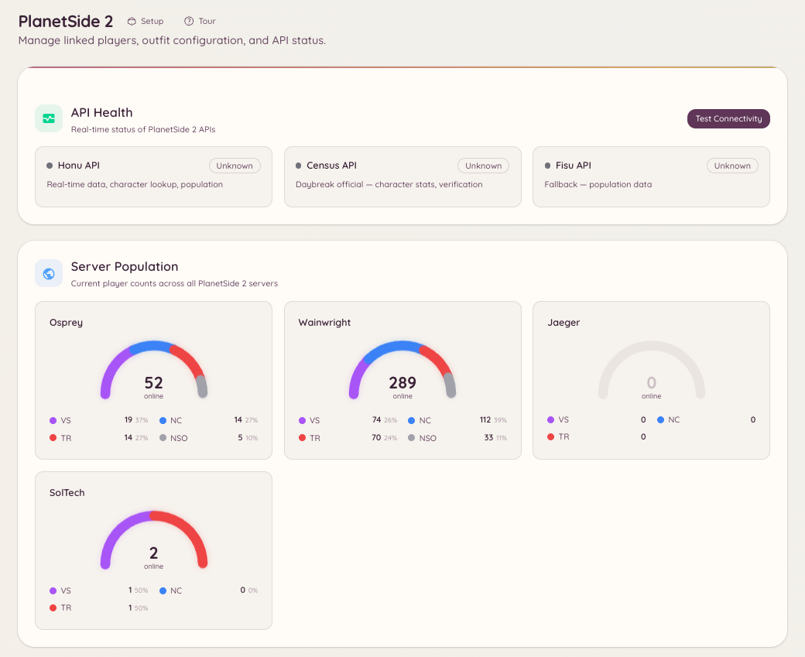

import { DashboardLink } from "/snippets/dashboard-link.jsx";

Die PlanetSide 2-Integration verbindet deinen Discord-Server mit der Census-API von Daybreak. Mitglieder bekommen damit Charakterabfragen, Werkzeuge zur Outfit-Verwaltung und Live-Daten zur Serverbevölkerung direkt in Discord.

<Frame>
  
</Frame>

## Accounts verknüpfen

Mitglieder verknüpfen ihren PlanetSide 2-Charakter mit ihrem Discord-Account:

```text
/ps2-link <character_name>
```

Nach der Verknüpfung können Mitglieder ihre eigenen Werte abrufen, ohne in den Abfragebefehlen einen Charakternamen anzugeben.

## Charakterabfrage

```text
/ps2-lookup <character_name>
```

Zeigt eine Profilkarte für den angegebenen Charakter mit:

- Battle Rank und ASP-Rang
- Outfit-Mitgliedschaft und Rang
- Fraktion
- Zeitpunkt des letzten Logins
- Kill/Death-Statistiken insgesamt

```text
/ps2-info
```

Zeigt das Profil des verknüpften Charakters (entspricht `/ps2 lookup view` mit deinem eigenen Charakternamen).

## Outfit-Verwaltung

```text
/ps2-outfit [outfit_tag]
```

Zeigt Informationen zu einem Outfit: Mitgliederzahl, Gründungsdatum, Fraktion und wie viele Mitglieder gerade online sind. Dafür brauchst du den Outfit-Tag (das kurze Kürzel mit 1 bis 4 Zeichen, nicht den vollen Namen).

```text
/ps2-promote <member> <rank>
```

Befördert ein Mitglied innerhalb des Outfits. Setzt einen passenden Offiziersrang im Outfit voraus sowie API-Berechtigungen (vergleichbar mit RCON), die unter <DashboardLink to="planetside/config">**PlanetSide \> Configuration**</DashboardLink> eingerichtet sind.

## Serverbevölkerung

```text
/ps2-population [server]
```

Zeigt die aktuelle Verteilung der Bevölkerung auf alle drei Fraktionen auf dem angegebenen Server (oder deinem eingestellten Standardserver). Die Daten kommen aus dem Echtzeit-Stream der Census-API.

Die Dashboard-Seite <DashboardLink to="planetside/status">**PlanetSide \> API Status**</DashboardLink> zeigt die Bevölkerungsdaten fortlaufend aktualisiert an.

## Einrichtung

Öffne im Dashboard <DashboardLink to="planetside/config">**PlanetSide \> Configuration**</DashboardLink>:

```text
/ps2-setup
```

Oder richte alles komplett über <DashboardLink to="planetside/config">**PlanetSide \> Configuration**</DashboardLink> ein. Die wichtigsten Einstellungen:

| Einstellung | Beschreibung |
| --- | --- |
| **Default server** (Standardserver) | Die Welt (der Server), die verwendet wird, wenn in Befehlen kein Server angegeben ist |
| **Outfit tag** (Outfit-Tag) | Der Outfit-Tag deiner Community für Outfit-Befehle |
| **Census API key** (Census-API-Schlüssel) | Optional, erhöht die Rate-Limits für API-Anfragen. Kostenlos bei Daybreak erhältlich. |

## Erforderliche Berechtigungen

| Aktion | Berechtigungsschlüssel |
| --- | --- |
| Charakterabfragen und Bevölkerung | `planetside.use` (standardmäßig erlaubt) |
| Einen Account verknüpfen | `planetside.use` (standardmäßig erlaubt) |
| Verknüpfte Spieler ansehen | `planetside.players.view_players` |
| Spielerdaten verwalten | `planetside.players.manage_players` |
| Bevölkerungsstatistiken ansehen | `planetside.monitoring.view_population` |
