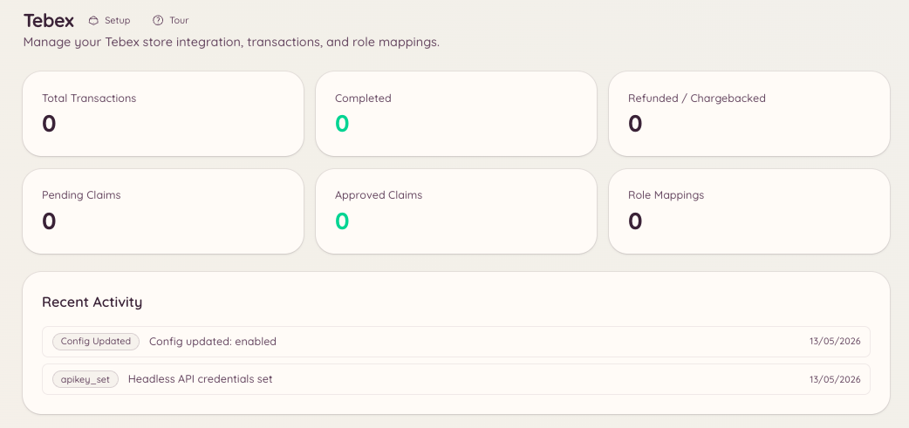

import { DashboardLink } from "/snippets/dashboard-link.jsx";

Die Tebex-Integration verbindet deinen Tebex-Spieleshop mit Discord. Das Team kann Transaktionen nachschlagen, Geschenkkarten ausstellen und manuelle Einlösungen bearbeiten, ohne Discord zu verlassen. Mitglieder können den Status ihrer eigenen Käufe prüfen.

<Frame>
  
</Frame>

## Einrichtung

Öffne im Dashboard <DashboardLink to="tebex/config">**Tebex \> Configuration**</DashboardLink> und gib deinen Tebex-API-Schlüssel ein. Den Schlüssel findest du in deinem Tebex-Shop im Bereich **Settings \> API Keys**.

```text
/tebex
```

Der Basisbefehl bietet über ein interaktives Panel Zugriff auf alle Tebex-Unterbefehle.

## Transaktionen

```text
/tebex transaction lookup <transaction_id>
```

Sucht eine bestimmte Transaktion anhand ihrer Tebex-Transaktions-ID. Ergebnis:

- Das gekaufte Paket
- Name und E-Mail-Adresse des Käufers
- Kaufdatum
- Zahlungsbetrag und Währung
- Aktueller Status der Transaktion

Öffne im Dashboard <DashboardLink to="tebex/transactions">**Tebex \> Transactions**</DashboardLink>, um Transaktionen zu durchsuchen, nach Käufer zu suchen und nach Zeitraum oder Paket zu filtern.

## Geschenkkarten

```text
/tebex giftcard create <amount>
/tebex giftcard lookup <code>
```

| Unterbefehl | Beschreibung |
| --- | --- |
| `create` | Erstellt eine neue Geschenkkarte über den angegebenen Betrag in der Währung deines Shops |
| `lookup` | Prüft das aktuelle Guthaben und das Ablaufdatum eines bestehenden Geschenkkarten-Codes |

Geschenkkarten-Codes werden über die Tebex-API erzeugt und können direkt an Mitglieder verteilt werden.

## Einlösungen

Mit Einlösungen (Claims) vergibst du Pakete manuell an Mitglieder. Öffne im Dashboard <DashboardLink to="tebex/claims">**Tebex \> Claims**</DashboardLink> oder nutze den Tebex-Slash-Befehl, um offene Einlösungen zu verwalten.

## Rollen-Zuordnungen

Rollen-Zuordnungen vergeben automatisch Discord-Rollen, wenn ein Mitglied ein bestimmtes Tebex-Paket kauft. Du richtest sie unter <DashboardLink to="tebex/mappings">**Tebex \> Role Mappings**</DashboardLink> ein.

Jede Zuordnung legt fest:

| Einstellung | Beschreibung |
| --- | --- |
| **Package** (Paket) | Das Tebex-Paket, das die Zuordnung auslöst |
| **Role to grant** (Zu vergebende Rolle) | Die Discord-Rolle, die beim Kauf vergeben wird |
| **Role to remove** (Zu entfernende Rolle) | Eine optionale Discord-Rolle, die beim Kauf entfernt wird (praktisch beim Upgrade auf eine höhere Mitgliedsstufe) |
| **Persistent** (Dauerhaft) | Ob die Rolle dauerhaft vergeben wird oder entfernt werden soll, wenn das Abo des Mitglieds ausläuft |

Bei Abo-Paketen kann Heimdall die Rolle optional entfernen, wenn das Abo abläuft oder gekündigt wird. Dafür muss dein Tebex-Webhook so eingerichtet sein, dass er Abo-Ereignisse sendet.

## Erforderliche Berechtigungen

| Aktion | Berechtigungsschlüssel |
| --- | --- |
| Shop-Informationen ansehen | `tebex.store.view_store` |
| Shop-Einstellungen verwalten | `tebex.store.manage_store` |
| Transaktionsverlauf ansehen | `tebex.store.view_transactions` |
| Geschenkkarten ausstellen und Einlösungen bearbeiten | `tebex.store.manage_claims` |
