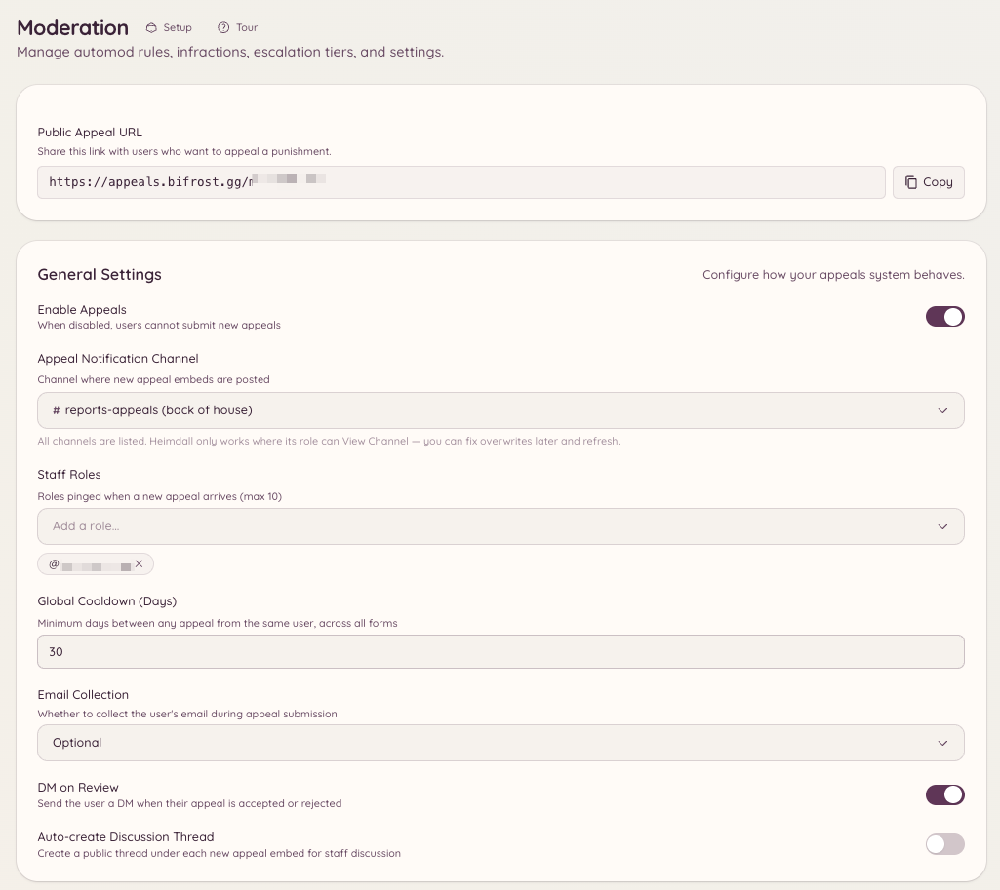

import { DashboardLink } from "/snippets/dashboard-link.jsx";

Das Einspruchssystem gibt gebannten Mitgliedern die Möglichkeit, ihren Bann über ein Formular anzufechten, statt sich direkt beim Team melden zu müssen. Einreichungen landen zur Prüfung durch das Team unter <DashboardLink to="appeals/submissions">**Appeals \> Submissions**</DashboardLink>, und die Einspruchsseite (eine eigene Weboberfläche, die ohne Discord-Account erreichbar ist) stellt das Formular für Mitglieder bereit.

<Frame>
  
</Frame>

## So funktioniert es für Mitglieder

Wird ein Mitglied gebannt, kann es die URL der Heimdall-Einspruchsseite aufrufen und ein Einspruchsformular absenden. Das Formular ist erreichbar, ohne bei Discord eingeloggt zu sein, es funktioniert also auch nach einem Bann. Das Mitglied gibt seinen Discord-Nutzernamen, den Server, von dem es gebannt wurde, und die Felder deines Einspruchsformulars an und sendet ab.

Der eingereichte Einspruch erscheint zur Prüfung durch das Team unter <DashboardLink to="appeals/submissions">**Appeals \> Submissions**</DashboardLink>.

## Das Einspruchssystem einrichten

Geh im Dashboard zu <DashboardLink to="appeals/config">**Appeals \> Configuration**</DashboardLink>.

### Das Einspruchsformular einrichten

Öffne <DashboardLink to="appeals/forms">**Appeals \> Forms**</DashboardLink>, um die Fragen deines Einspruchsformulars festzulegen. Jede Frage hat:

- **Label** (Beschriftung): der Fragetext, den die einreichende Person sieht
- **Type** (Typ): kurzer Text, langer Text oder Auswahl
- **Required** (Pflichtfeld): ob die Frage vor dem Absenden beantwortet werden muss

Typische Fragen sind: „Warum wurdest du gebannt?“, „Warum sollte dein Bann aufgehoben werden?“ und „Was wirst du anders machen?“

### Dein Einspruchslink

Hier gibt es nichts einzurichten. Jeder Server bekommt seinen eigenen Link auf der Einspruchsseite. Er steht als **Public Appeal URL** auf <DashboardLink to="appeals/config">**Appeals \> Configuration**</DashboardLink>, mit einem Button zum Kopieren. Ein White-Label-Bot nutzt seine eigene Einspruchsadresse, sobald eine eingerichtet ist.

Wie ein gebanntes Mitglied den Link per DM bekommt, hängt davon ab, wie es gebannt wurde:

- **Mit Heimdall** (`/ban` oder das Dashboard): Der Link steht in der Straf-DM, die nur verschickt wird, solange **DM on Infraction** unter <DashboardLink to="moderation/settings">**Moderation \> Settings**</DashboardLink> eingeschaltet ist. Stummschaltungen enthalten ihn auch.
- **Außerhalb von Heimdall** (über Discord selbst oder einen anderen Bot): Solange Einsprüche aktiviert sind, schickt Heimdall eine eigene Bann-Benachrichtigung per DM mit dem Link.
- **Automatisch** (Leave-Banns, Eskalation, Automod): Es wird keine DM verschickt. Teil den Link also selbst, wenn das Mitglied Einspruch einlegen können soll.

Beide DMs lassen sich unter <DashboardLink to="settings/messages">**Settings \> Messages**</DashboardLink> umformulieren, als **Punishment DM** und **Ban notification DM**.

## Einsprüche im Dashboard prüfen

Geh zu <DashboardLink to="appeals/submissions">**Appeals \> Submissions**</DashboardLink>. Jeder Einspruch zeigt:

- Den angegebenen Discord-Nutzernamen und die ID der einreichenden Person
- Das Datum der Einreichung
- Alle Antworten im Formular

Im Prüfbereich kannst du:

- **Approve** (Annehmen): das Mitglied entbannen und ihm optional eine DM mit einer Anleitung zum erneuten Beitreten schicken
- **Deny** (Ablehnen): die Entscheidung festhalten und optional einen Ablehnungsgrund schicken
- **Mark under review** (Als in Prüfung markieren): den Einspruch als offen markieren, während das Team darüber spricht

### Verknüpfte Fälle

Jeder Einspruch ist mit dem [Fall](/de/moderation/cases) verknüpft, um den es geht, und der Prüfbereich zeigt die Nummer dieses Falls mit einem Link dorthin. Der Link auf einem Bann-Bildschirm im Spiel und in jeder Zeile deiner Bann-Seite nennt den Fall. Ein Einspruch ohne Fall wird dem offenen Bann oder der offenen Stummschaltung des Mitglieds zugeordnet und immer nur mit einem Fall verknüpft, der das einspruchsführende Mitglied oder einen mit ihm verknüpften Account betrifft.

Wird der Einspruch angenommen, wird dieser Fall auf der Plattform aufgehoben, von der er stammt: ein Entbannen oder das Aufheben einer Stummschaltung auf Discord oder ein Widerruf in Minecraft. Der Fall zeigt den Einspruch und sein Ergebnis in seiner Zeitleiste. Schlägt das Aufheben fehl, zum Beispiel weil dem Bot eine Berechtigung fehlt, bleibt der Fall aktiv, und der Einspruch ist trotzdem darin festgehalten.

## Einspruchsformular per Befehl

```text
/appeals config
```

Öffnet das Konfigurations-Panel für Einsprüche in Discord, sodass du schnell an die Formulareinstellungen kommst, ohne ins Dashboard zu wechseln.

## Erforderliche Berechtigungen

| Aktion | Berechtigungsschlüssel |
| --- | --- |
| Einreichungen von Einsprüchen ansehen | `appeals.submissions.view` |
| Einsprüche prüfen und bearbeiten | `appeals.submissions.manage` |
| Das Einspruchsformular einrichten | `appeals.forms.manage_forms` |
| Dashboard-Konfiguration ansehen | `appeals.config.view_config` |
