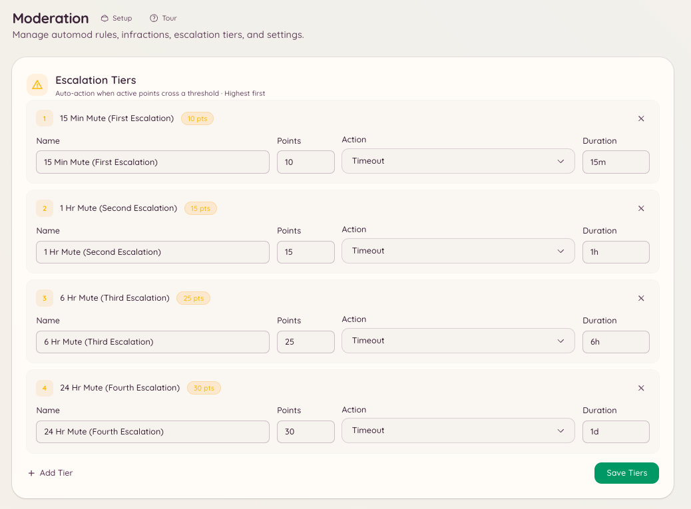

import { DashboardLink } from "/snippets/dashboard-link.jsx";

Die Eskalation automatisiert den Weg von kleinen Verwarnungen zu ernsten Strafen. Du legst Schwellen fest, also Punktsummen, und die Strafe, die der Bot verhängen soll, sobald die aktiven Punkte eines Mitglieds die jeweilige Schwelle erreichen. So muss das Team Strafen nicht von Hand verschärfen, und die Regeln werden einheitlich durchgesetzt.

<Frame>
  
</Frame>

## So funktioniert es

Jede Verwarnung, jeder Automod-Verstoß und jeder manuelle Verstoß bringt eine bestimmte Punktzahl. Punkte sind nicht dauerhaft: Jeder Verstoß hat eine Ablaufzeit, nach der seine Punkte nicht mehr zur Summe des Mitglieds zählen. Überschreitet die Summe der aktiven Punkte eines Mitglieds eine eingerichtete Schwelle, verhängt der Bot sofort die passende Strafe.

Die Eskalation greift jedes Mal erneut, wenn ein neuer Verstoß das Mitglied über eine Schwelle bringt. Wurde ein Mitglied bei 10 Punkten stummgeschaltet und erreicht dann 20 Punkte, greift die Aktion für 20 Punkte. Die frühere Strafe setzt die Schwelle nicht zurück.

## Eskalationsschwellen einrichten

Geh im Dashboard zu <DashboardLink to="moderation/escalation">**Moderation \> Escalation**</DashboardLink> und klick auf **New Threshold**.

Jede Schwelle hat diese Einstellungen:

| Einstellung | Beschreibung |
| --- | --- |
| **Points** (Punkte) | Die Summe aktiver Punkte, bei der diese Schwelle greift. |
| **Action** (Aktion) | Die Strafe: Warn (Verwarnung), Mute (Stummschaltung), Kick oder Ban (Bann). |
| **Duration** (Dauer) | Bei Mute und befristetem Bann, wie lange die Strafe dauert. |
| **Reason** (Grund) | Der Grund, der im Verstoß-Log festgehalten und an das Mitglied geschickt wird. |

### Beispielkonfiguration

| Punkte | Aktion | Dauer |
| --- | --- | --- |
| 5 | Mute | 1 Stunde |
| 10 | Mute | 24 Stunden |
| 20 | Kick | - |
| 30 | Ban | 7 Tage |
| 50 | Ban | Dauerhaft |

In diesem Beispiel wird ein Mitglied, das innerhalb der Ablaufzeit fünf Verwarnungen zu je 1 Punkt bekommt, automatisch für eine Stunde stummgeschaltet. Sammelt es nach dem Ende der Stummschaltung weiter Punkte, greift die Schwelle bei 10 Punkten, und die Stummschaltung dauert 24 Stunden.

## Punktwerte von Verstößen

Eine manuelle Verwarnung ist 1 Punkt wert, solange der Moderator nicht `points` setzt. Automod-Regeln legen ihren eigenen Wert unter <DashboardLink to="moderation/rules">**Moderation \> Rules**</DashboardLink> fest. Eine ernste Regel kann zum Beispiel 10 Punkte pro Verstoß vergeben statt 1.

## Ablauf der Punkte

Die Ablaufzeit der Punkte wird festgelegt, wenn der Verstoß erstellt wird. Verstöße aus Automod-Regeln nutzen die Ablaufzeit, die bei der jeweiligen Regel eingestellt ist. Bei manuellen Aktionen kann das Teammitglied eine Ablaufzeit angeben oder den Standard des Servers nutzen.

Punkte aus abgelaufenen Verstößen werden automatisch von der laufenden Summe des Mitglieds abgezogen. Das Team kann eine Verwarnung auch vorzeitig erlassen: Öffne ihren Fall unter <DashboardLink to="cases/list">**Cases \> All cases**</DashboardLink> und drück auf **Pardon**, dann zählen ihre Punkte nicht mehr.

## Erforderliche Berechtigungen

| Aktion | Berechtigungsschlüssel |
| --- | --- |
| Eskalations-Konfiguration ansehen | `moderation.config.view_config` |
| Schwellen erstellen und bearbeiten | `moderation.enforcement.manage_rules` |
