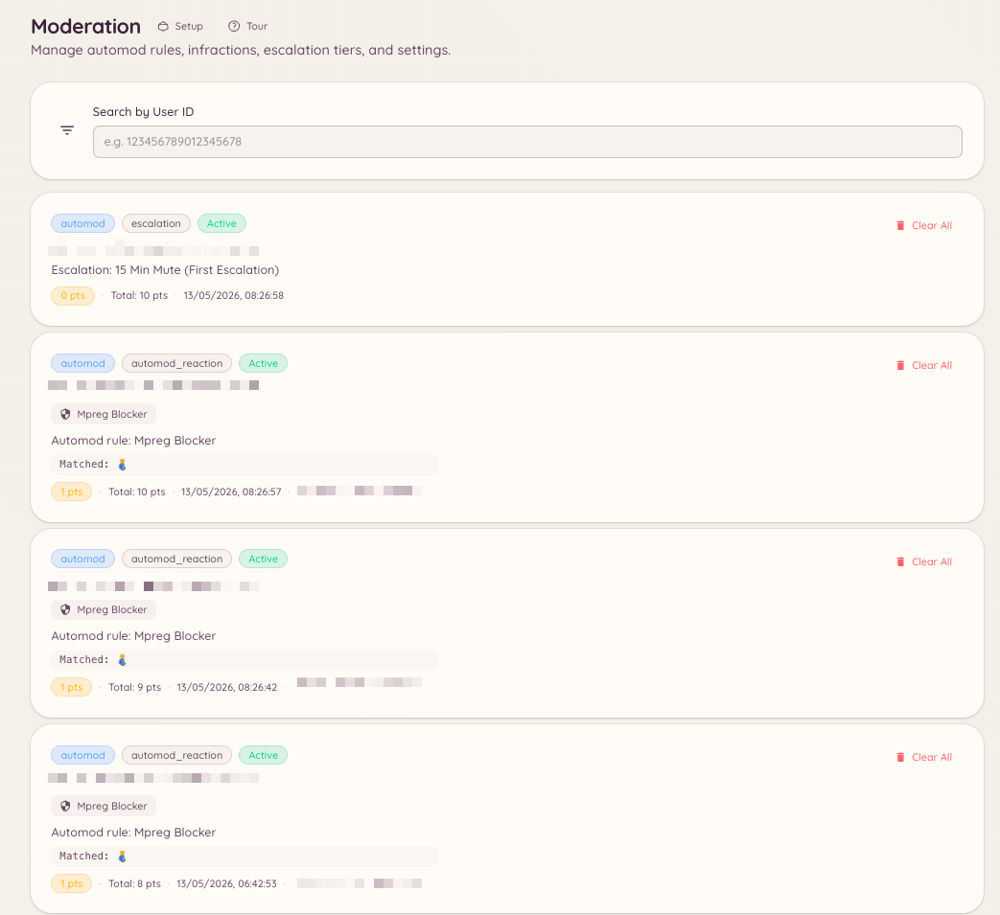

import { DashboardLink } from "/snippets/dashboard-link.jsx";

Jede Moderationsaktion in Heimdall, ob von einem Teammitglied ausgeführt oder von einer Automod-Regel ausgelöst, legt einen Verstoß-Eintrag an. Der Verstoß-Verlauf gibt dem Team ein vollständiges Bild der Moderationsakte eines Mitglieds, einschließlich der aktuellen aktiven Punktzahl.

<Frame>
  
</Frame>

## Die Verstöße eines Mitglieds ansehen

### Per Slash-Befehl

```text
/infractions <user>
```

Zeigt die Fälle des Mitglieds direkt in Discord an, auf Discord und auf jedem verknüpften Minecraft-Account, zusammen mit seiner aktiven Punktzahl. Es ist dasselbe Panel wie bei `/case lookup`.

### Über das Dashboard

Jeder Verstoß ist auch ein [Fall](/de/moderation/cases). Öffne im Dashboard <DashboardLink to="cases/list">**Cases \> All cases**</DashboardLink>. Such nach einem Mitglied und öffne es, um alle seine Fälle zu sehen, auf Discord und auf jedem verknüpften Minecraft-Account, mit seiner aktuellen aktiven Punktzahl.

## Verstöße verwalten

Auf der Seite eines Mitglieds kann ein Teammitglied mit `moderation.enforcement.manage_infractions` **Clear active infractions** (aktive Verstöße löschen) wählen. Damit werden die aktiven Punkte des Mitglieds auf null zurückgesetzt.

In einem einzelnen Fall kannst du Notizen und Beweise hinzufügen, den Grund ändern und eine Verwarnung erlassen, sodass ihre Punkte nicht mehr zählen. Siehe [Fälle](/de/moderation/cases).

## Punkte direkt setzen

```text
/setpoints <user> <points>
```

Setzt die aktive Verstoß-Punktzahl eines Mitglieds auf einen bestimmten Wert, ohne über einzelne Verstoß-Einträge zu gehen. Das ist praktisch, um die Position eines Mitglieds im Eskalationssystem von Hand anzupassen, ohne zusätzliche Verstoß-Einträge anzulegen.

## Filtern im Dashboard

Die Fallliste lässt sich nach Plattform, Aktionstyp, Status und dem Teammitglied filtern, das die Aktion ausgeführt hat.

## Erforderliche Berechtigungen

| Aktion | Berechtigungsschlüssel |
| --- | --- |
| Verstoß-Verlauf ansehen | `moderation.config.view_config` oder `cases.view_discord` |
| Aktive Verstöße eines Mitglieds löschen, eine Verwarnung erlassen | `moderation.enforcement.manage_infractions` |
