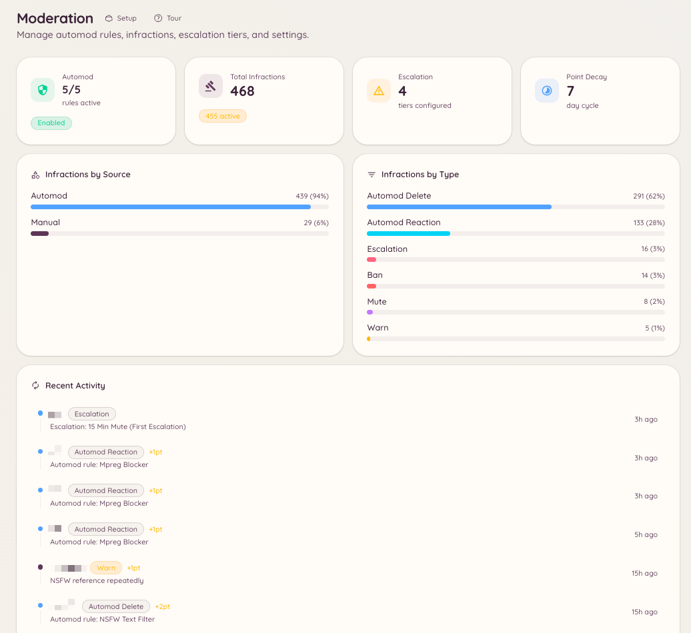

import { DashboardLink } from "/snippets/dashboard-link.jsx";

Das Moderations-Plugin von Heimdall vereint manuelle Durchsetzungsbefehle, eine automatische Regel-Engine, stufenweise Eskalation und einen vollständigen Verstoß-Verlauf. Alle diese Teile nutzen dasselbe Verstoß-System. Manuelle Verwarnungen und automatische Regelverstöße sammeln sich also in derselben Punktzahl und speisen dieselben Eskalationsschwellen.

<Frame>
  
</Frame>

## Bestandteile

<Columns cols={2}>
  <Card title="Manuelle Aktionen" icon="gavel" href="/de/moderation/manual-actions">
    Verwarnungen, Banns, Kicks, Mutes und das Löschen von Nachrichten direkt ausführen.
  </Card>

  <Card title="Automod-Regeln" icon="robot" href="/de/moderation/automod">
    Schlüsselwortfilter, Regex-Muster und Regeln für Inhaltstypen festlegen, die automatisch greifen.
  </Card>

  <Card title="Eskalation" icon="arrow-up" href="/de/moderation/escalation">
    Automatische Strafen einrichten, die greifen, wenn ein Mitglied Verstoß-Punkte sammelt.
  </Card>

  <Card title="Verstoß-Verlauf" icon="clock-rotate-left" href="/de/moderation/infractions">
    Jede Aktion gegen ein Mitglied ansehen, einschließlich Punktzahlen und Ablaufdaten.
  </Card>

  <Card title="Kanal-Steuerung" icon="lock" href="/de/moderation/channel-controls">
    Kanäle sperren, Banns für einzelne Kanäle verhängen und verhindern, dass Mitglieder Banns durch Verlassen und Wiederbeitreten umgehen.
  </Card>

  <Card title="Sticky-Nachrichten" icon="thumbtack" href="/de/moderation/stickies">
    Eine Nachricht automatisch ganz unten in einem Kanal halten.
  </Card>

  <Card title="Einsprüche" icon="scale-balanced" href="/de/moderation/appeals">
    Gebannte Mitglieder über ein strukturiertes Formular eine Überprüfung beantragen lassen.
  </Card>
</Columns>

## So funktionieren Verstöße und Punkte

Jede Moderationsaktion, ob von einem Teammitglied oder vom Automod, legt einen Verstoß-Eintrag an. Jeder Eintrag speichert die Art der Aktion, den Grund, das Teammitglied oder die Regel, die sie ausgelöst hat, einen einstellbaren Punktwert und ein optionales Ablaufdatum.

Punkte sammeln sich mit der Zeit an. Überschreitet die Summe der aktiven Punkte eines Mitglieds eine Schwelle, die du in den Eskalationseinstellungen festlegst, verhängt der Bot automatisch die zugehörige Strafe. Punkte verfallen einzeln nach der Ablauffrist des jeweiligen Verstoßes, und mit jedem verfallenen Punkt sinkt die Summe des Mitglieds.

Ein Mitglied, das im Lauf einer Woche mehrere kleine Verwarnungen bekommt, kann so einen automatischen Mute auslösen, auch wenn keine einzelne Aktion für sich eine Schwelle überschritten hat.

## Wo du es im Dashboard findest

Öffne in der Seitenleiste des Dashboards <DashboardLink to="moderation">**Moderation**</DashboardLink>. Der Moderationsbereich hat diese Seiten: <DashboardLink to="moderation/overview">**Overview**</DashboardLink>, <DashboardLink to="moderation/rules">**Rules**</DashboardLink>, <DashboardLink to="moderation/escalation">**Escalation**</DashboardLink>, <DashboardLink to="moderation/stickies">**Stickies**</DashboardLink>, <DashboardLink to="moderation/auto-responses">**Auto-Responses**</DashboardLink>, <DashboardLink to="moderation/leave-bans">**Leave Bans**</DashboardLink>, <DashboardLink to="moderation/channel-bans">**Channel Bans**</DashboardLink>, <DashboardLink to="moderation/locked-channels">**Locked Channels**</DashboardLink>, <DashboardLink to="moderation/slow-mode">**Slow Mode**</DashboardLink> und <DashboardLink to="moderation/settings">**Settings**</DashboardLink>.

Verstöße sind jetzt [Fälle](/de/moderation/cases) unter <DashboardLink to="cases/list">**Cases**</DashboardLink>, und Einsprüche gegen Banns haben einen eigenen Bereich <DashboardLink to="appeals">**Appeals**</DashboardLink>.

## Erforderliche Berechtigungen

Sowohl der Zugriff aufs Dashboard als auch die Nutzung der Befehle werden über das Berechtigungssystem von Heimdall gesteuert. Die wichtigsten Berechtigungsschlüssel für die Moderation:

| Schlüssel | Was er steuert |
| --- | --- |
| `moderation.enforcement.warn` | `/warn` ausführen |
| `moderation.enforcement.ban` | `/ban` und `/unban` ausführen |
| `moderation.enforcement.kick` | `/kick` ausführen |
| `moderation.enforcement.mute` | `/mute` ausführen |
| `moderation.enforcement.purge` | `/purge` ausführen |
| `moderation.enforcement.lock_channels` | `/lock` und `/unlock` ausführen |
| `moderation.enforcement.manage_rules` | Automod-Regeln im Dashboard erstellen und bearbeiten |
| `moderation.config.view_config` | Moderationseinstellungen im Dashboard ansehen |
