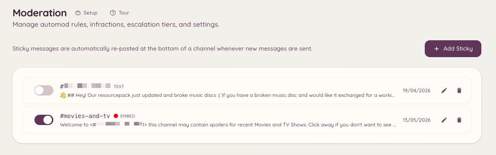

import { DashboardLink } from "/snippets/dashboard-link.jsx";

Eine Sticky-Nachricht ist eine Nachricht, die der Bot immer wieder ans Ende eines Kanals postet, sobald sie sonst aus dem Blickfeld rutschen würde. Wenn Mitglieder schreiben und die Sticky-Nachricht nach oben schieben, löscht der Bot die alte Kopie und postet unten eine neue.

Das ist praktisch, um Regeln, Anleitungen oder wichtige Ankündigungen in aktiven Kanälen festzuhalten, in denen eine normale angepinnte Nachricht in Discord leicht übersehen wird.

<Frame>
  
</Frame>

## Eine Sticky-Nachricht erstellen

```text
/sticky create [channel]
```

Dieser Befehl öffnet ein Formular, in das du den Inhalt der Nachricht eingibst. Die Nachricht unterstützt die normale Markdown-Formatierung von Discord. Nach dem Absenden postet der Bot die Sticky-Nachricht sofort im Zielkanal.

Pro Kanal kann nur eine Sticky-Nachricht aktiv sein.

## Sticky-Nachrichten im Dashboard verwalten

Geh im Dashboard zu <DashboardLink to="moderation/stickies">**Moderation \> Stickies**</DashboardLink>. Diese Seite listet alle aktiven Sticky-Nachrichten auf deinem Server. Hier kannst du:

- **Den Inhalt ansehen** von jeder Sticky-Nachricht
- **Bearbeiten**, also den Inhalt einer Sticky-Nachricht ändern
- **Löschen**, wodurch auch die gepostete Nachricht aus dem Kanal entfernt wird

## Per Befehl bearbeiten und löschen

```text
/sticky delete [channel]
```

Entfernt die aktive Sticky-Nachricht aus dem angegebenen Kanal (standardmäßig aus dem aktuellen). Der Bot löscht die zuletzt gepostete Sticky-Nachricht.

## Hinweise zum Verhalten

Der Bot postet die Sticky-Nachricht neu, sobald im Kanal eine neue Nachricht geschrieben wird. Eine kleine Verzögerung verhindert, dass der Kanal geflutet wird, wenn viele Nachrichten kurz hintereinander kommen. Bei viel Betrieb kann die Sticky-Nachricht vorübergehend einige Nachrichten über dem Ende stehen, bevor sie neu gepostet wird.

Sticky-Nachrichten werden unter dem eigenen Account des Bots gepostet. Löscht ein Moderator die Sticky-Nachricht von Hand, postet der Bot sie neu, sobald die nächste Nachricht im Kanal geschrieben wird.

## Erforderliche Berechtigungen

| Aktion | Berechtigungsschlüssel |
| --- | --- |
| Sticky-Nachrichten erstellen und löschen | `moderation.enforcement.manage_rules` |
| Sticky-Nachrichten im Dashboard ansehen | `moderation.config.view_config` |
