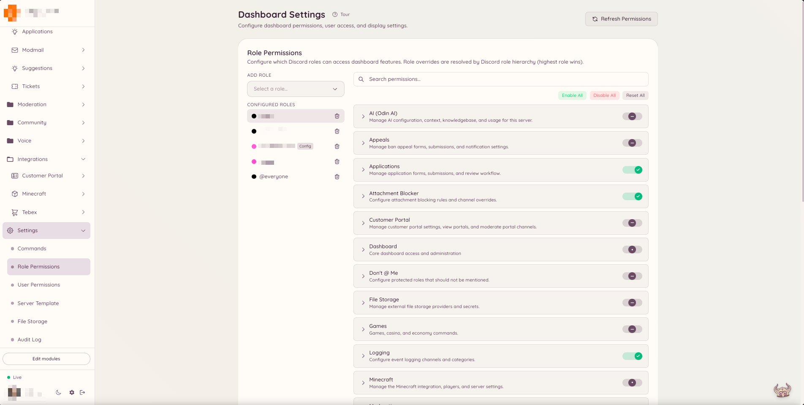

import { DashboardLink } from "/snippets/dashboard-link.jsx";

Heimdall hat ein eigenes Berechtigungssystem, das unabhängig von den nativen Rollenberechtigungen von Discord ist. Statt sich auf Berechtigungen wie **Nachrichten verwalten** oder **Mitglieder bannen** zu verlassen, prüft Heimdall, ob den Rollen eines Mitglieds ein bestimmter Heimdall-Berechtigungsschlüssel erteilt wurde. So kannst du einer eigenen Team-Rolle Moderationszugriff geben, ohne ihr weitreichende Berechtigungen auf Discord-Ebene zu erteilen.

## So funktionieren Berechtigungen

<Warning>
  **Kopier Schlüssel exakt. Setz nie einen aus dem Namen der Funktion und der Aktion zusammen.**

  {/* docs-manifest-ignore -- names the wrong form on purpose; that is the point of the line */}
  Die meisten Schlüssel haben drei Teile, nicht zwei: `confessions.log.view_author`, nicht
  `confessions.view_author`. Der mittlere Teil gehört zum Schlüssel und ist kein Hinweis
  darauf, wo er steht.

  Ein Schlüssel, den es nicht gibt, wird **stillschweigend abgelehnt**. Heimdall wertet einen
  unbekannten Schlüssel als verweigert und vermerkt ihn im Log, im Dashboard ist er also nirgends
  als falsch markiert. Das einzige Symptom ist eine Rolle, die richtig eingerichtet aussieht und
  die Funktion trotzdem nicht nutzen kann.

  [Jeder Schlüssel, genau so, wie er geschrieben werden muss](/docs/reference/permission-keys).
</Warning>


Jede Funktion in Heimdall stellt einen oder mehrere benannte Berechtigungsschlüssel bereit. Das Moderations-Plugin zum Beispiel stellt Schlüssel wie `moderation.enforcement.ban` und `moderation.enforcement.warn` bereit, das Ticket-Plugin `tickets.operations.manage_tickets` und `tickets.operations.claim_tickets`.

Diese Schlüssel weist du im Dashboard Discord-Rollen zu. Führt ein Mitglied einen Befehl aus oder öffnet einen Bereich im Dashboard, prüft Heimdall, ob einer seiner aktuellen Rollen der passende Schlüssel erteilt wurde. Wenn ja, wird die Aktion ausgeführt. Wenn nicht, antwortet der Bot mit einer Meldung, dass die Berechtigung fehlt.

## Standardzugriff

Manche Funktionen stehen standardmäßig allen Mitgliedern zur Verfügung. Das sind meist Funktionen für Mitglieder, zum Beispiel einen Vorschlag erstellen, ein Ticket öffnen, die Spielbefehle nutzen oder eine Übersetzung anfordern. Für diese Funktionen ist **default allow** (standardmäßig erlaubt) aktiv, und sie brauchen keine ausdrückliche Berechtigung.

Funktionen für das Team und für Administratoren sind standardmäßig eingeschränkt. Kein Mitglied kann einen `ban`-Befehl ausführen, Automod-Regeln verwalten oder den Bereich <DashboardLink to="moderation">**Moderation**</DashboardLink> im Dashboard öffnen, solange seiner Rolle nicht der passende Berechtigungsschlüssel erteilt wurde.

<Info>
  Mitglieder mit der Discord-Berechtigung **Administrator** umgehen alle Berechtigungsprüfungen von Heimdall und haben immer vollen Zugriff.
</Info>

## Berechtigungen einrichten

<Steps>
  <Step title="Settings öffnen">
    Klick in der Seitenleiste des Dashboards auf <DashboardLink to="settings">**Settings**</DashboardLink>. Die Settings-Seite ordnet die Einstellungen in mehreren Tabs oben auf der Seite.
  </Step>
  <Step title="Den Tab für Rollen oder Nutzer wählen">
    Wähle den Tab <DashboardLink to="settings/roles">**Role Permissions**</DashboardLink>, um Berechtigungen auf Rollenebene zu überschreiben, oder den Tab <DashboardLink to="settings/users">**User Permissions**</DashboardLink> für Überschreibungen pro Nutzer. Nutzer-Überschreibungen haben Vorrang vor allen rollenbasierten Berechtigungen und sind praktisch, um einer bestimmten Person unabhängig von ihren Rollen Zugriff zu geben oder zu sperren.
  </Step>
  <Step title="Eine Rolle oder einen Nutzer auswählen">
    Wähle im Dropdown die Discord-Rolle (oder den bestimmten Nutzer), die du einrichten willst. Darunter erscheinen alle verfügbaren Berechtigungsschlüssel, nach Plugin gruppiert.
  </Step>
  <Step title="Überschreibungen setzen">
    Jeder Berechtigungsschlüssel hat einen Schalter mit drei Stellungen: **Allow**, **Deny** oder **Default**. Allow erteilt die Berechtigung. Deny entzieht sie, auch wenn der Systemstandard den Zugriff sonst erlauben würde. Default richtet sich nach der systemweiten Einstellung für diesen Schlüssel: Die meisten Schlüssel stehen standardmäßig auf verweigert für Team-Aktionen und auf erlaubt für Funktionen für Mitglieder.
  </Step>
  <Step title="Änderungen speichern">
    Wenn alles passt, klick auf **Save** in der Speicherleiste, die unten auf der Seite erscheint. Die Änderungen gelten sofort für jedes Mitglied mit der eingerichteten Rolle.
  </Step>
</Steps>

<Frame>
  
</Frame>

## Berechtigungsschlüssel nach Bereich

Die Dokumentationsseite jeder Funktion listet die Berechtigungsschlüssel auf, die sie nutzt. Die Schlüssel folgen einem einheitlichen Namensschema:

```text
<plugin>.<action>
```

Zum Beispiel:

- `moderation.enforcement.ban`: darf `/ban` ausführen
- `tickets.operations.manage_tickets`: darf alle Tickets im Dashboard verwalten
- `modmail.analytics.view_analytics`: darf die Modmail-Analysen ansehen

## Rollenhierarchie

Heimdall berücksichtigt alle aktuellen Rollen eines Mitglieds. Wurde einer seiner Rollen die Berechtigung erteilt, ist das Mitglied berechtigt. Innerhalb des Berechtigungssystems gibt es keine Rollenhierarchie, es ist rein additiv. Entfernst du eine Rolle, fällt diese Quelle von Berechtigungen weg, andere Rollen des Mitglieds können den Zugriff aber weiterhin gewähren.

## Standards überschreiben

Willst du eine Funktion einschränken, die standardmäßig allen Mitgliedern erlaubt ist (zum Beispiel, weil du begrenzen willst, wer den KI-Befehl `/ask` nutzen darf), kannst du für diesen Berechtigungsschlüssel den Schalter **Restricted** aktivieren. Danach haben nur noch Rollen Zugriff, die du ausdrücklich zuweist.
