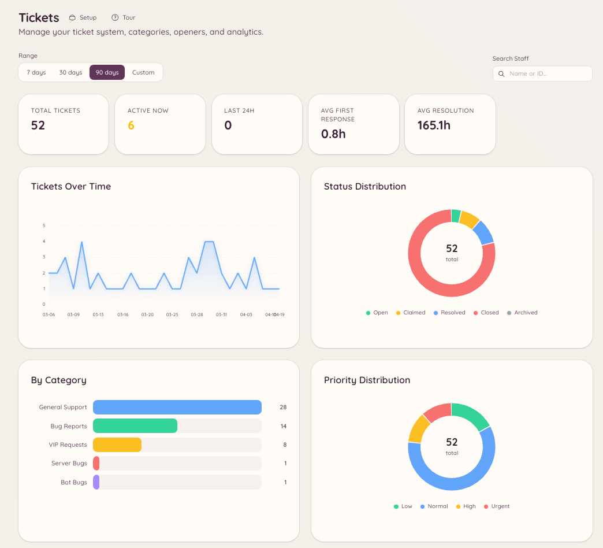

import { DashboardLink } from "/snippets/dashboard-link.jsx";

Sowohl das Ticket- als auch das Modmail-Plugin haben eine Analyse-Ebene, die Aufkommen, Antwortzeiten und die Aktivität des Teams erfasst. Die Analysen geben Server-Administratoren objektive Daten dazu, wie gut der Support läuft und welche Teammitglieder am meisten beitragen.

## Analysen aufrufen

- Ticket-Analysen: <DashboardLink to="tickets/analytics">**Tickets \> Analytics**</DashboardLink>
- Modmail-Analysen: <DashboardLink to="modmail/analytics">**Modmail \> Analytics**</DashboardLink>

Beide Bereiche haben denselben Aufbau und dieselben Arten von Kennzahlen.

<Frame>
  
</Frame>

## Erfasste Kennzahlen

### Aufkommen

| Kennzahl | Beschreibung |
| --- | --- |
| **Total opened** (Insgesamt geöffnet) | Anzahl der Tickets oder Threads, die im gewählten Zeitraum geöffnet wurden |
| **Total closed** (Insgesamt geschlossen) | Anzahl der im gewählten Zeitraum gelösten |
| **Open at end of period** (Offen am Ende des Zeitraums) | Tickets, die am Ende des Zeitraums noch ungelöst waren |
| **Daily breakdown** (Tägliche Aufschlüsselung) | Diagramm mit Öffnungen und Schließungen pro Tag |

### Antwortzeiten

| Kennzahl | Beschreibung |
| --- | --- |
| **First response time** (Erste Antwortzeit) | Wie lange es vom Erstellen des Tickets dauert, bis ein Teammitglied die erste Nachricht schickt |
| **Average handle time** (Durchschnittliche Bearbeitungszeit) | Gesamtdauer vom Öffnen bis zum Schließen |
| **SLA compliance** (SLA-Einhaltung) | Anteil der Tickets, bei denen die erste Antwort innerhalb deines festgelegten Ziels kam |

SLA-Ziele legst du unter <DashboardLink to="tickets/config">**Tickets \> Configuration**</DashboardLink> oder <DashboardLink to="modmail/config">**Modmail \> Configuration**</DashboardLink> als Dauer fest (z. B. 2 Stunden für die erste Antwort).

### Leistung des Teams

Die Tabelle zur Teamleistung zeigt für jedes Teammitglied:

- Anzahl der übernommenen oder zugewiesenen Tickets
- Durchschnittliche erste Antwortzeit
- Durchschnittliche Bearbeitungszeit
- Anzahl der geschlossenen Tickets
- Bewertungsdurchschnitt (falls Bewertungen aktiviert sind)

Klick auf die Zeile eines Teammitglieds, um seinen einzelnen Ticketverlauf zu öffnen.

## Zufriedenheitsbewertungen

Wird ein Ticket oder Modmail-Thread geschlossen, kann das Mitglied eingeladen werden, eine Zufriedenheitsbewertung abzugeben. Die Bewertung erscheint als Sternewertung von 1 bis 5, zusammen mit einem optionalen Kommentar.

### Bewertungen aktivieren

Öffne <DashboardLink to="tickets/config">**Tickets \> Configuration**</DashboardLink> oder <DashboardLink to="modmail/config">**Modmail \> Configuration**</DashboardLink> und schalte die Bewertungen ein (**Enable Ticket Reviews** für Tickets, **Enable Reviews** für Modmail). Außerdem kannst du festlegen:

- **Review Channel**: wo abgegebene Bewertungen gepostet werden
- **Require Moderation**: Bewertungen zurückhalten, bis das Team sie freigibt, bevor sie gepostet werden, im **Moderation Channel**, den du auswählst
- **Button emoji**: das Emoji auf dem Bewertungs-Button
- **Review fields**: die Fragen, die bewertet werden. Lass die Liste leer für eine einzige Gesamtbewertung in Sternen

### Bewertungen ansehen

Bewertungen erscheinen unter <DashboardLink to="tickets/reviews">**Tickets \> Reviews**</DashboardLink> und <DashboardLink to="modmail/analytics">**Modmail \> Analytics**</DashboardLink>. Die Bewertungsseite zeigt jede Bewertung, das zugehörige Ticket und alle Kommentare des Mitglieds.

## Nach Zeitraum filtern

Alle Analyseseiten lassen sich nach Zeitraum filtern. Wähle eine Vorgabe (letzte 7 Tage, letzte 30 Tage, letzte 90 Tage) oder lege einen eigenen Zeitraum fest. Die Kennzahlen aktualisieren sich sofort, wenn sich der Zeitraum ändert.

## Erforderliche Berechtigungen

| Aktion | Berechtigungsschlüssel |
| --- | --- |
| Ticket-Analysen ansehen | `tickets.analytics.view_analytics` |
| Modmail-Analysen ansehen | `modmail.analytics.view_analytics` |
| Bewertungen verwalten | `tickets.operations.manage_reviews`, `modmail.management.manage_reviews` |
