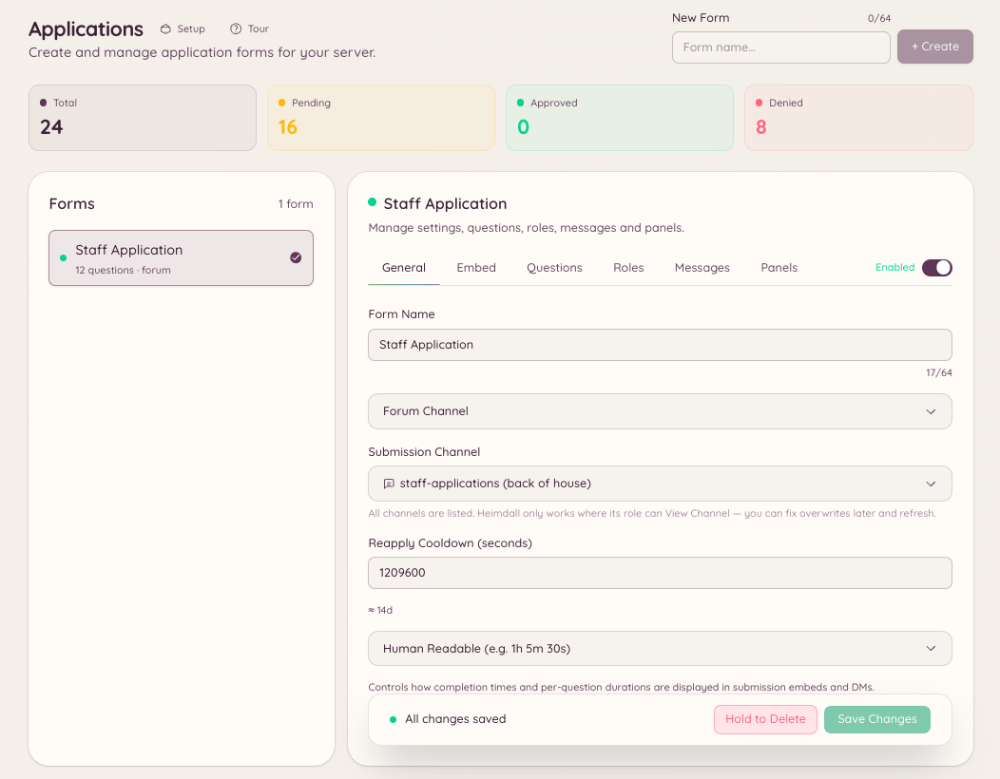

import { DashboardLink } from "/snippets/dashboard-link.jsx";

Mit dem Bewerbungs-Plugin erstellst du Formulare, die Mitglieder ausfüllen und dem Team zur Prüfung schicken. Nutz es für Team-Bewerbungen, Event-Anmeldungen, Allowlist-Anfragen oder jede Situation, in der du strukturierte Informationen von Mitgliedern brauchst.

<Frame>
  
</Frame>

## So funktionieren Bewerbungen

Du erstellst im Dashboard unter <DashboardLink to="applications">**Applications**</DashboardLink> ein Formular mit so vielen Fragen wie nötig. Mitglieder erreichen das Formular, indem sie `/application` ausführen und das Formular wählen, für das sie sich bewerben wollen. Nach dem Absenden erscheinen ihre Antworten unter <DashboardLink to="applications">**Applications**</DashboardLink>, wo das Team sie prüft, annimmt oder ablehnt. Die Mitglieder erfahren die Entscheidung per DM.

## Ein Formular erstellen

Geh im Dashboard zu <DashboardLink to="applications">**Applications**</DashboardLink> und klick auf **New Form**.

| Einstellung | Beschreibung |
| --- | --- |
| **Name** | Der Anzeigename des Formulars, den Mitglieder bei der Auswahl sehen |
| **Description** (Beschreibung) | Eine kurze Erklärung, wofür das Formular gedacht ist |
| **Channel** (Kanal) | Wo Benachrichtigungen über Einreichungen für das Team gepostet werden |
| **Questions** (Fragen) | Die Felder, die Mitglieder ausfüllen (kurzer Text, langer Text oder Auswahl) |
| **Review roles** (Prüfrollen) | Welche Rollen Einreichungen annehmen oder ablehnen können |
| **Acceptance message** (Annahmenachricht) | DM an das Mitglied, wenn seine Bewerbung angenommen wird |
| **Rejection message** (Ablehnungsnachricht) | DM an das Mitglied, wenn seine Bewerbung abgelehnt wird |

### Fragetypen

| Typ | Beschreibung |
| --- | --- |
| **Short text** (Kurzer Text) | Ein einzeiliges Textfeld, bis zu 256 Zeichen |
| **Long text** (Langer Text) | Ein mehrzeiliges Textfeld, bis zu 4000 Zeichen |
| **Multiple choice** (Auswahl) | Das Mitglied wählt eine Option aus einer festgelegten Liste |

## Eine Bewerbung absenden

```text
/application list
/application post <form>
```

`/application list` zeigt dem Mitglied alle verfügbaren Formulare. `/application post` öffnet das gewählte Formular als interaktives Formularfenster in Discord. Das Mitglied füllt jedes Feld aus und sendet ab. Hat das Formular mehr Felder, als in ein einzelnes Discord-Formularfenster passen, wird die Einreichung auf mehrere Schritte verteilt.

## Einreichungen prüfen

Geh im Dashboard zu <DashboardLink to="applications">**Applications**</DashboardLink>. Jede Einreichung zeigt alle Antworten, den Discord-Nutzernamen des Bewerbers und den Zeitpunkt der Einreichung. Im Prüfbereich gibt es:

- **Approve** (Annehmen): markiert die Einreichung als angenommen und schickt dem Bewerber die Annahme-DM
- **Decline** (Ablehnen): markiert die Einreichung als abgelehnt und schickt die Ablehnungs-DM
- **Pending** (Offen): noch nichts entschieden, für alle Prüfenden sichtbar

## Erforderliche Berechtigungen

| Aktion | Berechtigungsschlüssel |
| --- | --- |
| Eine Bewerbung absenden | Keine Berechtigung nötig |
| Formulare und Einreichungen ansehen | `applications.view` |
| Einreichungen annehmen und ablehnen | `applications.review` |
| Formulare erstellen, bearbeiten und posten | `applications.manage` |
