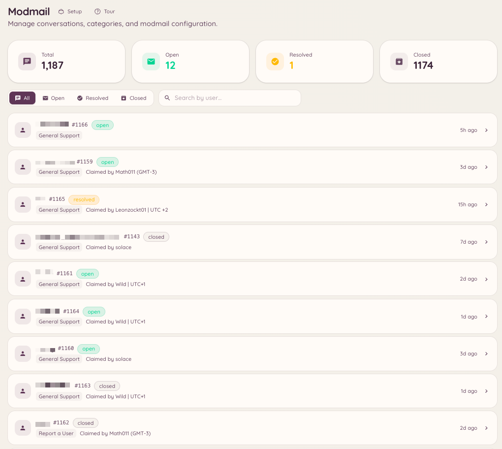

import { DashboardLink } from "/snippets/dashboard-link.jsx";

Modmail gibt Mitgliedern einen privaten Draht zu deinem Team über Discord-Direktnachrichten. Schreibt ein Mitglied dem Bot eine DM, wird in einem festgelegten Forumkanal auf deinem Server ein Thread erstellt. Das Team antwortet in diesem Thread, und der Bot leitet die Nachrichten per DM an das Mitglied weiter. Mitglied und Team sehen dabei nie die Server des anderen: Aus Sicht des Mitglieds führt es ein privates Gespräch mit dem Bot.

<Frame>
  
</Frame>

## So funktioniert es für Mitglieder

Ein Mitglied schickt dem Heimdall-Bot eine Direktnachricht. Der Bot bestätigt, dass ein Support-Thread eröffnet wurde, und sagt dem Mitglied, dass das Team antworten wird. Alle weiteren Nachrichten des Mitglieds werden an den Team-Thread weitergeleitet. Antwortet das Team im Thread, erscheinen die Nachrichten im DM-Verlauf des Mitglieds, als hätte der Bot sie geschickt.

Mitglieder können nicht erkennen, welches Teammitglied sich um ihr Anliegen kümmert, außer das Team gibt sich in seinen Nachrichten selbst zu erkennen.

## Einrichtung

### Grundkonfiguration

Geh im Dashboard zu <DashboardLink to="modmail/config">**Modmail \> Configuration**</DashboardLink>. Die wichtigsten Einstellungen sind:

| Einstellung | Beschreibung |
| --- | --- |
| **Forum channel** (Forumkanal) | Der Kanal, in dem Modmail-Threads erstellt werden. Muss ein Discord-Forumkanal sein. |
| **Staff roles** (Team-Rollen) | Rollen, die Modmail-Threads sehen und darin antworten können |
| **Opening message** (Eröffnungsnachricht) | Die DM, die das Mitglied bekommt, wenn sein Thread zum ersten Mal eröffnet wird |
| **Auto-close** (Automatisch schließen) | Threads automatisch schließen, die eine bestimmte Zeit lang inaktiv waren |
| **Anonymous replies** (Anonyme Antworten) | Verbergen, welches Teammitglied eine Antwort geschickt hat (standardmäßig an) |

### Kategorien

Mit Modmail-Kategorien leitest du verschiedene Arten von DMs an verschiedene Forumkanäle oder Teams weiter. Geh zu <DashboardLink to="modmail/categories">**Modmail \> Categories**</DashboardLink> und leg Kategorien für verschiedene Support-Bereiche an. Eröffnet ein Mitglied eine Modmail, wird es gebeten, eine Kategorie zu wählen, wenn mehr als eine eingerichtet ist.

### Autoantworten

Autoantworten sind vorgefertigte Nachrichten, die der Bot automatisch anhand von Schlüsselwörtern in der ersten Nachricht des Mitglieds schickt. Geh zu <DashboardLink to="modmail/auto-responses">**Modmail \> Auto-responses**</DashboardLink>, um sie einzurichten. Autoantworten schließen den Thread nicht: Sie liefern erste Informationen, während das Team übernimmt.

## Slash-Befehle

```text
/modmail open <user>
/modmail close [reason]
/modmail ban <user> [reason]
/modmail unban <user>
/modmail note <content>
/modmail snippet <name>
/modmail transfer <category>
```

| Unterbefehl | Beschreibung |
| --- | --- |
| `open` | Einen Modmail-Thread für ein Mitglied eröffnen, ohne dass es selbst schreibt |
| `close` | Den aktuellen Thread schließen und dem Mitglied eine Abschluss-DM schicken |
| `ban` | Ein Mitglied daran hindern, neue Modmail-Threads zu eröffnen |
| `unban` | Eine Modmail-Sperre aufheben |
| `note` | Eine private Team-Notiz hinzufügen, die das Mitglied nicht sieht |
| `snippet` | Einen gespeicherten Textbaustein in den Thread einfügen |
| `transfer` | Den Thread in eine andere Kategorie verschieben |

## Team-Notizen

Team-Notizen sind Nachrichten im Modmail-Thread, die nur das Team sieht. Sie sind anders formatiert als normale Antworten und werden nie an das Mitglied weitergeleitet. Nutz sie zur internen Abstimmung: um Teammitglieder zu markieren, Kontext zu ergänzen oder Probleme zur Prüfung zu kennzeichnen.

## Opener

Opener sind Buttons oder Panels in einem Kanal, die Mitglieder anklicken, um einen Modmail-Thread zu starten, ohne dem Bot direkt eine DM zu schreiben. Das ist praktisch auf Servern, auf denen Mitglieder vielleicht nicht wissen, dass sie Heimdall eine DM schreiben können, oder wenn du einen Button „Team kontaktieren“ in einem bestimmten Kanal haben willst.

Geh zu <DashboardLink to="modmail/openers">**Modmail > Openers**</DashboardLink> und klick auf **New Opener**. Stell die Beschriftung des Buttons ein, die Kategorie, die er öffnet, und eine eventuelle Eröffnungsnachricht an das Mitglied. Danach klickst du auf **Post**, und der Bot platziert das Opener-Panel im Kanal deiner Wahl.

## Quoten

Team-Quoten legen fest, wie viele offene Threads ein Teammitglied gleichzeitig bearbeiten kann. Erreicht ein Teammitglied seine Quote, werden neue Threads in den ihm zugewiesenen Kategorien entweder in eine Warteschlange gestellt oder an andere verfügbare Teammitglieder weitergeleitet. Quoten stellst du unter <DashboardLink to="modmail/quotas">**Modmail > Quotas**</DashboardLink> ein.

## Erforderliche Berechtigungen

| Aktion | Berechtigungsschlüssel |
| --- | --- |
| Gespräche ansehen | `modmail.conversations.view_conversations` |
| Gespräche verwalten | `modmail.conversations.manage_conversations` |
| Statistiken ansehen | `modmail.analytics.view_analytics` |
| Bewertungen verwalten | `modmail.management.manage_reviews` |
| Konfiguration verwalten | `modmail.management.manage_config` |
