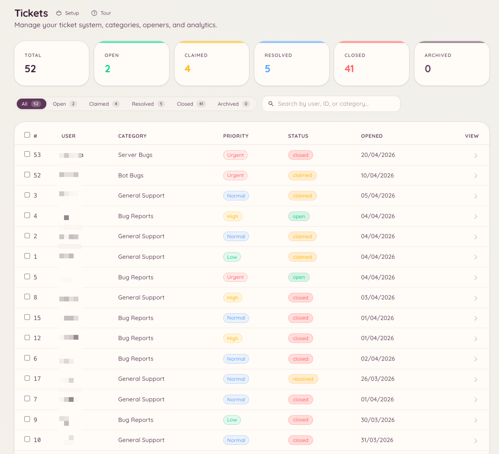

import { DashboardLink } from "/snippets/dashboard-link.jsx";

Das Ticket-System erstellt private Discord-Threads für einzelne Support-Anfragen. Mitglieder eröffnen ein Ticket, das Team antwortet im Thread, und das Ticket wird geschlossen, wenn das Problem gelöst ist. In der Konfiguration im Dashboard legst du fest, welche Support-Kategorien es gibt, wer Tickets eröffnen kann und wie sich das System automatisch verhält.

<Frame>
  
</Frame>

## So funktionieren Tickets für Mitglieder

Ein Mitglied führt `/ticket open` aus oder klickt einen Opener-Button, den du in einem Kanal platziert hast. Es wählt eine Kategorie, füllt optional ein Eröffnungsformular aus, und ein privater Thread wird erstellt. Den Thread sehen nur das Mitglied und die Team-Rollen, die für diese Kategorie eingerichtet sind. Mitglied und Team schreiben sich im Thread wie in einem normalen Gespräch.

Ist das Problem gelöst, schließt entweder das Mitglied oder ein Teammitglied das Ticket. Geschlossene Tickets lassen sich im Dashboard unter <DashboardLink to="tickets/list">**Tickets \> Tickets**</DashboardLink> nachlesen.

## Einrichtung

### Kategorien erstellen

Geh im Dashboard zu <DashboardLink to="tickets/categories">**Tickets \> Categories**</DashboardLink> und klick auf **New Category**. Jede Kategorie legt fest:

| Einstellung | Beschreibung |
| --- | --- |
| **Name** | Wird angezeigt, wenn ein Mitglied eine Ticket-Art wählt |
| **Description** (Beschreibung) | Kurze Erklärung, wofür diese Kategorie gedacht ist |
| **Channel** (Kanal) | Der übergeordnete Kanal, in dem Ticket-Threads erstellt werden |
| **Staff roles** (Team-Rollen) | Welche Rollen Tickets in dieser Kategorie sehen und darauf antworten können |
| **Opening form** (Eröffnungsformular) | Optionale Fragen, die das Mitglied beim Eröffnen des Tickets beantwortet |
| **Opening message** (Eröffnungsnachricht) | Die erste Nachricht, die der Bot im Ticket-Thread postet |
| **Auto-close** (Automatisch schließen) | Inaktive Tickets nach einer bestimmten Zeit automatisch schließen |

### Erinnerungen bei Inaktivität

Jede Kategorie kann bei Tickets, in denen es still wird, erst warnen und sie dann schließen. Unter **Inactivity Reminder** im Kategorie-Editor stellst du ein, wie lange ein Ticket ruhen darf, bevor die Warnung gepostet wird, wie lange nach der Warnung es geschlossen wird und wen die Warnung pingt:

| Ping-Verhalten | Wer gepingt wird |
| --- | --- |
| **Ping ticket opener** (Ersteller pingen) | Das Mitglied, das das Ticket eröffnet hat |
| **Ping all participants** (Alle Beteiligten pingen) | Der Ersteller und das Teammitglied, das das Ticket übernommen hat |
| **Smart (direction-aware)** (Smart, richtungsabhängig) | Wer als Nächstes antworten muss: der Ersteller, wenn das Team zuletzt geschrieben hat, das Team, wenn der Ersteller zuletzt geschrieben hat |
| **No ping** (Kein Ping) | Niemand |

Bei **Smart** wählst du, ob ein Ticket, das auf das Team wartet, die Team-Rollen der Kategorie pingt oder nur das Teammitglied, das es übernommen hat. Ein nicht übernommenes Ticket pingt immer die Team-Rollen.

#### Den Ersteller fragen, wenn er fertig wirkt

Ein Support-Gespräch endet oft damit, dass das Team antwortet und das Mitglied mit „Danke“ reagiert. Smart würde das Ticket dann so behandeln, als warte es auf das Team. Damit das Team nicht wegen eines gelösten Tickets gepingt wird, kann Smart einen Abschluss erkennen und stattdessen das Mitglied fragen: Die Warnung wird zu „Is your issue sorted?“ (Ist dein Problem gelöst?) mit den Buttons **Yes, close it** (Ja, schließen) und **I still need help** (Ich brauche noch Hilfe). „I still need help“ pingt sofort das Team. Antwortet niemand, wird das Ticket nach dem normalen Zeitplan geschlossen.

Zwei Einstellungen bestimmen, wann eine Antwort als Abschluss zählt:

| Einstellung | Wie sie entscheidet | Standard |
| --- | --- | --- |
| **Ask the opener when they look done (AI)** (Ersteller fragen, wenn er fertig wirkt, per KI) | [Odin AI](/de/ai/odin) liest das Ende des Gesprächs. Läuft nur auf Servern mit eingerichteter KI und schickt die letzten Ticket-Nachrichten an den KI-Anbieter | An |
| **Ask the opener when they look done (length)** (Ersteller fragen, wenn er fertig wirkt, nach Länge) | Alles, was das Mitglied seit der letzten Antwort des Teams geschrieben hat, liegt unter dem Zeichenlimit, ohne Fragezeichen und ohne Anhang. Wird auch genutzt, wenn die KI-Prüfung nicht laufen kann | Aus |

Den Wortlaut der Frage kannst du unter <DashboardLink to="tickets/config">**Tickets \> Configuration**</DashboardLink> als Nachricht **Resolution Check** ändern.

### Opener einrichten

Opener sind die Buttons oder Auswahlmenüs, mit denen Mitglieder Tickets erstellen. Geh zu <DashboardLink to="tickets/openers">**Tickets \> Openers**</DashboardLink> und klick auf **New Opener**. Nachdem du den Opener eingerichtet hast, klickst du auf **Post**, und der Bot schickt das Opener-Panel in einen Kanal deiner Wahl. Du kannst denselben Opener in mehreren Kanälen posten und jede Kopie über die Liste **Posted in** im Post-Dialog aktualisieren oder löschen. Siehe [Panels in mehr als einem Kanal](/de/dashboard#panels-posted-in-more-than-one-channel).

Ein Opener kann je nach Einrichtung einen einzelnen Button „Open Ticket“ zeigen oder ein Auswahlmenü mit mehreren Kategorien.

## Slash-Befehle

Der Befehl `/ticket` hat diese Unterbefehle:

| Unterbefehl | Beschreibung |
| --- | --- |
| `/ticket open [category]` | Ein neues Ticket eröffnen, optional mit vorausgewählter Kategorie |
| `/ticket close [reason]` | Den aktuellen Ticket-Thread schließen |
| `/ticket claim` | Das Ticket dir selbst als zuständigem Teammitglied zuweisen |
| `/ticket unclaim` | Deine Übernahme des Tickets aufheben |
| `/ticket assign <user>` | Das Ticket einem anderen Teammitglied zuweisen |
| `/ticket add <user>` | Ein Mitglied zum privaten Thread hinzufügen |
| `/ticket remove <user>` | Ein Mitglied aus dem privaten Thread entfernen |
| `/ticket rename <name>` | Den Ticket-Thread umbenennen |
| `/ticket priority <level>` | Die Priorität des Tickets festlegen |
| `/ticket note <content>` | Eine private Team-Notiz zum Ticket hinzufügen |
| `/ticket transcript` | Ein Texttranskript des Gesprächs erstellen |

Der Befehl `/ticket-admin` erlaubt die Verwaltung von Kategorien direkt aus Discord und deckt dieselben Vorgänge ab wie <DashboardLink to="tickets/categories">**Tickets \> Categories**</DashboardLink>.

## Antworten mit KI-Unterstützung

Ist das KI-Plugin aktiviert und mit deinen Ticket-Kategorien verbunden, kann Heimdall Antwortentwürfe auf Basis deiner Wissensdatenbank und früherer Lösungen vorschlagen. Die Einrichtung steht unter [Odin AI](/de/ai/odin).

## Bewertungen

Mitglieder können optional gebeten werden, beim Schließen eines Tickets eine Zufriedenheitsbewertung abzugeben. Die Abfrage bittet das Mitglied, seine Erfahrung zu bewerten und optional einen Kommentar zu hinterlassen. Punktzahlen und Kommentare werden im Statistik-Dashboard unter <DashboardLink to="tickets/reviews">**Tickets > Reviews**</DashboardLink> zusammengefasst und lassen sich nach Kategorie und Zeitraum filtern.

Aktiviere Bewertungen unter <DashboardLink to="tickets/config">**Tickets > Configuration**</DashboardLink>. Ob beim Schließen eines Tickets die Bewertungsabfrage verschickt wird, stellst du pro Kategorie mit **Send Review Prompt on Close** unter <DashboardLink to="tickets/categories">**Tickets \> Categories**</DashboardLink> ein.

## Autoantworten

Ticket-Autoantworten sind vorgefertigte Antworten, die beim Eröffnen eines Tickets automatisch gepostet werden, wenn die Eröffnungsnachricht auf einen Auslöser passt. Geh zu <DashboardLink to="tickets/auto-responses">**Tickets > Auto-Responses**</DashboardLink>, um sie einzurichten.

Jede Autoantwort hat:

| Einstellung | Beschreibung |
|---|---|
| **Name** | Interne Bezeichnung |
| **Trigger** (Auslöser) | Ein Schlüsselwort oder eine Wendung, die in der Eröffnungsnachricht vorkommen muss |
| **Response** (Antwort) | Die Nachricht, die automatisch im Ticket-Thread gepostet wird |
| **Category scope** (Kategorie-Bereich) | Die Autoantwort optional auf bestimmte Ticket-Kategorien beschränken |

Autoantworten werden vom Bot im Thread gepostet. Sie schließen das Ticket nicht: Das Gespräch führt weiterhin das Team.

## Quoten

Quoten begrenzen, wie vielen offenen Tickets ein einzelnes Teammitglied gleichzeitig zugewiesen sein kann. Geh zu <DashboardLink to="tickets/quotas">**Tickets > Quotas**</DashboardLink>, um Limits pro Rolle oder pro Nutzer einzurichten.

Erreicht ein Teammitglied seine Quote:

- Die automatische Zuweisung überspringt es beim Verteilen neuer Tickets
- Eine manuelle Zuweisung ist weiterhin möglich, wenn eine leitende Person die Quote übergeht

Die Auslastung der Quoten siehst du unter <DashboardLink to="tickets/analytics">**Tickets \> Analytics**</DashboardLink>, neben Antwortzeiten und Kennzahlen zum Schließen.

## Erforderliche Berechtigungen

| Aktion | Berechtigungsschlüssel |
| --- | --- |
| Ein Ticket eröffnen | Keine Berechtigung nötig |
| Jedes Ticket schließen | `tickets.operations.manage_tickets` |
| Tickets übernehmen | `tickets.operations.claim_tickets` |
| Alle Tickets ansehen | `tickets.operations.view_tickets` |
| Statistiken ansehen | `tickets.analytics.view_analytics` |
| Konfiguration verwalten | `tickets.config.manage_config` |
