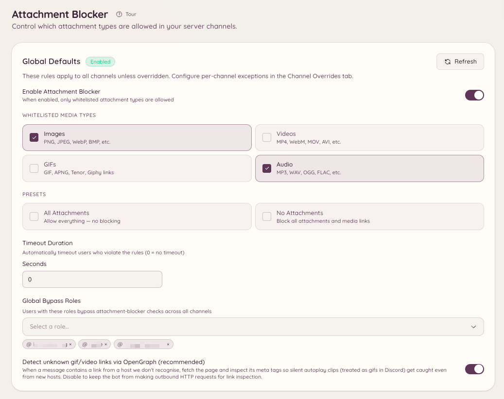

import { DashboardLink } from "/snippets/dashboard-link.jsx";

Der Anhang-Blocker legt fest, welche Arten von Medien Mitglieder posten dürfen, und entfernt alles, was gegen die Regel verstößt. Er arbeitet mit vier Medientypen: **Images** (Bilder), **Videos**, **GIFs** und **Audio**. Du legst eine Regel für den ganzen Server fest, überschreibst sie in den Kanälen, die etwas anderes brauchen, und schränkst einzelne Mitglieder ein, wenn eine bestimmte Person das Problem ist.

<Frame>
  
</Frame>

## So funktioniert es

Jede Nachricht in einem erfassten Kanal wird gegen die Regel geprüft, die dort gilt. Die Prüfung schaut sich an:

- Dateien, die als Anhang hochgeladen wurden.
- Medien in einer weitergeleiteten Nachricht.
- Embeds, die Discord für einen Link auflöst. So wird ein Tenor-GIF oder ein eingebettetes Video erkannt.
- Medienlinks im Nachrichtentext: Tenor, Giphy, Imgur und direkte Dateilinks.
- Unbekannte Links, die auf OpenGraph-Medien geprüft werden, wenn **OG fallback** aktiv ist. Ein Link, der sich als Bild oder Video herausstellt, wird als dieser Medientyp behandelt.

Er blockiert nicht nach Dateiendung. Es gibt keine Liste mit `.exe` oder `.zip` zum Ausfüllen und keine MIME-Strings zum Eintippen. Du wählst Medientypen, und der gewählte Modus entscheidet, was mit allem anderen passiert.

## Einen Modus wählen

Jede Konfigurationsebene nutzt einen von zwei Modi.

| | Whitelist | Blacklist |
| --- | --- | --- |
| Was die Liste bedeutet | Nur die gelisteten Typen sind erlaubt | Nur die gelisteten Typen werden entfernt |
| Ein Medientyp, den du nicht gelistet hast | Wird entfernt | Ist erlaubt |
| Eine Datei, die kein Medium ist, etwa ein PDF oder ein Archiv | Wird entfernt | Ist erlaubt |
| Vorgaben | **All** (alles erlauben, also praktisch aus) und **No attachments** (alles blockieren) | Keine Vorgaben |
| Eine leere Liste | Kein sinnvoller Zustand, wähle einen Typ oder nutze eine Vorgabe | Blockiert nichts |

Die Zeile zu Dateien, die keine Medien sind, ist die, über die viele stolpern. Eine Whitelist ist eine Aussage über alles. Ein Kanal mit einer Whitelist für **Images** entfernt also auch PDFs, Textdateien und Archive. Eine Blacklist ist eine Aussage über die Typen, die sie nennt. Eine Blacklist für **Videos** entfernt also Videos und lässt ein PDF in Ruhe.

Eine leere Blacklist blockiert absichtlich nichts. Das ist der ehrliche Zustand für "Ich habe den Modus gewählt, aber noch keine Typen".

Konfigurationen, die angelegt wurden, bevor es den Blacklist-Modus gab, sind Whitelists. Für einen Server, der schon eingerichtet war, hat sich also nichts geändert.

## Server-Standards

Der Server-Standard gilt überall dort, wo es keine Überschreibung gibt. Du legst ihn im Dashboard unter <DashboardLink to="attachment-blocker/global">**Attachment Blocker \> Global Settings**</DashboardLink> fest oder in Discord:

```text
/attachment-blocker setup type: Images mode: Whitelist timeout: 60
```

Jeder Aufruf fügt der Liste **einen** Typ hinzu. Führ ihn also einmal pro Typ aus, den du auf der Liste haben willst. Lässt du `mode` weg, behält der Server den Modus, den er schon nutzt. **All** und **None** sind Whitelist-Konzepte und werden im Blacklist-Modus abgelehnt, denn eine Blacklist für alles ist eine Whitelist für nichts, und eine Schreibweise pro Ergebnis reicht.

`/attachment-blocker view` gibt die aktuell geltende Regel aus, und `/attachment-blocker disable` schaltet die Funktion serverweit ab.

## Kanal-Überschreibungen

Eine Kanal-Überschreibung ersetzt in diesem Kanal den Server-Standard, einschließlich des Modus. Du fügst sie unter <DashboardLink to="attachment-blocker/channels">**Attachment Blocker \> Channel Overrides**</DashboardLink> hinzu oder so:

```text
/attachment-blocker channel add channel: #media type: Videos mode: Blacklist
/attachment-blocker channel remove channel: #media
```

Zwei Dinge solltest du wissen:

- **Threads folgen ihrem übergeordneten Kanal.** Ein Thread ohne eigene Überschreibung nutzt die Überschreibung des Kanals oder Forums, in dem er liegt.
- **Eine Überschreibung ohne gelistete Typen erbt alles.** Sie übernimmt sowohl den Modus als auch die Liste vom Server-Standard, damit eine halb ausgefüllte Überschreibung nie still zu einer eigenen Regel wird.

## Temporäre Sprachkanäle

Temporäre Sprachkanäle entstehen bei Bedarf und lassen sich deshalb nicht von Hand mit einer Überschreibung versehen. Stattdessen legst du die Regel am Opener fest, der sie erzeugt, unter <DashboardLink to="attachment-blocker/tempvc">**Attachment Blocker \> TempVC Openers**</DashboardLink>. Jeder temporäre Kanal, den dieser Opener erstellt, bekommt diese Regel.

## Bypass-Rollen

Eine Bypass-Rolle überspringt die Modusprüfung, Mitglieder mit dieser Rolle können also posten, was sie wollen. Du kannst einen Bypass serverweit erteilen oder nur in einem Kanal:

```text
/attachment-blocker bypass add role: @Moderator
/attachment-blocker bypass channel-add channel: #media role: @Content Team
```

`/attachment-blocker bypass list` und `/attachment-blocker bypass channel-list` zeigen, wer gerade einen Bypass hat, und `/attachment-blocker bypass remove` und `/attachment-blocker bypass channel-remove` nehmen die Rolle wieder heraus.

Eine Bypass-Rolle schützt ein Mitglied nicht vor einer Einschränkung, die sich gezielt gegen es richtet. Genau dafür sind Einschränkungen da.

## Ein Mitglied einschränken

Wenn ein einzelnes Mitglied das Problem ist, schränk dieses Mitglied ein, statt den Kanal für alle zu verschärfen. Das Einschränkungs-Panel öffnest du mit einem dieser Befehle:

```text
/attachment-blocker user restrict user: @member
/attachmentban user: @member
```

Der Kontextmenü-Eintrag **Apps \> Restrict Attachments** auf einer seiner Nachrichten öffnet dasselbe Panel und ist meist schneller.

Im Panel wählst du die Typen, die blockiert werden sollen, ob die Einschränkung serverweit oder nur in ausgewählten Kanälen gilt, wie lange sie dauert und einen Grund. Eine Einschränkung:

- **Hat Vorrang vor Bypass-Rollen.** Ein eingeschränktes Mitglied bleibt eingeschränkt, auch wenn es eine hat.
- **Hat Vorrang vor der Kanalregel.** Sie gilt unabhängig davon, was der Kanal erlaubt.
- **Sagt dem Mitglied, wann sie endet.** Es bekommt eine DM, wenn sie aufgehoben wird und wenn sie abläuft.

`/attachment-blocker user list` zeigt die aktiven Einschränkungen, `/attachment-blocker user unrestrict` und `/attachmentunban` heben eine auf, und <DashboardLink to="attachment-blocker/restrictions">**Attachment Blocker \> User Restrictions**</DashboardLink> im Dashboard erledigt all das im Web.

## Timeouts und DMs

Verstößt eine Nachricht gegen die Regel:

1. Die Nachricht wird gelöscht.
2. Das Mitglied bekommt per DM eine Erklärung, was entfernt wurde und warum. Diese Nachricht ist eine Vorlage, du kannst sie also unter **Message Templates** umschreiben.
3. Legt die Ebene, die die Nachricht erfasst hat, einen Timeout fest, bekommt das Mitglied einen Timeout für so viele Sekunden.

Der Timeout wird über das Moderationssystem von Heimdall verhängt statt als reine Discord-Aktion. Er erscheint also im Feed der Mod-Aktionen zusammen mit dem Rest deines Moderationsverlaufs. Setz ihn auf `0`, um zu löschen, ohne jemandem einen Timeout zu geben. Jede Ebene hat ihren eigenen Timeout, eine Kanal-Überschreibung kann also einen längeren Timeout verhängen als der Server-Standard, oder gar keinen.

## Befehle

```text
/attachment-blocker setup type: [mode:] [timeout:]
/attachment-blocker view
/attachment-blocker disable
```

```text
/attachment-blocker channel add channel: type: [mode:] [timeout:]
/attachment-blocker channel remove channel:
```

```text
/attachment-blocker bypass add role:
/attachment-blocker bypass remove role:
/attachment-blocker bypass list
/attachment-blocker bypass channel-add channel: role:
/attachment-blocker bypass channel-remove channel: role:
/attachment-blocker bypass channel-list channel:
```

```text
/attachment-blocker user restrict user:
/attachment-blocker user unrestrict user:
/attachment-blocker user list
/attachmentban user:
/attachmentunban user:
```

## Erforderliche Berechtigungen

| Aktion | Berechtigungsschlüssel |
| --- | --- |
| Die Konfiguration und die Bypass-Listen ansehen | `attachment-blocker.view_config` |
| Server-Standards, Kanal-Überschreibungen und Opener-Überschreibungen ändern | `attachment-blocker.manage_config` |
| Einschränkungen einzelner Mitglieder ansehen | `attachment-blocker.view_restrictions` |
| Einschränkungen einzelner Mitglieder verhängen, bearbeiten und aufheben | `attachment-blocker.manage_restrictions` |
| Dich selbst einschränken oder die Einschränkung aufheben, vor allem zum Testen | `attachment-blocker.manage_own_restrictions` |

**Manage Own Restrictions** hebt nur die Sperre auf, die verhindert, dass du dich im Einschränkungs-Panel selbst auswählst. Allein bewirkt sie nichts, erteile sie also zusammen mit **Manage User Restrictions**.
