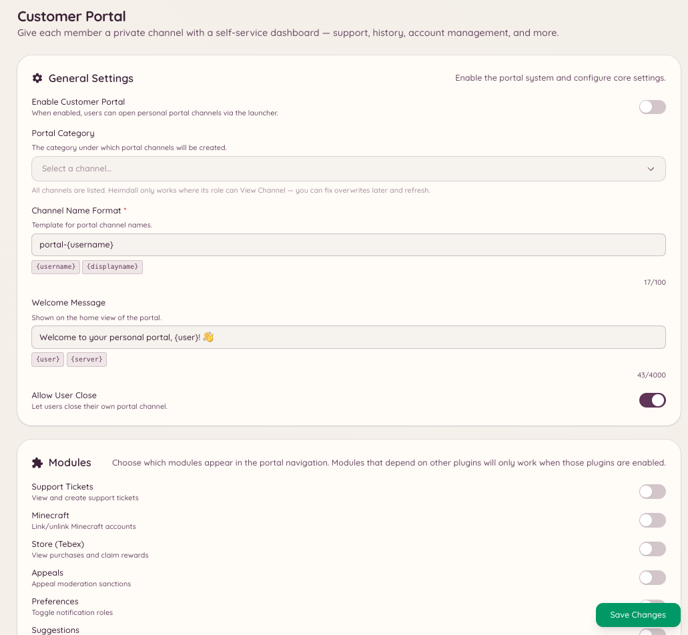

import { DashboardLink } from "/snippets/dashboard-link.jsx";

Das Kundenportal ist ein Dashboard für Mitglieder, das komplett in Discord läuft. Öffnet ein Mitglied das Portal, zeigt es eine Übersicht über alles, was Heimdall über es weiß: verknüpfte Accounts (Minecraft, PlanetSide 2, Forum-Accounts), aktive Tickets oder Modmail-Threads, offene Erinnerungen und den Economy-Kontostand.

Das Portal ist ein zentraler Einstieg, über den Mitglieder ihre Verbindung zum Bot und zu den Diensten des Servers verwalten, ohne sich durch mehrere Befehle arbeiten zu müssen.

<Frame>
  
</Frame>

## Das Portal öffnen

```text
/portal setup
```

Öffnet das Kundenportal für das Mitglied, das den Befehl ausgeführt hat. Das Panel erscheint als interaktive Nachricht, die nur dieses Mitglied sieht. Beim Öffnen lädt das Portal seine Daten neu.

## Was das Portal zeigt

Was im Portal steht, hängt davon ab, welche Plugins auf deinem Server aktiv sind:

| Bereich | Wird angezeigt, wenn |
| --- | --- |
| **Linked accounts** (Verknüpfte Accounts) | Die Integrationen für Minecraft, PlanetSide 2 oder NamelessMC aktiviert sind |
| **Active tickets** (Aktive Tickets) | Das Ticket-Plugin aktiviert ist und das Mitglied offene Tickets hat |
| **Modmail threads** (Modmail-Threads) | Das Modmail-Plugin aktiviert ist und das Mitglied offene Gespräche hat |
| **Reminders** (Erinnerungen) | Das Erinnerungs-Plugin aktiviert ist |
| **Economy balance** (Economy-Kontostand) | Das Spiele- bzw. Economy-Plugin aktiviert ist |

Mitglieder können direkt im Portal etwas erledigen, etwa ein Ticket schließen, eine Erinnerung ansehen oder nachsehen, welche Accounts verknüpft sind, ohne einzelne Befehle auszuführen.

## Das Portal konfigurieren

Geh im Dashboard zu <DashboardLink to="customer-portal/config">**Customer Portal \> Configuration**</DashboardLink>, um:

- Festzulegen, welche Bereiche erscheinen
- Festzulegen, welche Integrationen das Portal enthält
- Einzustellen, in welchen Kanälen der Portal-Befehl verfügbar ist

```text
/portal close
```

Schließt ein aktives Portal. Portale laufen nach einer gewissen Zeit ohne Aktivität automatisch ab.

```text
/portal refresh
```

Lädt alle Daten neu und aktualisiert das Portal mit den aktuellen Informationen. Praktisch, wenn sich der Status eines Mitglieds geändert hat, während das Portal offen war.

## Erforderliche Berechtigungen

| Aktion | Berechtigungsschlüssel |
| --- | --- |
| Das Portal nutzen | Standardmäßig für alle Mitglieder verfügbar |
| Portal-Konfiguration ansehen | `customerPortal.viewConfig` |
| Portal-Konfiguration verwalten | `customerPortal.manageConfig` |
| Portale von Mitgliedern verwalten | `customerPortal.managePortals` |
