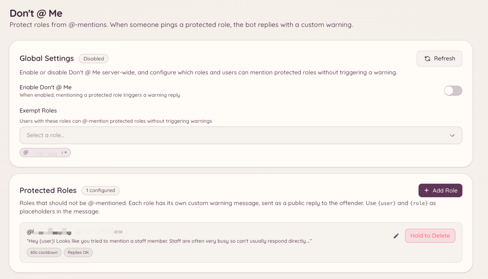

import { DashboardLink } from "/snippets/dashboard-link.jsx";

Das Plugin "Don't @ Me" verhindert, dass Mitglieder Rollen pingen, die nicht massenhaft erwähnt werden sollen. Erwähnt die Nachricht eines Mitglieds eine geschützte Rolle, löscht der Bot die Nachricht und verwarnt das Mitglied. Das ist eine leichtgewichtige Alternative dazu, @Erwähnungen für eine Rolle ganz abzuschalten: Die Rolle bleibt für das Team erwähnbar, aber der Bot fängt unerlaubte Erwähnungen ab.

<Frame>
  
</Frame>

## Geschützte Rollen einrichten

```text
/dontatme add <role>
```

Fügt eine Rolle zur Schutzliste hinzu. Mitglieder, die diese Rolle erwähnen (außerhalb der Ausnahmen), bekommen ihre Nachricht gelöscht und erhalten eine Verwarnung.

```text
/dontatme remove <role>
```

Entfernt eine Rolle von der Schutzliste.

Öffne im Dashboard <DashboardLink to="dont-at-me">**Don't @ Me**</DashboardLink>, um alle geschützten Rollen zu sehen. Dort kannst du auch die Warnnachricht an Mitglieder festlegen und bestimmen, ob die Warnung öffentlich im Kanal gepostet oder per DM geschickt wird.

## Ausnahmen

Rollen und Kanäle lassen sich vom Plugin ausnehmen:

- **Rollen-Ausnahme**: Team-Rollen, die geschützte Rollen berechtigterweise erwähnen müssen, sind ausgenommen. Ausgenommene Rollen fügst du im Dashboard auf der Seite <DashboardLink to="dont-at-me">**Don't @ Me**</DashboardLink> hinzu.
- **Kanal-Ausnahme**: Bestimmte Kanäle (z. B. reine Team-Kanäle) können von der Überwachung ausgeschlossen werden.

## Verhalten bei Warnungen

Wird eine geschützte Erwähnung erkannt:

1. Die Nachricht wird sofort gelöscht.
2. Der Bot postet eine kurze Warnung im Kanal (oder schreibt dem Mitglied eine DM, je nach Einstellung), die erklärt, dass die Rolle nicht erwähnt werden darf.
3. Optional wird die Warnung über das Moderations-Plugin als Verstoß erfasst, was der Akte des Mitglieds Punkte hinzufügt.

## Erforderliche Berechtigungen

| Aktion | Berechtigungsschlüssel |
| --- | --- |
| Einstellungen ansehen | `dontAtMe.viewConfig` |
| Einstellungen ändern | `dontAtMe.manageConfig` |
