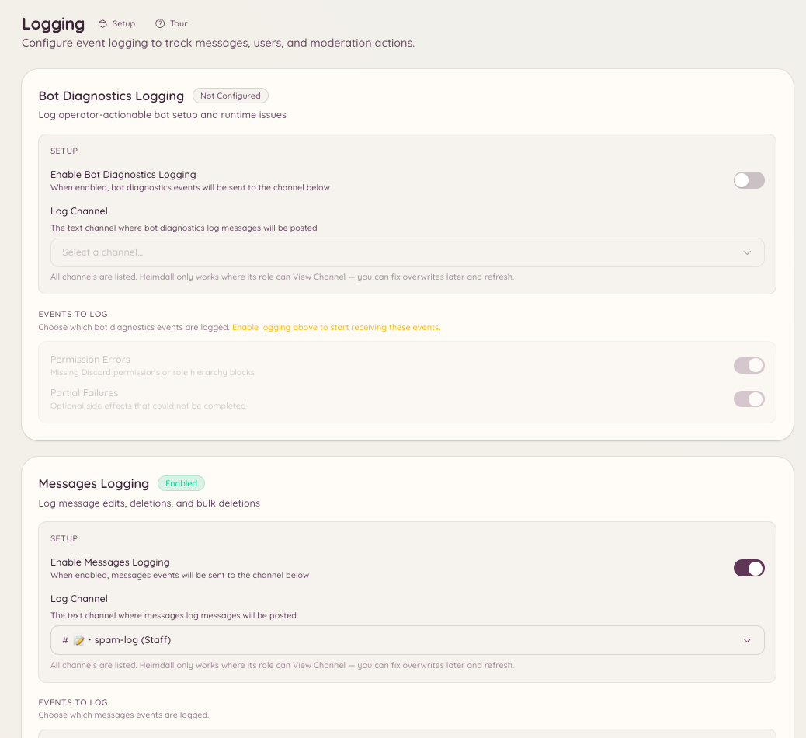

import { DashboardLink } from "/snippets/dashboard-link.jsx";

Das Logging-Plugin erfasst Events auf deinem Discord-Server und postet formatierte Meldungen in Kanäle deiner Wahl. Jede Event-Kategorie kann in einen anderen Kanal gehen. Du kannst also Nachrichten-Events in einen Kanal schicken, Mitglieder-Events in einen zweiten und Moderationsaktionen in einen dritten.

<Frame>
  
</Frame>

## Einrichtung

```text
/logging setup <category> <channel>
```

Richtet eine bestimmte Event-Kategorie so ein, dass sie in den angegebenen Kanal loggt. Führ den Befehl einmal für jede Kategorie aus, die du aktivieren willst.

```text
/logging disable <category>
```

Beendet das Logging für eine Kategorie, ohne den Rest deiner Konfiguration zu entfernen.

Geh im Dashboard zu <DashboardLink to="logging">**Logging**</DashboardLink>, um alle eingerichteten Kategorien und ihre Zielkanäle auf einen Blick zu sehen.

## Event-Kategorien

| Kategorie | Geloggte Events |
| --- | --- |
| **Messages** (Nachrichten) | Bearbeitete Nachrichten (mit Inhalt vorher und nachher), gelöschte Nachrichten, Massenlöschungen |
| **Members** (Mitglieder) | Beitritte, Austritte, Änderungen an Nutzername, Avatar und Spitzname |
| **Roles** (Rollen) | Rollen erstellt, gelöscht und bearbeitet; Rollen vergeben und entfernt |
| **Channels** (Kanäle) | Kanäle erstellt, gelöscht und Einstellungen geändert |
| **Voice** (Sprache) | Mitglieder treten Sprachkanälen bei, verlassen sie oder wechseln zwischen ihnen |
| **Moderation** | Banns, Entbannungen, Kicks, Timeouts und ihre Gründe (aus dem Audit-Log von Discord) |
| **Server** | Änderungen an Servername, Icon oder Einstellungen |
| **Invites** (Einladungen) | Einladungen erstellt und gelöscht (welche Einladung ein Mitglied zum Beitreten genutzt hat) |

## Format der Log-Nachrichten

Jeder Log-Eintrag zeigt:

- Die Art des Events als Überschrift
- Den betroffenen Nutzer, Kanal oder die Rolle, als Erwähnung oder mit Namen
- Bei Bearbeitungen die Werte vorher und nachher
- Einen Zeitstempel
- Wo es passt, einen Link zur Originalnachricht oder zum Kontext

Der Bot nutzt das Audit-Log von Discord, um Events nach Möglichkeit dem Teammitglied zuzuordnen, das sie ausgelöst hat. Events, die das Audit-Log nicht abdeckt (etwa Bearbeitungen einer Nachricht durch ihren Autor), werden direkt dem Autor zugeordnet.

## Erforderliche Berechtigungen

| Aktion | Berechtigungsschlüssel |
| --- | --- |
| Logging-Konfiguration ansehen | `logging.view_config` |
| Logging-Konfiguration ändern | `logging.manage_config` |
