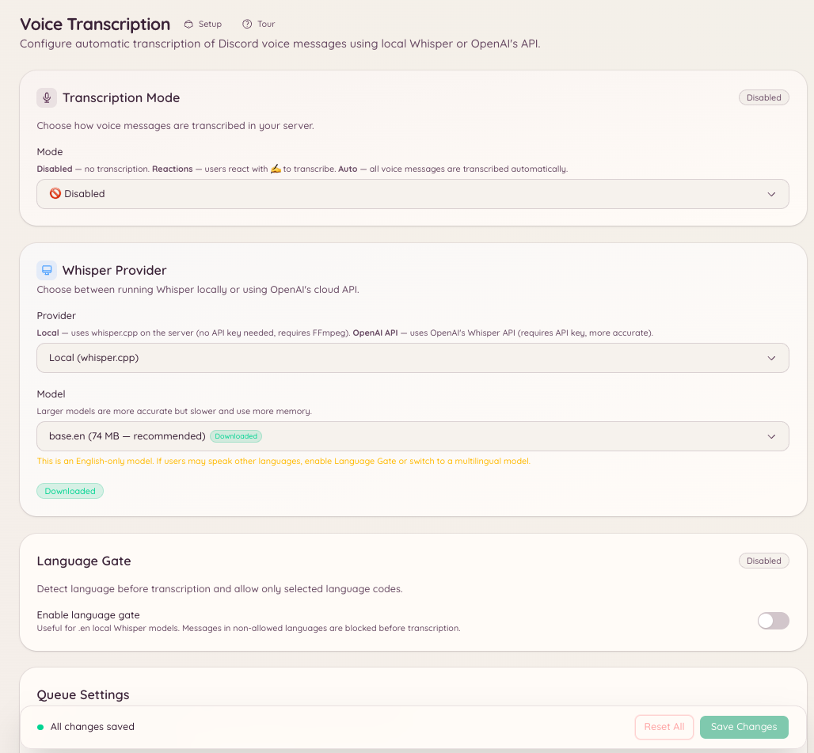

import { DashboardLink } from "/snippets/dashboard-link.jsx";

Das Plugin für Sprach-Transkription wandelt Discord-Sprachnachrichten (die Audioclips, die Mitglieder direkt im Discord-Client aufnehmen) in Text um. Schickt ein Mitglied in einem eingerichteten Kanal eine Sprachnachricht, antwortet der Bot mit einer Transkription dessen, was gesagt wurde.

So werden Sprachnachrichten für Mitglieder zugänglich, die kein Audio hören können oder wollen. Gespräche lassen sich besser durchsuchen, und es hilft in lauten Umgebungen, in denen Zuhören kaum möglich ist.

<Note>
  Dieses Plugin transkribiert Discord-Sprachnachrichten (die Funktion zum Aufnehmen von Sprachnachrichten im Discord-Client). Es transkribiert kein Audio aus Sprachkanälen.
</Note>

<Frame>
  
</Frame>

## Einrichtung

Öffne im Dashboard <DashboardLink to="vc-transcription">**VC Transcription**</DashboardLink> oder nutze den Slash-Befehl:

```text
/voice-transcription set <channel>
```

Lege fest, in welchen Kanälen der Bot auf Sprachnachrichten achten soll. Du kannst die Transkription für bestimmte Kanäle oder für den ganzen Server aktivieren.

```text
/voice-transcription status
```

Zeigt, in welchen Kanälen die Transkription gerade aktiv ist.

## So funktioniert die Transkription

Wird in einem eingerichteten Kanal eine Sprachnachricht gesendet, lädt der Bot das Audio herunter, schickt es an das Speech-to-Text-Modell Whisper und postet das Transkript als Antwort auf die Sprachnachricht. Je nach Länge des Audios erscheint das Transkript ein paar Sekunden nach der Sprachnachricht.

Transkriptionen sind klar als vom Bot erzeugt gekennzeichnet und können Fehler enthalten, besonders bei ungewöhnlichen Akzenten, Fachbegriffen oder schlechter Audioqualität.

## Einstellungen im Dashboard

Öffne im Dashboard <DashboardLink to="vc-transcription">**VC Transcription**</DashboardLink>, um:

- Kanäle zur Transkriptionsliste hinzuzufügen oder daraus zu entfernen
- Den Transkriptionsverlauf eines Kanals anzusehen
- Die Transkription ein- oder auszuschalten, ohne die Einstellungen zu entfernen

## Erforderliche Berechtigungen

| Aktion | Berechtigungsschlüssel |
| --- | --- |
| Einstellungen ansehen | `vcTranscription.viewConfig` |
| Einstellungen ändern | `vcTranscription.manageConfig` |
