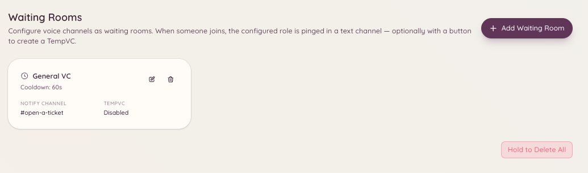

import { DashboardLink } from "/snippets/dashboard-link.jsx";

Das Warteraum-Plugin überwacht einen Sprachkanal, den du als Warteraum festlegst. Betritt ein Mitglied diesen Kanal, postet der Bot eine Benachrichtigung in einem eingestellten Team-Kanal, damit sich ein Teammitglied um es kümmern kann. Das ist praktisch für Server mit Sprach-Support unter vier Augen, Bewerbungsgesprächen oder anderen Fällen, in denen ein Mitglied signalisieren muss, dass es zum Reden bereit ist.

<Frame>
  
</Frame>

## So funktioniert es

Ein Mitglied betritt den Warteraum-Sprachkanal. Der Bot schickt sofort eine Benachrichtigung in den eingestellten Benachrichtigungskanal des Teams. Die Nachricht enthält den Namen des Mitglieds und einen Zeitstempel. Das Team sieht die Benachrichtigung und kann dann entweder dem Warteraum-Sprachkanal beitreten oder das Mitglied in einen privaten Kanal verschieben.

Verlässt das Mitglied den Warteraum, aktualisiert oder entfernt der Bot die Benachrichtigung, damit keine veralteten Hinweise stehen bleiben.

## Einrichtung

Öffne im Dashboard <DashboardLink to="waiting-room/config">**Waiting Room \> Configuration**</DashboardLink>.

| Einstellung | Beschreibung |
| --- | --- |
| **Waiting room channel** (Warteraum-Kanal) | Der Sprachkanal, den Mitglieder betreten, um zu signalisieren, dass sie Hilfe brauchen |
| **Notification channel** (Benachrichtigungskanal) | Der Textkanal, in dem das Team die Warteraum-Hinweise bekommt |
| **Notification message** (Benachrichtigungstext) | Die Nachrichtenvorlage, die gepostet wird, wenn ein Mitglied hereinkommt |
| **Ping roles** (Ping-Rollen) | Rollen, die in der Benachrichtigung erwähnt werden, damit das Team sofort Bescheid weiß |

Du kannst mehrere Warteraum-Kanäle einrichten, jeden mit eigenem Benachrichtigungskanal und eigenen Ping-Rollen.

## Variablen im Benachrichtigungstext

| Variable | Wird ersetzt durch |
| --- | --- |
| `{user}` | Eine Erwähnung des Mitglieds, das beigetreten ist |
| `{user.name}` | Den Anzeigenamen des Mitglieds |
| `{channel}` | Den Namen des Warteraum-Kanals |
| `{time}` | Den Zeitpunkt, zu dem das Mitglied beigetreten ist |

## Die Annehmen-Funktion nutzen

Teammitglieder können in der Benachrichtigung auf den Button **Accept** klicken, um die wartende Person zu übernehmen. Damit wird die Benachrichtigung als erledigt markiert, und es kümmern sich nicht mehrere Teammitglieder gleichzeitig um dieselbe Person.

## Erforderliche Berechtigungen

| Aktion | Berechtigungsschlüssel |
| --- | --- |
| Einstellungen ansehen | `waitingRoom.viewConfig` |
| Einstellungen ändern | `waitingRoom.manageConfig` |
| Mitglieder im Warteraum annehmen | `waitingRoom.accept` |
