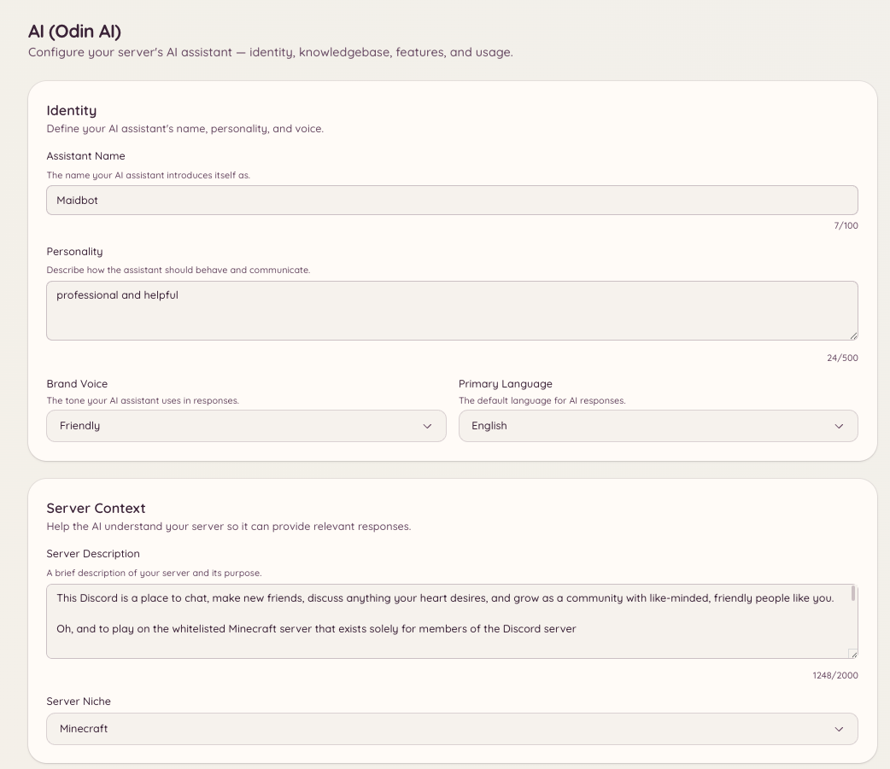

import { DashboardLink } from "/snippets/dashboard-link.jsx";

Odin es el asistente de IA de Heimdall. Los miembros hacen preguntas y reciben respuestas basadas en la base de conocimiento de tu servidor: documentación, preguntas frecuentes, normas o cualquier otro contenido que subas. Odin mantiene el contexto de la conversación durante una sesión, así que las preguntas de seguimiento funcionan con naturalidad sin tener que repetir los antecedentes.

<Frame>
  
</Frame>

## Hacer una pregunta

```text
/ask <question>
```

Los miembros preguntan lo que quieran en lenguaje normal. Odin responde a partir de tu base de conocimiento y cita las entradas que ha usado. Por defecto, `/ask` solo responde a partir de la base de conocimiento: si la base de conocimiento no cubre la pregunta, Odin lo dice en lugar de inventarse algo y ofrece al miembro una forma de contactar con el staff (un botón de ticket o de modmail, según cómo reciba tu servidor las peticiones de soporte).

Para que `/ask` responda también a preguntas generales con los conocimientos propios de Odin, activa **Allow general knowledge** (permitir conocimientos generales) en <DashboardLink to="ai/feature-qa_bot">**AI \> Q&A Bot**</DashboardLink> (IA > Bot de Q&A). Los datos sobre tu servidor (enlaces, tarifas, comandos, staff) siguen saliendo solo de la base de conocimiento.

Por defecto, `/ask` está disponible para todos los miembros. El acceso se puede restringir en la configuración de permisos.

## Base de conocimiento

La base de conocimiento es el conjunto de documentos que usa Odin para responder a las preguntas. Ve a <DashboardLink to="ai/knowledgebase">**AI \> Knowledgebase**</DashboardLink> (IA > Base de conocimiento) en el panel para gestionarla.

### Añadir documentos

Haz clic en **Add Document** (añadir documento) y pega el contenido o sube un archivo. Cada documento debería tratar un tema concreto: las normas del servidor, unas preguntas frecuentes, guías de integración o cualquier contenido estructurado que quieras que Odin consulte.

Formatos admitidos:

- Texto sin formato
- Markdown
- PDF
- Formatos de documento habituales

Una vez subido, el documento se procesa y se indexa. Odin empieza a usarlo en sus respuestas en unos minutos.

### Importar desde la web

En lugar de pegar el contenido, puedes traer páginas directamente desde un sitio web:

- **Import URLs** (importar URL) descarga las páginas que indiques, una por línea, y ordena cada una en su propia entrada.
- **Deep Crawl** (rastreo profundo) sigue los enlaces de un sitio, hasta el límite de páginas que fijes, e importa todas las páginas con contenido real.

Las dos opciones usan tokens de IA para ordenar cada página. Un sitio que publica versiones en Markdown de sus páginas (como hacen la mayoría de las plataformas de documentación) se guarda tal cual y ordenarlo no cuesta nada.

Importar una página que ya está en la base de conocimiento no crea una segunda copia. Las páginas se identifican por su dirección: una página sin cambios se omite sin gastar tokens, y una página que ha cambiado actualiza su entrada existente, conservando el título y las etiquetas que le pusiste. **Preview Pages** (previsualizar páginas) muestra cuántas páginas son nuevas, cuántas han cambiado y cuántas siguen igual antes de confirmar, así que volver a rastrear un sitio que ya importaste solo cuesta tokens por lo que ha cambiado.

### Mantener las entradas al día

Odin vuelve a revisar cada página importada una vez a la semana. Si la página no ha cambiado, no pasa nada y no se gasta ningún token. Si ha cambiado, la entrada se actualiza a partir de la página, usando los tokens de IA de este servidor para las páginas que hay que ordenar. Si la IA no puede ordenar la nueva versión, por ejemplo porque el servidor se ha quedado sin tokens de IA, la entrada se deja exactamente como estaba y se vuelve a intentar más tarde, en lugar de sustituirla por el texto de la página sin ordenar. La página <DashboardLink to="ai/usage">**AI \> Usage**</DashboardLink> (IA > Uso) lo muestra aparte como **Knowledgebase Upkeep** (mantenimiento de la base de conocimiento). Desactívalo con **Keep imported pages up to date** (mantener al día las páginas importadas), en la parte inferior de la página <DashboardLink to="ai/knowledgebase">**AI \> Knowledgebase**</DashboardLink>.

- **Tus ediciones se respetan.** En cuanto editas a mano el contenido de una entrada, Odin nunca vuelve a copiar la página encima. Si la página cambia después, la entrada se marca como **Page changed since your edit** (la página ha cambiado desde tu edición), y tú eliges **Replace with new version** (sustituir por la nueva versión) o **Keep my version** (conservar mi versión).
- **Las páginas eliminadas se marcan, nunca se borran.** Una entrada cuya página devuelve "no encontrada" se marca como **Page missing** (falta la página). Tras dos revisiones semanales seguidas, se deja fuera de las respuestas, para que Odin deje de citar una página que el sitio ha retirado. Vuelve por sí sola si la página reaparece. Para seguir usándola de todos modos, edita la entrada y borra su URL de origen.
- **Vigila un sitio para detectar páginas nuevas.** Todos los sitios rastreados en profundidad aparecen en **Crawled sites** (sitios rastreados). Activa su interruptor de vigilancia y Odin lo rastreará cada semana e importará hasta 25 páginas que todavía no estén en la base de conocimiento. Encontrar páginas no cuesta tokens; ordenar cada página nueva, sí. Una página en la que la IA no encuentra nada que merezca la pena guardar, como una página de inicio de sesión, se recuerda y no se vuelve a mirar hasta que cambie su contenido.
- **Las páginas que cambian en cada visita se revisan menos a menudo.** Algunas páginas cambian cada vez que se cargan, por ejemplo porque muestran la hora actual. Tras tres revisiones semanales seguidas con cambios, el intervalo entre revisiones se duplica cada vez, hasta llegar a cada ocho semanas, para que una página así no cueste tokens todas las semanas.

Usa el filtro **Needs attention** (requiere atención) para ver todas las entradas con una página que falta, una página que ha cambiado desde tu edición o la misma página importada dos veces.

<Note>
Una entrada que la IA ha creado a partir de varias páginas a la vez se marca como **Not updated automatically** (no se actualiza automáticamente), porque volver a leer una de sus páginas la sustituiría por una parte de sí misma. Vuelve a rastrear el sitio para actualizarla.
</Note>

### Gestionar los documentos

La página <DashboardLink to="ai/knowledgebase">**AI \> Knowledgebase**</DashboardLink> muestra todos los documentos con su fecha de creación y su estado. Puedes:

- **Editar** el contenido de un documento si la información cambia
- **Borrar** un documento para que Odin deje de consultarlo
- **Previsualizar** cómo interpreta y resume Odin el documento

## Contexto de la conversación

Odin mantiene el contexto dentro de una sesión de conversación. Cuando un miembro hace una pregunta de seguimiento, Odin usa los intercambios anteriores de esa misma sesión para entender a qué se refiere. El contexto es de cada miembro y caduca tras un tiempo de inactividad.

El staff puede leer las conversaciones anteriores en <DashboardLink to="ai/conversations">**AI \> Conversations**</DashboardLink> (IA > Conversaciones), algo útil para averiguar el porqué de una respuesta inesperada.

## Configuración

Ve a <DashboardLink to="ai/setup">**AI \> Setup & Context**</DashboardLink> (IA > Configuración y contexto) en el panel para definir:

| Ajuste | Descripción |
| --- | --- |
| **Identidad** | El nombre, la personalidad, el tono de marca y el idioma principal de Odin |
| **Contexto del servidor** | Una descripción de tu servidor y su temática, para que las respuestas encajen con tu comunidad |
| **Contexto de los canales** | Para qué sirve cada canal, para que Odin pueda mandar a los miembros al sitio adecuado |
| **Normas y pautas** | Las normas de tu servidor, lo que se puede y no se puede hacer, los temas prohibidos y los avisos obligatorios |
| **Marca** | El color, el logotipo y el texto del pie de las respuestas de Odin |

Para limitar en qué canales funciona `/ask`, o para fijar sus tiempos de espera, usa <DashboardLink to="ai/feature-qa_bot">**AI \> Q&A Bot**</DashboardLink>.

## Funciones

Ve a <DashboardLink to="ai/features">**AI \> Features**</DashboardLink> (IA > Funciones) para ver y activar cada una de las capacidades de IA disponibles en tu servidor. Cada función es un comportamiento distinto que puede tener Odin.

### Moderación de texto

Odin puede evaluar cada mensaje de los canales configurados y marcar o quitar el contenido que incumpla tus normas. A diferencia del automod basado en regex, la moderación de texto entiende el contexto: sabe distinguir entre hablar de un tema e incumplir de verdad una norma sobre él.

Configura qué canales se vigilan, qué busca la IA y qué medida se toma (marcar para revisión, borrar o advertir) en <DashboardLink to="ai/feature-text_moderation">**AI \> Text Moderation**</DashboardLink> (IA > Moderación de texto).

#### Ajustes recomendados

La moderación de texto parte de un conjunto de ajustes recomendados que mantenemos y mejoramos con el tiempo. Cada ajuste que no tocas sigue la recomendación, así que cuando publicamos una versión mejor, tu servidor la recibe automáticamente.

Un ajuste que cambias pasa a ser tuyo y se marca como **Custom** (personalizado). Conserva tu valor cuando cambian las recomendaciones. Pulsa **Use recommended** (usar el recomendado) junto a él para volver a seguir la recomendación.

Cuando una nueva versión cambia un ajuste que has personalizado, la tarjeta **New recommendations** (nuevas recomendaciones) lo muestra. Para cada uno puedes elegir **Use recommended** o **Keep mine** (conservar el mío). Heimdall también publica un aviso único en tu canal de escalada para que el cambio no pase desapercibido.

#### Valoraciones y mejora de las recomendaciones

Cada escalada de la IA en tu canal de registro tiene los botones 👍 y 👎, además de un botón para comentar. Úsalos para decirle a Odin cuándo una decisión ha sido acertada o equivocada. Esas valoraciones son las que hacen que mejoren los ajustes recomendados.

Para mejorar las recomendaciones de todos los servidores, las valoraciones se recogen de forma centralizada junto con la decisión a la que se refieren. Antes de que nada salga de tu servidor, se quitan del mensaje las menciones, los ID de usuario y los nombres del autor, y el autor solo se identifica con un código de un solo sentido que no se puede volver a convertir en un ID de Discord. Los mensajes que plantean una preocupación por el bienestar o por autolesiones nunca se envían. Las valoraciones se conservan durante un máximo de 24 meses.

<Note>
Los servidores que usan su propia clave de OpenRouter pueden excluirse en **Improving recommended settings** (mejora de los ajustes recomendados), en la página <DashboardLink to="ai/feature-text_moderation">**AI \> Text Moderation**</DashboardLink>. Excluirse también borra las valoraciones que tu servidor ya ha enviado. Los servidores con la IA gestionada por Heimdall no pueden excluirse, porque las recomendaciones de las que dependen se construyen a partir de estas valoraciones.
</Note>

### Moderación de imágenes

Si está activada, Odin analiza las imágenes adjuntas a los mensajes de los canales vigilados. Configura los umbrales de sensibilidad y la medida que se toma cuando se detecta un incumplimiento de las normas en <DashboardLink to="ai/feature-image_moderation">**AI \> Image Moderation**</DashboardLink> (IA > Moderación de imágenes).

### Respuesta automática en tickets

Cuando se abre un ticket, Odin compara el mensaje de apertura con tu base de conocimiento y publica una respuesta sugerida en el hilo para que el staff la revise antes de enviarla. Así se reduce el número de tickets que el staff tiene que responder a mano y se acortan los tiempos de respuesta en las preguntas habituales.

Actívalo y configúralo en <DashboardLink to="ai/feature-ticket_auto_reply">**AI \> Ticket Auto-Reply**</DashboardLink> (IA > Respuesta automática en tickets) o en la sección <DashboardLink to="tickets/ai">**Tickets \> AI**</DashboardLink> (Tickets > IA).

### Asistente de modmail

La misma capacidad que la respuesta automática en tickets, aplicada a las conversaciones de modmail que llegan. Cuando un miembro abre un hilo de modmail, Odin sugiere una respuesta a partir del primer MD y de tu base de conocimiento.

Actívalo y configúralo en <DashboardLink to="ai/feature-modmail_assistant">**AI \> Modmail Assistant**</DashboardLink> (IA > Asistente de modmail) o en la sección <DashboardLink to="modmail/ai">**Modmail \> AI**</DashboardLink> (Modmail > IA).

### Bot de Q&A

El bot de Q&A vigila los canales configurados y responde a las preguntas automáticamente, sin que los miembros tengan que usar el comando `/ask`. Cuando un mensaje parece una pregunta, Odin lo compara con tu base de conocimiento y responde si encuentra una respuesta de la que está seguro.

Es distinto de las respuestas automáticas: el bot de Q&A usa el razonamiento completo de la IA en lugar de la coincidencia de patrones, y solo responde cuando tiene suficiente seguridad. Configura los canales que vigila y el umbral de confianza en <DashboardLink to="ai/feature-qa_bot">**AI \> Q&A Bot**</DashboardLink>.

### Modos de conversación

Los modos de conversación te permiten configurar cómo se comporta Odin en canales concretos; por ejemplo, preparar un canal donde Odin mantenga el contexto de una conversación continua y haga de asistente permanente. Configura los modos disponibles y los canales a los que se aplican en <DashboardLink to="ai/feature-conversation_modes">**AI \> Conversation Modes**</DashboardLink> (IA > Modos de conversación).

Cada modo tiene dos ajustes que deciden cómo responde:

- **Allow general knowledge** (permitir conocimientos generales; activado por defecto). Odin responde a preguntas generales, como las del juego o el tema de tu comunidad, con sus propios conocimientos, y usa tu base de conocimiento para todo lo relacionado con tu servidor. Dice cuándo no está seguro y señala en qué puede diferir tu servidor del caso general. Los datos sobre tu propio servidor, como enlaces, tarifas, comandos y staff, siguen saliendo solo de la base de conocimiento. Desactívalo para que el modo responda solo a partir de la base de conocimiento, como hace `/ask` por defecto.
- **Handoff action** (acción de traspaso). Qué pasa cuando un miembro pide hablar con una persona o necesita algo que solo puede hacer el staff. Las preguntas normales siempre se responden, nunca se traspasan.
  - **No hand-off** (sin traspaso; por defecto): Odin dice que no puede ayudar y ahí se queda.
  - **Open a ticket** (abrir un ticket): Odin muestra el botón de tickets de tu servidor, o el de modmail si usas modmail.
  - **Ping a staff role** (mencionar a un rol del staff): Odin menciona al rol que elijas. Cada miembro puede mencionarlo como mucho una vez cada 10 minutos, y el rol recibe como mucho una mención por minuto; los traspasos posteriores nombran el rol sin notificarlo. El rol tiene que ser mencionable, o Heimdall necesita el permiso **Mencionar @everyone, @here y todos los roles**. Si no, el modo se comporta como **No hand-off**.

Odin responde en el idioma en el que escribe el miembro. La frase fija de traspaso y los textos de los botones siguen el **Primary Language** (idioma principal) definido en <DashboardLink to="ai/setup">**AI \> Setup & Context**</DashboardLink>.

## Registros de moderación

<DashboardLink to="ai/moderation-logs">**AI \> Moderation Logs**</DashboardLink> (IA > Registros de moderación) muestra un registro de las acciones de moderación de la IA: los eventos de moderación de texto y de imágenes, lo que se marcó y la medida que se tomó. Úsalo para revisar las decisiones de la IA y ajustar tu configuración si está siendo demasiado estricta o demasiado permisiva.

## Conversaciones

<DashboardLink to="ai/conversations">**AI \> Conversations**</DashboardLink> es un registro de las conversaciones de los miembros con Odin. El staff puede abrir una conversación para leerla, marcarla o darla por revisada, añadir una buena respuesta a la base de conocimiento o restringir al miembro el uso de las funciones de IA.

## Restricciones

<DashboardLink to="ai/restrictions">**AI \> Restrictions**</DashboardLink> (IA > Restricciones) muestra los miembros que tienen prohibido, de forma permanente o temporal, usar las funciones de IA, y permite al staff añadir o quitar esas restricciones.

Limitar `/ask` a canales concretos, y sus tiempos de espera, se hace en cambio en <DashboardLink to="ai/feature-qa_bot">**AI \> Q&A Bot**</DashboardLink>. Sin un límite de canales, `/ask` está disponible en todos los canales.

## Uso y facturación

<DashboardLink to="ai/usage">**AI \> Usage**</DashboardLink> muestra el consumo de tokens de IA de tu servidor a lo largo del tiempo, desglosado por función (Q&A, moderación, respuesta automática en tickets, etc.) y por día. Es útil para entender qué funciones consumen más tokens.

<DashboardLink to="ai/billing">**AI \> Billing**</DashboardLink> (IA > Facturación) muestra tu saldo actual de créditos de IA y permite comprar créditos adicionales. Las funciones de IA consumen créditos por cada token procesado; el coste exacto depende del modelo que esté configurado en tu instalación.

<Note>
  Uso y Facturación solo se ven si tu instalación de Heimdall usa créditos de IA basados en tokens. Las instalaciones autoalojadas que usan un modelo local o su propia clave de API no verán estas secciones.
</Note>

## La IA en otros plugins

Odin se integra con los tickets, el modmail y las sugerencias:

- <DashboardLink to="tickets/ai">**Tickets \> AI**</DashboardLink>: activa la respuesta automática en tickets para categorías de tickets concretas
- <DashboardLink to="modmail/ai">**Modmail \> AI**</DashboardLink>: activa el asistente de modmail para categorías de modmail concretas
- **Sugerencias**: Odin genera automáticamente un título conciso cuando un miembro envía una sugerencia, si **AI Titles** (títulos con IA) está activado para la categoría de la sugerencia en <DashboardLink to="suggestions/categories">**Suggestions \> Categories**</DashboardLink> (Sugerencias > Categorías). Una sugerencia sin categoría nunca recibe título. Con la IA gestionada por Heimdall, también tiene que estar activado **Suggestion Titles** (títulos de sugerencias) en <DashboardLink to="ai/features">**AI \> Features**</DashboardLink>

## Permisos necesarios

| Acción | Clave de permiso |
| --- | --- |
| Usar `/ask` | `ai.qa.use_ask` (permitido por defecto) |
| Ver el contexto de la conversación | `ai.context.view_context` |
| Gestionar el contexto de la conversación | `ai.context.manage_context` |
| Ver la configuración | `ai.config.view_config` |
| Gestionar la configuración | `ai.config.manage_config` |
| Ver la base de conocimiento | `ai.knowledgebase.view_knowledgebase` |
| Gestionar la base de conocimiento | `ai.knowledgebase.manage_knowledgebase` |
