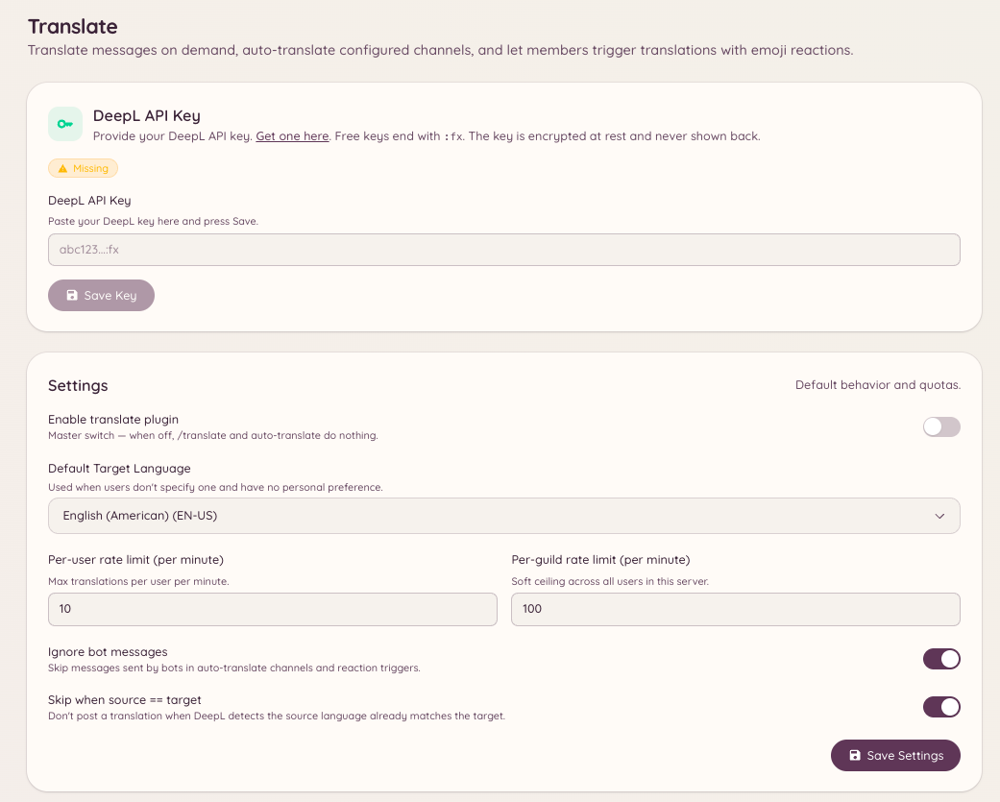

import { DashboardLink } from "/snippets/dashboard-link.jsx";

El plugin de traducción usa DeepL para traducir mensajes. Los miembros pueden traducir cualquier mensaje cuando quieran, y los administradores pueden configurar canales en los que todos los mensajes se traducen automáticamente a un idioma de destino.

<Frame>
  
</Frame>

## Traducir un mensaje

```text
/translate message <message_id> <target_language>
```

Traduce un mensaje concreto al idioma de destino. El bot responde con el texto traducido. El mensaje original no se modifica.

También puedes traducir desde el menú contextual **Aplicaciones** de Discord: haz clic derecho en cualquier mensaje, elige **Aplicaciones** y luego **Translate**.

## Consultar un idioma

```text
/translate language <language>
```

Busca un idioma por su nombre o su código para confirmar cómo lo identifica DeepL y desde qué otros idiomas y hacia cuáles se puede traducir.

## Canales con traducción automática

Puedes configurar canales para que todos sus mensajes se traduzcan automáticamente a un idioma de destino concreto. Es útil en comunidades multilingües en las que quieres que un mismo canal sea accesible para hablantes de distintos idiomas.

Ve a <DashboardLink to="translate/channels">**Translate \> Channels**</DashboardLink> (Traducción > Canales) en el panel para añadir canales a la lista de traducción automática. Para cada canal, configura:

| Ajuste | Descripción |
| --- | --- |
| **Canal** | El canal de Discord en el que activar la traducción automática |
| **Idioma de destino** | El idioma al que se traducen todos los mensajes |
| **Idioma de origen** | El idioma de origen esperado, o detección automática si lo dejas sin definir |
| **Traducir mensajes de bots** | Si el bot traduce también los mensajes que envían otros bots |

Con la traducción automática activa, el bot publica una traducción como respuesta a cada mensaje. Los mensajes que ya están en el idioma de destino se omiten.

## Emojis de cada idioma

Ve a <DashboardLink to="translate/emoji">**Translate \> Emoji Mappings**</DashboardLink> (Traducción > Emojis de idiomas) en el panel para configurar qué bandera o emoji personalizado representa a cada idioma. Estos emojis se usan en el encabezado de los mensajes traducidos para indicar de forma visual el idioma de origen y el de destino.

## Probar la traducción

Ve a <DashboardLink to="translate/test">**Translate \> Test**</DashboardLink> (Traducción > Prueba) en el panel para pasar un texto de prueba por el motor de traducción y comprobar el resultado antes de aplicarlo a canales reales.

## Permisos necesarios

| Acción | Clave de permiso |
| --- | --- |
| Traducir mensajes | `translate.use` (permitido por defecto) |
| Ver la configuración | `translate.view_config` |
| Gestionar la configuración | `translate.manage_config` |
