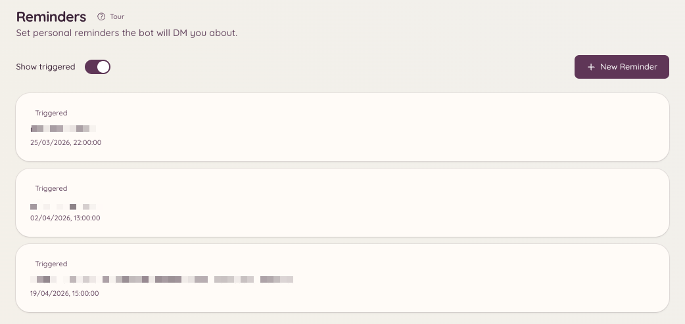

import { DashboardLink } from "/snippets/dashboard-link.jsx";

La función de recordatorios permite a los miembros crearse recordatorios. A la hora programada, el bot entrega el recordatorio por MD o lo publica en el canal donde se creó. Los recordatorios pueden incluir contexto de forma opcional (por ejemplo, un enlace a un ticket o a un hilo de modmail), para que lleguen con información suficiente para actuar.

<Frame>
  
</Frame>

## Crear un recordatorio

```text
/reminder
```

Al ejecutar `/reminder` se abre un panel interactivo. Desde el panel puedes:

- Escribir una descripción de lo que tienes que recordar
- Elegir cuándo quieres que te lo recuerde (una hora concreta, o un plazo a partir de ahora como `in 2 hours` o `tomorrow at 9am`)
- Elegir si el recordatorio se entrega por MD o se publica en el canal actual

El bot confirma el recordatorio con un mensaje que muestra el contenido y la hora de entrega programada.

## Gestionar tus recordatorios

```text
/reminders
```

Abre un panel con la lista de todos tus recordatorios pendientes. Desde este panel puedes:

- **Ver** el contenido completo de cada recordatorio
- **Borrar** los recordatorios que ya no necesites
- **Editar** la hora o la descripción de un recordatorio pendiente

Si tienes acceso al panel web, la página <DashboardLink to="reminders">**Reminders**</DashboardLink> muestra la misma lista, siempre solo con tus propios recordatorios, y también te permite añadirlos, editarlos o borrarlos desde ahí.

## Contexto de tickets y modmail

Cuando ejecutas `/reminder` dentro de un ticket o un hilo de modmail activo, el bot adjunta automáticamente al recordatorio un enlace a ese hilo. Cuando salta el recordatorio, incluye un enlace directo para que vuelvas a la conversación.

## Entrega de los recordatorios

Los recordatorios se entregan a la hora programada estés o no conectado. Si el bot no puede enviarte un MD (por ejemplo, porque tienes desactivados los MD de los miembros del servidor), intentará publicar el recordatorio en el canal donde lo creaste.

## Permisos necesarios

| Acción | Clave de permiso |
| --- | --- |
| Crear recordatorios | `reminders.view_reminders` (permitido por defecto) |
| Gestionar tus propios recordatorios | `reminders.view_reminders` (permitido por defecto) |
| Enviar recordatorios a otros miembros | `reminders.send_public_reminders` |
| Ver todos los recordatorios del servidor | `reminders.manage_reminders` |
