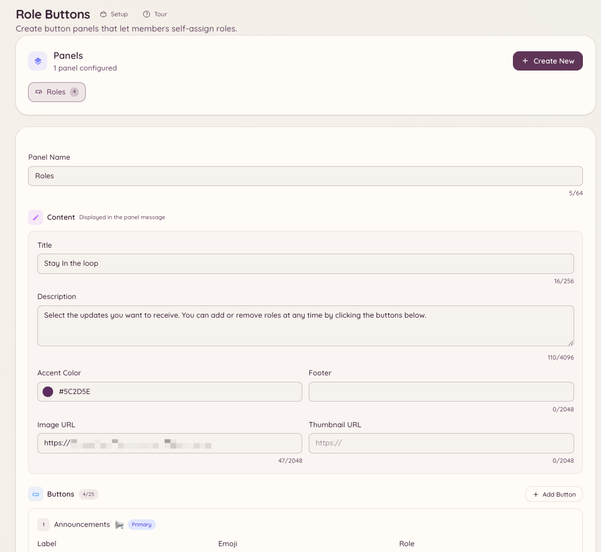

import { DashboardLink } from "/snippets/dashboard-link.jsx";

Los botones de roles son paneles permanentes publicados en un canal, con botones que los miembros pulsan para darse o quitarse roles. A diferencia de la selección de roles integrada en Discord, los paneles de Heimdall admiten modos de alternancia, grupos de roles y textos y estilos de botón personalizados.

<Frame>
  
</Frame>

## Crear un panel

```text
/rolebuttons create
```

Este comando abre un proceso de configuración en el que defines el panel. También puedes crear y gestionar los paneles por completo desde el panel web, en <DashboardLink to="rolebuttons">**Role Buttons**</DashboardLink> (Botones de roles).

### Ajustes del panel

| Ajuste | Descripción |
| --- | --- |
| **Título** | El texto del encabezado del panel |
| **Descripción** | Texto explicativo que aparece debajo del título |
| **Modo** | Cómo se asignan los roles (ver más abajo) |

### Modos de asignación

| Modo | Comportamiento |
| --- | --- |
| **Alternar** | Al pulsar se añade el rol si no lo tienes y se quita si lo tienes |
| **Solo añadir** | Al pulsar siempre se añade el rol, nunca se quita |
| **Solo quitar** | Al pulsar siempre se quita el rol, nunca se añade |
| **Exclusivo** | Solo se puede tener un rol del panel a la vez; al elegir uno nuevo se quita el anterior |

### Añadir botones

Cada botón de un panel corresponde a un rol de Discord. Para cada botón configuras:

| Ajuste | Descripción |
| --- | --- |
| **Rol** | El rol de Discord que se asigna |
| **Texto** | El texto del botón |
| **Estilo** | Principal (blurple), Secundario (gris), Éxito (verde) o Peligro (rojo) |
| **Emoji** | Un emoji opcional que se muestra en el botón |

Un mismo panel admite hasta 25 botones (5 filas de 5).

## Publicar el panel

```text
/rolebuttons post <panel_id> [channel]
```

Publica el panel en el canal indicado (o en el canal actual si no indicas ninguno). El panel es permanente: se queda en el canal indefinidamente y sigue funcionando después de que el bot se reinicie.

Si necesitas actualizar el contenido del panel después de publicarlo, edítalo en <DashboardLink to="rolebuttons">**Role Buttons**</DashboardLink> en el panel web. El mensaje publicado se actualiza solo.

## Gestionar los paneles

```text
/rolebuttons list
/rolebuttons edit <panel_id>
/rolebuttons delete <panel_id>
/rolebuttons update <panel_id>
```

La página <DashboardLink to="rolebuttons">**Role Buttons**</DashboardLink> del panel web muestra todos los paneles con el sitio donde están publicados, el número de botones y la hora de la última actualización.

## Permisos necesarios

| Acción | Clave de permiso |
| --- | --- |
| Usar los paneles de botones de roles | Todos los miembros por defecto |
| Ver los paneles en el panel web | `rolebuttons.view` |
| Crear y editar paneles | `rolebuttons.manage` |
