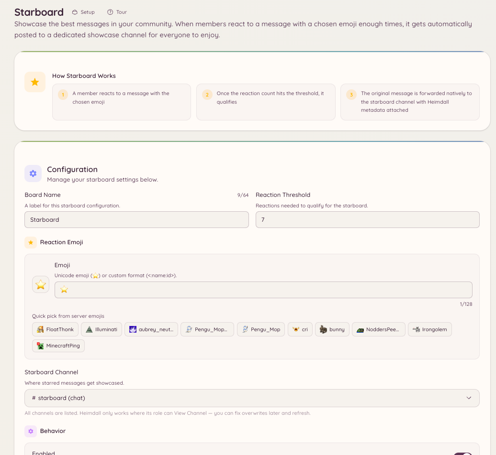

import { DashboardLink } from "/snippets/dashboard-link.jsx";

El starboard recoge los mensajes que reciben suficientes reacciones y los vuelve a publicar en un canal propio. Es una herramienta de selección en manos de la comunidad: los miembros votan con reacciones y el contenido más popular sale a la luz solo.

<Frame>
  
</Frame>

## Cómo funciona

Cuando un mensaje alcanza o supera el número de reacciones que has configurado como umbral, el bot lo copia al canal de starboard. El mensaje publicado muestra el autor original, el canal original, un enlace al original y el número actual de reacciones.

Si el número de reacciones baja del umbral (porque los miembros quitan sus reacciones), el bot quita la entrada del starboard o la mantiene, según tu configuración.

## Configuración

Ve a <DashboardLink to="starboard">**Starboard**</DashboardLink> en el panel y configura:

| Ajuste | Descripción |
| --- | --- |
| **Canal** | El canal donde se vuelven a publicar los mensajes destacados |
| **Emoji de reacción** | Qué reacción activa el starboard (por defecto, el emoji de estrella) |
| **Umbral** | El número mínimo de reacciones necesario |
| **Autoestrella** | Si cuenta la reacción del propio autor original |
| **Mensajes de bots** | Si se pueden destacar los mensajes de bots |
| **Canales NSFW** | Si se incluyen los mensajes de canales marcados como NSFW |

## Cola de moderación

El starboard tiene una cola de moderación opcional. Cuando está activada, los mensajes no se publican en el starboard en cuanto alcanzan el umbral. En su lugar, entran en una cola de pendientes en la página <DashboardLink to="starboard">**Starboard**</DashboardLink>, donde el staff puede aprobarlos o rechazarlos antes de que aparezcan.

Ve a <DashboardLink to="starboard">**Starboard**</DashboardLink> en el panel y activa **Require moderation approval** (exigir aprobación de moderación). Las entradas pendientes aparecen en la **Moderation Queue** (cola de moderación) de la misma página.

El staff con el permiso `starboard.moderate` puede aprobar o rechazar las entradas pendientes. Las aprobadas se publican; las rechazadas se descartan.

## Cambiar el umbral después de configurarlo

Subir el umbral después de configurarlo no quita las entradas del starboard ya publicadas con el umbral anterior. Bajarlo no añade mensajes antiguos con efecto retroactivo. El umbral solo se aplica a las reacciones que lleguen desde el momento en que cambia.

## Permisos necesarios

El starboard es totalmente automático y los miembros no necesitan ningún permiso. La configuración es solo para administradores:

| Acción | Clave de permiso |
| --- | --- |
| Ver la configuración | `starboard.view_config` |
| Cambiar la configuración | `starboard.manage_config` |
| Moderar la cola de aprobación | `starboard.moderate` |
