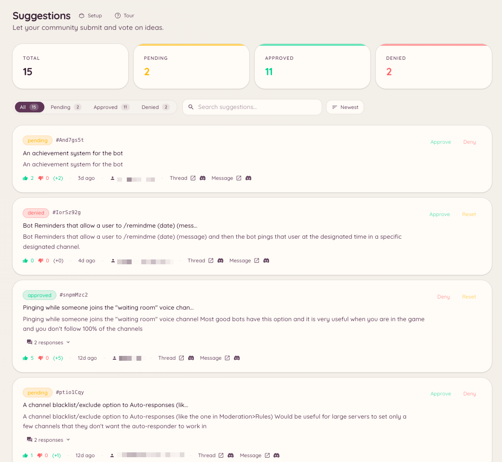

import { DashboardLink } from "/snippets/dashboard-link.jsx";

La función de sugerencias crea un flujo de trabajo propio para las opiniones de los miembros. Los miembros envían sugerencias con un comando de barra, el bot las publica como mensajes con formato en un canal designado con reacciones de voto a favor y en contra, y el staff las revisa y las gestiona desde el panel o con comandos de barra.

<Frame>
  
</Frame>

## Enviar una sugerencia

```text
/suggest <content>
```

El miembro escribe el texto de su sugerencia. El bot la publica en el canal de sugerencias configurado con las reacciones de voto ya puestas. Si la generación de títulos con IA está activada, el bot también crea un título breve que resume la sugerencia a partir de su contenido.

## Categorías

Las sugerencias se pueden enviar a distintos canales según su categoría. Ve a <DashboardLink to="suggestions/categories">**Suggestions \> Categories**</DashboardLink> en el panel para crearlas.

Cada categoría tiene:

| Ajuste | Descripción |
| --- | --- |
| **Name** (nombre) | Se muestra cuando un miembro elige una categoría |
| **Channel** (canal) | Dónde se publican las sugerencias de esta categoría |
| **Voting style** (estilo de votación) | Votos a favor y en contra, puntuación con estrellas o reacciones con emojis personalizados |
| **Who can suggest** (quién puede sugerir) | Limita el envío a roles concretos |

Cuando hay varias categorías, al ejecutar `/suggest` se le pide al miembro que elija una.

## Gestionar las sugerencias

```text
/suggestion-config
/suggestion-categories list
/suggestion-categories create <name>
/suggestion-categories delete <id>
```

El staff gestiona cada sugerencia desde el panel, en <DashboardLink to="suggestions/list">**Suggestions \> Suggestions**</DashboardLink>, o con las acciones del menú contextual del mensaje de la sugerencia.

Acciones disponibles en una sugerencia:

| Acción | Descripción |
| --- | --- |
| **Approve** (aprobar) | Marca la sugerencia como aceptada; el bot añade una insignia de estado al mensaje |
| **Reject** (rechazar) | La marca como rechazada, con un motivo opcional publicado como respuesta |
| **In progress** (en curso) | La marca como en desarrollo |
| **Implemented** (implementada) | La marca como completada |
| **Archive** (archivar) | La quita del listado activo sin borrarla |

Cuando se actúa sobre una sugerencia, el bot actualiza el mensaje original para mostrar el nuevo estado y mantiene visibles los resultados de la votación.

## Configuración en el panel

Ve a <DashboardLink to="suggestions/config">**Suggestions \> Configuration**</DashboardLink> para configurar:

| Ajuste | Descripción |
| --- | --- |
| **Default channel** (canal predeterminado) | Adónde van las sugerencias cuando no hay categorías definidas |
| **Anonymous suggestions** (sugerencias anónimas) | Publica las sugerencias sin mostrar el nombre de quien las envía |
| **Duplicate detection** (detección de duplicados) | Avisa a quien envía la sugerencia si ya existe una parecida |
| **AI titles** (títulos con IA) | Genera automáticamente un título corto a partir del texto de la sugerencia |
| **Min/max length** (longitud mínima/máxima) | Impone límites de caracteres al contenido enviado |

## Botones de apertura

Los botones de apertura son botones publicados en un canal que los miembros pulsan para enviar una sugerencia mediante un formulario emergente, sin tener que escribir el comando `/suggest`. Ve a <DashboardLink to="suggestions/openers">**Suggestions \> Openers**</DashboardLink> y pulsa **New Opener**. Configura la etiqueta del botón y un texto de indicación opcional, y después pulsa **Post** para colocar el panel del botón en un canal.

Los botones de apertura sirven para que el flujo de sugerencias esté siempre a la vista en un canal de sugerencias propio, o en servidores donde los comandos de barra están restringidos.

## Permisos necesarios

| Acción | Clave de permiso |
| --- | --- |
| Enviar sugerencias | `suggestions.create_suggestion` (permitido por defecto) |
| Ver las sugerencias en el panel | `suggestions.items.view_suggestions` |
| Aprobar y rechazar sugerencias | `suggestions.items.manage_suggestions` |
