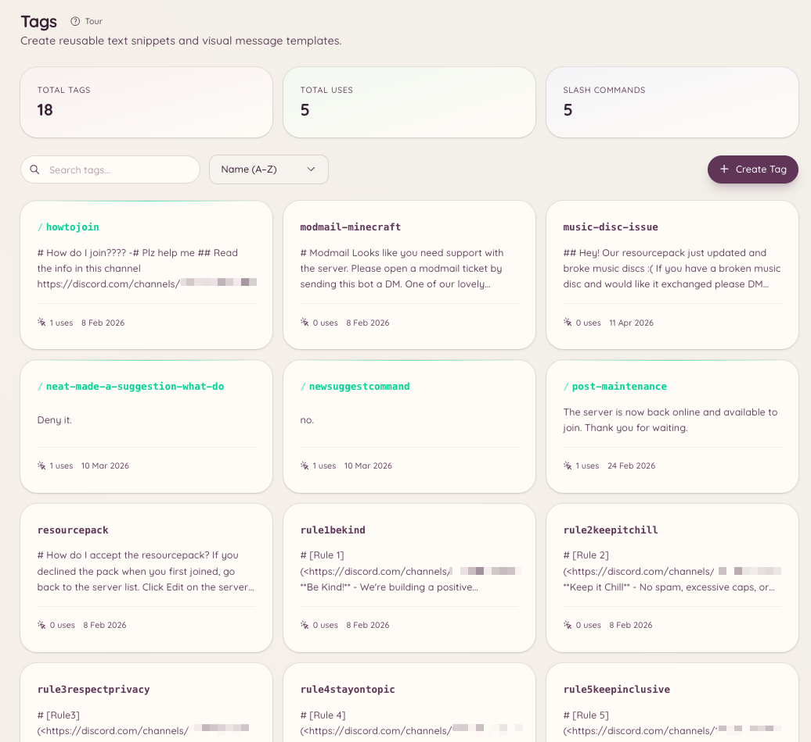

import { DashboardLink } from "/snippets/dashboard-link.jsx";

Las etiquetas son contenidos reutilizables (un bloque de texto, un embed o un mensaje con formato) que se pueden publicar en cualquier canal con un solo comando. Son especialmente útiles para el staff que responde a menudo las mismas preguntas, comparte los mismos recursos o publica anuncios con formato. Las etiquetas guardan el contenido una vez y permiten que cualquiera con acceso lo publique al instante.

<Frame>
  
</Frame>

## Usar una etiqueta

```text
/tag use <name>
```

Publica el contenido de la etiqueta en el canal actual. Los nombres de las etiquetas tienen autocompletado: empieza a escribir y el bot te sugiere las etiquetas que coinciden.

## Crear una etiqueta

```text
/tag create <name>
```

Abre un formulario emergente donde escribes el contenido de la etiqueta. El contenido admite el markdown de Discord. Si quieres crear una etiqueta con un embed enriquecido, usa <DashboardLink to="tags/tags">**Tags**</DashboardLink> en el panel, donde tienes un editor visual de embeds.

Para crear una etiqueta desde el panel, ve a <DashboardLink to="tags/tags">**Tags**</DashboardLink> y pulsa **New Tag**. El editor del panel admite:

- Contenido de texto plano
- Embed con título, descripción, campos, color y miniatura
- Subida de archivos adjuntos

## Editar y borrar

```text
/tag edit <name>
/tag delete <name>
```

Al editar se abre el mismo formulario que al crear. Al borrar, la etiqueta se elimina para siempre.

## Ver la lista de etiquetas

```text
/tag list
```

Muestra todas las etiquetas disponibles en tu servidor. La página <DashboardLink to="tags/tags">**Tags**</DashboardLink> del panel ofrece la misma lista con opciones de búsqueda y filtrado.

## Publicaciones

Las publicaciones se parecen a las etiquetas, pero están pensadas para contenido más largo fijado en canales concretos. Las publicaciones programadas se gestionan en el panel, en <DashboardLink to="settings/messages">**Settings \> Messages**</DashboardLink>, dentro de **Scheduled posts**. El comando `/post` funciona junto a `/tag`:

```text
/post send <name> [channel]
/post list
```

Una publicación envía el contenido a un canal designado en lugar de al canal donde se ejecuta el comando. Usa las publicaciones para cosas como anuncios semanales o recursos fijados que tienen que ir a un sitio concreto, se lance el comando donde se lance.

## Plantillas

Las plantillas son embeds base guardados en el panel que el staff puede usar como punto de partida al crear etiquetas nuevas. Están en <DashboardLink to="settings/messages">**Settings \> Messages**</DashboardLink>, dentro de **Reusable templates**.

## Permisos necesarios

| Acción | Clave de permiso |
| --- | --- |
| Usar etiquetas | `tags.view_tags` (permitido por defecto) |
| Crear, editar y borrar etiquetas | `tags.manage_tags` |
| Enviar publicaciones | `tags.manage_posts` |
