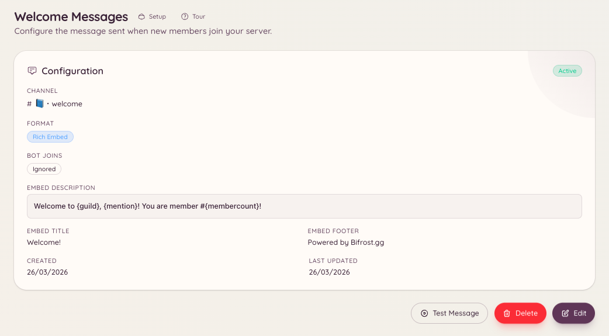

import { DashboardLink } from "/snippets/dashboard-link.jsx";

El plugin de bienvenida publica un mensaje en un canal concreto cada vez que un miembro entra en tu servidor. El mensaje es totalmente personalizable: puedes escribirlo como texto normal o como un embed enriquecido, y usar variables para incluir el nombre del miembro, el nombre del servidor y el número actual de miembros.

<Frame>
  
</Frame>

## Configuración

```text
/welcome setup
```

`/welcome setup` abre un formulario de configuración donde eliges el canal de bienvenida y redactas tu mensaje. También puedes configurarlo todo desde el panel, en <DashboardLink to="welcome">**Welcome**</DashboardLink> (Bienvenida).

### Configuración desde el panel

Ve a <DashboardLink to="welcome">**Welcome**</DashboardLink> en la barra lateral del panel. La página de configuración tiene:

| Ajuste | Descripción |
| --- | --- |
| **Canal** | El canal donde se publican los mensajes de bienvenida |
| **Contenido del mensaje** | El texto normal o el contenido del embed del mensaje de bienvenida |
| **Interruptor de embed** | Envía el mensaje como un embed enriquecido con color y campos |
| **Color del embed** | El color del lateral izquierdo del embed |

## Variables disponibles

Las variables son marcadores de tu mensaje que el bot rellena en el momento de enviarlo. Escríbelas entre llaves:

| Variable | Se sustituye por |
| --- | --- |
| `{user}` | Una mención al nuevo miembro (`@Username`) |
| `{user.name}` | El nombre visible del miembro (sin mención) |
| `{user.id}` | El ID de usuario de Discord del miembro |
| `{server}` | El nombre de tu servidor |
| `{server.count}` | El número total de miembros después de la entrada |
| `{server.id}` | El ID de tu servidor |

### Mensaje de ejemplo

```text
Welcome to {server}, {user}! You are member number {server.count}.
Please read <#channel-id> before getting started.
```

## Probar el mensaje de bienvenida

```text
/welcome test
```

Publica una vista previa de tu mensaje de bienvenida en el canal actual, usando tu propia cuenta como miembro de prueba. Es útil para comprobar el formato y las variables antes de la próxima entrada real.

## Ver la configuración actual

```text
/welcome view
```

Muestra la configuración actual del mensaje de bienvenida sin hacer un envío de prueba.

## Quitar el mensaje de bienvenida

```text
/welcome remove
```

Desactiva el mensaje de bienvenida. La configuración se conserva para que puedas volver a activarlo más adelante.

## Permisos necesarios

| Acción | Clave de permiso |
| --- | --- |
| Ver la configuración de bienvenida | `welcome.view_config` |
| Editar la configuración de bienvenida | `welcome.manage_config` |
