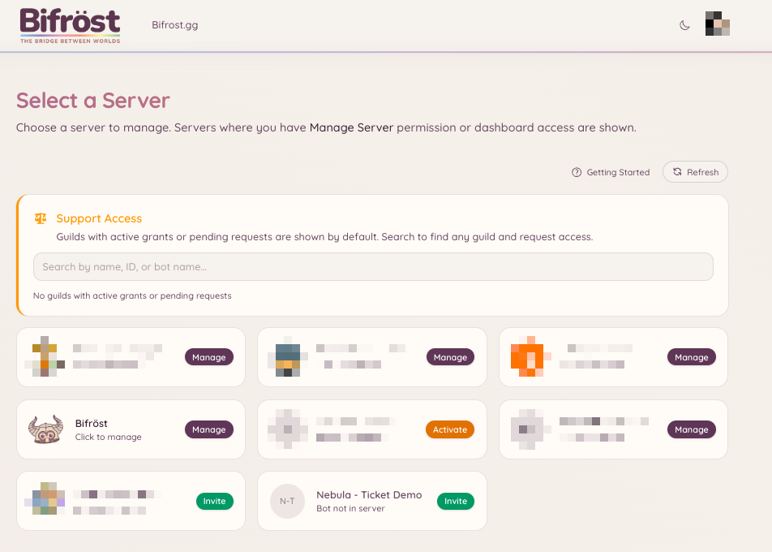
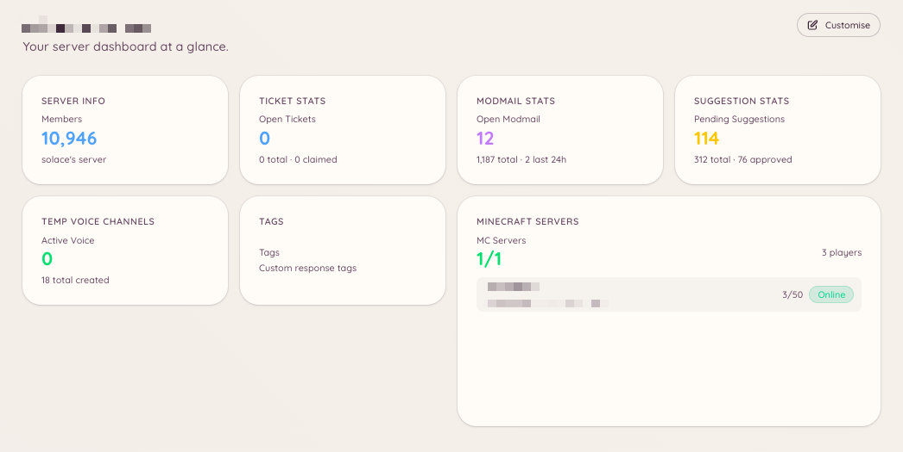

import { DashboardLink } from "/snippets/dashboard-link.jsx";

El panel de Heimdall es una interfaz web donde los administradores del servidor configuran todas las funciones del bot. Los miembros normales no necesitan acceso al panel a menos que se les haya concedido de forma explícita.

## Iniciar sesión

Ve a [**bot.bifrost.gg**](https://bot.bifrost.gg) y pulsa **Sign in with Discord**. Discord te pedirá que autorices la aplicación del panel, que lee tu nombre de usuario, tu avatar y la lista de servidores que gestionas. No se pide acceso a mensajes ni a contenido.

Una vez dentro, llegarás al selector de servidores.

## Selector de servidores

El selector de servidores muestra todos los servidores de Discord en los que tienes el permiso Gestionar servidor y en los que está Heimdall. Pulsa la tarjeta de un servidor para abrir su panel.

Si gestionas un servidor pero Heimdall no se ha añadido a él, la tarjeta mostrará "Invite". Solo tienes que pulsarla para invitar a Heimdall a tu servidor.

<Frame>
  
</Frame>

## Página de vista general

La página <DashboardLink to="overview">**Overview**</DashboardLink> es lo primero que ves al seleccionar un servidor. En lugar de un diseño fijo, es un panel de widgets totalmente personalizable. Heimdall ofrece una biblioteca de widgets informativos (desde el número de miembros del servidor y las colas de tickets hasta el estado del servidor de Minecraft y el volumen de modmail) y tú los colocas como mejor te vaya para trabajar.

Para personalizar el diseño, pulsa **Edit layout** en la esquina superior derecha de la página <DashboardLink to="overview">**Overview**</DashboardLink>. En el modo de edición puedes:

- **Añadir widgets**: pulsa el botón **\+** para abrir el selector de widgets y colocar widgets de la biblioteca
- **Mover widgets**: arrastra cualquier tarjeta a una nueva posición de la cuadrícula
- **Cambiar el tamaño de los widgets**: arrastra el tirador de tamaño para cambiar las dimensiones de una tarjeta
- **Quitar widgets**: pasa el ratón por encima de una tarjeta y pulsa el botón de quitar para sacarla de la cuadrícula

Los widgets que tienes disponibles dependen de qué funciones estén activadas en tu servidor y de qué permisos del panel tenga concedidos tu rol. Los widgets de funciones que no están activas no aparecen en el selector.

<Frame>
  
</Frame>

## Navegación

La barra lateral izquierda muestra todas las funciones disponibles. Cada entrada enlaza con la sección de configuración y gestión de esa función. Las secciones con subpáginas se despliegan al pulsarlas y muestran pestañas como **Configuration**, **Analytics**, **Categories**, etc.

La barra lateral se divide en grupos que coinciden con las secciones de esta documentación: moderación, soporte, comunidad, voz, juegos, integraciones, IA y utilidades.

## Paneles publicados en más de un canal

Un panel de botones es un mensaje con botones que pulsan los miembros, como un botón para abrir tickets, un panel de botones de roles o el panel para vincular la cuenta de Minecraft. Puedes publicar el mismo panel en todos los canales que quieras. Publicarlo en un canal nuevo añade una copia allí. Nunca mueve ni borra las copias que ya tienes.

Al publicar un panel, el cuadro de publicación muestra una lista **Posted in** (publicado en) con todas las copias que Heimdall conoce. Cada fila muestra el canal, cuándo se publicó la copia, quién la publicó si Heimdall lo sabe, y su estado:

| Estado | Significado | Qué puedes hacer |
| --- | --- | --- |
| **Live** (activa) | El mensaje está en el canal | **Refresh** lo actualiza con el texto actual. **Delete** lo quita del canal |
| **Deleted** (borrada) | Alguien borró el mensaje en Discord | **Post again** lo vuelve a poner en el mismo canal. **Remove from list** lo olvida |
| **Can't reach** (inaccesible) | Heimdall no puede ver el canal ni leer su historial | **Remove from list** lo olvida. Heimdall no puede saber si el mensaje sigue ahí, así que bórralo a mano si es así |

Cambiar el texto de un panel, o un ajuste que cambie lo que dice, actualiza todas las copias que siguen ahí. Una copia que alguien ha borrado se quita de la lista en lugar de volver a publicarse.

Heimdall solo borra los mensajes que envió él. Si resulta que una copia de la lista es un mensaje de otra persona, Delete lo deja en el canal y solo lo quita de la lista.

Al borrar un botón de apertura de sugerencias o de juegos también se borran las copias de la lista a las que Heimdall puede llegar. Una copia a la que no puede llegar, o que nunca estuvo en la lista, se queda en Discord con botones que ya no funcionan, así que bórrala allí.

<Note>
  En la mayoría de los paneles, Heimdall antes solo recordaba la copia más reciente, así que al principio esa es la única copia antigua que aparece en la lista. Una copia antigua en otro sitio se añade la primera vez que un miembro pulsa uno de sus botones, siempre que Heimdall pueda saber a qué panel pertenece. En los botones de apertura (tickets, modmail, sugerencias y juegos), Heimdall no siempre puede saber a qué botón de apertura pertenece una copia antigua, así que puede que una copia antigua de un botón de apertura nunca se añada de esta forma. Mientras una copia no esté en la lista, Refresh y Delete no pueden llegar a ella, y puedes borrarla en Discord como siempre.
</Note>

## Permisos en el panel

Tu acceso a las secciones del panel depende de los permisos que tengan concedidos tus roles de Discord. Si no ves una sección, o no tienes el permiso correspondiente o la función no está activada. Los administradores con el permiso **Administrador** de Discord siempre tienen acceso completo.

Consulta [Permisos](/es/permissions) para ver una explicación completa de cómo funciona el sistema de permisos.

## Hacer cambios

Los cambios que haces en el panel se aplican al instante. No hay un paso de publicar ni de guardar todo: cada sección tiene su propio botón **Save** que aplica los cambios solo a esa sección.

<Note>
  No hace falta reiniciar el bot cuando cambias la configuración. Los cambios se recogen automáticamente.
</Note>
