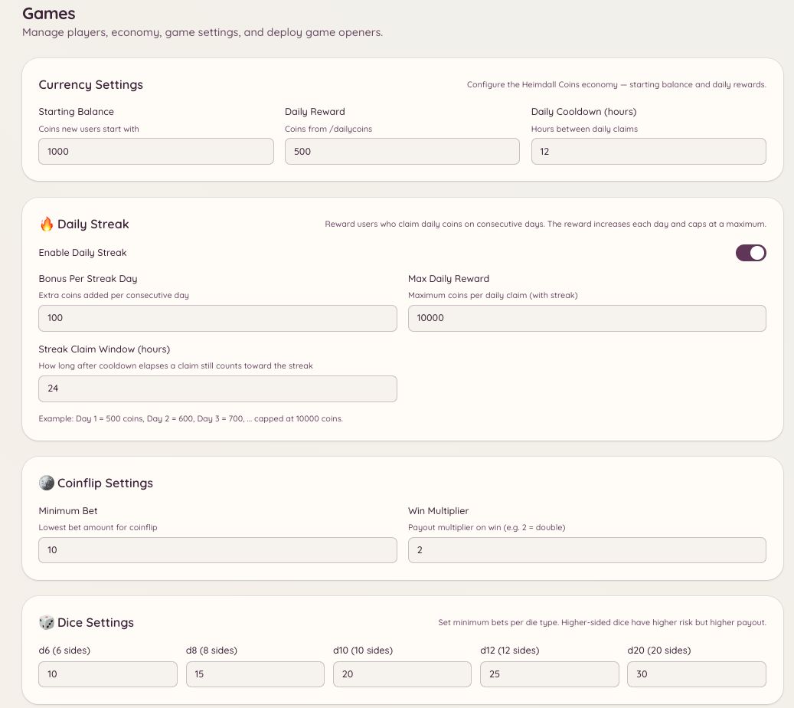

import { DashboardLink } from "/snippets/dashboard-link.jsx";

El sistema de economía le da a tu servidor una moneda virtual que los miembros ganan y gastan con los juegos y las recompensas diarias. La moneda es propia de cada servidor: los saldos no pasan de un servidor a otro.

<Frame>
  
</Frame>

## Consultar tu saldo

```text
/balance [user]
```

Muestra tu saldo actual de monedas. Si indicas un usuario, muestra el saldo de ese miembro (siempre que haya hecho visible su saldo).

## Recompensa diaria

```text
/dailycoins
```

Reclama tu asignación diaria de monedas. Los miembros pueden ejecutarlo una vez por cada periodo de espera (24 horas por defecto). La cantidad que se entrega se fija en <DashboardLink to="games/config/economy">**Games \> Configuration \> Economy**</DashboardLink>.

Los administradores también pueden crear comandos de recompensa adicionales con cantidades y periodos de espera propios mediante la configuración de `/economy claim`.

## Dar propinas a otros miembros

```text
/tip <user> <amount>
```

Transfiere monedas de tu saldo a otro miembro. La propina es inmediata y no se puede deshacer. Úsala para premiar a miembros que ayudan, pagar servicios dentro de la economía del juego o compartir ganancias.

## Tabla de clasificación

```text
/leaderboard
```

Muestra a quienes más monedas tienen en tu servidor, ordenados por saldo. La tabla de clasificación es propia de cada servidor.

Los administradores también pueden ver la tabla de clasificación completa en el panel, en <DashboardLink to="games/players">**Games \> Players**</DashboardLink>, que incluye más detalle que la versión de Discord.

## Recompensas reclamables

El comando `/economy claim` permite a los administradores configurar eventos de recompensa únicos o recurrentes. Los miembros ejecutan el comando para recibir una recompensa definida por el administrador. Configura los eventos de recompensa en <DashboardLink to="games/config">**Games \> Configuration**</DashboardLink>.

## Gestionar los saldos de los miembros

Los administradores pueden ver y ajustar el saldo de cada miembro desde el panel, en <DashboardLink to="games/players">**Games \> Players**</DashboardLink>. Selecciona a un miembro y usa las herramientas de ajuste de saldo para añadir, quitar o fijar directamente su saldo. Todos los ajustes quedan registrados.

## Historial de transacciones

La página <DashboardLink to="games/transactions">**Games \> Transactions**</DashboardLink> del panel muestra un registro de todas las transacciones de la economía: recompensas diarias, propinas, ganancias y pérdidas en los juegos y ajustes de los administradores. Cada entrada muestra el miembro, la cantidad, el tipo de transacción y la marca de tiempo.

## Personalizar la moneda

Configura el nombre de la moneda, su emoji, la cantidad de la recompensa diaria y el saldo inicial en <DashboardLink to="games/config/economy">**Games \> Configuration \> Economy**</DashboardLink>. Cambiar el nombre de la moneda no afecta a los saldos existentes.

## Permisos necesarios

| Acción | Clave de permiso |
| --- | --- |
| Consultar el saldo y reclamar recompensas | `games.use` (permitido por defecto) |
| Dar propinas | `games.use` (permitido por defecto) |
| Gestionar los saldos de los jugadores | `games.manage` |
