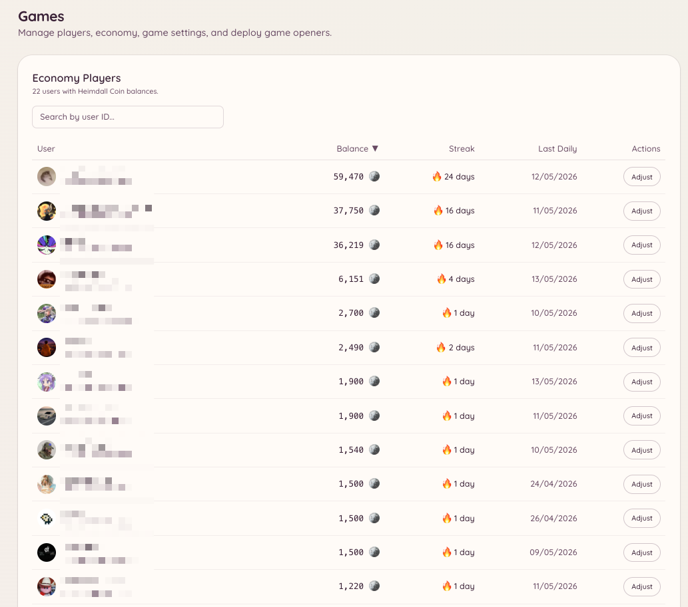

import { DashboardLink } from "/snippets/dashboard-link.jsx";

La función de juegos ofrece un conjunto completo de juegos interactivos (juegos de mesa, juegos de casino y un sistema de economía), todos jugables directamente en Discord. Cada juego es su propio comando de barra. La capa de economía da a los miembros una moneda virtual que ganan con las recompensas diarias, las ganancias en los juegos y las propinas.

<Frame>
  
</Frame>

## Juegos disponibles

<Columns cols={2}>
  <Card title="Juegos de mesa" icon="chess-board" href="/es/games/board-games">
    2048, Connect Four, Memory, Tic-Tac-Toe, Battleship, Solitaire
  </Card>

  <Card title="Juegos de casino" icon="dice" href="/es/games/casino">
    Blackjack, Coinflip, Dice, Higher-Lower, Horse Racing, Mines, Roulette
  </Card>

  <Card title="Economía" icon="coins" href="/es/games/economy">
    Saldo, monedas diarias, propinas, tabla de clasificación y recompensas reclamables
  </Card>
</Columns>

## Activar los juegos

Ve a <DashboardLink to="games/config">**Games \> Configuration**</DashboardLink> en el panel. Los juegos están activados por defecto para todos los miembros en cuanto la función está activa.

## Control de acceso

Puedes limitar qué canales y roles tienen acceso a los juegos:

- **Canales**: ve a <DashboardLink to="games/config/channels">**Games \> Configuration \> Channels**</DashboardLink> e indica los canales donde se permiten los juegos. Si no hay canales configurados, los juegos funcionan en todas partes.
- **Roles**: ve a <DashboardLink to="games/config/openers">**Games \> Configuration \> Openers**</DashboardLink> para limitar los comandos de juegos a roles concretos.

Limitar los juegos a un canal propio evita que llenen otras partes de tu servidor.

## Configuración de la economía

Ve a <DashboardLink to="games/config/economy">**Games \> Configuration \> Economy**</DashboardLink> para configurar:

| Ajuste | Descripción |
| --- | --- |
| **Currency name** (nombre de la moneda) | Cómo llama tu servidor a su moneda (por ejemplo, "monedas", "oro", "créditos") |
| **Currency emoji** (emoji de la moneda) | Un emoji opcional que se muestra junto a los saldos |
| **Daily claim amount** (cantidad diaria) | Cuántas monedas reciben los miembros en cada recompensa diaria |
| **Daily claim cooldown** (espera de la recompensa diaria) | Cuánto tiempo pasa entre recompensas diarias (24 horas por defecto) |
| **Starting balance** (saldo inicial) | Con cuántas monedas empiezan los miembros nuevos |

## Ajustes de visibilidad

Puedes ocultar juegos concretos de la lista de comandos sin desactivarlos. Ve a <DashboardLink to="games/config/visibility">**Games \> Configuration \> Visibility**</DashboardLink> para elegir qué juegos ven los miembros.

## Estadísticas de los jugadores

Ve a <DashboardLink to="games/players">**Games \> Players**</DashboardLink> en el panel para ver a todos los miembros que han usado el sistema de juegos. Para cada jugador puedes ver su saldo actual, el total de partidas jugadas, su balance de victorias y derrotas en cada tipo de juego y la última vez que estuvo activo.

El staff con el permiso `games.manage` puede ajustar el saldo de un jugador, reiniciar sus estadísticas o quitarlo de la tabla de clasificación desde esta página.

## Transacciones

Ve a <DashboardLink to="games/transactions">**Games \> Transactions**</DashboardLink> para ver el libro completo de transacciones de la economía de tu servidor. Cada entrada registra:

| Campo | Descripción |
| --- | --- |
| **Player** (jugador) | A qué miembro pertenece la transacción |
| **Type** (tipo) | El origen de la transacción (recompensa diaria, victoria o derrota en un juego, propina, ajuste de un administrador, recompensa por voto) |
| **Amount** (cantidad) | Cuántas monedas se añadieron o se descontaron |
| **Balance after** (saldo después) | El saldo del jugador después de la transacción |
| **Timestamp** (marca de tiempo) | Cuándo se hizo la transacción |

Filtra por jugador, tipo de transacción o rango de fechas. El registro de transacciones es de solo lectura.

## Analíticas

Ve a <DashboardLink to="games/analytics">**Games \> Analytics**</DashboardLink> para ver estadísticas globales de los juegos de tu servidor:

- Los juegos más jugados por número de sesiones
- El total de monedas en circulación
- Los jugadores activos cada día a lo largo del tiempo
- Quienes más ganan y quienes más gastan

## Preguntas de trivia

Si el juego de trivia está activado, ve a <DashboardLink to="games/trivia">**Games \> Trivia Questions**</DashboardLink> para gestionar el banco de preguntas. Puedes:

- Añadir preguntas de trivia propias con respuestas de opción múltiple
- Importar un lote de preguntas desde un archivo CSV
- Editar o borrar preguntas existentes
- Activar o desactivar preguntas concretas sin borrarlas

Las preguntas propias aparecen en la rotación de la trivia junto a las preguntas incluidas.

## Recompensas por votar

Ve a <DashboardLink to="games/topgg">**Games \> Vote Rewards**</DashboardLink> para configurar recompensas de economía para los miembros que votan por tu servidor en top.gg. Cuando un miembro vota, Heimdall recibe un aviso por webhook de top.gg y abona automáticamente en su saldo la recompensa en monedas configurada.

Para configurar las recompensas por votar:

1. Introduce la URL de tu servidor en top.gg en la configuración
2. Copia la URL del webhook que se te da y pégala en los ajustes de webhook de la ficha de tu servidor en top.gg
3. Fija la cantidad de la recompensa (monedas por voto)
4. Si quieres, configura un multiplicador extra para los votos del fin de semana

## Permisos necesarios

| Acción | Clave de permiso |
| --- | --- |
| Jugar a los juegos | `games.use` (permitido por defecto) |
| Gestionar la configuración | `games.manage` |
