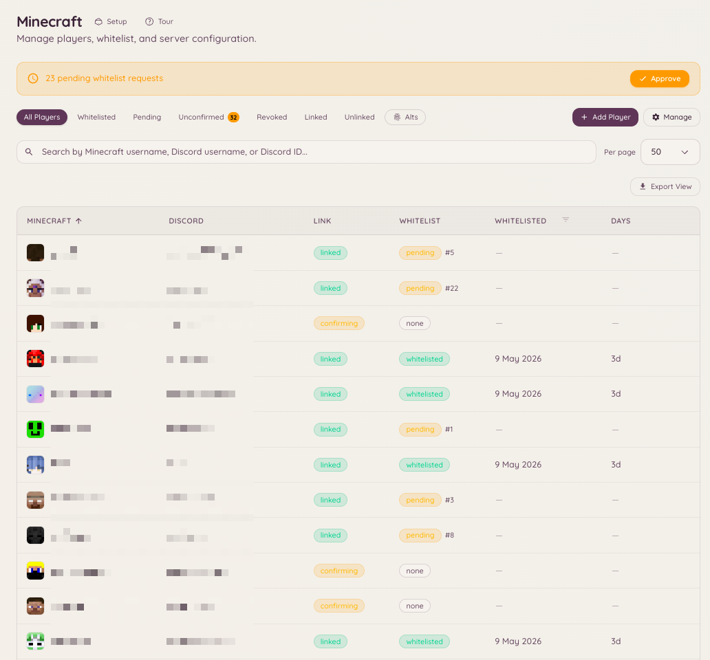

import { DashboardLink } from "/snippets/dashboard-link.jsx";

La integración con Minecraft conecta tu servidor de Discord con uno o varios servidores de Minecraft Java Edition. Ofrece vinculación de cuentas (une un usuario de Discord con su nombre de usuario de Minecraft), gestión de la lista blanca sincronizada con los roles de Discord, acceso por RCON para ejecutar comandos a distancia, una vista del estado del servidor en directo y un motor de sanciones nativo para baneos, silencios, advertencias y expulsiones.

<Frame>
  
</Frame>

## Navegación en el panel

La función de Minecraft tiene siete páginas en la barra lateral del panel:

| Página | Qué hay en ella |
| --- | --- |
| <DashboardLink to="minecraft/networks">**Networks**</DashboardLink> | Tus servidores, quién está en ellos y qué acaba de pasar |
| <DashboardLink to="minecraft/players">**Players**</DashboardLink> | La lista de jugadores, la cola de entrada y el perfil de cada jugador |
| <DashboardLink to="minecraft/rules">**Rules**</DashboardLink> | Qué cuenta como infracción y cómo escala |
| <DashboardLink to="minecraft/history">**History**</DashboardLink> | Todo lo que le ha pasado a un jugador, por orden cronológico |
| <DashboardLink to="minecraft/enforcement">**Enforcement**</DashboardLink> | Cómo sanciona Heimdall y qué ve el público |
| <DashboardLink to="minecraft/bridge">**Chat Bridge**</DashboardLink> | Retransmite el chat del juego a canales de Discord, y al revés |
| <DashboardLink to="minecraft/settings">**Settings**</DashboardLink> | Vinculación, RCON, sincronización de roles, alertas y mensajes para todo el servidor de Discord |

## Vinculación de cuentas

Un vínculo une un nombre de Minecraft con una cuenta de Discord. Los miembros lo inician desde Discord y demuestran que es suyo con un código de 6 dígitos que se muestra en el juego.

### El panel de vinculación de cuentas

El panel es un mensaje de Discord con los botones **Link Account**, **Unlink Account** y **My Account**. Publícalo de cualquiera de estas formas:

- El último paso de la configuración de Minecraft ofrece publicarlo.
- <DashboardLink to="settings/messages">**Settings \> Messages**</DashboardLink>, en **Account linking panel**: **Post** lo envía al canal que elijas. Publicarlo en el canal donde ya está actualiza ese mensaje; publicarlo en otro sitio añade allí una copia y deja las demás donde están (consulta [Paneles publicados en más de un canal](/es/dashboard#panels-posted-in-more-than-one-channel)). Ahí también puedes reescribir el texto del panel y conservar sus botones.
- `/minecraft-setup panel` desde Discord.

Los miembros también pueden empezar con un comando de barra:

```text
/link-minecraft
```

### Cómo se consigue el código

Después de que un miembro introduzca su nombre de Minecraft, el código le llega en el juego:

- **Un servidor que exige lista blanca** rechaza su entrada y muestra el código en la pantalla de desconexión.
- **Una red configurada para que entre cualquiera** (ver más abajo) le deja entrar. Con el plugin de Heimdall 3.0.0-rc.19 o posterior, el código se muestra en cuanto entra, y al momento si ya está conectado. En Paper 1.21.7 o posterior, con un cliente 1.21.6 o posterior, se abre como un diálogo con un botón **Copy code**; en todos los demás casos, incluidos los jugadores de Bedrock, es un mensaje de chat en el que puedes hacer clic para copiarlo. El aviso indica la cuenta de Discord que lo pidió y advierte al jugador de que nunca dé el código a nadie.
- **Cualquier servidor** también da el código si se pide: el jugador ejecuta **/linkdiscord** en el juego.

Después, el miembro pulsa **Confirm Code** en el panel de su cuenta en Discord y lo introduce.

Los jugadores también pueden empezar en el juego: **/linkdiscord** les da un código sin haber empezado desde Discord.

<Note>
En una red que deja entrar a cualquiera, **/linkdiscord** necesita el plugin 3.0.0-rc.13 o posterior. Las versiones anteriores lo tratan como el comando del módulo de lista blanca y solo lo repiten. Actualiza el plugin con **/hd update** en el juego o desde su página de descarga.
</Note>

### Dejar entrar a cualquiera

La política de cada red, en su página dentro de <DashboardLink to="minecraft/networks">**Minecraft \> Networks**</DashboardLink>, tiene la opción **Anyone can join, linking is optional** (puede entrar cualquiera, vincular es opcional). Con ella activada no se rechaza a nadie, la lista blanca se desactiva en los servidores de esa red y los jugadores que quieran sus roles de Discord en el juego se vinculan como se explica arriba. El resto de la política de la red vuelve a aplicarse cuando la desactivas.

Una vez vinculado, Heimdall puede:

- Añadir al miembro a la lista blanca, automáticamente o tras la aprobación del staff, según la política de la red
- Quitarlo de la lista blanca si pierde el acceso
- Sincronizar sus roles de Discord con grupos del juego (<DashboardLink to="minecraft/settings">**Minecraft \> Settings \> Role sync**</DashboardLink>)
- Mostrar su nombre de usuario de Minecraft junto a su perfil de Discord en el portal de clientes

<span id="linked-role"></span>
### Rol de vinculado

Heimdall puede dar un rol de Discord a cada miembro que haya vinculado una cuenta de Minecraft, por ejemplo para abrir un canal solo para jugadores. Actívalo en <DashboardLink to="minecraft/settings">**Minecraft \> Settings**</DashboardLink>, dentro de **Who can link, and how**, y elige el rol.

- El rol se da en cuanto se confirma el vínculo, esté o no el jugador en la lista blanca todavía. Funciona igual con la lista blanca activada que solo con la vinculación.
- Se quita cuando el miembro desvincula su última cuenta de Minecraft, o cuando el staff borra al jugador definitivamente.
- **Take it away from blocked players** (quitárselo a los jugadores bloqueados), activado por defecto, también quita el rol mientras un jugador está bloqueado, revocado o eliminado por el staff, y se lo devuelve cuando se le desbloquea.
- Los miembros que se vincularon antes de que lo activaras reciben el rol al guardar. Cambiar el rol pasa a todo el mundo del rol antiguo al nuevo.
- Cambiar el rol, o la opción **Take it away from blocked players**, lanza una [tarea en segundo plano](/es/community/levels#background-jobs) que recorre a todos los miembros vinculados. Su progreso aparece debajo del ajuste después de guardar, y en <DashboardLink to="settings/background-jobs">**Settings \> Background Jobs**</DashboardLink>, donde también puedes cancelarla. Para verla se necesita `minecraft.server.manage_config`.
- Heimdall solo quita el rol a los miembros a los que se lo dio, así que quien lo recibió de tu mano lo conserva.

El bot necesita el permiso **Gestionar roles** y un rol por encima del rol de vinculado. Se rechaza un rol con permisos de moderación o de administración, en Discord o en Heimdall, y también un rol que ya da una asignación de sincronización de roles de Minecraft a Discord.

## Gestión de la lista blanca

Ve a <DashboardLink to="minecraft/players">**Minecraft \> Players**</DashboardLink> en el panel para ver el estado completo de la lista blanca: quién está vinculado, quién está pendiente de verificación y a quién se ha aprobado o denegado a mano.

### Lista blanca automática y aprobación

La política de cada red, en <DashboardLink to="minecraft/networks">**Minecraft \> Networks**</DashboardLink>, decide qué concede un vínculo: **Auto-whitelist** añade a la lista blanca de esa red a un miembro vinculado sin revisión, y **Require staff approval** retiene las solicitudes en una cola en la página <DashboardLink to="minecraft/players">**Players**</DashboardLink> hasta que se tome una decisión. La lista blanca la envía a tus servidores el plugin de Heimdall, no RCON.

Cómo se vinculan los miembros, cuántas cuentas puede tener cada uno y cuánto tiempo sigue siendo válido un código se configura en <DashboardLink to="minecraft/settings">**Minecraft \> Settings \> Who can link, and how**</DashboardLink>.

```text
/import-whitelist
```

Importa un archivo de lista blanca existente de tu servidor de Minecraft y vincula cada nombre de usuario con su cuenta de Discord cuando encuentra una coincidencia.

## Estado del servidor

```text
/mcstatus [server]
/minecraft-status
```

Muestra el estado en directo de tu servidor de Minecraft configurado: si está en línea o no, el número actual de jugadores, la lista de jugadores y la versión del servidor. La información se obtiene directamente mediante el protocolo del servidor de Minecraft y no requiere RCON.

La página <DashboardLink to="minecraft/networks">**Minecraft \> Networks**</DashboardLink> del panel muestra la misma información, servidor por servidor, en un formato que se actualiza continuamente.

## Lista de jugadores

```text
/playerlist [public]
```

`/playerlist` es opcional y está desactivado por defecto: no registra ningún comando, ni ocupa ningún hueco de comandos, hasta que un administrador activa **Player list command** en <DashboardLink to="minecraft/settings">**Minecraft \> Settings**</DashboardLink>. El comando en sí no tiene opción de servidor. El panel fija lo que muestra cuando lo activas: un servidor reclamado o, en un servidor de Discord con más de una red, una red entera, agrupada según el servidor en el que está cada jugador. Los miembros nunca eligen el destino; solo ven el que se configuró en el panel.

La respuesta solo la ve quien ejecutó el comando, salvo que añada `public:true`, que publica la lista en el canal. Es una respuesta puntual y nunca se actualiza sola. Para una tarjeta en directo que se va refrescando, usa `/mcstatus watch`.

### Jugadores invisibles

Los servidores conectados que usan el plugin de Minecraft `3.0.0-rc.13` o posterior informan de cuáles de sus jugadores conectados están en modo invisible, reconociendo la clave de metadatos `vanished` que fijan EssentialsX, SuperVanish, PremiumVanish, CMI y VanishNoPacket. Heimdall oculta el nombre de un jugador invisible a quien no tenga `minecraft.server.view_vanished`, en todos los sitios donde se muestra un nombre: `/playerlist`, `/mcstatus get` y el panel **Online players** de cada servidor en <DashboardLink to="minecraft/networks">**Minecraft \> Networks**</DashboardLink>.

Los números de jugadores del panel, el recuadro Players de <DashboardLink to="minecraft/networks">**Minecraft \> Networks**</DashboardLink>, su minigráfico y la vista general siempre muestran el número visible, para todo el mundo, para que vayan al mismo ritmo que las actualizaciones en directo. Quien tiene `minecraft.server.view_vanished` ve además una etiqueta "+N vanished" junto al recuadro Players y una insignia Vanished en esas filas del panel Online Players. `/mcstatus get` funciona de otra forma: quien tiene el permiso sigue recibiendo ahí la lista completa, con marcas `(vanished)`, y un número que los incluye.

Las vistas públicas siempre ocultan a los jugadores invisibles, mire quien mire: una tarjeta de estado vigilada, `/mcstatus send` y `/playerlist public:true` nunca los muestran, ni siquiera a quien ejecutó el comando. Quien sí tiene el permiso sigue viéndolos en su propia respuesta privada, cada uno marcado con `(vanished)` para que quede claro a quién no pueden ver sus compañeros del canal.

Un servidor de backend con una versión antigua del plugin, o sin plugin, no puede informar del modo invisible, así que sus jugadores invisibles aparecen como cualquier otro. En una red, si alguien con el permiso ejecuta `/playerlist` y al menos un backend no puede informar del modo invisible, una nota de una línea avisa de que puede que aparezca alguien oculto. No hay nada que configurar: es un límite de lo que ese servidor puede contarle a Heimdall, no un ajuste.

## Puente de chat

El puente de chat retransmite el chat del juego a canales de Discord, y los mensajes de Discord de vuelta al juego. Configúralo en <DashboardLink to="minecraft/bridge">**Minecraft \> Chat Bridge**</DashboardLink> añadiendo una asignación: elige un canal de Discord, con qué servidores habla (un servidor, una red o todos los servidores) y en qué sentido viajan los mensajes. Cada asignación elige también si se retransmiten el chat, las entradas, las salidas y las muertes.

No se guarda nada. Los mensajes se retransmiten y luego se descartan, tanto en el bot como en el servidor de Minecraft.

### Canales de ChatControl

Si tus servidores usan ChatControl con los canales activados, cada asignación tiene una sección **ChatControl channels** con los canales que indican tus servidores. Solo se retransmite a ese canal de Discord el chat de los canales que marques, así que los canales del staff y de administración se quedan fuera de Discord salvo que los elijas.

- **Hay que elegir un canal.** ChatControl no tiene canal predeterminado, así que una asignación sin canales elegidos no retransmite nada del chat de un servidor que tenga activados los canales de ChatControl. La asignación muestra un aviso hasta que eliges uno.
- **Un canal de Discord por público.** Para retransmitir un canal del staff, añade otra asignación para un canal de Discord solo del staff y elige ahí únicamente el canal del staff.
- **De Discord a Minecraft va al primer canal elegido.** Los mensajes enviados en el canal de Discord solo los ven los jugadores de ese canal de ChatControl, así que las respuestas en un canal de Discord del staff se quedan en el canal del staff del juego.
- **Los servidores sin canales no se ven afectados.** Un servidor sin ChatControl, o con sus canales desactivados, retransmite el chat exactamente igual que antes, a las asignaciones sin canales elegidos.

<Note>
El filtrado por canales necesita en cada servidor una versión del plugin de Heimdall compatible con ChatControl. Una versión antigua no distingue los canales y retransmite todos, y los mensajes de Discord de una asignación con canales no se le envían en absoluto. Un proxy tampoco distingue los canales, así que mientras algún servidor indique canales de ChatControl, el chat retransmitido por un proxy se descarta. Deja que tus servidores de backend retransmitan su propio chat.
</Note>

## RCON

RCON te permite ejecutar comandos en el servidor de Minecraft directamente desde Discord. Configura la conexión en <DashboardLink to="minecraft/settings">**Minecraft \> Settings \> RCON**</DashboardLink> con el host, el puerto y la contraseña de RCON de tu servidor. El acceso por RCON está limitado a los miembros con el permiso de Heimdall correspondiente.

## Configuración del servidor de Minecraft

Los servidores se añaden en <DashboardLink to="minecraft/networks">**Minecraft \> Networks**</DashboardLink>: añade un servidor, instala en él el plugin de Heimdall y reclámalo con el código que te da el panel. La configuración te guía paso a paso y termina ofreciéndote publicar el panel de vinculación de cuentas.

Los ajustes para todo el servidor de Discord están en <DashboardLink to="minecraft/settings">**Minecraft \> Settings**</DashboardLink>:

| Tarjeta | Qué contiene |
| --- | --- |
| **Server address** (dirección del servidor) | La dirección que se muestra a los miembros cuando se les dice que entren |
| **Who can link, and how** (quién puede vincular y cómo) | Si hace falta un vínculo para entrar, si uno puede desvincularse solo, cuentas por miembro, validez del código, recordatorios |
| **Role sync** (sincronización de roles) | Roles de Discord asignados a grupos del juego |
| **RCON** | Host, puerto y contraseña para ejecutar comandos |
| **Player list command** (comando de lista de jugadores) | Qué servidor o red muestra `/playerlist` |
| **Messages** (mensajes) | Lo que ven los jugadores en el juego, y un enlace para editar el panel de vinculación de cuentas |

## Reglas

<DashboardLink to="minecraft/rules">**Minecraft \> Rules**</DashboardLink> es donde defines qué cuenta como infracción en tu servidor de Minecraft y cómo escalan las infracciones repetidas. Cada regla es un tipo de infracción (griefing, spam en el chat, etc.) con una escala de niveles: la primera vez puede ser una advertencia, una posterior una expulsión, y otra más puede pasar a tu plugin de baneos o a las sanciones nativas, según tu modo de sanción en Enforcement.

El staff registra una infracción en el juego con el comando offend, eligiendo el tipo de infracción; Heimdall mira en qué nivel está el jugador y ejecuta el comando configurado para ese nivel.

<span id="history"></span>
## Historial

<DashboardLink to="minecraft/history">**Minecraft \> History**</DashboardLink> es una sola línea temporal con todo lo que le ha pasado a un jugador. El registro de infracciones que alimenta Rules y el registro nativo de baneos, silencios, advertencias y expulsiones se combinan en una única lista ordenada por fecha.

Antes eran dos sitios, y la lista de sanciones era una tarjeta al final de la página de ajustes, que no es donde nadie busca un baneo.

La tabla muestra Kind (tipo), Player (jugador), Reason (motivo), Staff, Length (duración) y Status (estado). Una sanción que puede terminar sola lleva la insignia **Temporary**; una que no, pone **Permanent**.

### Filtros

Cuatro filtros, todos guardados en la URL, así que una vista filtrada se puede pegar en un ticket y otra persona puede abrirla.

| Filtro | Admite |
| --- | --- |
| **Kind** (tipo) | All, Offense, Ban, IP ban, Mute, Warn, Kick, Other |
| **Status** (estado) | All, Active, Expired or done, Revoked or pardoned |
| **Player** (jugador) | Un nombre o un UUID |
| **Staff** | Un nombre de alguien del staff o un ID de Discord |

Kind abarca los dos registros: una infracción cuyo nivel dio una advertencia al jugador aparece aquí como **Warn**, no solo como **Offense**. **Other** cubre los tipos que nadie busca por nombre (geo, subred y congelación). En Status, **Expired or done** agrupa una sanción que se agotó con una que terminó en el mismo momento de aplicarse, como una expulsión; en la tabla se etiquetan como Expired y Done, porque solo una de ellas tuvo alguna vez fecha de fin.

La lista se pagina con un botón **Load more** que añade filas en lugar de sustituirlas.

### Actuar sobre una fila

**Revoke** levanta una sanción y **Pardon** perdona una infracción. Los dos piden un motivo opcional y lo guardan, y es el único registro de por qué se levantó algo. Revocar necesita `minecraft.punishments.revoke`; perdonar necesita `minecraft.offenses.pardon_infractions`.

<span id="issue-punishment"></span>
### Aplicar una sanción

El botón **Issue punishment** de la cabecera de la página abre un formulario emergente:

| Campo | Notas |
| --- | --- |
| **Type** (tipo) | Ban, Mute, Warn, Kick o Freeze |
| **Player** (jugador) | Un nombre o un UUID |
| **Length** (duración) | Solo para Ban y Mute. En blanco significa permanente. Una congelación dura hasta que alguien la levanta |
| **Reason** (motivo) | Texto libre |
| **Announcement** (anuncio) | Solo se muestra si tienes `minecraft.punishments.silent`. Fijado en silencioso para una congelación, de la que solo se informa al staff |

<Note>
History se abre para cualquiera que tenga alguna de las claves de ver infracciones o alguna de las claves de sanciones, pero el listado vuelve a comprobar ambas familias contigo y solo te devuelve las mitades que tienes. Alguien con `minecraft.offenses.view_infractions` y sin ninguna clave de sanciones abre History y no ve ningún baneo.
</Note>

## Aplicación de sanciones

<DashboardLink to="minecraft/enforcement">**Minecraft \> Enforcement**</DashboardLink> es cómo sanciona Heimdall y qué ve el público. Es el motor nativo de Heimdall de baneos, baneos de IP, silencios, advertencias y expulsiones para los servidores de Minecraft conectados. Sustituye el envío de un comando de consola a otro plugin de baneos por una aplicación directa de Heimdall, y mantiene un único registro de sanciones que leen y escriben History, `/mc-punish` y los comandos del juego que se explican más abajo.

Cada servidor tiene uno de tres modos, que se eligen con tres tarjetas en <DashboardLink to="minecraft/enforcement">**Minecraft \> Enforcement**</DashboardLink> y, en una red a la que nunca se le ha elegido modo, como un paso del asistente de configuración:

| Modo | Qué pasa |
| --- | --- |
| **Offenses only** (solo infracciones) | El predeterminado. Heimdall registra las infracciones y ejecuta los comandos de tus niveles de escalado; tu plugin de baneos actual, si tienes uno, sigue al mando en el juego y no se aplica nada de forma nativa. Elígelo si no quieres que Heimdall aplique sanciones. |
| **Alongside your ban plugin** (junto a tu plugin de baneos) | Heimdall aplica las sanciones a través de tu plugin actual y las refleja aquí, para que el panel, las apelaciones y la página pública de baneos lo vean todo. Tu plugin sigue siendo la fuente de verdad en el juego. Requiere LiteBans en el servidor. Las congelaciones son la excepción: LiteBans no tiene, así que en este modo también las aplica y las hace cumplir el propio Heimdall (consulta [Congelaciones](#freezes)). Elígelo como primer paso de una migración, para que el staff pueda ver el historial antes de que cambie nada en el servidor. |
| **Heimdall runs bans** (Heimdall gestiona los baneos) | Ningún otro plugin de baneos. Heimdall aplica él mismo los baneos, silencios, advertencias, expulsiones y congelaciones, con tus pantallas, la página pública de baneos y las apelaciones, todo desde aquí. Añade `/mc-punish` en Discord y los comandos de sanción del juego que se explican más abajo. Elígelo cuando hayas importado el historial y estés listo para quitar el plugin de baneos antiguo. |

Cambiar de modo tiene efecto al instante, así que el panel te pide que lo confirmes antes y detalla qué cambia: qué comandos aparecen o desaparecen y quién aplica las sanciones a partir de entonces. Todas las sanciones ya registradas se conservan, cambies al modo que cambies.

### Qué hay en la página Enforcement

- **Mode** (modo): el selector Offenses only / Alongside your ban plugin / Heimdall runs bans de arriba.
- **Enforcement settings** (ajustes de aplicación): alias de comandos raíz (un único interruptor para todo el servidor de Discord, sin excepción por servidor), silencioso por defecto, el baneo para un jugador congelado que se desconecta y la lista de comandos bloqueados que impone un silencio. Todo a nivel de servidor de Discord, todo guardado aquí, todo protegido por `minecraft.punishments.manage`.
- **Screens** (pantallas): los segmentos MiniMessage que lee un jugador sancionado, entre ellos el mensaje de congelación, más las dos plantillas de anuncio. Consulta [Pantallas](#screens) más abajo.
- **Minecraft appeal form** (formulario de apelación de Minecraft): elige un formulario de apelación específico de Minecraft para rellenar `{appeal_url}` en las pantallas. Usa un formulario distinto del formulario de apelación de sanciones de Discord.
- **Import existing punishments** (importar sanciones existentes): **Run import** pide al servidor conectado que ejecute de una sola pasada sus importadores de LiteBans, AdvancedBan, BanManager y del `banned-players.json` de vanilla, saltándose los que no encuentre. **Preview import** hace la misma lectura y no escribe nada, para que puedas ver primero qué haría una importación. Las direcciones IP se convierten en hash en ese servidor antes de que nada llegue a Heimdall. Importar nunca envía por sí solo una actualización de aplicación, así que no expulsa a un jugador que esté conectado en ese momento ni sustituye nunca una sanción que ya esté activa para el mismo objetivo, pero una fila importada que sigue activa se aplica después con la sincronización normal. La tarjeta de cada importación muestra lo que entró, lo que sigue en vigor y lo que se levantó para coincidir con LiteBans.
- **Public bans page** (página pública de baneos): ahora está en <DashboardLink to="cases/bans-page">**Cases \> Bans page**</DashboardLink>; esta tarjeta enlaza allí. Consulta más abajo.

El explorador de sanciones y el formulario para aplicarlas ya no están aquí. Se han trasladado a [History](#history), que los combina con el registro de infracciones. Un enlace antiguo a `/minecraft/punishments` sigue funcionando: lleva a Enforcement, salvo que incluya alguno de los filtros del explorador antiguo, en cuyo caso lleva a History con esos filtros traducidos.

### Migrar desde LiteBans

Si hoy usas LiteBans, haz el cambio en este orden. Todos los servidores necesitan el plugin de Heimdall 3.0.0-rc.22 o posterior para la vista previa y para que las advertencias se muestren una sola vez.

1. **Junto a tu plugin de baneos.** Cambia a **Alongside your ban plugin**. El staff ve el historial en el panel mientras LiteBans sigue aplicando las sanciones, y cada baneo, silencio o levantamiento que haga LiteBans a partir de ahora se copia a Heimdall.
2. **Permisos.** Concede los nodos `heimdall.punishments.*` a tus rangos del staff (consulta [Comandos del juego](#in-game-commands)), y `heimdall.admin` a quien vaya a hacer la importación.
3. **Haz una copia de seguridad** de la base de datos de LiteBans. También es tu forma de dar marcha atrás.
4. **Previsualiza la importación.** Pulsa **Preview import** en la página <DashboardLink to="minecraft/enforcement">**Enforcement**</DashboardLink>, o ejecuta `hd import --dry-run` en la consola del servidor (o `/hd import --dry-run` en el juego). La vista previa lee todo lo que leería una importación real y no escribe nada. Informa de:
   - cuántos baneos, baneos de IP y silencios seguirían en vigor;
   - cuántas filas coinciden con algo que Heimdall ya copió mientras funcionaba junto a LiteBans;
   - cuántos sigue aplicando Heimdall aunque LiteBans los haya levantado. La importación los levanta para que coincidan.
   - cuántos tiene Heimdall que LiteBans no tiene, como los aplicados desde Discord. Revísalos antes de cambiar, porque Heimdall también los aplicará cuando gestione los baneos.
5. **Ejecuta la importación.** Usa **Run import**, o ejecuta `hd import` en la consola del servidor (`hdp import` en el proxy). Ejecútalo en cada servidor que tenga su propia base de datos de LiteBans. Un lote que falle aparece indicado en el resultado, y volver a ejecutarlo continúa desde ahí.
6. **Vuelve a previsualizar.** No debería encontrar nada nuevo que importar ni nada que levantar. Si lo encuentra, vuelve a ejecutar la importación antes de seguir.
7. **Cambia a Heimdall runs bans** en un momento tranquilo, avisando al staff de que no use comandos de sanción mientras tanto.
8. **Detén cada servidor y quita `LiteBans.jar`.** Guarda el jar y su base de datos hasta que estés seguro, ya que volver a ponerlo y cambiar a **Alongside your ban plugin** es la forma de dar marcha atrás.
9. Si quieres, activa **Register root command aliases**, para que los comandos `ban`, `mute` y similares de la red se registren como comandos propios de Heimdall, y no solo los que llevan el prefijo `hd`. Es un único ajuste para todo el servidor de Discord (no hay un interruptor aparte por servidor), y los alias solo se registran en el modo **Heimdall runs bans**.

Las advertencias importadas son solo historial. LiteBans ya se las mostró al jugador, así que Heimdall no las vuelve a mostrar. Una advertencia aplicada en Heimdall se muestra al jugador una vez: al momento si está conectado y, si no, la próxima vez que entre. La muestra el proxy, o el propio servidor si no tiene un proxy delante.

Los servidores que nunca quieran el motor nativo pueden quedarse en Offenses only indefinidamente; es un estado final admitido, no un paso intermedio hacia Heimdall runs bans.

<span id="in-game-commands"></span>
### Comandos del juego

<Note>
Los comandos de esta sección son comandos del juego y de la consola de Minecraft, que se ejecutan en el servidor conectado, no comandos de barra de Discord. No aparecen en la [referencia de comandos](/docs/reference/commands) de Discord de Heimdall.
</Note>

Cuando el modo de sanciones es Alongside your ban plugin o Heimdall runs bans, el plugin registra una familia de comandos con el prefijo `hd` en los servidores de backend y otra con el prefijo `hdp` en el proxy:

```text
/hd ban       /hd tempban    /hd ipban
/hd mute      /hd tempmute   /hd kick      /hd warn
/hd unban     /hd unmute     /hd unwarn
/hd freeze    /hd unfreeze
/hd history   /hd banlist
```

La mayoría de los verbos de sanción tienen la misma forma:

```text
/hd ban <player> [duration] [reason] [-s|-p]
```

Una expulsión, una advertencia y una congelación no tienen duración, así que su forma es `<player> [reason]` y nada más, mientras que `tempban` y `tempmute` exigen una duración. Si te equivocas de forma, el verbo te dice la suya, tanto si has escrito la versión con `hd` como un alias raíz.

**La duración puede ir en cualquier sitio después del jugador, y los modificadores también.** El primer elemento completo que sea una duración se toma como la duración, y todo lo demás, en cualquier orden, es el motivo, así que estos dos son el mismo baneo:

```text
/hd ban Steve griefing spawn 7d
/hd ban Steve 7d griefing spawn
```

Una palabra con una duración metida dentro sigue siendo una palabra: `abc5m` y `1day-old` son texto del motivo, no duraciones.

En el modo **Heimdall runs bans**, el interruptor **Register root command aliases** registra además los nombres de comando sin prefijo (`ban`, `mute`, `kick`, etc.) como alias en el juego. Es un único ajuste para todo el servidor de Discord que se aplica a todos los servidores conectados, sin excepción por servidor, y las dos formas se comportan igual. Déjalo desactivado mientras siga instalado un plugin de baneos como LiteBans, ya que, si no, los dos plugins se pelearían por el mismo nombre de comando; actívalo solo después de quitar ese plugin. Estos alias del juego son independientes de los comandos de moderación `/ban`, `/mute` y `/kick` de Discord de Heimdall, y no comparten código con ellos.

### Autocompletado con tabulador

El autocompletado con tabulador sigue la misma regla que el analizador, así que nunca sugiere un nombre en mitad de un motivo. Los modificadores no cuentan al averiguar qué palabra es el objetivo, así que un nombre se sigue completando después de un `-s`.

| Dónde pulsas el tabulador | Qué se ofrece |
| --- | --- |
| La posición del objetivo | Nombres de jugadores. Primero todos los conectados y después todos los que este servidor ha visto o sancionado |
| El objetivo de un verbo de revocación | Solo los jugadores que de verdad tienen una de esas sanciones que levantar |
| Una palabra que empieza por `-` | Los modificadores `-s` y `-p`, y solo si puedes usarlos |
| Después del objetivo, en un verbo con duración, antes de escribirla | Una lista corta de duraciones habituales: 30m, 1h, 6h, 1d, 7d, 30d, perm |
| Dentro del motivo | Nada |

Las sugerencias tienen un máximo de 100. Un backend aplicador no tiene historial de direcciones propio, así que solo completa con los jugadores conectados y el almacén de sanciones.

<span id="durations"></span>
### Duraciones

Una sola gramática, compartida por los comandos del juego, `/mc-punish` y el formulario **Issue punishment** de <DashboardLink to="minecraft/history">**Minecraft \> History**</DashboardLink>, y fijada por una tabla de casos de prueba contra la que se prueban tanto el bot como el plugin. Las duraciones se guardan en segundos, así que `30s` son treinta segundos y no se redondea a un minuto.

| Unidad | Formas de escribirla |
| --- | --- |
| segundos | `s`, `sec`, `secs`, `second`, `seconds` |
| minutos | `m`, `min`, `mins`, `minute`, `minutes` |
| horas | `h`, `hr`, `hrs`, `hour`, `hours` |
| días | `d`, `day`, `days` |
| semanas | `w`, `week`, `weeks` |
| meses | `mo`, `month`, `months` (30 días) |
| años | `y`, `year`, `years` (365 días) |
| permanente | `perm`, `permanent` |

Un mes son siempre 30 días y un año siempre 365, a propósito: un baneo tiene que durar lo mismo sea cual sea el mes del calendario en que se aplicó.

- **No distingue mayúsculas y minúsculas.** `1D12H` es `1d12h`.
- **Compuestas, sin espacios dentro de un elemento.** `1d12h`, `2h30m`, `1w2d3h`. Las partes se suman, así que `1h1h` son dos horas. `2 hours` son dos palabras y ninguna de ellas es una duración.
- **Solo elementos completos.** Un elemento es una duración o no lo es; no hay coincidencias parciales. Esto es lo que permite que el analizador del juego saque la duración de una línea de comando libre sin comerse parte del motivo.
- **Cero no es una duración.** `0s` no es una duración, así que un `0` suelto en un motivo no puede aplicar sin querer un baneo de cero segundos.
- **Diez años es la sanción más larga que se puede aplicar.** Todos los sitios donde una persona escribe una duración coinciden en eso, así que un `1000d` escrito por error se rechaza se haya escrito donde se haya escrito. Usa permanente en su lugar. Las importaciones y los niveles de infracción no se escriben a mano y tienen sus propios límites, y en el modo **Alongside your ban plugin** un baneo de LiteBans de más de diez años se refleja como permanente en lugar de rechazarse, porque el baneo ya está vigente allí y no hay nadie presente a quien avisar.

**Una advertencia, una expulsión y una congelación no tienen duración.** Solo un baneo, un baneo de IP y un silencio pueden ser temporales; todo lo demás es un momento y no un estado. Una advertencia es una nota en un historial que no caduca, y una expulsión ya ha ocurrido cuando se registra.

En el juego, esos dos verbos no completan duraciones, y un comando que lleve una de todas formas se rechaza con un mensaje que indica la palabra, en lugar de quitarla del motivo sin avisar. Pon la palabra en el motivo o quítala. Esto también detecta `perm`, que es un elemento de duración aunque no se traduzca en ninguna duración.

Permanente se escribe igual en todas partes: `perm` o `permanent`, o sin duración. En el juego eso significa omitir el elemento, en el formulario **Issue punishment** de <DashboardLink to="minecraft/history">**Minecraft \> History**</DashboardLink> significa dejar **Length** en blanco, y en `/mc-punish` significa omitir la opción `duration`. Los tres aceptan indistintamente la palabra y el vacío.

<span id="freezes"></span>
### Congelaciones

Una congelación mantiene quieto a un jugador mientras el staff lo revisa, por ejemplo para mirar su pantalla en busca de un cliente con trampas. Las congelaciones necesitan el plugin 3.0.0-rc.26 o posterior en todos los servidores, y funcionan tanto en el modo **Alongside your ban plugin** como en **Heimdall runs bans**. LiteBans no tiene congelación, así que en el modo enganchado Heimdall aplica él mismo las congelaciones y deja todo lo demás a LiteBans. En **Offenses only** el plugin no aplica ninguna congelación, así que el panel y `/mc-punish` se niegan a aplicarla.

Aplica una con `/hd freeze <player> [reason]` en el juego, `/mc-punish freeze` en Discord o **Freeze** en el formulario [Aplicar una sanción](#issue-punishment). Levántala con `/hd unfreeze <player>`, `/mc-punish unfreeze` o **Revoke** en la fila de History. Una congelación no tiene duración: dura hasta que alguien la levanta. Nadie puede congelarse a sí mismo.

Con los alias raíz activados en el modo **Heimdall runs bans**, `/freeze` y `/unfreeze` también funcionan en el juego. {/* docs-manifest-ignore -- Minecraft commands, not Heimdall's */}

Lo que recibe un jugador congelado:

- **El mensaje de congelación**, cuando se aplica la congelación, cuando entra estando congelado y cada 15 segundos a partir de entonces. Es el segmento **Freeze message** de [Pantallas](#screens), y le dice que no se desconecte.
- **No puede moverse, construir, romper, usar objetos, tirar ni recoger objetos, ni pelear.** Eso incluye las perlas de ender, las frutas coral, comer y beber, lanzar cosas y subirse a una barca, una vagoneta o una montura. Tampoco se le puede hacer daño. El staff todavía puede teletransportarlo.
- **El chat solo va al staff.** Lo que escribe se le muestra a él y al staff del mismo servidor como `[Frozen] Steve: ...`, en texto plano, y a nadie más. No se guarda, y nunca se envía a Heimdall ni a Discord.
- **Los comandos están bloqueados.** Todos los comandos, no solo la lista de comandos bloqueados que usa un silencio.

**Quién lo oye.** El staff que tiene `heimdall.punishments.freeze` o `heimdall.admin`. Una congelación oculta lo reduce a quienes tienen `heimdall.punishments.hidden`, y sus líneas llevan el prefijo `(hidden)`.

**El permiso.** `heimdall.punishments.freeze` por sí solo permite congelar y descongelar; no necesita además `heimdall.admin`. En Bukkit se concede por defecto a los operadores. En Velocity y BungeeCord, concédelo con tu plugin de permisos. Ten en cuenta que `/hd rollback <player>`, que necesita `heimdall.punishments.unban`, levanta la última sanción activa del jugador, y esa puede ser una congelación.

**Anuncios.** Una congelación nunca se anuncia al servidor. La ve el staff que tiene `heimdall.punishments.notify`, igual que ve una sanción silenciosa.

**Desconectarse estando congelado.** Se avisa al momento al staff que puede congelar: `[Heimdall] Steve logged out while frozen.` En la página <DashboardLink to="minecraft/enforcement">**Enforcement**</DashboardLink>, **Ban frozen players who log out** va un paso más allá: si el jugador no vuelve en 30 segundos, se le banea durante el tiempo que elijas (permanente por defecto), con el motivo "Logged out while frozen". Los 30 segundos absorben una conexión caída y un reinicio del proxy, así que una reconexión rápida o un reinicio del proxy nunca banean a nadie. Si la expulsión vino de un servidor que se cayó o se estaba apagando, sin un servidor de reserva al que mandarlo, el proxy hace ping a ese servidor unos segundos después de la expulsión y otra vez antes de que salte el baneo. Si alguno de los pings no recibe respuesta, se avisa al staff en lugar de banear a nadie. No salta nada si el staff lo descongela antes, o si ya está baneado o baneado por IP. El baneo siempre es silencioso, así que el servidor nunca se entera.

**Expulsado estando congelado.** La alerta dice que fue expulsado en lugar de que se desconectó. Una expulsión, un baneo o un baneo de IP aplicados a través de Heimdall (`/hd kick <player>`, `/mc-punish kick`, el panel, etc.) no provocan un baneo por desconexión: el staff decidió sacarlo. En una red, si Heimdall tarda más de 10 segundos en pasarle esa expulsión al proxy, el baneo todavía puede aplicarse; descongelarlo lo impide. Cualquier otra expulsión sigue provocándolo, porque un jugador puede hacer que lo expulsen a propósito para librarse de una revisión.

- En una red, esto lo decide el proxy, ya que un backend ve un cambio de servidor como una desconexión.
- En el modo **Heimdall runs bans**, Heimdall aplica el baneo y aparece en History como aplicado por Heimdall.
- En el modo **Alongside your ban plugin**, el baneo pasa por LiteBans, así que LiteBans tiene que estar instalado en el proxy (o en el servidor, si no hay proxy). Sin él, el staff sigue recibiendo la alerta pero no se banea a nadie. Si no se le puede preguntar a LiteBans si ya lo tiene baneado, tampoco se banea a nadie, y se le dice al staff que lo haga a mano. Una congelación oculta nunca se convierte en un baneo de LiteBans, ya que ese baneo y su motivo serían visibles para todos a quienes LiteBans muestra los baneos.
- En una red con más de un proxy, cada proxy solo sabe de los jugadores que se desconectan de él. Un jugador que se cae de un proxy y se vuelve a conectar por otro dentro de los 30 segundos sigue siendo baneado.

En una red, los comandos propios del proxy también están bloqueados, así que un jugador congelado no puede usar `/server` ni un comando de hub para irse a otro servidor. El staff sí puede moverlo, y si su servidor se cae, el proxy lo sigue mandando a un servidor de reserva como siempre. {/* docs-manifest-ignore -- a proxy command, not Heimdall's */}

### Sanciones silenciosas

Cada servidor de Discord tiene un interruptor **Silent by default** en la página <DashboardLink to="minecraft/enforcement">**Enforcement**</DashboardLink>. Una sanción pública se anuncia en el chat a todo el servidor; una silenciosa solo se anuncia al staff que tiene el nodo de permiso del juego `heimdall.punishments.notify`, con el prefijo `(silent)` para que se vea claramente cuál es cuál.

El staff puede apartarse del valor predeterminado del servidor de Discord en una sanción concreta:

- **En el juego**, añadir `-s` (silenciosa) o `-p` (pública) a un comando de sanción necesita el nodo del juego `heimdall.punishments.silent`.
- **En Discord o en el panel**, hacer lo mismo necesita la clave de permiso del panel `minecraft.punishments.silent` ("Override silent punishments").

En ambos casos, sin el permiso el modificador se rechaza directamente en lugar de descartarse sin avisar: un moderador nunca cree que una sanción salió en silencio cuando no fue así. Un modificador que coincide con el valor predeterminado del servidor de Discord siempre se permite, ya que no cambia nada.

En una red con proxy, solo el proxy anuncia las sanciones en el chat (un backend aplicador nunca lo hace), así que allí son los propios nodos de permiso del proxy los que deciden quién ve un anuncio silencioso. Una sanción caducada nunca se anuncia, ni tampoco una que haya sido sustituida por otra más reciente.

En Bukkit, `heimdall.punishments.notify` y `heimdall.punishments.silent` están declarados como hijos de `heimdall.admin` concedidos por defecto a los operadores, así que un administrador ya tiene los dos. Velocity y BungeeCord no tienen un descriptor así que leer, de modo que concede los dos nodos a tus rangos del staff con tu plugin de permisos (LuckPerms o similar) antes de contar con ellos allí.

Los nodos de permiso del juego son `heimdall.punishments.<action>`, uno por acción: ban, ipban, mute, warn, kick, unban, unmute, history y dupeip. La congelación es la excepción: `heimdall.punishments.freeze` cubre tanto `freeze` como `unfreeze`, consulta [Congelaciones](#freezes). Estos nodos no heredan de `litebans.*` ni de los nodos de ningún otro plugin, así que concédelos a tus rangos del staff antes de quitar el plugin antiguo, no después, o el staff perderá el acceso en cuanto lo quites.

### Jugadores silenciados

Un silencio lo aplica el backend en el que está el jugador. Lo que ve el jugador silenciado:

- **La pantalla de silencio una vez.** Ve la pantalla de silencio completa cuando se aplica el silencio estando conectado, o con su primer mensaje si se le silenció mientras no estaba. Se muestra una vez por silencio, en cada servidor y en cada sesión.
- **Un recordatorio después.** Cada mensaje después del primero recibe una línea, por defecto "You are muted for another 9m 59s." Es el segmento **Mute reminder** de [Pantallas](#screens).

**Comandos bloqueados.** La página <DashboardLink to="minecraft/enforcement">**Enforcement**</DashboardLink> muestra los comandos que un jugador silenciado no puede ejecutar (`/msg`, `/tell`, `/me`, `/r`, `/whisper` y `/w` por defecto). {/* docs-manifest-ignore -- Minecraft commands, not Heimdall's */}

- Una entrada bloquea ese comando y todo lo que se escriba detrás, palabra completa a palabra completa. `ch send` bloquea `/ch send hi` pero no `/ch join`, y `me` bloquea `/me waves` pero no `/menu`. {/* docs-manifest-ignore -- Minecraft commands, not Heimdall's */}
- Una entrada también bloquea la forma con espacio de nombres del comando de un plugin, así que `me` también bloquea `/minecraft:me`.
- Un `*` al final se ignora, así que `tpa*` significa `tpa`: bloquea `/tpa` pero no `/tpaccept`.

La coincidencia con subcomandos necesita el plugin 3.0.0-rc.24 o posterior. Antes, solo se comparaba la primera palabra del comando, así que una entrada como `ch send` no bloqueaba nada.

**Alertas para el staff.** Se puede avisar al staff cuando un jugador silenciado intenta hablar. La alerta dice `[Heimdall] Steve tried to speak while muted`, o `tried to use a blocked command while muted`. Dos nodos de permiso del juego lo controlan:

| Nodo | Qué añade |
| --- | --- |
| `heimdall.punishments.notify.muted` | La alerta en sí |
| `heimdall.punishments.notify.muted.content` | Una segunda línea con lo que el jugador intentó decir, o el comando tal como lo escribió |

Los dos son opcionales. Nadie los tiene por defecto, ni siquiera los operadores, y `heimdall.admin` no los incluye. Concédelos a los rangos del staff que deban ver las alertas.

- **Dónde aparecen las alertas:** solo en el servidor que rechazó el mensaje, así que en una red con varios backends, el staff de un backend no ve los intentos en otro.
- **Limitación:** cada silencio genera como máximo una alerta cada 30 segundos mientras el jugador sigue conectado. La siguiente alerta indica cuántos intentos abarca, por ejemplo `(4 more since)`. Volver a entrar, o un silencio nuevo, empieza la cuenta de cero.
- **Silencios ocultos:** una alerta de un silencio oculto también necesita `heimdall.punishments.hidden`, y lleva el prefijo `(hidden)`.
- **Privacidad:** lo que dijo el jugador se muestra en texto plano, así que no puede meter formato ni enlaces en el chat del staff. Nunca se guarda, y nunca se envía a Heimdall ni a Discord.

Las alertas para el staff y el recordatorio editable necesitan el plugin 3.0.0-rc.25 o posterior.

<span id="screens"></span>
### Pantallas

Las pantallas son lo que lee un jugador sancionado. Son plantillas de [MiniMessage](https://docs.advntr.dev/minimessage/format.html) que se editan en la página <DashboardLink to="minecraft/enforcement">**Enforcement**</DashboardLink>, no en ningún archivo del servidor, y vienen con un diseño predeterminado con la marca Bifrost en lugar de un recuadro vacío.

Hay once segmentos:

| Segmento | Dónde se muestra |
| --- | --- |
| **Base** | Un bloque de cabecera que se incluye al principio de las pantallas de baneo, silencio, expulsión y advertencia y de sus variantes permanentes. No lo usan el recordatorio de silencio ni los anuncios |
| **Ban screen** (pantalla de baneo) | En la pantalla de desconexión cuando un jugador baneado intenta entrar |
| **Ban, permanent variant** (baneo, variante permanente) | Opcional. Sustituye la pantalla de baneo cuando el baneo no caduca nunca |
| **Mute screen** (pantalla de silencio) | En el chat, una vez por silencio: cuando se aplica estando el jugador conectado, o con su primer mensaje |
| **Mute, permanent variant** (silencio, variante permanente) | Opcional. Sustituye la pantalla de silencio cuando el silencio no caduca nunca |
| **Mute reminder** (recordatorio de silencio) | En el chat, por cada mensaje que un jugador silenciado intenta enviar después del primero. Si se deja vacío, se usa el predeterminado |
| **Kick screen** (pantalla de expulsión) | En el chat cuando se expulsa a un jugador |
| **Warn screen** (pantalla de advertencia) | En el chat cuando se advierte a un jugador |
| **Freeze message** (mensaje de congelación) | En el chat cuando se congela a un jugador, cuando entra estando congelado y cada 15 segundos hasta que se le descongela. Si se deja vacío, se usa el predeterminado |
| **Issue announcement** (anuncio de aplicación) | La línea de chat que se publica cuando se aplica una sanción |
| **Revoke announcement** (anuncio de revocación) | La línea de chat que se publica cuando se levanta una sanción antes de tiempo |

Cada segmento tiene un máximo de 4000 caracteres.

#### Marcadores

Los valores se escapan antes de analizar la plantilla, así que un motivo no puede inyectar formato.

| Marcador | Es | Válido en |
| --- | --- | --- |
| `{base}` | El segmento base ya renderizado | Las seis pantallas, no en la propia base, el recordatorio de silencio ni los anuncios |
| `{server}` | El nombre de tu servidor de Discord | Todos los segmentos |
| `{player}` | El nombre de usuario del jugador sancionado | Todos los segmentos |
| `{staff}` | Quién la aplicó (Console cuando no tiene autor) | Todos los segmentos |
| `{id}` | El id de la sanción, para apelaciones y consultas | Todos los segmentos |
| `{type}` | Temporary ban, Permanent ban, Temporary mute, Kick, Warning, etc. | Todos los segmentos |
| `{reason}` | El motivo, vacío cuando no se indicó ninguno | Todos los segmentos |
| `{duration}` | La duración original (`1d`, `3d 4h`), vacía cuando es permanente | Todos los segmentos |
| `{remaining}` | El tiempo que queda (`23h 42m`), vacío cuando es permanente | Todos los segmentos |
| `{date_start}` | Cuándo se aplicó, `yyyy/MM/dd HH:mm` en la hora del servidor | Todos los segmentos |
| `{date_end}` | Cuándo caduca, vacío cuando es permanente | Todos los segmentos |
| `{appeal_url}` | El enlace al formulario de apelación, vacío cuando no se ha elegido formulario | Todos los segmentos |
| `{verb}` | banned, temporarily banned, muted, unbanned, etc. | Solo en los dos anuncios |

Un marcador usado donde no significa nada se rechaza al guardar, en lugar de aceptarse y no mostrar nada. `{base}` en un anuncio y `{verb}` en una pantalla de baneo se rechazan los dos con un mensaje que indica los marcadores disponibles ahí.

#### Segmentos opcionales

El texto entre `[ ... ]` se descarta siempre que algún marcador de dentro quede vacío, y una línea que se quede en blanco por eso se elimina por completo. Esto es lo que mantiene cortos los textos predeterminados: un baneo permanente pierde su línea de duración, un servidor de Discord sin formulario de apelación pierde su línea de apelación y un anuncio sin motivo pierde su cláusula "for", sin necesitar una plantilla distinta para cada combinación.

Para mostrar un corchete literal, escápalo como `\[` o `\]`.

La línea del ID también va envuelta así. Una sanción aplicada mientras el bot no estaba disponible solo tiene un id local con el que no se puede abrir ninguna apelación, así que la fila desaparece mientras dura la caída y vuelve con el id real en cuanto se sincroniza.

#### Variantes permanentes

Las pantallas de baneo y de silencio tienen cada una una variante permanente opcional, y las dos están en blanco por defecto. En blanco significa "reutilizar la pantalla temporal", lo que funciona porque `{type}` ya dice "Permanent ban" y la línea de duración se quita sola.

Escribe una solo si un baneo permanente necesita un diseño distinto, no solo un texto distinto. Una variante que escribas **sustituye** por completo a la pantalla temporal, así que empiézala con `{base}` si quieres recuperar la cabecera.

#### Restablecer el valor predeterminado

Cada segmento tiene su propio botón **Reset to default**, y las variantes permanentes tienen **Clear** en su lugar, ya que estar en blanco es su estado normal.

Restablecer no pega el texto predeterminado actual en los ajustes de tu servidor de Discord; borra el valor, de modo que el segmento sigue el texto predeterminado que viene incluido y recoge cualquier mejora futura. Un segmento que hayas escrito tú se queda exactamente como lo escribiste.

#### Se rechazan los códigos de color antiguos

Las pantallas son MiniMessage. El signo de sección (`§`) se rechaza al guardar, porque el plugin le pasa la plantilla al analizador de MiniMessage, que no sabe qué es un signo de sección, y el jugador recibiría los códigos impresos como una sopa de etiquetas. Usa etiquetas en su lugar: `<red>`, `<bold>`, `<gradient:#a:#b>`.

#### Personalizar la cabecera base

La base predeterminada empieza con el nombre de tu servidor de Discord en el degradado de Bifrost. Para poner ahí el logotipo de texto de tu propia red, edita solo esa primera línea y deja el resto:

```text
<b><red>Example Network</red></b> <gray>Moderation</gray>
<gradient:#c278b0:#a292dc><st>                                          </st></gradient>
[<gray>Staff</gray> <dark_gray>»</dark_gray> <yellow>{staff}</yellow>]
<gray>You</gray> <dark_gray>»</dark_gray> <yellow>{player}</yellow>
[<gray>ID</gray> <dark_gray>»</dark_gray> <yellow>{id}</yellow>]
```

Todas las pantallas que empiezan con `{base}` recogen el cambio, así que este es el único sitio que tienes que editar para la marca.

<Note>
Los clientes anteriores a la 1.16 no pueden mostrar un degradado hexadecimal. Adventure convierte cada color al más cercano de los dieciséis colores antiguos, así que la cabecera se vuelve morado claro y los separadores, grises. Se lee bien, es menos bonito y no hay nada que configurar.
</Note>

### Anuncios

Las dos plantillas de anuncio son las líneas de chat que ve tu servidor cuando se aplica o se levanta una sanción. Usan los mismos marcadores y la misma regla de segmentos opcionales que las pantallas, más `{verb}`.

```text
Issue:  {staff} {verb} {player}[ for {reason}][ ({duration})]
Revoke: {staff} {verb} {player}[ for {reason}]
```

`{verb}` se elige según el tipo de sanción y según si tiene caducidad: "banned", "temporarily banned", "muted", "unbanned", etc. Como las cláusulas del motivo y la duración son segmentos opcionales, un baneo permanente sin motivo queda como "Adam banned Steve" y no queda nada colgando.

Hay tres cosas que no se pueden configurar aquí, a propósito:

- **El prefijo `(silent)`.** Una sanción silenciosa produce la misma frase con `(silent)` delante, y solo la ven quienes tienen `heimdall.punishments.notify`. Lo antepone el plugin y no se puede quitar desde una plantilla, porque una plantilla que pudiera quitarlo sería una forma de anunciar a bombo y platillo una sanción silenciosa. El staff siempre se entera de que ha ocurrido una acción; lo que se consigue con el silencio es que el resto del servidor no se entere.
- **Lo que un anuncio nunca contiene.** Ninguna dirección, ningún hash, ningún UUID. Un baneo de IP se anuncia como "IP-banned". La línea es siempre una sola línea: un salto de línea en un motivo se convierte en un espacio.
- **Qué tipos se anuncian.** Los baneos geográficos y de subred no nombran a ningún jugador, así que no producen ninguna línea, y tampoco una sanción cuyo nombre de objetivo no se conoce. Una congelación siempre se anuncia como silenciosa, así que solo el staff que tiene `heimdall.punishments.notify` ve "Adam froze Steve".

**Vaciar una plantilla desactiva ese anuncio.** Un recuadro vacío es el interruptor, y desactiva la línea para todo el mundo, staff incluido. Es a propósito: un servidor de Discord que ha dicho que no quiere difusión lo ha dicho sobre la difusión, no sobre quién la lee. Silenciar al resto del servidor y seguir avisando al staff es para lo que sirve `-s`, y es una decisión de cada sanción. Una plantilla vacía solo puede deberse a que tú vaciaste el recuadro, porque el bot envía su texto predeterminado siempre que el valor no está definido, y el plugin recurre a ese mismo texto predeterminado siempre que el bot no envía nada.

### `/mc-punish`

`/mc-punish` es la forma de gestionar las sanciones desde Discord con Heimdall. Solo se registra en los servidores donde el modo de sanciones es Alongside your ban plugin o Heimdall runs bans, así que un servidor en Offenses only no gasta ningún hueco de comandos en él. Sus subcomandos `ban`, `ipban`, `mute` y `warn` admiten cada uno un modificador de silencio opcional, protegido igual que los modificadores `-s`/`-p` del juego descritos más arriba en Sanciones silenciosas.

| Subcomando | Qué hace | Clave de permiso |
| --- | --- | --- |
| `/mc-punish ban` | Banea a un jugador, con duración y modificador de silencio opcionales | `minecraft.punishments.issue` |
| `/mc-punish ipban` | Banea una IP que se conecta, asociada opcionalmente a un jugador | `minecraft.punishments.issue` |
| `/mc-punish mute` | Silencia a un jugador, con duración opcional | `minecraft.punishments.issue` |
| `/mc-punish warn` | Advierte a un jugador | `minecraft.punishments.issue` |
| `/mc-punish kick` | Expulsa a un jugador | `minecraft.punishments.issue` |
| `/mc-punish unban` | Revoca un baneo o un baneo de IP activo | `minecraft.punishments.revoke` |
| `/mc-punish unmute` | Revoca un silencio activo | `minecraft.punishments.revoke` |
| `/mc-punish freeze` | Congela a un jugador en su sitio, siempre en silencio | `minecraft.punishments.issue` |
| `/mc-punish unfreeze` | Levanta una congelación | `minecraft.punishments.revoke` |
| `/mc-punish history` | Muestra el historial de sanciones de un jugador | `minecraft.punishments.view` |

La opción `duration` solo aparece en `ban`, `ipban` y `mute`, y sigue la [gramática de arriba](#durations). Omítela para una sanción permanente, o pon `perm`; aquí las dos cosas significan lo mismo.

### Página pública de baneos

La página pública de baneos ahora está en [Casos](/es/moderation/cases#public-bans-page), en <DashboardLink to="cases/bans-page">**Cases \> Bans page**</DashboardLink>, y puede mostrar los baneos de Discord junto a los de Minecraft. Tu enlace actual y quién podía ver qué se mantuvieron sin cambios con el traslado. Quién ve qué se configura por niveles (Public, Signed in, Members y niveles por rol), marcando en cada nivel los baneos, baneos de IP y silencios de Minecraft, los motivos, los nombres del staff y las entradas caducadas.

La página está en `/<nanoId>` en el dominio de tu web de baneos, un id aleatorio del servidor en lugar de su id de Discord. Un visitante que tenga que iniciar sesión lo hace con Discord a través del panel principal; la web de baneos nunca tiene su propio inicio de sesión con Discord. Una sanción que el staff revocó antes de tiempo nunca aparece.

Cada fila activa de Minecraft lleva su número de caso y un enlace **Appeal** que indica ese caso, para que la apelación llegue al caso correcto.

La página nunca muestra una dirección IP ni un hash, ni en la vista pública ni en la de sesión iniciada.

### Página del jugador y lista de cuentas alternativas

La página del jugador de Minecraft (<DashboardLink to="minecraft/players">**Minecraft \> Players**</DashboardLink> y luego un jugador) muestra una línea temporal combinada con las sanciones de ese jugador y las infracciones de la escala de infracciones, con la duración y una insignia de temporal o permanente en cada sanción.

Una tarjeta "Shares an address with" (comparte dirección con) muestra otras cuentas que se conectaron desde la misma dirección que este jugador, sin mostrar nunca esa dirección. Necesita `minecraft.trace.view_trace`, no las claves de sanciones, porque su función es sacar a la luz asociaciones entre cuentas alternativas. Combina dos fuentes: los registros de sanciones cuyo hash de dirección coincide (etiquetados como "From punishment records") y una consulta en directo al historial de direcciones de los propios servidores conectados (etiquetada como "Seen on your servers"). Solo un proxy de entrada o un servidor independiente guardan ese historial de direcciones, así que un servidor de backend detrás de un proxy no puede responder, y la tarjeta indica ese hueco en lugar de mostrar una lista vacía: puede decir que no se pudo preguntar a ningún proxy ni servidor independiente, que ningún servidor que respondió ha visto nunca a este jugador o, cuando las dos fuentes han vuelto realmente vacías, que ninguna otra cuenta comparte dirección con este jugador. Cada fuente tiene un máximo de 50 cuentas, y se indica cuando una fuente se ha recortado. Los nombres que se muestran son los últimos que vio un servidor para esa cuenta y pueden estar desactualizados, así que cada fila enlaza por el UUID de la cuenta, nunca por el nombre.

<Note>
Heimdall nunca muestra una dirección IP, ni en la página del jugador de <DashboardLink to="minecraft/players">**Minecraft \> Players**</DashboardLink>, ni en la página de baneos, ni en ningún otro sitio del panel. En su propia base de datos guarda un hash HMAC de cada IP con una sal por servidor de Discord que él mismo conserva, lo que basta para relacionar dos conexiones con la misma dirección, pero no se muestra en ningún sitio de la interfaz. Ese hash no es una barrera criptográfica de privacidad frente a alguien con acceso a la base de datos y a la sal, solo frente a lo que muestra la interfaz. Una dirección compartida no prueba que el propietario sea el mismo.
</Note>

### Si Heimdall no está disponible

Cada servidor conectado, tanto proxies como backends, guarda su propia copia local de las sanciones activas y la consulta directamente, así que un inicio de sesión o un mensaje de chat nunca se quedan esperando a Heimdall. Durante una caída, un jugador baneado sigue sin poder entrar y un jugador silenciado sigue sin poder hablar. Un baneo o un silencio aplicado mientras no hay conexión se aplica al momento a la copia de ese servidor y queda en cola para sincronizarse cuando vuelva la conexión; los demás servidores no lo ven hasta entonces. Un baneo aplicado en el proxy sigue cubriendo toda la red, ya que todos los inicios de sesión pasan por el proxy, mientras que un silencio aplicado en un backend se queda en ese backend hasta que se vuelve a conectar.

Las pantallas también siguen funcionando, con la última configuración que recibió el servidor, así que un jugador baneado durante una caída sigue leyendo tu texto en lugar de una pantalla en blanco.

## Permisos necesarios

| Acción | Clave de permiso |
| --- | --- |
| Vincular una cuenta de Minecraft | `minecraft.players.use_linking` (permitido por defecto) |
| Ver la lista de jugadores | `minecraft.players.view_players` |
| Gestionar jugadores y aprobaciones | `minecraft.players.manage_players` |
| Aprobar solicitudes de lista blanca | `minecraft.players.approve_whitelist` |
| Ver el estado del servidor | `minecraft.server.view_status` |
| Usar RCON | `minecraft.server.use_rcon` |
| Ejecutar `/playerlist` | `minecraft.server.use_playerlist` (permitido por defecto) |
| Publicar `/playerlist` en público | `minecraft.server.post_playerlist` |
| Ver a los jugadores invisibles en las listas y los recuentos de conectados | `minecraft.server.view_vanished` |
| Ver las infracciones | `minecraft.offenses.view_infractions` |
| Gestionar las infracciones | `minecraft.offenses.manage_offenses` |
| Perdonar una infracción | `minecraft.offenses.pardon_infractions` |
| Registrar una infracción y activar el escalado | `minecraft.offenses.offend_players` |
| Ver las sanciones y la configuración de la página pública de baneos | `minecraft.punishments.view` |
| Aplicar sanciones (baneo, silencio, advertencia, expulsión, congelación) | `minecraft.punishments.issue` |
| Revocar una sanción activa | `minecraft.punishments.revoke` |
| Cambiar el modo silencioso de una sanción desde Discord o el panel | `minecraft.punishments.silent` |
| Gestionar el modo de sanciones, los alias, las pantallas y el formulario de apelación | `minecraft.punishments.manage` |
| Ver qué cuentas comparten dirección | `minecraft.trace.view_trace` |
| Gestionar el puente de chat | `minecraft.bridge.manage_bridge` |
