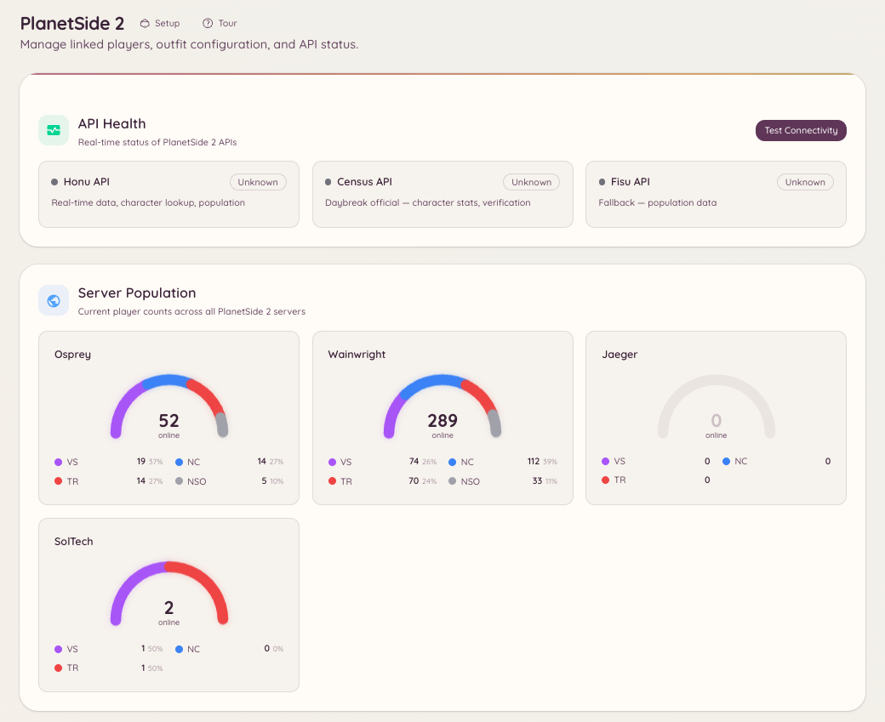

import { DashboardLink } from "/snippets/dashboard-link.jsx";

La integración con PlanetSide 2 conecta tu servidor de Discord con la Census API de Daybreak y da a los miembros acceso a consultas de personajes, herramientas de gestión de outfits y datos de población de los servidores en directo, todo dentro de Discord.

<Frame>
  
</Frame>

## Vinculación de cuentas

Los miembros vinculan su personaje de PlanetSide 2 con su cuenta de Discord:

```text
/ps2-link <character_name>
```

Una vez vinculado, los miembros pueden consultar sus propias estadísticas sin indicar un nombre de personaje en los comandos de consulta.

## Consulta de personajes

```text
/ps2-lookup <character_name>
```

Muestra una ficha de perfil del personaje indicado con:

- Rango de batalla y rango ASP
- Outfit al que pertenece y su rango en él
- Facción
- Marca de tiempo del último inicio de sesión
- Estadísticas totales de bajas y muertes

```text
/ps2-info
```

Muestra el perfil del personaje vinculado (equivale a ejecutar `/ps2 lookup view` con el nombre de tu propio personaje).

## Gestión de outfits

```text
/ps2-outfit [outfit_tag]
```

Muestra información sobre un outfit: número de miembros, fecha de creación, facción y número de miembros conectados ahora mismo. Requiere la etiqueta del outfit (el identificador corto de 1 a 4 caracteres, no el nombre completo).

```text
/ps2-promote <member> <rank>
```

Asciende a un miembro dentro del outfit. Requiere el rango de oficial del outfit adecuado y permisos de API equivalentes a RCON configurados en <DashboardLink to="planetside/config">**PlanetSide \> Configuration**</DashboardLink>.

## Población de los servidores

```text
/ps2-population [server]
```

Muestra el reparto actual de la población entre las tres facciones en el servidor indicado (o en tu servidor predeterminado configurado). Se actualiza a partir del flujo en tiempo real de Census.

La página <DashboardLink to="planetside/status">**PlanetSide \> API Status**</DashboardLink> del panel muestra los datos de población en un formato que se actualiza continuamente.

## Configuración

Ve a <DashboardLink to="planetside/config">**PlanetSide \> Configuration**</DashboardLink> en el panel:

```text
/ps2-setup
```

O configúralo todo desde <DashboardLink to="planetside/config">**PlanetSide \> Configuration**</DashboardLink>. Ajustes principales:

| Ajuste | Descripción |
| --- | --- |
| **Default server** (servidor predeterminado) | El mundo (servidor) que se usa cuando un comando no indica servidor |
| **Outfit tag** (etiqueta del outfit) | La etiqueta del outfit de tu comunidad para los comandos relacionados con outfits |
| **Census API key** (clave de la Census API) | Opcional; aumenta los límites de peticiones a la API. Daybreak la da gratis. |

## Permisos necesarios

| Acción | Clave de permiso |
| --- | --- |
| Consultas de personajes y población | `planetside.use` (permitido por defecto) |
| Vincular una cuenta | `planetside.use` (permitido por defecto) |
| Ver los jugadores vinculados | `planetside.players.view_players` |
| Gestionar los datos de los jugadores | `planetside.players.manage_players` |
| Ver las estadísticas de población | `planetside.monitoring.view_population` |
