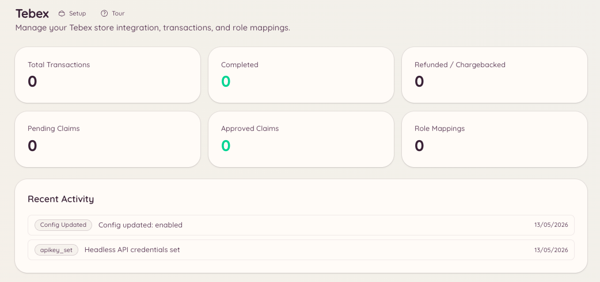

import { DashboardLink } from "/snippets/dashboard-link.jsx";

La integración con Tebex vincula tu tienda de juego Tebex con Discord. El staff puede consultar transacciones, emitir tarjetas regalo y tramitar reclamaciones manuales sin salir de Discord. Los miembros pueden consultar el estado de sus propias compras.

<Frame>
  
</Frame>

## Configuración

Ve a <DashboardLink to="tebex/config">**Tebex \> Configuration**</DashboardLink> en el panel e introduce tu clave de API de Tebex. La clave está en la sección **Settings \> API Keys** de tu tienda Tebex.

```text
/tebex
```

El comando base da acceso a todos los subcomandos de Tebex mediante un panel interactivo.

## Transacciones

```text
/tebex transaction lookup <transaction_id>
```

Busca una transacción concreta por su ID de transacción de Tebex. Devuelve:

- El paquete comprado
- El nombre y el correo electrónico del comprador
- La fecha de compra
- El importe pagado y la moneda
- El estado actual de la transacción

Ve a <DashboardLink to="tebex/transactions">**Tebex \> Transactions**</DashboardLink> en el panel para explorar las transacciones, buscar por comprador y filtrar por rango de fechas o por paquete.

## Tarjetas regalo

```text
/tebex giftcard create <amount>
/tebex giftcard lookup <code>
```

| Subcomando | Descripción |
| --- | --- |
| `create` | Genera una tarjeta regalo nueva por el valor indicado en la moneda de tu tienda |
| `lookup` | Consulta el saldo actual y la caducidad de un código de tarjeta regalo existente |

Los códigos de las tarjetas regalo se generan a través de la API de Tebex y puedes repartirlos directamente a los miembros.

## Reclamaciones

Las reclamaciones te permiten conceder paquetes a los miembros de forma manual. Ve a <DashboardLink to="tebex/claims">**Tebex \> Claims**</DashboardLink> en el panel o usa el comando de barra de Tebex para gestionar las reclamaciones pendientes.

## Asignación de roles

Las asignaciones de roles dan automáticamente roles de Discord cuando un miembro compra un paquete concreto de Tebex. Ve a <DashboardLink to="tebex/mappings">**Tebex \> Role Mappings**</DashboardLink> para configurarlas.

Cada asignación define:

| Ajuste | Descripción |
| --- | --- |
| **Package** (paquete) | El paquete de Tebex que activa la asignación |
| **Role to grant** (rol que se da) | El rol de Discord que se asigna con la compra |
| **Role to remove** (rol que se quita) | Un rol de Discord opcional que se quita con la compra (útil para subir de nivel de suscripción) |
| **Persistent** (persistente) | Si la asignación del rol es permanente o se debe quitar si caduca la suscripción del miembro |

En los paquetes de suscripción, Heimdall puede quitar el rol de forma opcional cuando la suscripción caduca o se cancela. Para ello, tu webhook de Tebex tiene que estar configurado para enviar los eventos de suscripción.

## Permisos necesarios

| Acción | Clave de permiso |
| --- | --- |
| Ver la información de la tienda | `tebex.store.view_store` |
| Gestionar los ajustes de la tienda | `tebex.store.manage_store` |
| Ver el historial de transacciones | `tebex.store.view_transactions` |
| Emitir tarjetas regalo y tramitar reclamaciones | `tebex.store.manage_claims` |
