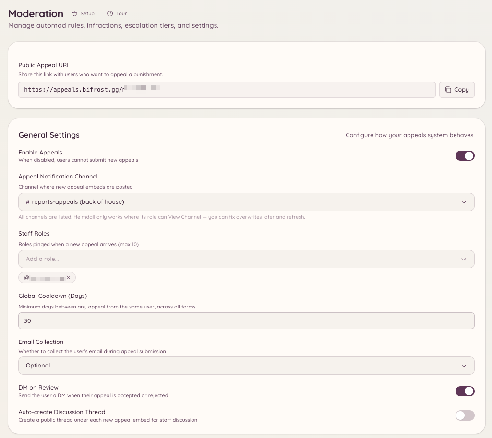

import { DashboardLink } from "/snippets/dashboard-link.jsx";

El sistema de apelaciones da a los miembros baneados una forma de recurrir su baneo enviando un formulario, en lugar de obligarles a contactar directamente con el staff. Los envíos llegan a <DashboardLink to="appeals/submissions">**Appeals \> Submissions**</DashboardLink> (Apelaciones > Envíos) para que el staff los revise, y el sitio de apelaciones (una interfaz web aparte a la que se accede sin cuenta de Discord) se encarga del formulario que ve el miembro.

<Frame>
  
</Frame>

## Cómo funciona para los miembros

Cuando un miembro es baneado, puede entrar en la URL del sitio de apelaciones de Heimdall y enviar un formulario de apelación. Al formulario se accede sin iniciar sesión en Discord, así que funciona aunque el miembro esté baneado. El miembro indica su nombre de usuario de Discord, el servidor del que fue baneado y los campos que hayas definido en tu formulario de apelación, y lo envía.

La apelación enviada aparece en <DashboardLink to="appeals/submissions">**Appeals \> Submissions**</DashboardLink> para que el staff la revise.

## Configurar el sistema de apelaciones

Ve a <DashboardLink to="appeals/config">**Appeals \> Configuration**</DashboardLink> (Apelaciones > Configuración) en el panel.

### Configura el formulario de apelación

Abre <DashboardLink to="appeals/forms">**Appeals \> Forms**</DashboardLink> (Apelaciones > Formularios) para definir las preguntas de tu formulario de apelación. Cada pregunta tiene:

- **Etiqueta**: el texto de la pregunta que ve quien la envía
- **Tipo**: texto corto, texto largo u opción múltiple
- **Obligatoria**: si hay que responderla antes de enviar

Algunas preguntas habituales son: "¿Por qué te banearon?", "¿Por qué debería levantarse tu baneo?" y "¿Qué vas a hacer de otra forma?"

### Tu enlace de apelación

No hay nada que configurar. Cada servidor tiene su propio enlace en el sitio de apelaciones, que aparece como **Public Appeal URL** (URL pública de apelación) en <DashboardLink to="appeals/config">**Appeals \> Configuration**</DashboardLink> con un botón para copiarlo. Un bot White-Label usa su propia dirección de apelaciones cuando se configura una.

Cómo recibe el enlace por MD un miembro baneado depende de cómo fue baneado:

- **Con Heimdall** (`/ban` o el panel): el enlace va en el MD de la sanción, que solo se envía mientras **DM on Infraction** (MD al sancionar) está activado en <DashboardLink to="moderation/settings">**Moderation \> Settings**</DashboardLink> (Moderación > Ajustes). Los silencios también lo incluyen.
- **Fuera de Heimdall** (desde el propio Discord o con otro bot): mientras las apelaciones estén activadas, Heimdall envía un MD aparte de aviso de baneo con el enlace.
- **Automáticamente** (baneos al salir, escalada, automod): no se envía ningún MD, así que comparte tú el enlace si quieres que puedan apelar.

Los dos MD se pueden reescribir en <DashboardLink to="settings/messages">**Settings \> Messages**</DashboardLink> (Ajustes > Mensajes), como **Punishment DM** (MD de sanción) y **Ban notification DM** (MD de aviso de baneo).

## Revisar las apelaciones en el panel

Ve a <DashboardLink to="appeals/submissions">**Appeals \> Submissions**</DashboardLink>. Cada apelación muestra:

- El nombre de usuario y el ID de Discord que ha indicado quien la envía
- La fecha de envío
- Todas las respuestas a los campos del formulario

Desde el panel de revisión puedes:

- **Aprobar**: desbanea al miembro y, si quieres, le envía un MD con instrucciones para volver a entrar
- **Denegar**: registra la decisión y, si quieres, envía el motivo de la denegación
- **Marcar como en revisión**: marca la apelación como pendiente mientras el staff la comenta

### Casos vinculados

Cada apelación está vinculada al [caso](/es/moderation/cases) al que se refiere, y el panel de revisión muestra el número de ese caso con un enlace. El enlace de la pantalla de baneo dentro del juego y el de cada fila de tu página de baneos indican el caso. Una apelación sin caso se asocia al baneo o al silencio activo del miembro, y solo se vincula a un caso sobre el propio miembro que apela o sobre una cuenta vinculada a él.

Aprobar la apelación levanta ese caso en la plataforma de la que vino: un desbaneo o el fin de un silencio en Discord, o una revocación en Minecraft. El caso muestra la apelación y su resultado en su historial. Si no se puede levantar, por ejemplo porque al bot le falta un permiso, el caso sigue activo y la apelación queda registrada igualmente en él.

## Formulario de apelación con comandos

```text
/appeals config
```

Abre el panel de configuración de apelaciones en Discord, para acceder rápido a los ajustes del formulario sin ir al panel web.

## Permisos necesarios

| Acción | Clave de permiso |
| --- | --- |
| Ver las apelaciones enviadas | `appeals.submissions.view` |
| Revisar y resolver apelaciones | `appeals.submissions.manage` |
| Configurar el formulario de apelación | `appeals.forms.manage_forms` |
| Ver la configuración en el panel | `appeals.config.view_config` |
