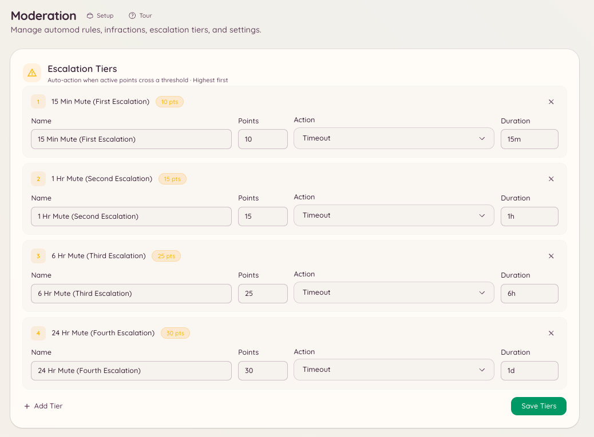

import { DashboardLink } from "/snippets/dashboard-link.jsx";

La escalada automatiza el paso de las advertencias leves a los castigos graves. Tú defines unos umbrales (totales de puntos) y el castigo que debe aplicar el bot cuando los puntos activos de un miembro alcanzan cada umbral. Así el staff no tiene que escalar los castigos a mano y las normas se aplican siempre igual.

<Frame>
  
</Frame>

## Cómo funciona

Cada advertencia, infracción del automod y sanción manual asigna un número de puntos. Los puntos no son permanentes: cada sanción tiene un periodo de caducidad, y pasado ese tiempo sus puntos dejan de contar para el total del miembro. Cuando el total de puntos activos de un miembro supera un umbral configurado, el bot aplica de inmediato el castigo correspondiente.

La escalada vuelve a saltar cada vez que una sanción nueva lleva al miembro por encima de un umbral. Si un miembro ya fue silenciado al llegar a 10 puntos y después llega a 20, salta la acción de los 20 puntos: el castigo anterior no reinicia el umbral.

## Configurar los umbrales de escalada

Ve a <DashboardLink to="moderation/escalation">**Moderation \> Escalation**</DashboardLink> (Moderación > Escalada) en el panel y haz clic en **New Threshold** (nuevo umbral).

Cada umbral tiene estos ajustes:

| Ajuste | Descripción |
| --- | --- |
| **Puntos** | El total de puntos activos con el que salta este umbral. |
| **Acción** | El castigo que se aplica: advertir, silenciar, expulsar o banear. |
| **Duración** | En los silencios y los baneos temporales, cuánto dura el castigo. |
| **Motivo** | El motivo que queda en el registro de sanciones y que se envía al miembro. |

### Configuración de ejemplo

| Puntos | Acción | Duración |
| --- | --- | --- |
| 5 | Silenciar | 1 hora |
| 10 | Silenciar | 24 horas |
| 20 | Expulsar | - |
| 30 | Banear | 7 días |
| 50 | Banear | Permanente |

En este ejemplo, un miembro que recibe cinco advertencias de 1 punto dentro del periodo de caducidad queda silenciado automáticamente durante una hora. Si sigue acumulando puntos cuando termina el silencio, salta el umbral de 10 puntos y el silencio pasa a ser de 24 horas.

## Puntos de cada sanción

Una advertencia manual vale 1 punto, salvo que el moderador indique `points`. Las reglas del automod definen su propio valor en <DashboardLink to="moderation/rules">**Moderation \> Rules**</DashboardLink> (Moderación > Reglas): por ejemplo, una regla grave puede asignar 10 puntos por infracción en lugar de 1.

## Caducidad de los puntos

La caducidad de los puntos de cada sanción se fija en el momento de crearla. Las sanciones creadas por reglas del automod usan la caducidad configurada en esa regla. En las acciones manuales, el miembro del staff que la pone puede indicar una caducidad o usar la predeterminada del servidor.

Los puntos de las sanciones caducadas se restan automáticamente del total del miembro. El staff también puede perdonar una advertencia antes de tiempo: abre su caso en <DashboardLink to="cases/list">**Cases \> All cases**</DashboardLink> (Casos > Todos los casos) y pulsa **Pardon** (perdonar), y sus puntos dejan de contar.

## Permisos necesarios

| Acción | Clave de permiso |
| --- | --- |
| Ver la configuración de escalada | `moderation.config.view_config` |
| Crear y editar umbrales | `moderation.enforcement.manage_rules` |
