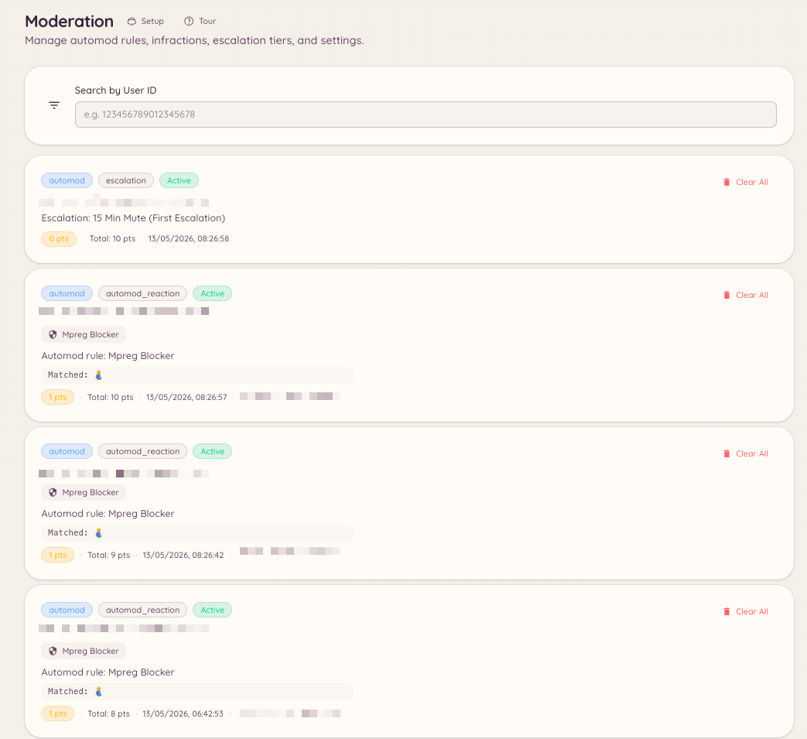

import { DashboardLink } from "/snippets/dashboard-link.jsx";

Cada acción de moderación en Heimdall, la haga un miembro del staff o la dispare una regla de automod, crea un registro de sanción. El historial de sanciones le da al staff una imagen completa del historial de moderación de cualquier miembro, incluido su total actual de puntos activos.

<Frame>
  
</Frame>

## Ver las sanciones de un miembro

### Con un comando de barra

```text
/infractions <user>
```

Muestra los casos del miembro directamente en Discord, tanto en Discord como en cualquier cuenta de Minecraft vinculada, con su total de puntos activos. Es el mismo panel que `/case lookup`.

### Desde el panel

Cada sanción es también un [caso](/es/moderation/cases). Ve a <DashboardLink to="cases/list">**Cases \> All cases**</DashboardLink> en el panel. Busca a un miembro y ábrelo para ver todos sus casos, en Discord y en cualquier cuenta de Minecraft vinculada, con su total actual de puntos activos.

## Gestionar sanciones

En la página de un miembro, el staff con `moderation.enforcement.manage_infractions` puede usar **Clear active infractions** (borrar las sanciones activas), que devuelve a cero los puntos activos del miembro.

Desde un caso concreto puedes añadir notas y pruebas, cambiar el motivo y perdonar una advertencia para que sus puntos dejen de contar. Consulta [Casos](/es/moderation/cases).

## Fijar los puntos directamente

```text
/setpoints <user> <points>
```

Fija el total de puntos de sanción activos de un miembro en un valor concreto, sin pasar por los registros de sanción individuales. Es útil para ajustar a mano la posición de un miembro dentro del sistema de escalado sin crear registros de sanción adicionales.

## Filtros en el panel

La lista de casos se puede filtrar por plataforma, tipo de acción, estado y el miembro del staff que aplicó la acción.

## Permisos necesarios

| Acción | Clave de permiso |
| --- | --- |
| Ver el historial de sanciones | `moderation.config.view_config` o `cases.view_discord` |
| Borrar las sanciones activas de un miembro, perdonar una advertencia | `moderation.enforcement.manage_infractions` |
