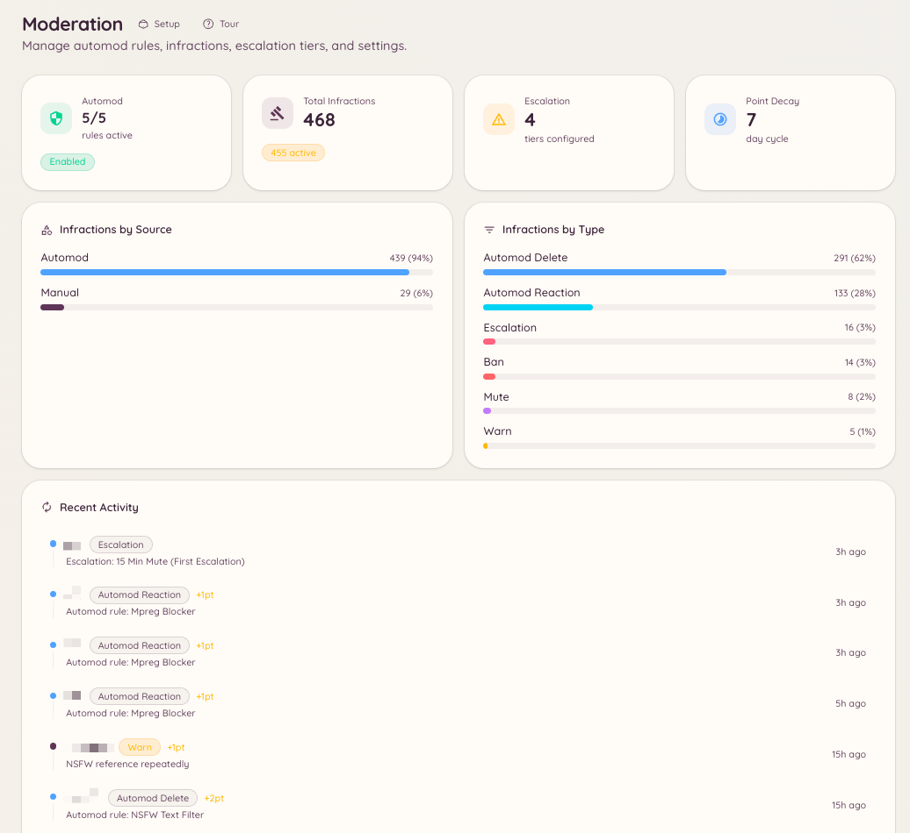

import { DashboardLink } from "/snippets/dashboard-link.jsx";

La función de moderación de Heimdall combina comandos de aplicación manual, un motor de reglas automático, un escalado progresivo y un historial de sanciones completo. Todas estas partes comparten el mismo sistema de sanciones de fondo, lo que significa que las advertencias manuales y las infracciones de reglas automáticas se suman al mismo total de puntos y alimentan los mismos umbrales de escalado.

<Frame>
  
</Frame>

## Componentes

<Columns cols={2}>
  <Card title="Acciones manuales" icon="gavel" href="/es/moderation/manual-actions">
    Aplica advertencias, baneos, expulsiones, silencios y purgas de mensajes directamente.
  </Card>

  <Card title="Reglas de automod" icon="robot" href="/es/moderation/automod">
    Define filtros de palabras clave, patrones regex y reglas por tipo de contenido que se aplican automáticamente.
  </Card>

  <Card title="Escalado" icon="arrow-up" href="/es/moderation/escalation">
    Configura sanciones automáticas que se aplican a medida que un miembro acumula puntos de sanción.
  </Card>

  <Card title="Historial de sanciones" icon="clock-rotate-left" href="/es/moderation/infractions">
    Consulta todas las acciones tomadas contra un miembro, incluidos los totales de puntos y las fechas de caducidad.
  </Card>

  <Card title="Control de canales" icon="lock" href="/es/moderation/channel-controls">
    Bloquea canales, aplica baneos por canal y evita que los miembros salgan y vuelvan a entrar para esquivar un baneo.
  </Card>

  <Card title="Mensajes fijos" icon="thumbtack" href="/es/moderation/stickies">
    Mantén automáticamente un mensaje fijo al final de un canal.
  </Card>

  <Card title="Apelaciones" icon="scale-balanced" href="/es/moderation/appeals">
    Permite que los miembros baneados soliciten una revisión mediante un formulario organizado.
  </Card>
</Columns>

## Cómo funcionan las sanciones y los puntos

Cada acción de moderación, la tome un miembro del staff o el automod, crea un registro de sanción. Cada registro guarda el tipo de acción, el motivo, el miembro del staff o la regla que la provocó, un valor en puntos configurable y una caducidad opcional.

Los puntos se acumulan con el tiempo. Cuando el total de puntos activos de un miembro supera un umbral que configuras en los ajustes de escalado, el bot aplica automáticamente la sanción correspondiente. Los puntos caducan uno a uno según el periodo de caducidad de cada sanción y, a medida que caducan, el total del miembro baja.

Esto significa que un miembro que recibe varias advertencias leves en una semana puede provocar un silencio automático, aunque ninguna acción por sí sola haya superado un umbral.

## Dónde está en el panel

Ve a <DashboardLink to="moderation">**Moderation**</DashboardLink> en la barra lateral del panel. La sección de moderación tiene estas páginas: <DashboardLink to="moderation/overview">**Overview**</DashboardLink>, <DashboardLink to="moderation/rules">**Rules**</DashboardLink>, <DashboardLink to="moderation/escalation">**Escalation**</DashboardLink>, <DashboardLink to="moderation/stickies">**Stickies**</DashboardLink>, <DashboardLink to="moderation/auto-responses">**Auto-Responses**</DashboardLink>, <DashboardLink to="moderation/leave-bans">**Leave Bans**</DashboardLink>, <DashboardLink to="moderation/channel-bans">**Channel Bans**</DashboardLink>, <DashboardLink to="moderation/locked-channels">**Locked Channels**</DashboardLink>, <DashboardLink to="moderation/slow-mode">**Slow Mode**</DashboardLink> y <DashboardLink to="moderation/settings">**Settings**</DashboardLink>.

Las sanciones ahora son [casos](/es/moderation/cases), en <DashboardLink to="cases/list">**Cases**</DashboardLink>, y las apelaciones de baneos tienen su propia sección <DashboardLink to="appeals">**Appeals**</DashboardLink>.

## Permisos necesarios

Tanto el acceso al panel como el uso de los comandos se controlan con el sistema de permisos de Heimdall. Claves de permiso principales para la moderación:

| Clave | Qué controla |
| --- | --- |
| `moderation.enforcement.warn` | Ejecutar `/warn` |
| `moderation.enforcement.ban` | Ejecutar `/ban` y `/unban` |
| `moderation.enforcement.kick` | Ejecutar `/kick` |
| `moderation.enforcement.mute` | Ejecutar `/mute` |
| `moderation.enforcement.purge` | Ejecutar `/purge` |
| `moderation.enforcement.lock_channels` | Ejecutar `/lock` y `/unlock` |
| `moderation.enforcement.manage_rules` | Crear y editar reglas de automod en el panel |
| `moderation.config.view_config` | Ver la configuración de moderación en el panel |
