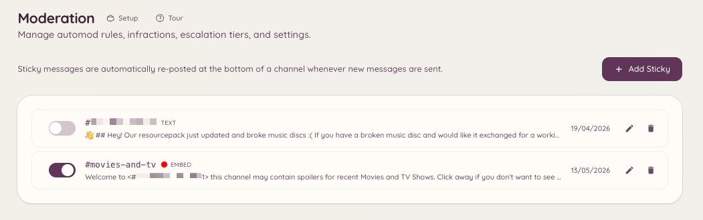

import { DashboardLink } from "/snippets/dashboard-link.jsx";

Un mensaje fijo es un mensaje que el bot vuelve a publicar al final de un canal cada vez que quedaría fuera de la vista. A medida que los miembros envían mensajes y lo empujan hacia arriba, el bot borra la copia antigua y publica una nueva al final.

Es útil para tener a la vista normas, instrucciones o anuncios importantes en canales activos, donde un mensaje anclado normal de Discord pasaría desapercibido con facilidad.

<Frame>
  
</Frame>

## Crear un mensaje fijo

```text
/sticky create [channel]
```

Este comando abre un formulario donde escribes el contenido del mensaje. El mensaje admite el formato Markdown estándar de Discord. Al enviarlo, el bot publica el mensaje fijo de inmediato en el canal de destino.

Solo puede haber un mensaje fijo activo por canal.

## Gestionar los mensajes fijos desde el panel

Ve a <DashboardLink to="moderation/stickies">**Moderation \> Stickies**</DashboardLink> (Moderación > Mensajes fijos) en el panel. Esta página muestra todos los mensajes fijos activos de tu servidor. Desde aquí puedes:

- **Ver el contenido** de cada mensaje fijo
- **Editar** el contenido de un mensaje fijo
- **Borrar** un mensaje fijo, lo que elimina del canal el mensaje publicado

## Editar y borrar con comandos

```text
/sticky delete [channel]
```

Quita el mensaje fijo activo del canal indicado (por defecto, el canal actual). El bot borra el mensaje fijo publicado más reciente.

## Notas sobre el funcionamiento

El bot vuelve a publicar el mensaje fijo cada vez que se envía un mensaje nuevo en el canal. Hay un pequeño retardo para no inundar el canal cuando se envían mensajes muy seguidos. Con mucho tráfico, el mensaje fijo puede quedar temporalmente varios mensajes por encima del final antes de volver a publicarse.

Los mensajes fijos se publican con la propia cuenta del bot. Si un moderador borra a mano el mensaje fijo, el bot lo volverá a publicar la próxima vez que se envíe un mensaje nuevo en el canal.

## Permisos necesarios

| Acción | Clave de permiso |
| --- | --- |
| Crear y borrar mensajes fijos | `moderation.enforcement.manage_rules` |
| Ver los mensajes fijos en el panel | `moderation.config.view_config` |
