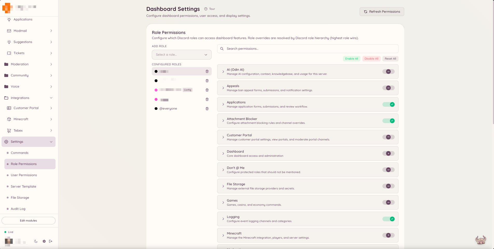

import { DashboardLink } from "/snippets/dashboard-link.jsx";

Heimdall tiene su propio sistema de permisos, independiente de los permisos de rol nativos de Discord. En lugar de depender de permisos como **Gestionar mensajes** o **Banear miembros**, Heimdall comprueba si a los roles de un miembro se les ha concedido una clave de permiso concreta de Heimdall. Así puedes dar acceso de moderación a un rol de staff personalizado sin darle a ese rol permisos amplios a nivel de Discord.

## Cómo funcionan los permisos

<Warning>
  **Copia las claves tal cual. Nunca reconstruyas una a partir del nombre de la función y de la acción.**

  {/* docs-manifest-ignore -- names the wrong form on purpose; that is the point of the line */}
  La mayoría de las claves tienen tres partes, no dos: `confessions.log.view_author`, no
  `confessions.view_author`. El segmento del medio forma parte de la clave, no es una nota
  sobre dónde está.

  Una clave que no existe se **rechaza sin avisar**. Heimdall trata una clave que no reconoce
  como denegada y lo anota en su registro, así que nada en el panel la marca como incorrecta. El
  único síntoma es un rol que parece bien configurado y no puede usar la función.

  [Todas las claves, exactamente como hay que escribirlas](/docs/reference/permission-keys).
</Warning>


Cada función de Heimdall expone una o varias claves de permiso con nombre. Por ejemplo, la función de moderación expone claves como `moderation.enforcement.ban` y `moderation.enforcement.warn`. La función de tickets expone `tickets.operations.manage_tickets` y `tickets.operations.claim_tickets`.

Asignas estas claves a roles de Discord desde el panel. Cuando un miembro ejecuta un comando o entra en una sección del panel, Heimdall comprueba si a alguno de sus roles actuales se le ha concedido la clave correspondiente. Si es así, la acción sigue adelante. Si no, el bot responde con un mensaje de permiso denegado.

## Acceso por defecto

Algunas funciones están disponibles para todos los miembros por defecto. Suelen ser funciones pensadas para los miembros, por ejemplo crear una sugerencia, abrir un ticket, usar los comandos de juegos o pedir una traducción. Estas funciones tienen activado **default allow** (permitido por defecto) y no requieren que se conceda ningún permiso de forma explícita.

Las funciones para el staff y de administración están restringidas por defecto. Ningún miembro puede ejecutar un comando `ban`, gestionar reglas de automod ni entrar en la sección <DashboardLink to="moderation">**Moderation**</DashboardLink> del panel a menos que a su rol se le haya concedido la clave de permiso adecuada.

<Info>
  Los miembros con el permiso **Administrador** de Discord se saltan todas las comprobaciones de permisos de Heimdall y siempre tienen acceso completo.
</Info>

## Configurar los permisos

<Steps>
  <Step title="Abre Settings">
    En la barra lateral del panel, pulsa <DashboardLink to="settings">**Settings**</DashboardLink>. La página de ajustes organiza la configuración en varias pestañas en la parte superior.
  </Step>
  <Step title="Elige la pestaña de roles o de usuarios">
    Elige la pestaña <DashboardLink to="settings/roles">**Role Permissions**</DashboardLink> para configurar excepciones de permisos por rol, o la pestaña <DashboardLink to="settings/users">**User Permissions**</DashboardLink> para excepciones por usuario. Las excepciones de usuario tienen prioridad sobre todos los permisos por rol y sirven para dar o bloquear el acceso a una persona concreta sean cuales sean sus roles.
  </Step>
  <Step title="Elige un rol o un usuario">
    Usa el desplegable para seleccionar el rol de Discord (o el usuario concreto) que quieres configurar. Debajo aparecen todas las claves de permiso disponibles, agrupadas por función.
  </Step>
  <Step title="Fija las excepciones">
    Cada clave de permiso tiene un interruptor de tres posiciones: **Allow** (permitir), **Deny** (denegar) o **Default** (predeterminado). Allow concede el permiso. Deny lo quita aunque el valor predeterminado del sistema permitiera el acceso. Default se remite al ajuste general del sistema para esa clave: la mayoría de las claves deniegan por defecto las acciones del staff y permiten las funciones pensadas para los miembros.
  </Step>
  <Step title="Guarda los cambios">
    Cuando estés conforme, pulsa **Save** en la barra de guardado que aparece en la parte inferior de la página. Los cambios se aplican al instante a cualquier miembro que tenga el rol configurado.
  </Step>
</Steps>

<Frame>
  
</Frame>

## Claves de permiso por sección

La página de documentación de cada función indica las claves de permiso que usa. Las claves siguen un patrón de nombres coherente:

```text
<plugin>.<action>
```

Por ejemplo:

- `moderation.enforcement.ban`: poder ejecutar `/ban`
- `tickets.operations.manage_tickets`: poder gestionar todos los tickets en el panel
- `modmail.analytics.view_analytics`: poder ver las analíticas de modmail

## Jerarquía de roles

Heimdall evalúa todos los roles actuales de un miembro. Si a cualquiera de sus roles se le ha concedido el permiso, el miembro tiene acceso. No hay jerarquía de roles dentro del sistema de permisos: es puramente aditivo. Quitar un rol quita esa fuente de permisos, pero otros roles que tenga el miembro pueden seguir dándole acceso.

## Cambiar los valores predeterminados

Si quieres restringir una función que por defecto permite a todos los miembros (por ejemplo, quieres limitar quién puede usar el comando de IA `/ask`), puedes activar el interruptor **Restricted** (restringido) en esa clave de permiso. Una vez restringida, solo tendrán acceso los roles que asignes de forma explícita.
